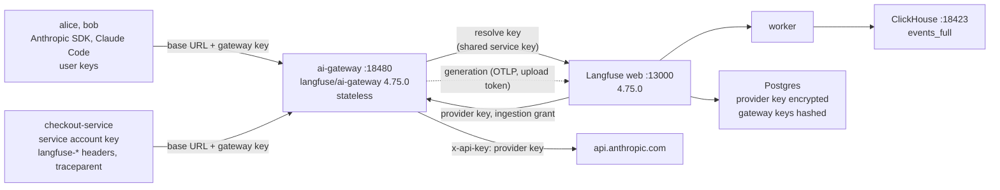
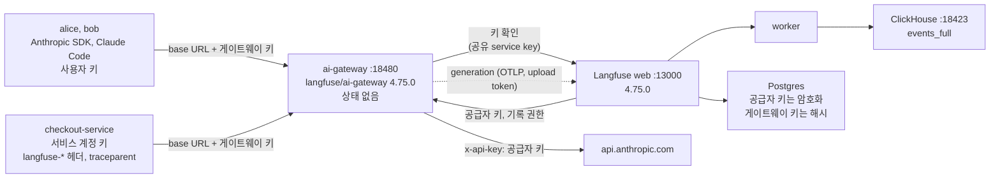

# Langfuse AI Gateway (beta) next to self-hosted Langfuse v4: real Anthropic calls, per-person keys, cost per user, key and model

[English](#english) | [한국어](#한국어)

---

## English

**Verified end to end on 2026-11-05** with **Langfuse v4.75.0 web and worker / `langfuse/ai-gateway` 4.75.0 / SDK 4.17.0 / CH 26.8.22.13** (its own compose project on the `_base/` compose file, `events_only` mode), **real calls to the Anthropic API** with Claude Haiku 4.5 (`claude-haiku-4-5-20251001`), Anthropic Python SDK 1.12.1, Claude Code 2.1.220, Docker 29.9.2, Compose v5.6.1, Python 3.12.14: [05-check.py](05-check.py) passed 34 checks (2 INFO); with an injected fault (a service forgets `langfuse-user-id`, an app forgets `traceparent`) 3 of them failed. [06-ee-audit.sh](06-ee-audit.sh) found no audit record without a licence, and `create` and `delete` in Postgres `audit_logs` with the Enterprise licence. Log: [lab-output.md](lab-output.md). All model calls of the run cost 0.04006 USD (16 generations; 0.0397 of it one Claude Code call), as Langfuse priced them.

The gateway went into public beta with Langfuse v4.75.0 (released 2026-11-04). Apps and coding agents send their OpenAI or Anthropic requests to the gateway with a gateway key; the gateway swaps in the organization's provider key, forwards the request unchanged, and records the call as a Langfuse generation.

### The short answer

| Claim | What the run showed |
|---|---|
| Only the base URL and the API key change | **Yes.** The Anthropic SDK with `base_url=<gateway>/anthropic` and a gateway key got Anthropic's own response (Anthropic `request-id`, dated model, usage), streaming included. `claude -p` worked with `ANTHROPIC_BASE_URL` and `ANTHROPIC_AUTH_TOKEN`. |
| No shared provider keys | **Yes.** The provider key lives once, encrypted, in Postgres (`gateway_ai_connections`); the gateway container has none in its environment; it gets the key from web per request. Gateway keys are Langfuse API keys (`sk-lf-…`) with the role `AI_GATEWAY`, stored hashed. |
| Cost per user, key and model | **Yes.** Every generation carries user, key name, key ID and the key's metadata (`team`, `cost_center`) next to model, usage and cost. One `GROUP BY` over `events_full` gives the table the gateway's Analytics page shows. A user key always records its owner: a `langfuse-user-id` header is ignored. A service account key takes the end user from that header, or falls back to the key name. |
| Tracing for apps you cannot instrument | **Yes, in `FULL` mode:** input and output are stored. **`USAGE` mode** (the default) stores model, usage, cost and latency without input or output. |
| Model allowlist | **Works, by exact ID.** With only `claude-haiku-4-5-20251001` allowed, the model list shows only it and other models get `403`. The alias `claude-haiku-4-5` of the same model **also gets `403`**: the check compares strings. |
| Key expiry, revocation | **Immediate.** An expired key got `401` on the first call after `expiresAt`; a revoked key on the first call after revoke (web evicts it from the resolve cache). |
| Losing gateway access | **Deletes the person's keys.** Changing a member's role to VIEWER made their key fail on the next call, and the key row was gone. Changing the role back does not bring it back; they issue a new key. |
| Audit logging | **Enterprise only on self-hosted.** Without a licence no audit record is written for key creation or revocation; with the licence both are recorded. On Langfuse Cloud the code always writes them (source, not tested here). |
| SDK trace + gateway | **One trace.** With `traceparent` from a Langfuse SDK span, the gateway's generation got the app's trace ID and the app span as its parent. |

### What runs



| File | Does |
|---|---|
| [docker-compose.yml](docker-compose.yml) | Overlay on `_base/docker-compose.yml`: web and worker with the gateway variables, the `ai-gateway` container, host ports 13000 (web), 18480 (gateway), 18423 (ClickHouse HTTP); the other backends publish nothing |
| [lib.sh](lib.sh) | `lab_compose`: the `_base` files plus the overlay as compose project `lf-gateway-lab`, Langfuse pinned to 4.75.0 for this project only |
| [lablib.py](lablib.py) | NextAuth login and tRPC calls as the UI makes them, ClickHouse and Postgres queries, `.run/state.json` |
| [01-up.sh](01-up.sh) | Generates the gateway service key and the ES256 signing key into `.run/` once, starts the project, waits for web `/api/public/health` and gateway `/health`, `/ready` |
| [02-setup.py](02-setup.py) | Admin setup: two developers with the AI Gateway role, ingestion project and `FULL` mode, the Anthropic credential `anthropic-lab`, three gateway keys with metadata |
| [03-calls.py](03-calls.py) | Seven scenarios with real calls (below). `FAULT=1` injects the fault, `SKIP_CLAUDE_CODE=1` leaves out `claude -p` |
| [04-controls.py](04-controls.py) | Allowlist, expiry, revocation, role change, `USAGE` mode, and what the AI Gateway role may not do |
| [05-check.py](05-check.py) | 34 checks against ClickHouse, Postgres, the gateway container and the v2 observations API |
| [06-ee-audit.sh](06-ee-audit.sh) · [06-audit-probe.py](06-audit-probe.py) | Optional: a key created and revoked without and with the Enterprise licence, audit records counted |
| [99-down.sh](99-down.sh) | Stops the project; `--purge` also removes its volumes and `.run/` |

| Scenario | Key | What it shows |
|---|---|---|
| s1 sdk-basic | alice (user) | Anthropic SDK, only `base_url` and `api_key` changed |
| s2 sdk-stream | alice (user) | `stream=True`, model ID with the credential prefix `anthropic-lab:` |
| s3 user-key-override | bob (user) | `langfuse-user-id: mallory@example.com` is ignored for a user key |
| s4 service-end-user | checkout-service | end user, session, environment, tags, metadata and trace name from `langfuse-*` headers |
| s5 service-default | checkout-service | no headers: the key name becomes the user |
| s6 sdk-traceparent | checkout-service | a Langfuse SDK span injects `traceparent`; the generation joins that trace |
| s7 claude-code | alice (user) | `claude -p` with `ANTHROPIC_BASE_URL` and `ANTHROPIC_AUTH_TOKEN`, a fresh `CLAUDE_CONFIG_DIR` |

### Run

Needs `ANTHROPIC_API_KEY` in `_base/.env` (or `LF_ENV_FILE`): the gateway always calls `api.anthropic.com` and `api.openai.com`, so there is no mock. The calls use `max_tokens` 10 or less.

```bash
labs/v4/ai-gateway/01-up.sh
.venv-v4/bin/python labs/v4/ai-gateway/02-setup.py
.venv-v4/bin/python labs/v4/ai-gateway/03-calls.py
.venv-v4/bin/python labs/v4/ai-gateway/04-controls.py
.venv-v4/bin/python labs/v4/ai-gateway/05-check.py
labs/v4/ai-gateway/06-ee-audit.sh                    # optional: needs LANGFUSE_EE_LICENSE_KEY
labs/v4/ai-gateway/99-down.sh                        # --purge removes the volumes and .run/
```

The UI is at http://localhost:13000 (the headless-init user of `_base/.env`): **Organization settings → AI Gateway** has Setup, Models, Gateway keys and Analytics. `LF_ENV_FILE=<path>` points the scripts at another clone's `_base/.env`. The shared stack on :3000 can keep running; this project shares nothing with it.

### Self-hosting: what the gateway needs

- **Langfuse ≥ 4.75.0** for web and gateway, the same version for both. Not in `legacy` write mode: gateway generations are stored only in the v4 tables.
- **On web:** `LANGFUSE_AI_GATEWAY_DEPLOYED=true` (otherwise the UI says the gateway is not deployed), `LANGFUSE_AI_GATEWAY_PUBLIC_URL` (shown in the UI and the setup snippets), `LANGFUSE_AI_GATEWAY_SERVICE_KEY`, `LANGFUSE_AI_GATEWAY_JWT_PRIVATE_KEY` (ES256 PEM; `openssl ecparam -name prime256v1 -genkey -noout`), and `ENCRYPTION_KEY`, which encrypts the provider keys. Changing it makes stored provider keys unreadable.
- **On the gateway:** `LANGFUSE_AI_GATEWAY_WEB_URL`, the same service key, and `LANGFUSE_AI_GATEWAY_ALLOW_HTTP_WEB_URL=true` when web is reached over plain http (only on a private network: web's answers carry the provider key).
- **Supported path: the Helm chart** (`langfuse.gateway.enabled: true`, chart after 2.2.0). The Docker Compose file of Langfuse does not ship the gateway; this lab adds it the way the self-hosting page describes for other setups. It ran read-only, with all capabilities dropped and as non-root.
- **TLS:** the gateway does not terminate TLS. Put it behind a proxy or load balancer with timeouts above 120 s (600 s for the longest streams), no response buffering and a 16 MiB body limit. This lab used plain http on localhost; `claude -p` accepted that.
- **Egress:** the gateway and web call the official provider URLs directly and ignore `HTTP(S)_PROXY`. Azure OpenAI, Amazon Bedrock and internal LLM proxies are not supported in the beta.
- **No licence needed** for the gateway itself on a self-hosted instance (it is enabled for every organization unless `LANGFUSE_AI_GATEWAY_ENABLED` says otherwise); the code is under the MIT part of the repository (`ai-gateway/`, `web/src/features/ai-gateway/`).

### What arrives

One generation per model call, named after the API format (`anthropic.messages`), from `service_name = langfuse-ai-gateway`, ingested over OTLP with the gateway key as `ingestion_api_key`. From s4 (FULL mode):

| Field | Value |
|---|---|
| `provided_model_name` | `claude-haiku-4-5-20251001` (requested `claude-haiku-4-5`, kept as `langfuse.gateway.model.requested`) |
| `usage_details` / `cost_details` | input 15, output 5 tokens · 0.000015 + 0.000025 = 0.00004 USD |
| `user_id` · `session_id` · `environment` · `tags` · `trace_name` | `end-user-42` · `checkout-<run>` · `production` · `checkout, beta` · `checkout-summary` |
| `input` / `output` | the request's `messages` and the assistant message with `stop_reason` |
| metadata | `langfuse.gateway.api_key.{id,name}`, `langfuse.gateway.api_key.metadata.{team,cost_center}`, `langfuse.gateway.connection.{id,name,provider}`, `langfuse.gateway.user_id_source` (`api_key_owner`, `client` or `api_key_name`), `langfuse.gateway.ingestion.mode`, `langfuse.gateway.request.id`, `langfuse.gateway.upstream.request.id` (Anthropic's `request-id`), body sizes, status codes, client user agent; the request's own `langfuse-metadata` keys (`order`, `region`) |

Response headers: `langfuse-trace-id`, `langfuse-observation-id`, `langfuse-request-id`, `langfuse-provider`, plus Anthropic's own `request-id`.

Cost per user, key and model, straight from ClickHouse:

```sql
SELECT user_id,
       metadata_values[indexOf(metadata_names, 'langfuse.gateway.api_key.name')]         AS key_name,
       metadata_values[indexOf(metadata_names, 'langfuse.gateway.api_key.metadata.team')] AS team,
       provided_model_name AS model, count() AS calls, round(sum(total_cost), 6) AS cost_usd
FROM events_full FINAL
WHERE project_id = 'llm-observability' AND has(metadata_names, 'langfuse.gateway.api_key.id')
GROUP BY user_id, key_name, team, model
ORDER BY cost_usd DESC
```

| user | key | team | model | calls | cost (USD) |
|---|---|---|---|---:|---:|
| alice@example.com | alice-laptop | platform | claude-haiku-4-5-20251001 | 7 | 0.039835 |
| bob@example.com | bob-laptop | data | claude-haiku-4-5-20251001 | 3 | 0.000066 |
| *(empty)* | checkout-service | payments | claude-haiku-4-5-20251001 | 1 | 0.000040 |
| checkout-service | checkout-service | payments | claude-haiku-4-5-20251001 | 1 | 0.000040 |
| end-user-42 | checkout-service | payments | claude-haiku-4-5-20251001 | 1 | 0.000040 |
| bob@example.com | bob-temp | data | claude-haiku-4-5-20251001 | 2 | 0.000026 |
| alice@example.com | alice-short | platform | claude-haiku-4-5-20251001 | 1 | 0.000013 |

Alice's 0.0398 USD is almost all the single Claude Code call: Claude Code sends a ~119 KB request (system prompt and 24 tool definitions), for which Anthropic reported 31,590 prompt-cache write tokens. The empty user is s6: inside an app's own trace the gateway keeps the user of the app's spans, and that span set none. The same numbers appear on **Organization settings → AI Gateway → Analytics**, which leaves service account keys out of its per-user charts.

### Controls, measured

| Control | Test | Result |
|---|---|---|
| Allowlist | credential allows only `claude-haiku-4-5-20251001` | model list shows only that ID; `claude-haiku-4-5-20251001` and `anthropic-lab:claude-haiku-4-5-20251001` → 200; `claude-sonnet-4-5-20250929` → **403** `permission_error: Model is not allowed for this provider connection`; the alias `claude-haiku-4-5` → **403** as well; after *Enable all* the alias → 200 |
| Expiry | user key with `expiresAt` = creation + 40 s | 200 before; **401** on the first call after `expiresAt` (0.1 s later) |
| Revocation | key used twice (cached lookup), then revoked | **401** on the first call after revoke |
| Role change | bob AI_GATEWAY → VIEWER → AI_GATEWAY | 401 on the next call; his key row was **deleted**; after the role came back the old key stayed 401 and a newly issued key → 200 |
| Ingestion mode | one call in `USAGE` | usage and cost recorded, `input` and `output` empty, `langfuse.gateway.ingestion.mode = usage` |
| Role scope | a member with the AI Gateway role calls `createConnection` | **403 FORBIDDEN** |
| Audit log | create + revoke a key, without and with the EE licence | none without; `create`, `delete` in Postgres `audit_logs` with it |

Expiry, revocation and the role change did not wait for the 60 s resolve cache: web evicts the key on revoke and on the role change, and caps a cached lookup at the key's `expiresAt`. Config and credential changes evict the organization's entries too. A role change only stops the key because Langfuse deletes it.

### Gaps

- **Allowlists match strings, not models.** The provider's model list gives dated IDs for older models (`claude-haiku-4-5-20251001`) and undated ones for newer models. Clients that send an alias get `403` once a credential has an explicit list, so allow the IDs your clients actually send, or tell clients to send the listed ID.
- **Losing gateway access deletes keys.** A role change to VIEWER (or NONE) removes the person's user keys at once. Restoring the role does not restore them. Use service account keys for anything that must survive membership changes.
- **Audit records need the Enterprise licence on a self-hosted instance** (`isAuditLogEnabled`: Cloud always, self-hosted only with the `audit-logs` entitlement). Without it, key creation and revocation leave no trace.
- **The OpenAI route was not run** (no OpenAI key). Responses, Chat Completions, Codex and Copilot are documented by Langfuse but not tested here.
- **Not run:** the Helm chart, TLS in front of the gateway, more than one gateway replica, the memory budget and `503` under load, long streams and graceful shutdown, Claude Desktop, turn grouping for Claude Code (`CLAUDE_CODE_PROPAGATE_TRACEPARENT`), `NONE` mode, Langfuse Cloud and its rate limits.
- **Known beta cost bugs** (Langfuse's list, not reproduced here): estimated cost on failed or cancelled OpenAI calls, OpenAI cache writes at $0, Anthropic 1-hour cache writes at the 5-minute rate. Input over 5 MiB is not stored; output over 1 MiB is cut in the record.
- **Analytics loses the names of deleted keys.** Keys that were revoked or removed by a role change show up as raw IDs in *Cost by gateway key*; the name stays in each generation's `langfuse.gateway.api_key.name`, so a ClickHouse query still has it.
- **Key metadata is fixed at creation.** To change `team` or `cost_center`, issue a new key and revoke the old one.
- **One trace per model call** for Claude Code by default (s7: one call, one trace, session `claude-code:<id>`); use sessions or turn grouping.
- **Generic names:** every generation is `anthropic.messages`; set `langfuse-trace-name` per call when you want something else.

### Sources (all read 2026-11-04)

- Langfuse: [AI Gateway overview](https://langfuse.com/docs/gateway/overview) · [Concepts](https://langfuse.com/docs/gateway/concepts) · [Set up as an admin](https://langfuse.com/docs/gateway/get-started/admin-setup) · [Send your first request](https://langfuse.com/docs/gateway/get-started/first-request) · [Authentication (keys)](https://langfuse.com/docs/gateway/features/api-keys) · [Model management](https://langfuse.com/docs/gateway/features/models) · [Tracing](https://langfuse.com/docs/gateway/features/tracing) · [REST API](https://langfuse.com/docs/gateway/features/rest-api) · [Analytics](https://langfuse.com/docs/gateway/features/analytics) · [Known limitations](https://langfuse.com/faq/all/ai-gateway-known-limitations) · [Self-hosting the AI Gateway](https://langfuse.com/self-hosting/configuration/ai-gateway) · [Claude Code with the gateway](https://langfuse.com/integrations/developer-tools/claude-code-gateway)
- Release and image: [langfuse v4.75.0](https://github.com/langfuse/langfuse/releases/tag/v4.75.0) (2026-11-04) · [`langfuse/ai-gateway` on Docker Hub](https://hub.docker.com/r/langfuse/ai-gateway) (tag 4.75.0)
- Source read at v4.75.0: `ai-gateway/src/resolution/contracts.rs` (official provider origins), `ai-gateway/src/providers/mod.rs` (origin override only in tests), `web/src/features/ai-gateway/server/router.ts` (tRPC control plane), `web/src/features/ai-gateway/fns/isGatewayModelAllowed.ts` (exact match), `web/src/features/ai-gateway/server/apiKey/{gatewayApiKeyService,userBoundApiKeys}.ts` (revoke, delete on role change), `web/src/features/ai-gateway/server/availability.ts`, `web/src/features/audit-logs/isAuditLogEnabled.ts`

---

## 한국어

**2026-11-05 처음부터 끝까지 검증.** 대상은 **Langfuse v4.75.0 web·worker / `langfuse/ai-gateway` 4.75.0 / SDK 4.17.0 / CH 26.8.22.13**(`_base/` compose 파일 위의 별도 compose 프로젝트, `events_only` 모드)이고, Claude Haiku 4.5(`claude-haiku-4-5-20251001`)로 **Anthropic API를 실제로 호출**했습니다(Anthropic Python SDK 1.12.1, Claude Code 2.1.220, Docker 29.9.2, Compose v5.6.1, Python 3.12.14). [05-check.py](05-check.py)는 34개 검사를 통과했습니다(INFO 2개). 결함을 넣으면(서비스가 `langfuse-user-id`를, 앱이 `traceparent`를 빠뜨림) 그중 3개가 실패합니다. [06-ee-audit.sh](06-ee-audit.sh)는 라이선스 없이는 감사 기록이 없고, Enterprise 라이선스가 있으면 Postgres `audit_logs`에 `create`와 `delete`가 남는 것을 확인했습니다. 로그: [lab-output.md](lab-output.md). 이 실행의 모델 호출 비용은 Langfuse 계산으로 0.04006 USD였습니다(generation 16개, 그중 0.0397은 Claude Code 호출 한 번).

게이트웨이는 Langfuse v4.75.0(2026-11-04 출시)과 함께 공개 베타가 됐습니다. 앱과 코딩 에이전트가 OpenAI나 Anthropic 요청을 게이트웨이 키와 함께 게이트웨이로 보내면, 게이트웨이가 조직의 공급자 키로 바꿔 끼워 요청을 그대로 넘기고, 그 호출을 Langfuse generation으로 기록합니다.

### 짧은 답

| 주장 | 실행 결과 |
|---|---|
| base URL과 API 키만 바꾸면 된다 | **예.** Anthropic SDK에 `base_url=<gateway>/anthropic`과 게이트웨이 키만 주면 Anthropic의 응답이 그대로 왔습니다(Anthropic `request-id`, 날짜가 붙은 모델, usage). 스트리밍도 같습니다. `claude -p`도 `ANTHROPIC_BASE_URL`과 `ANTHROPIC_AUTH_TOKEN`으로 동작했습니다. |
| 공급자 키를 나눠 갖지 않는다 | **예.** 공급자 키는 Postgres(`gateway_ai_connections`)에 한 번, 암호화되어 있습니다. 게이트웨이 컨테이너 환경에는 없고, 요청마다 web에서 받아 씁니다. 게이트웨이 키는 역할이 `AI_GATEWAY`인 Langfuse API 키(`sk-lf-…`)이고 해시로 저장됩니다. |
| 사용자·키·모델별 비용 | **예.** 모든 generation에 모델, 사용량, 비용과 함께 사용자, 키 이름, 키 ID, 키 metadata(`team`, `cost_center`)가 붙습니다. `events_full`에 `GROUP BY` 하나면 게이트웨이 Analytics 화면과 같은 표가 나옵니다. 사용자 키는 언제나 키 주인을 기록하고 `langfuse-user-id` 헤더는 무시합니다. 서비스 계정 키는 그 헤더에서 최종 사용자를 받고, 없으면 키 이름을 씁니다. |
| 계측할 수 없는 앱도 tracing | **`FULL` 모드에서 예:** 입력과 출력이 저장됩니다. 기본값인 **`USAGE` 모드**는 모델, 사용량, 비용, 지연 시간만 저장하고 입력과 출력은 저장하지 않습니다. |
| 모델 허용 목록 | **정확한 ID로만 동작합니다.** `claude-haiku-4-5-20251001`만 허용하면 모델 목록에 그것만 보이고 다른 모델은 `403`입니다. 같은 모델의 별칭 `claude-haiku-4-5`도 **`403`입니다**. 문자열을 비교하기 때문입니다. |
| 키 만료, 폐기 | **즉시.** 만료된 키는 `expiresAt` 뒤 첫 호출부터, 폐기한 키는 폐기 뒤 첫 호출부터 `401`이었습니다(web이 resolve 캐시에서 지웁니다). |
| 게이트웨이 권한을 잃으면 | **그 사람의 키가 삭제됩니다.** 멤버의 역할을 VIEWER로 바꾸자 다음 호출부터 키가 실패했고, 키 행이 사라졌습니다. 역할을 되돌려도 키는 돌아오지 않으며 새로 발급해야 합니다. |
| 감사 로그 | **셀프호스팅에서는 Enterprise 전용.** 라이선스가 없으면 키 생성과 폐기에 감사 기록이 남지 않고, 라이선스가 있으면 둘 다 남습니다. Langfuse Cloud에서는 코드상 항상 기록합니다(소스 확인, 실행하지 않음). |
| SDK trace + 게이트웨이 | **trace 하나.** Langfuse SDK span의 `traceparent`를 넘기면 게이트웨이 generation이 앱의 trace ID를 쓰고 앱 span을 부모로 삼았습니다. |

### 구성



| 파일 | 하는 일 |
|---|---|
| [docker-compose.yml](docker-compose.yml) | `_base/docker-compose.yml` 위의 overlay: 게이트웨이 변수를 넣은 web과 worker, `ai-gateway` 컨테이너, 호스트 포트 13000(web), 18480(게이트웨이), 18423(ClickHouse HTTP). 나머지 백엔드는 포트를 열지 않습니다 |
| [lib.sh](lib.sh) | `lab_compose`: `_base` 파일과 overlay를 compose 프로젝트 `lf-gateway-lab`으로 묶고, 이 프로젝트에만 Langfuse 4.75.0을 고정 |
| [lablib.py](lablib.py) | UI와 같은 방식의 NextAuth 로그인과 tRPC 호출, ClickHouse·Postgres 조회, `.run/state.json` |
| [01-up.sh](01-up.sh) | 게이트웨이 service key와 ES256 서명 키를 `.run/`에 한 번 만들고, 프로젝트를 띄워 web `/api/public/health`와 게이트웨이 `/health`, `/ready`를 기다립니다 |
| [02-setup.py](02-setup.py) | 관리자 설정: AI Gateway 역할의 개발자 두 명, 기록 프로젝트와 `FULL` 모드, Anthropic 자격 증명 `anthropic-lab`, metadata가 붙은 게이트웨이 키 세 개 |
| [03-calls.py](03-calls.py) | 실제 호출 시나리오 7개(아래). `FAULT=1`은 결함 주입, `SKIP_CLAUDE_CODE=1`은 `claude -p` 생략 |
| [04-controls.py](04-controls.py) | 허용 목록, 만료, 폐기, 역할 변경, `USAGE` 모드, AI Gateway 역할이 못 하는 일 |
| [05-check.py](05-check.py) | ClickHouse, Postgres, 게이트웨이 컨테이너, v2 observations API로 34개 검사 |
| [06-ee-audit.sh](06-ee-audit.sh) · [06-audit-probe.py](06-audit-probe.py) | 선택: Enterprise 라이선스 없이와 있이 키 하나를 만들고 폐기해 감사 기록을 셉니다 |
| [99-down.sh](99-down.sh) | 프로젝트를 멈춥니다. `--purge`는 볼륨과 `.run/`까지 지웁니다 |

| 시나리오 | 키 | 보여 주는 것 |
|---|---|---|
| s1 sdk-basic | alice(사용자) | Anthropic SDK에서 `base_url`과 `api_key`만 바꿈 |
| s2 sdk-stream | alice(사용자) | `stream=True`, 자격 증명 접두사 `anthropic-lab:`이 붙은 모델 ID |
| s3 user-key-override | bob(사용자) | 사용자 키에서는 `langfuse-user-id: mallory@example.com`이 무시됨 |
| s4 service-end-user | checkout-service | `langfuse-*` 헤더로 최종 사용자, 세션, 환경, 태그, metadata, trace 이름 |
| s5 service-default | checkout-service | 헤더가 없으면 키 이름이 사용자 |
| s6 sdk-traceparent | checkout-service | Langfuse SDK span이 `traceparent`를 넣고, generation이 그 trace에 들어감 |
| s7 claude-code | alice(사용자) | `ANTHROPIC_BASE_URL`, `ANTHROPIC_AUTH_TOKEN`, 새 `CLAUDE_CONFIG_DIR`로 `claude -p` |

### 실행

`_base/.env`(또는 `LF_ENV_FILE`)에 `ANTHROPIC_API_KEY`가 있어야 합니다. 게이트웨이는 언제나 `api.anthropic.com`과 `api.openai.com`을 부르므로 mock이 없습니다. 호출은 `max_tokens` 10 이하입니다.

```bash
labs/v4/ai-gateway/01-up.sh
.venv-v4/bin/python labs/v4/ai-gateway/02-setup.py
.venv-v4/bin/python labs/v4/ai-gateway/03-calls.py
.venv-v4/bin/python labs/v4/ai-gateway/04-controls.py
.venv-v4/bin/python labs/v4/ai-gateway/05-check.py
labs/v4/ai-gateway/06-ee-audit.sh                    # 선택: LANGFUSE_EE_LICENSE_KEY 필요
labs/v4/ai-gateway/99-down.sh                        # --purge는 볼륨과 .run/까지 삭제
```

UI는 http://localhost:13000(`_base/.env`의 headless-init 사용자)입니다. **Organization settings → AI Gateway**에 Setup, Models, Gateway keys, Analytics가 있습니다. `LF_ENV_FILE=<경로>`를 주면 다른 클론의 `_base/.env`를 읽습니다. :3000의 공유 스택은 계속 돌아가도 됩니다. 이 프로젝트는 그것과 아무것도 공유하지 않습니다.

### 셀프호스팅: 게이트웨이에 필요한 것

- **Langfuse ≥ 4.75.0**, web과 게이트웨이가 같은 버전. `legacy` 쓰기 모드는 안 됩니다. 게이트웨이 generation은 v4 테이블에만 저장됩니다.
- **web에:** `LANGFUSE_AI_GATEWAY_DEPLOYED=true`(없으면 UI가 게이트웨이가 배포되지 않았다고 표시), `LANGFUSE_AI_GATEWAY_PUBLIC_URL`(UI와 설정 스니펫에 표시), `LANGFUSE_AI_GATEWAY_SERVICE_KEY`, `LANGFUSE_AI_GATEWAY_JWT_PRIVATE_KEY`(ES256 PEM, `openssl ecparam -name prime256v1 -genkey -noout`), 그리고 공급자 키를 암호화하는 `ENCRYPTION_KEY`. 이 값을 바꾸면 저장된 공급자 키를 읽을 수 없습니다.
- **게이트웨이에:** `LANGFUSE_AI_GATEWAY_WEB_URL`, 같은 service key, web에 평문 http로 닿을 때는 `LANGFUSE_AI_GATEWAY_ALLOW_HTTP_WEB_URL=true`(사설 네트워크에서만. web의 응답에 공급자 키가 들어 있습니다).
- **지원 경로는 Helm 차트**(`langfuse.gateway.enabled: true`, 2.2.0 이후 차트)입니다. Langfuse의 Docker Compose 파일에는 게이트웨이가 없습니다. 이 실습은 셀프호스팅 페이지가 다른 구성용으로 적은 방법으로 게이트웨이를 붙였습니다. 읽기 전용 파일시스템, 모든 capability 제거, non-root로 돌았습니다.
- **TLS:** 게이트웨이는 TLS를 직접 종료하지 않습니다. 앞에 프록시나 로드 밸런서를 두고 타임아웃을 120초보다 길게(가장 긴 스트림은 600초), 응답 버퍼링을 끄고, 본문 한도를 16 MiB로 잡으세요. 이 실습은 localhost에서 평문 http를 썼고 `claude -p`는 그대로 받아들였습니다.
- **외부 통신:** 게이트웨이와 web은 공식 공급자 URL을 직접 부르고 `HTTP(S)_PROXY`를 무시합니다. 베타에서는 Azure OpenAI, Amazon Bedrock, 사내 LLM 프록시를 지원하지 않습니다.
- 셀프호스팅에서 게이트웨이 자체에는 **라이선스가 필요 없습니다**(`LANGFUSE_AI_GATEWAY_ENABLED`로 막지 않으면 모든 조직에서 켜짐). 코드는 저장소의 MIT 부분(`ai-gateway/`, `web/src/features/ai-gateway/`)에 있습니다.

### 들어오는 것

모델 호출 하나에 generation 하나입니다. 이름은 API 형식(`anthropic.messages`), `service_name = langfuse-ai-gateway`, OTLP로 들어오고 `ingestion_api_key`는 게이트웨이 키입니다. s4(FULL 모드)에서:

| 필드 | 값 |
|---|---|
| `provided_model_name` | `claude-haiku-4-5-20251001`(요청한 이름 `claude-haiku-4-5`는 `langfuse.gateway.model.requested`에 남음) |
| `usage_details` / `cost_details` | 입력 15, 출력 5토큰 · 0.000015 + 0.000025 = 0.00004 USD |
| `user_id` · `session_id` · `environment` · `tags` · `trace_name` | `end-user-42` · `checkout-<run>` · `production` · `checkout, beta` · `checkout-summary` |
| `input` / `output` | 요청의 `messages`와 `stop_reason`이 있는 assistant 메시지 |
| metadata | `langfuse.gateway.api_key.{id,name}`, `langfuse.gateway.api_key.metadata.{team,cost_center}`, `langfuse.gateway.connection.{id,name,provider}`, `langfuse.gateway.user_id_source`(`api_key_owner`, `client`, `api_key_name`), `langfuse.gateway.ingestion.mode`, `langfuse.gateway.request.id`, `langfuse.gateway.upstream.request.id`(Anthropic의 `request-id`), 본문 크기, 상태 코드, 클라이언트 user agent, 그리고 요청의 `langfuse-metadata` 키(`order`, `region`) |

응답 헤더: `langfuse-trace-id`, `langfuse-observation-id`, `langfuse-request-id`, `langfuse-provider`, 그리고 Anthropic의 `request-id`.

사용자·키·모델별 비용을 ClickHouse에서 바로:

```sql
SELECT user_id,
       metadata_values[indexOf(metadata_names, 'langfuse.gateway.api_key.name')]         AS key_name,
       metadata_values[indexOf(metadata_names, 'langfuse.gateway.api_key.metadata.team')] AS team,
       provided_model_name AS model, count() AS calls, round(sum(total_cost), 6) AS cost_usd
FROM events_full FINAL
WHERE project_id = 'llm-observability' AND has(metadata_names, 'langfuse.gateway.api_key.id')
GROUP BY user_id, key_name, team, model
ORDER BY cost_usd DESC
```

| 사용자 | 키 | team | 모델 | 호출 | 비용(USD) |
|---|---|---|---|---:|---:|
| alice@example.com | alice-laptop | platform | claude-haiku-4-5-20251001 | 7 | 0.039835 |
| bob@example.com | bob-laptop | data | claude-haiku-4-5-20251001 | 3 | 0.000066 |
| *(비어 있음)* | checkout-service | payments | claude-haiku-4-5-20251001 | 1 | 0.000040 |
| checkout-service | checkout-service | payments | claude-haiku-4-5-20251001 | 1 | 0.000040 |
| end-user-42 | checkout-service | payments | claude-haiku-4-5-20251001 | 1 | 0.000040 |
| bob@example.com | bob-temp | data | claude-haiku-4-5-20251001 | 2 | 0.000026 |
| alice@example.com | alice-short | platform | claude-haiku-4-5-20251001 | 1 | 0.000013 |

Alice의 0.0398 USD는 거의 전부 Claude Code 호출 한 번입니다. Claude Code는 약 119 KB의 요청(시스템 프롬프트와 도구 정의 24개)을 보냈고, Anthropic은 프롬프트 캐시 쓰기 31,590토큰으로 보고했습니다. 사용자가 빈 행은 s6입니다. 앱 자신의 trace 안에서는 게이트웨이가 앱 span의 사용자를 그대로 두는데, 그 span에 사용자가 없었습니다. 같은 숫자가 **Organization settings → AI Gateway → Analytics**에도 나오며, 이 화면의 사용자별 차트는 서비스 계정 키를 뺍니다.

### 통제, 측정값

| 통제 | 시험 | 결과 |
|---|---|---|
| 허용 목록 | 자격 증명이 `claude-haiku-4-5-20251001`만 허용 | 모델 목록에 그 ID만 보임. `claude-haiku-4-5-20251001`과 `anthropic-lab:claude-haiku-4-5-20251001` → 200, `claude-sonnet-4-5-20250929` → **403** `permission_error: Model is not allowed for this provider connection`, 별칭 `claude-haiku-4-5`도 → **403**. *Enable all* 뒤에는 별칭 → 200 |
| 만료 | `expiresAt` = 생성 + 40초인 사용자 키 | 만료 전 200, `expiresAt` 뒤 첫 호출(0.1초 뒤)부터 **401** |
| 폐기 | 두 번 써서(조회가 캐시됨) 폐기 | 폐기 뒤 첫 호출부터 **401** |
| 역할 변경 | bob AI_GATEWAY → VIEWER → AI_GATEWAY | 다음 호출부터 401, 키 행이 **삭제됨**. 역할을 되돌린 뒤에도 옛 키는 401이고, 새로 발급한 키 → 200 |
| 기록 모드 | `USAGE`에서 호출 한 번 | 사용량과 비용은 기록, `input`과 `output`은 비어 있음, `langfuse.gateway.ingestion.mode = usage` |
| 역할 범위 | AI Gateway 역할 멤버가 `createConnection` 호출 | **403 FORBIDDEN** |
| 감사 로그 | EE 라이선스 없이와 있이 키 생성 + 폐기 | 없이는 기록 없음, 있으면 Postgres `audit_logs`에 `create`, `delete` |

만료, 폐기, 역할 변경은 60초 resolve 캐시를 기다리지 않았습니다. web이 폐기와 역할 변경 때 키를 캐시에서 지우고, 캐시된 조회를 키의 `expiresAt`까지로 자릅니다. 설정과 자격 증명을 바꿔도 그 조직의 캐시가 지워집니다. 역할 변경으로 키가 멈추는 것은 Langfuse가 키를 지우기 때문입니다.

### 한계

- **허용 목록은 모델이 아니라 문자열을 맞춥니다.** 공급자의 모델 목록은 오래된 모델에는 날짜가 붙은 ID(`claude-haiku-4-5-20251001`), 새 모델에는 날짜 없는 ID를 줍니다. 자격 증명에 명시적인 목록이 생기면 별칭을 보내는 클라이언트는 `403`을 받습니다. 클라이언트가 실제로 보내는 ID를 허용하거나, 목록에 있는 ID를 보내게 하세요.
- **게이트웨이 권한을 잃으면 키가 지워집니다.** VIEWER(또는 NONE)로 바꾸면 그 사람의 사용자 키가 바로 삭제되고, 역할을 되돌려도 복구되지 않습니다. 멤버십 변화에도 살아 있어야 하는 것은 서비스 계정 키로 쓰세요.
- **셀프호스팅에서 감사 기록에는 Enterprise 라이선스가 필요합니다**(`isAuditLogEnabled`: Cloud는 항상, 셀프호스팅은 `audit-logs` entitlement가 있을 때만). 없으면 키 생성과 폐기가 아무 흔적도 남기지 않습니다.
- **OpenAI 경로는 실행하지 않았습니다**(OpenAI 키 없음). Responses, Chat Completions, Codex, Copilot은 Langfuse 문서에 있지만 여기서 시험하지 않았습니다.
- **실행하지 않은 것:** Helm 차트, 게이트웨이 앞의 TLS, 게이트웨이 replica 두 개 이상, 메모리 예산과 부하 시 `503`, 긴 스트림과 graceful shutdown, Claude Desktop, Claude Code 턴 묶기(`CLAUDE_CODE_PROPAGATE_TRACEPARENT`), `NONE` 모드, Langfuse Cloud와 그 rate limit.
- **알려진 베타 비용 버그**(Langfuse 목록, 여기서 재현하지 않음): 실패하거나 취소된 OpenAI 호출의 추정 비용, OpenAI 캐시 쓰기 $0, Anthropic 1시간 캐시 쓰기를 5분 요율로 계산. 5 MiB가 넘는 입력은 저장되지 않고, 1 MiB가 넘는 출력은 기록에서 잘립니다.
- **Analytics는 지워진 키의 이름을 잃습니다.** 폐기되거나 역할 변경으로 지워진 키는 *Cost by gateway key*에 ID로만 나옵니다. 이름은 각 generation의 `langfuse.gateway.api_key.name`에 남아 있으므로 ClickHouse 쿼리에서는 보입니다.
- **키 metadata는 만들 때 정해집니다.** `team`이나 `cost_center`를 바꾸려면 새 키를 발급하고 옛 키를 폐기하세요.
- Claude Code는 기본적으로 **모델 호출 하나가 trace 하나**입니다(s7: 호출 하나, trace 하나, 세션 `claude-code:<id>`). 세션이나 턴 묶기를 쓰세요.
- **이름이 일반적입니다:** 모든 generation이 `anthropic.messages`입니다. 다른 이름이 필요하면 호출마다 `langfuse-trace-name`을 주세요.

### 출처(모두 2026-11-04 확인)

위 English 절의 목록과 같습니다: Langfuse AI Gateway 문서(개요, 개념, 관리자 설정, 첫 요청, 키, 모델 관리, tracing, REST API, Analytics, 알려진 한계, 셀프호스팅, Claude Code), 릴리스 v4.75.0과 `langfuse/ai-gateway` 이미지, v4.75.0 소스 파일.
