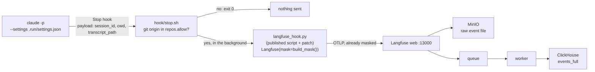
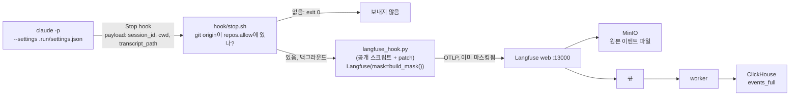

# Claude Code sessions in self-hosted Langfuse v4: the Stop hook, a repository allowlist and client-side masking

[English](#english) | [한국어](#한국어)

---

## English

**Verified end to end on 2026-11-13** with **Langfuse v4.56.0 / SDK 4.17.0 / CH 26.8.22.13** (its own compose project `lf-cc-lab` on the `_base/` compose file, `events_only` mode), **Claude Code 2.1.220** with `claude -p --model haiku` (`claude-haiku-4-5-20251001`, real model calls), Docker 29.9.3, Compose v5.7.0, Python 3.12.14, from purged volumes: [04-check.py](04-check.py) passed 24 checks; with `--fault` (the expectations of the `masked` and `full` runs swapped) 4 of them failed. Log: [lab-output.md](lab-output.md). The five runs cost 0.054 USD as Claude Code reported it; Langfuse priced the four stored sessions at 0.040677 USD, the same as Claude Code's figure for them.

### The short answer

| Question | Answer |
|---|---|
| Is there an official way to send Claude Code to Langfuse? | Yes: Langfuse publishes a Python Stop hook on its *Claude Code* integration page. After each response it reads the session transcript from where it last stopped and sends every new turn as a trace. [02-install-hook.sh](02-install-hook.sh) fetches that script and stops if its sha256 differs from the one read on 2026-11-13. |
| What does one turn look like? | One trace per turn, `Claude Code - Turn N`, in a Langfuse session with Claude Code's session id. Here every turn had 4 observations: the turn span, `Claude Generation 1` and `2` (model, tokens, cost) and `Tool: Read` (input and output). |
| Can I keep some repositories out? | The published hook sends every session. This lab's [hook/stop.sh](hook/stop.sh) runs it only when the repository's git `origin` (`owner/name`) is listed in `repos.allow`. The run in a repository that is not listed stored **nothing**, in ClickHouse or in MinIO. |
| Can secrets stay on my machine? | Yes, with the SDK's `mask` callback, which runs **before** export. In `masked`, `prompts` and `none` modes none of six random secret-shaped values, and not the home directory path, reached ClickHouse **or** the raw event files in MinIO. In `full` mode (the positive control) all of them did. |
| Does the hook slow Claude Code down? | `stop.sh` returned in 69 ms; the upload runs in the background and took 0.04–0.44 s. |
| Can I count tokens and cost per repository? | Yes, with SQL over `events_full`: the repository is a trace tag. See [Tokens and cost in SQL](#tokens-and-cost-in-sql). |

### What runs



| File | Does |
|---|---|
| [lib.sh](lib.sh) | Paths and `lab_compose`: the `_base/` compose file plus this overlay, as compose project `lf-cc-lab`, with the v4 track pins |
| [docker-compose.yml](docker-compose.yml) | Overlay: publishes only web (`127.0.0.1:13000`) and ClickHouse HTTP (`127.0.0.1:18423`), so it runs next to the shared v4 stack |
| [01-up.sh](01-up.sh) | Starts Langfuse and waits for web |
| [02-install-hook.sh](02-install-hook.sh) | Installs the hook into `.run/hook/`, never into `~/.claude`: the published script (sha256-pinned) patched by [hook/patch_hook.py](hook/patch_hook.py), [hook/mask.py](hook/mask.py), [hook/stop.sh](hook/stop.sh), a venv with the track's `langfuse` pin, the lab project's keys and a `settings.json` that registers the Stop hook for step 03 only |
| [03-runs.py](03-runs.py) | Five real `claude -p` runs in two throwaway git repositories (one allowed, one not), one per content mode; each prompt reads a `config.env` of random fake secrets and carries one more fake secret itself |
| [04-check.py](04-check.py) | 24 checks against ClickHouse `events_full` and a copy of the MinIO bucket, and the measurements; `--fault` swaps two expectations and must fail |
| [99-down.sh](99-down.sh) | Stops the lab; `--purge` also deletes the volumes and `.run/` |
| [hook/repos.allow.example](hook/repos.allow.example) | The allowlist format |

`patch_hook.py` makes three changes to the published script. Each anchor must be found exactly once, so a changed upstream script fails instead of being patched halfway:

1. `CC_LANGFUSE_REPO` (set by `stop.sh`) becomes a trace tag and metadata `repo`.
2. `Langfuse(..., mask=build_mask())`: every input, output and metadata goes through `mask.py`.
3. `CC_LANGFUSE_STATE_DIR` moves the state and log directory (published default `~/.claude/state`).

### Run

Needs Docker, Python 3.12, `jq`, `git`, and the `claude` CLI signed in (the runs use your Claude Code account; about 0.05 USD with Haiku).

```bash
cp _base/.env.example _base/.env          # once per clone, if missing
labs/v4/claude-code-tracing/01-up.sh
labs/v4/claude-code-tracing/02-install-hook.sh
python3 labs/v4/claude-code-tracing/03-runs.py
python3 labs/v4/claude-code-tracing/04-check.py
python3 labs/v4/claude-code-tracing/04-check.py --fault   # must FAIL
labs/v4/claude-code-tracing/99-down.sh --purge
```

The UI is at `http://localhost:13000` with the `LANGFUSE_INIT_USER_*` login of `_base/.env`. `LF_ENV_FILE=<path>` points the scripts at another clone's `_base/.env`.

### The content modes

`CC_LANGFUSE_CONTENT` picks how much leaves the machine. What the runs stored, read back from `events_full`:

| Mode | Prompt (turn input) | `Tool: Read` output | Fake values stored | Home path stored |
|---|---|---|---|---|
| `masked` (default) | `… ignore it: DB_PASSWORD=[REDACTED:secret]` | the file, with `[REDACTED:aws-access-key-id]`, `[REDACTED:secret]` ×2, `[REDACTED:password]`, `[REDACTED:langfuse-key]`; `LOG_LEVEL=info` kept | 0 of 6 | no (`~/…`) |
| `prompts` | `[prompt hidden: 108 chars]` | as `masked` | 0 of 6 | no |
| `none` | `[hidden: 108 chars]` (the `role` value too) | `[hidden: 336 chars]` | 0 of 6 | no |
| `full` | as typed | as read | **6 of 6** | **yes** |

In every mode the observation names (`Tool: Read`), model, token counts, cost and timings remain: the `none` run still recorded 56,205 tokens. The raw OTLP event file of each run in MinIO had the same result as ClickHouse: no fake value in `masked`, `prompts` and `none`, all six in `full`.

`mask.py` matches shapes and names: private key blocks, AWS key IDs and session tokens, Langfuse, Anthropic, OpenAI-style, GitHub and Slack tokens, JWTs, bearer tokens, the password in `scheme://user:password@`, `--password`-style flags, and `NAME=value` where the name contains `SECRET`, `PASSWORD`, `TOKEN`, `API_KEY`, `ACCESS_KEY`, `PRIVATE_KEY` or `CREDENTIAL`. The AWS secret access key in this run was caught by its name, not its value. A secret with neither a known shape nor a telling name is not masked in `masked` or `prompts` mode; only `none` hides every string.

### Client-side `mask` and Langfuse's server-side masking

| | SDK `mask` (this lab) | Enterprise ingestion masking (`LANGFUSE_INGESTION_MASKING_CALLBACK_URL`) |
|---|---|---|
| Where it runs | in the hook process, when the observation is created, before export | in the Langfuse worker, on events that already arrived |
| Raw event file in S3/MinIO | **masked** (measured here) | **original**: the worker reads the raw event that web wrote to the event bucket, then masks what goes to ClickHouse |
| Licence | none (OSS SDK) | Enterprise |
| When the mask function raises | the SDK stores `<fully masked due to failed mask function>` for that value (SDK 4.17.0 source, `_client/span.py`; not injected here) | stored unmasked by default; `..._FAIL_CLOSED=true` drops the event |
| Who controls the rules | each machine that runs the hook | the operator of the Langfuse instance |

The server-side columns come from [`labs/v4/langfuse-ee`](../langfuse-ee/) step 12 (not re-run here). The two combine: mask on the client for what must not leave the machine, and keep server-side masking as a net for clients you do not control.

Langfuse's masking page now recommends `mask_otel_spans` for new Python setups; `mask` (which the hook uses) applies to data set through SDK APIs such as `start_observation()` and `update()`, which is how the hook creates every observation.

### What arrives

One turn of the `masked` run, from `events_full`:

```
Claude Code - Turn 1   [SPAN]         tags claude-code, allowed-lab · session = Claude Code's session id
  Claude Generation 1  [GENERATION]   claude-haiku-4-5-20251001, usage and cost
  Tool: Read           [TOOL]         input {"file_path": "~/…/config.env"}, output with [REDACTED:…]
  Claude Generation 2  [GENERATION]
```

Per session: 4 observations, 2 generations, 1 tool, 4.5–6.6 s from the first to the last observation.

### Tokens and cost in SQL

```sql
SELECT arrayJoin(arrayFilter(t -> t != 'claude-code', tags)) AS repo,
       uniqExact(session_id)                         AS sessions,
       sum(usage_details['input'])                   AS input,
       sum(usage_details['output'])                  AS output,
       sum(usage_details['cache_read_input_tokens']) AS cache_read,
       sum(usage_details['cache_creation_input_tokens']) AS cache_write,
       round(sum(total_cost), 6)                     AS cost_usd
FROM events_full
WHERE type = 'GENERATION'
GROUP BY repo;
```

| repo | sessions | input | output | cache_read | cache_write | cost_usd |
|---|---|---|---|---|---|---|
| allowed-lab | 4 | 72 | 1978 | 216204 | 7276 | 0.040677 |

Per session, Langfuse's cost matched Claude Code's own `total_cost_usd` to the sixth decimal (for example 0.015090 and 0.01508975 for the `masked` run). Cache reads are 96 % of all tokens (216,204 of 225,530).

### Measured

| What | Value |
|---|---|
| Observations per turn | 4 (1 span, 2 generations, 1 tool) in all four stored sessions |
| `stop.sh` return time | 69 ms (72 ms in the first check run) |
| Upload time in the background | 0.04–0.44 s (4 uploads, from the hook log) |
| Langfuse cost of the 4 stored sessions | 0.040677 USD = the sum of Claude Code's `total_cost_usd` for them |
| Denied repository | 0 rows in `events_full`, no raw event file |

### Using it on your own machine

The lab installs nothing into `~/.claude`. For real use, the same files go into a directory of your choice, `stop.sh` is registered as a `Stop` hook in `~/.claude/settings.json`, and the keys go into the file `CC_LANGFUSE_ENV_FILE` names (default `~/.config/claude-langfuse.env`, mode 600). Without that file the hook does nothing. Without `CC_LANGFUSE_STATE_DIR` the state and log stay at the published default, `~/.claude/state/`. The first Stop of a session sends the whole transcript so far; after that, only new turns. Text over 20,000 characters is cut (`CC_LANGFUSE_MAX_CHARS`).

### Gaps

- **Pattern masking has misses by design.** See the list above; use `prompts` or `none` where that matters.
- **Only `claude -p` with one Read tool was run.** Interactive sessions, long sessions with many turns, sub-agents, compaction and other tools were not part of this run.
- **No failure was injected on the Langfuse side** (web down, slow, wrong key). The hook is written fail-open, but this lab did not measure what is lost.
- **One machine, one project.** Several people sending to one project, and the per-person keys that would need, were not run.
- **The published script can change.** The sha256 pin stops `02`; update the pin and `patch_hook.py` together after reading the new script.

### Sources (all read 2026-11-13)

- Langfuse: [Claude Code integration](https://langfuse.com/integrations/developer-tools/claude-code) (the hook script, fetched as `claude-code.md` by step 02) · [Masking](https://langfuse.com/docs/observability/features/masking) (`mask`, `mask_otel_spans`) · [Data masking (self-hosted)](https://langfuse.com/self-hosting/security/data-masking)
- Claude Code: [Hooks](https://code.claude.com/docs/en/hooks) (Stop fires when Claude finishes responding; common input fields `session_id`, `transcript_path`, `cwd`) · [Monitoring](https://code.claude.com/docs/en/monitoring-usage) (OpenTelemetry metrics and events, for comparison)
- Source read: the published `langfuse_hook.py` (sha256 `6dfb65d9…`), langfuse SDK 4.17.0 in the hook venv

---

## 한국어

**2026-11-13 처음부터 끝까지 검증.** 대상은 **Langfuse v4.56.0 / SDK 4.17.0 / CH 26.8.22.13**(`_base/` compose 파일 위의 별도 compose 프로젝트 `lf-cc-lab`, `events_only` 모드)이고, **Claude Code 2.1.220**의 `claude -p --model haiku`(`claude-haiku-4-5-20251001`, 실제 모델 호출)로 돌렸습니다(Docker 29.9.3, Compose v5.7.0, Python 3.12.14, 볼륨을 지운 상태에서 시작). [04-check.py](04-check.py)는 24개 검사를 통과했습니다. `--fault`(`masked`와 `full` 실행의 기대값을 맞바꿈)로는 그중 4개가 실패합니다. 로그: [lab-output.md](lab-output.md). 실행 다섯 번의 비용은 Claude Code 보고 기준 0.054 USD였고, 저장된 세션 4개에 대해 Langfuse가 계산한 비용 0.040677 USD는 같은 세션의 Claude Code 수치와 같았습니다.

### 짧은 답

| 질문 | 답 |
|---|---|
| Claude Code를 Langfuse로 보내는 공식 방법이 있나? | 있습니다. Langfuse가 *Claude Code* 연동 페이지에 Python Stop hook을 공개합니다. 응답이 끝날 때마다 세션 transcript를 지난번 위치부터 읽어 새 턴마다 trace 하나로 보냅니다. [02-install-hook.sh](02-install-hook.sh)는 그 스크립트를 받아 2026-11-13에 읽은 sha256과 다르면 멈춥니다. |
| 턴 하나는 어떤 모양인가? | 턴마다 trace 하나(`Claude Code - Turn N`)이고, Claude Code의 세션 id가 Langfuse 세션입니다. 이번 실행에서는 턴마다 observation 4개였습니다: 턴 span, `Claude Generation 1`·`2`(모델, 토큰, 비용), `Tool: Read`(입력과 출력). |
| 일부 저장소를 뺄 수 있나? | 공개된 hook은 모든 세션을 보냅니다. 이 실습의 [hook/stop.sh](hook/stop.sh)는 저장소의 git `origin`(`owner/name`)이 `repos.allow`에 있을 때만 hook을 실행합니다. 목록에 없는 저장소에서 돌린 실행은 ClickHouse에도 MinIO에도 **아무것도** 남기지 않았습니다. |
| 비밀값을 내 컴퓨터 밖으로 안 내보낼 수 있나? | 예. SDK의 `mask` callback이 **내보내기 전에** 돕니다. `masked`·`prompts`·`none` 모드에서는 무작위로 만든 비밀값 모양의 값 6개와 홈 디렉터리 경로가 ClickHouse에도, MinIO의 원본 이벤트 파일에도 들어가지 않았습니다. 양성 대조인 `full` 모드에서는 모두 들어갔습니다. |
| hook 때문에 Claude Code가 느려지나? | `stop.sh`는 69 ms에 돌아왔습니다. 업로드는 백그라운드에서 0.04–0.44초 걸렸습니다. |
| 저장소별 토큰과 비용을 셀 수 있나? | 예. 저장소가 trace 태그라서 `events_full`에 SQL을 쓰면 됩니다. [SQL로 보는 토큰과 비용](#sql로-보는-토큰과-비용)을 보세요. |

### 구성



| 파일 | 하는 일 |
|---|---|
| [lib.sh](lib.sh) | 경로와 `lab_compose`: `_base/` compose 파일에 이 overlay를 더해 v4 트랙 고정 버전으로, compose 프로젝트 `lf-cc-lab`로 실행 |
| [docker-compose.yml](docker-compose.yml) | overlay: web(`127.0.0.1:13000`)과 ClickHouse HTTP(`127.0.0.1:18423`)만 열어 공유 v4 스택 옆에서 돌 수 있게 함 |
| [01-up.sh](01-up.sh) | Langfuse를 띄우고 web을 기다림 |
| [02-install-hook.sh](02-install-hook.sh) | hook을 `~/.claude`가 아니라 `.run/hook/`에 설치: 공개 스크립트(sha256 고정)를 [hook/patch_hook.py](hook/patch_hook.py)로 고친 것, [hook/mask.py](hook/mask.py), [hook/stop.sh](hook/stop.sh), 트랙의 `langfuse` 버전을 담은 venv, 실습 프로젝트 키, 03단계에만 Stop hook을 거는 `settings.json` |
| [03-runs.py](03-runs.py) | 일회용 git 저장소 두 개(허용 하나, 비허용 하나)에서 실제 `claude -p`를 모드별로 다섯 번 실행. 프롬프트마다 무작위 가짜 비밀값이 든 `config.env`를 읽게 하고, 프롬프트 자체에도 가짜 비밀값을 하나 넣음 |
| [04-check.py](04-check.py) | ClickHouse `events_full`과 MinIO 버킷 사본에 대한 검사 24개와 측정. `--fault`는 기대값 두 개를 바꾸고 실패해야 함 |
| [99-down.sh](99-down.sh) | 실습 중지. `--purge`는 볼륨과 `.run/`도 지움 |
| [hook/repos.allow.example](hook/repos.allow.example) | 허용 목록 형식 |

`patch_hook.py`는 공개 스크립트를 세 군데 고칩니다. 고칠 자리는 각각 정확히 한 번 있어야 하므로, upstream 스크립트가 바뀌면 반쯤 고쳐지지 않고 실패합니다.

1. `stop.sh`가 넣는 `CC_LANGFUSE_REPO`를 trace 태그와 metadata `repo`로.
2. `Langfuse(..., mask=build_mask())`: 모든 입력, 출력, metadata가 `mask.py`를 거침.
3. `CC_LANGFUSE_STATE_DIR`로 state와 로그 디렉터리를 옮김(공개 스크립트 기본값 `~/.claude/state`).

### 실행

Docker, Python 3.12, `jq`, `git`, 로그인된 `claude` CLI가 필요합니다(실행은 본인 Claude Code 계정을 쓰고, Haiku로 약 0.05 USD).

```bash
cp _base/.env.example _base/.env          # clone마다 한 번, 없을 때만
labs/v4/claude-code-tracing/01-up.sh
labs/v4/claude-code-tracing/02-install-hook.sh
python3 labs/v4/claude-code-tracing/03-runs.py
python3 labs/v4/claude-code-tracing/04-check.py
python3 labs/v4/claude-code-tracing/04-check.py --fault   # 실패해야 함
labs/v4/claude-code-tracing/99-down.sh --purge
```

UI는 `http://localhost:13000`이고, `_base/.env`의 `LANGFUSE_INIT_USER_*`로 로그인합니다. `LF_ENV_FILE=<경로>`로 다른 clone의 `_base/.env`를 쓸 수 있습니다.

### 내용 모드

`CC_LANGFUSE_CONTENT`가 컴퓨터 밖으로 나가는 양을 정합니다. 실행 결과를 `events_full`에서 다시 읽은 것입니다.

| 모드 | 프롬프트(턴 입력) | `Tool: Read` 출력 | 저장된 가짜 값 | 홈 경로 저장 |
|---|---|---|---|---|
| `masked`(기본) | `… ignore it: DB_PASSWORD=[REDACTED:secret]` | 파일 내용, `[REDACTED:aws-access-key-id]`, `[REDACTED:secret]` 2개, `[REDACTED:password]`, `[REDACTED:langfuse-key]`로 바뀜. `LOG_LEVEL=info`는 그대로 | 6개 중 0 | 아니요(`~/…`) |
| `prompts` | `[prompt hidden: 108 chars]` | `masked`와 같음 | 6개 중 0 | 아니요 |
| `none` | `[hidden: 108 chars]`(`role` 값도) | `[hidden: 336 chars]` | 6개 중 0 | 아니요 |
| `full` | 입력 그대로 | 읽은 그대로 | **6개 중 6** | **예** |

모든 모드에서 observation 이름(`Tool: Read`), 모델, 토큰 수, 비용, 시간은 남습니다. `none` 실행도 토큰 56,205개를 기록했습니다. 실행마다 MinIO에 있는 원본 OTLP 이벤트 파일도 ClickHouse와 결과가 같았습니다. `masked`·`prompts`·`none`에는 가짜 값이 없고, `full`에는 6개가 다 있습니다.

`mask.py`는 모양과 이름으로 찾습니다: private key 블록, AWS 키 ID와 세션 토큰, Langfuse·Anthropic·OpenAI 형식·GitHub·Slack 토큰, JWT, bearer 토큰, `scheme://user:password@`의 비밀번호, `--password` 같은 플래그, 그리고 이름에 `SECRET`, `PASSWORD`, `TOKEN`, `API_KEY`, `ACCESS_KEY`, `PRIVATE_KEY`, `CREDENTIAL`이 들어간 `NAME=value`. 이번 실행의 AWS secret access key는 값이 아니라 이름으로 잡혔습니다. 알려진 모양도 아니고 이름으로도 드러나지 않는 비밀값은 `masked`·`prompts` 모드에서 가려지지 않습니다. 모든 문자열을 가리는 것은 `none`뿐입니다.

### 클라이언트 `mask`와 Langfuse 서버 측 마스킹

| | SDK `mask`(이 실습) | Enterprise 수집 마스킹(`LANGFUSE_INGESTION_MASKING_CALLBACK_URL`) |
|---|---|---|
| 도는 곳 | hook 프로세스 안, observation을 만들 때, 내보내기 전 | Langfuse worker 안, 이미 도착한 이벤트에 |
| S3/MinIO 원본 이벤트 파일 | **마스킹됨**(이번 측정) | **원본**: web이 이벤트 버킷에 쓴 원본을 worker가 읽고, ClickHouse로 갈 것만 마스킹 |
| 라이선스 | 필요 없음(OSS SDK) | Enterprise |
| mask 함수가 예외를 내면 | SDK가 그 값을 `<fully masked due to failed mask function>`으로 저장(SDK 4.17.0 소스 `_client/span.py`, 여기서 결함을 넣어 보지는 않음) | 기본값은 마스킹 없이 저장, `..._FAIL_CLOSED=true`면 이벤트를 버림 |
| 규칙을 누가 정하나 | hook을 돌리는 각 컴퓨터 | Langfuse 인스턴스 운영자 |

서버 측 열은 [`labs/v4/langfuse-ee`](../langfuse-ee/) 12단계의 결과입니다(여기서 다시 돌리지 않음). 둘은 함께 씁니다. 컴퓨터 밖으로 나가면 안 되는 것은 클라이언트에서 가리고, 통제할 수 없는 클라이언트에 대비해 서버 측 마스킹을 안전망으로 둡니다.

Langfuse 마스킹 문서는 새 Python 설정에 `mask_otel_spans`를 권합니다. hook이 쓰는 `mask`는 `start_observation()`·`update()` 같은 SDK API로 넣은 데이터에 적용되고, hook은 모든 observation을 그렇게 만듭니다.

### 들어오는 것

`masked` 실행의 턴 하나(`events_full`에서):

```
Claude Code - Turn 1   [SPAN]         태그 claude-code, allowed-lab · session = Claude Code 세션 id
  Claude Generation 1  [GENERATION]   claude-haiku-4-5-20251001, 사용량과 비용
  Tool: Read           [TOOL]         입력 {"file_path": "~/…/config.env"}, 출력에 [REDACTED:…]
  Claude Generation 2  [GENERATION]
```

세션마다 observation 4개, generation 2개, tool 1개이고, 첫 observation부터 마지막까지 4.5–6.6초였습니다.

### SQL로 보는 토큰과 비용

```sql
SELECT arrayJoin(arrayFilter(t -> t != 'claude-code', tags)) AS repo,
       uniqExact(session_id)                         AS sessions,
       sum(usage_details['input'])                   AS input,
       sum(usage_details['output'])                  AS output,
       sum(usage_details['cache_read_input_tokens']) AS cache_read,
       sum(usage_details['cache_creation_input_tokens']) AS cache_write,
       round(sum(total_cost), 6)                     AS cost_usd
FROM events_full
WHERE type = 'GENERATION'
GROUP BY repo;
```

| repo | sessions | input | output | cache_read | cache_write | cost_usd |
|---|---|---|---|---|---|---|
| allowed-lab | 4 | 72 | 1978 | 216204 | 7276 | 0.040677 |

세션별로 Langfuse 비용은 Claude Code 자체의 `total_cost_usd`와 소수점 여섯째 자리까지 같았습니다(예: `masked` 실행 0.015090과 0.01508975). 전체 토큰의 96%(225,530개 중 216,204개)가 캐시 읽기입니다.

### 측정값

| 항목 | 값 |
|---|---|
| 턴당 observation | 저장된 세션 4개 모두 4개(span 1, generation 2, tool 1) |
| `stop.sh` 반환 시간 | 69 ms(첫 검사 실행에서는 72 ms) |
| 백그라운드 업로드 시간 | 0.04–0.44초(업로드 4번, hook 로그) |
| 저장된 세션 4개의 Langfuse 비용 | 0.040677 USD = 같은 세션의 Claude Code `total_cost_usd` 합 |
| 비허용 저장소 | `events_full` 0행, 원본 이벤트 파일 없음 |

### 내 컴퓨터에서 쓰기

실습은 `~/.claude`에 아무것도 설치하지 않습니다. 실제로 쓰려면 같은 파일을 원하는 디렉터리에 두고, `stop.sh`를 `~/.claude/settings.json`의 `Stop` hook으로 등록하고, 키를 `CC_LANGFUSE_ENV_FILE`이 가리키는 파일(기본값 `~/.config/claude-langfuse.env`, 권한 600)에 넣습니다. 이 파일이 없으면 hook은 아무것도 하지 않습니다. `CC_LANGFUSE_STATE_DIR`이 없으면 state와 로그는 공개 스크립트 기본값인 `~/.claude/state/`에 남습니다. 세션의 첫 Stop은 그때까지의 transcript 전체를, 그 뒤로는 새 턴만 보냅니다. 20,000자가 넘는 텍스트는 잘립니다(`CC_LANGFUSE_MAX_CHARS`).

### 한계

- **패턴 마스킹은 구조상 놓치는 것이 있습니다.** 위 목록을 보고, 중요한 곳에서는 `prompts`나 `none`을 쓰세요.
- **도구 하나(Read)를 쓰는 `claude -p`만 돌렸습니다.** 대화형 세션, 턴이 많은 긴 세션, sub-agent, compaction, 다른 도구는 이번 실행에 없습니다.
- **Langfuse 쪽 장애는 넣지 않았습니다**(web 중지, 지연, 틀린 키). hook은 fail-open으로 쓰여 있지만, 무엇이 빠지는지는 재지 않았습니다.
- **컴퓨터 하나, 프로젝트 하나.** 여러 사람이 한 프로젝트로 보내는 구성과 그에 필요한 사람별 키는 돌리지 않았습니다.
- **공개 스크립트는 바뀔 수 있습니다.** sha256 고정이 `02`를 멈춥니다. 새 스크립트를 읽은 뒤 고정값과 `patch_hook.py`를 함께 고치세요.

### 출처(모두 2026-11-13 확인)

위 English 절의 목록과 같습니다: Langfuse Claude Code 연동 페이지(hook 스크립트), Masking 문서(`mask`, `mask_otel_spans`), 셀프호스팅 Data masking 문서, Claude Code Hooks 문서(Stop 이벤트, payload), Monitoring 문서(OpenTelemetry 메트릭과 이벤트), 공개 `langfuse_hook.py`(sha256 `6dfb65d9…`)와 hook venv의 langfuse SDK 4.17.0 소스.
