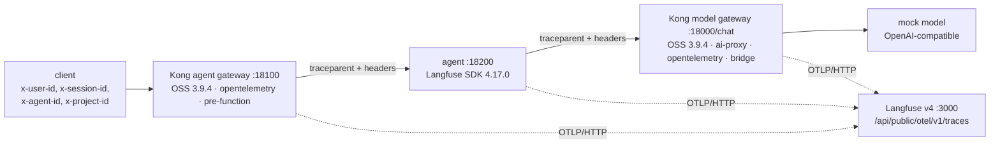
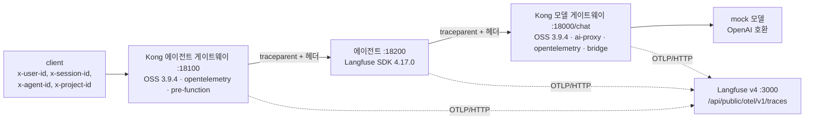

# Kong Gateway → self-hosted Langfuse v4 over OpenTelemetry: a model gateway, an agent gateway and an SDK agent in one trace

[English](#english) | [한국어](#한국어)

---

## English

**Verified end to end on 2026-11-04** with **Kong Gateway OSS 3.9.4** (the `kong` Docker image) against **Langfuse v4.56.0 / SDK 4.17.0 / CH 26.8.22.13** on the shared v4 stack (`_base/`, `events_only` mode), a mock OpenAI-compatible model (no model calls, no cost), Docker 29.9.2, Compose v5.6.1, Python 3.12.14: [04-check.py](04-check.py) passed 18 checks; with an injected fault (the agent does not extract `traceparent`) 5 of them failed. The comparison step [05-ee-compare.sh](05-ee-compare.sh) ran the **Enterprise image `kong/kong-gateway` 3.14.0.16 without a licence**. Log: [lab-output.md](lab-output.md).

### The short answer

| Question | Answer |
|---|---|
| Is there an official Kong ↔ Langfuse integration? | Yes, on Langfuse's side: the *Kong API Gateway Integration* page. It uses Kong's bundled `opentelemetry` plugin pointed at Langfuse's OTLP endpoint, no collector, and asks for **Kong Gateway 3.13 or later** with `ai-proxy` / `ai-proxy-advanced`. There is no Langfuse plugin in Kong's Plugin Hub. |
| Does Kong OSS send LLM data (model, tokens, prompt) as spans? | **No.** The last OSS image is 3.9.4; its source has no `gen_ai` span code. Langfuse gets the request spans (`kong`, `kong.balancer`, …) and nothing else. Kong's "Gen AI tracing attributes" are labelled v3.13+, and 3.10+ ships only as Kong Gateway Enterprise. |
| Can OSS get there anyway? | Yes, with ~40 lines of Lua in a `pre-function` plugin (the *bridge* in [kong-model.yml](kong-model.yml)). It turns `ai-proxy`'s own statistics into one Langfuse generation with model, usage, input and output. |
| Can Kong create the trace ID and span structure? | Yes. With no incoming `traceparent` Kong starts the trace, injects W3C `traceparent` upstream, and returns the trace ID in a response header (`http_response_header_for_traceid`). With an incoming `traceparent` it joins that trace. |
| Headers (user, project, agent) → span attributes? | Not configurable in the `opentelemetry` plugin. It needs Lua, either `pre-function` (here) or a custom plugin. Langfuse v4 wants these attributes on **every** span, so the snippet sets them on all of Kong's spans. |
| Can one Langfuse receive from two gateways at once? | **Yes, verified.** Both gateways and the agent's SDK export to the same project at the same time; one request becomes **one trace**: agent gateway → SDK agent → model gateway → generation. |

### What runs



| File | Does |
|---|---|
| [docker-compose.yml](docker-compose.yml) | Own project `lf-kong-lab`: `mock-llm`, `kong-model`, `kong-agent` (OSS 3.9.4, DB-less), and `kong-model-ee` (profile `ee`). Host ports 18000/18001, 18100/18101, 18300/18301. Langfuse through `host.docker.internal:3000`. |
| [kong-model.yml](kong-model.yml) | Model gateway: routes `/raw` (ai-proxy + opentelemetry) and `/chat` (the same plus the bridge) |
| [kong-agent.yml](kong-agent.yml) | Agent gateway: a plain proxy to the agent, with the header mapping only |
| [mock_llm.py](mock_llm.py) | `POST /v1/chat/completions` with a fixed `usage` block |
| [01-up.sh](01-up.sh) | Builds `LF_OTEL_AUTH` from the project keys in `_base/.env` and starts the lab. Never touches the `langfuse-hols-v4-*` containers. |
| [02-model-gateway.sh](02-model-gateway.sh) | Scenario A: a client calls `/raw` and `/chat` directly |
| [03-agent-through-gateways.py](03-agent-through-gateways.py) | Scenario B: client → agent gateway → SDK agent → model gateway |
| [04-check.py](04-check.py) | 18 checks against ClickHouse `events_full` and the Langfuse v2 observations API |
| [05-ee-compare.sh](05-ee-compare.sh) | `/raw` on the Enterprise image, unlicensed, to show its native Gen AI span |
| [99-down.sh](99-down.sh) | Removes this lab's containers. The traces stay in Langfuse. |

### Run

```bash
_base/bin/up.sh v4                                   # if the v4 stack is not up yet
labs/v4/kong-gateway-otel/01-up.sh
labs/v4/kong-gateway-otel/02-model-gateway.sh
.venv-v4/bin/python labs/v4/kong-gateway-otel/03-agent-through-gateways.py
.venv-v4/bin/python labs/v4/kong-gateway-otel/04-check.py
labs/v4/kong-gateway-otel/05-ee-compare.sh           # optional: Enterprise image, no licence
labs/v4/kong-gateway-otel/99-down.sh
```

`LF_ENV_FILE=<path>` points the scripts at another clone's `_base/.env`. On Linux Docker Engine, start step 03 with `AGENT_BIND=0.0.0.0`, because `host-gateway` does not reach the host's loopback there. On Docker Desktop the default `127.0.0.1` works.

### Kong configuration that matters

Exporter, on both gateways:

```yaml
plugins:
  - name: opentelemetry
    config:
      traces_endpoint: http://host.docker.internal:3000/api/public/otel/v1/traces
      headers:
        Authorization: "{vault://env/lf-otel-auth}"   # "Basic base64(pk-lf-…:sk-lf-…)" from env LF_OTEL_AUTH
        x-langfuse-ingestion-version: "4"            # v4: shows up in real time on the v4 data model
      resource_attributes: { service.name: kong-model-gateway }
      propagation: { extract: [w3c], inject: [w3c], default_format: w3c }
      http_response_header_for_traceid: x-trace-id
```

Process settings: `KONG_TRACING_INSTRUMENTATIONS` and `KONG_TRACING_SAMPLING_RATE=1.0`. Langfuse's page uses `all`, which gives ~7 internal spans per gateway per request (`kong.router`, `kong.dns`, `kong.access.plugin.*`, …): 21 observations in scenario B. The lab defaults to `request,balancer`, which gives 7. Both were run; set `KONG_TRACING_INSTRUMENTATIONS=all` to compare.

`ai-proxy` needs `logging.log_statistics: true` for model and usage, and `logging.log_payloads: true` for the bodies. The bridge reads what `ai-proxy` already puts into `kong.log.serialize()` (`ai.proxy.meta`, `.usage`, `.payload`). In the **log** phase it adds a span `chat <model>` under `kong.balancer` with `langfuse.observation.type=generation`, `gen_ai.request.model`, `gen_ai.response.model`, `gen_ai.usage.input_tokens` / `output_tokens`, and `langfuse.observation.input` / `output`. `pre-function` (priority 1000000) runs before `opentelemetry` (14) in that phase, so the span exists when Kong encodes the batch. It runs in Kong's default Lua sandbox (`untrusted_lua = sandbox`).

### The header contract

| Request header | Kong / SDK sets | Langfuse field |
|---|---|---|
| `x-user-id` | `langfuse.user.id` | `userId` |
| `x-session-id` | `langfuse.session.id` | `sessionId` |
| `x-agent-id` | `langfuse.trace.metadata.agent_id` | metadata `agent_id` |
| `x-project-id` | `langfuse.trace.metadata.project_id` | metadata `project_id` |
| `traceparent` | Kong's `propagation`; the agent calls `propagate.extract` / `inject` | trace ID, parent span |

`x-project-id` is your own label. The **Langfuse project is chosen by the key** in the exporter's `Authorization` header, not by a header. Each producer maps the contract itself: Kong with the Lua snippet, the agent with the SDK's `propagate_attributes(user_id=…, session_id=…, metadata=…)`. The agent forwards the headers on its model call.

### What arrives

Scenario B, one trace (from [04-check.py](04-check.py), `kong.*` internal spans not shown):

```
kong  [SPAN, kong-agent-gateway]                      ← root; Kong created the trace ID
  support-agent  [AGENT, support-agent]                ← SDK, child of the agent gateway's kong.balancer
    lookup-policy  [TOOL, support-agent]
    kong  [SPAN, kong-model-gateway]                   ← model gateway joined via traceparent
      chat mock-gpt  [GENERATION, kong-model-gateway]  ← the bridge: model, usage 16/8/24, input/output
```

In `events_full`, all 7 rows of all three producers carry `user_id` and `session_id`. The v2 observations API returns the same 7, and the generation has `model: mock-gpt` and `usageDetails {input 16, output 8, total 24}`. Without the bridge (`/raw`), the 2 spans have no model, no usage, no input and no user.

Enterprise 3.14.0.16, unlicensed, `/raw` with no bridge: Kong itself emits `chat mock-gpt` as a **GENERATION** with model and usage. Langfuse keeps `gen_ai.response.finish_reasons`, `gen_ai.response.id` and others as metadata. It started with the notice `No license found`, and `ai-proxy` and the Gen AI span worked. The routes needed an explicit `protocols: [http, https]`: without it they loaded as `https` only and answered `426 Please use HTTPS protocol`.

### Gaps

- **OSS has no native Gen AI spans.** Either keep the bridge, or move to Kong Gateway Enterprise ≥ 3.13. Running the Enterprise image without a licence worked here; whether that is allowed for production use is a licensing question this lab did not check.
- **Prompt bodies are all or nothing.** They need `log_payloads: true`, and that also writes the bodies to every Kong log plugin on the route. The bridge's input and output are the raw OpenAI request and response JSON (with `model` and `stream`), not just the messages. Masking has to happen elsewhere, for example in Langfuse's masking (`langfuse-ee` step 08) or by not logging payloads.
- **Enterprise prompt and response arrive in OTLP form.** On Langfuse 4.56.0, input and output are stored as JSON-encoded OTLP `kvlistValue` structures (`gen_ai.input.messages` is a structured attribute). The text is readable but is not shown as chat messages.
- **Header → attribute needs code** on every Kong version (OSS and Enterprise). The `opentelemetry` plugin has no field for it. The Langfuse page also uses Lua (`post-function`).
- **Streaming was not tested.** The mock answers non-streaming only.
- **Cost is empty** unless a Langfuse model definition matches the model name (`mock-gpt` has none).
- **Timestamps:** Kong's spans have millisecond precision. In one run on a single host, the SDK's agent span ended 3 ms after its Kong parent. Expect small overlaps between producers, and clock skew across hosts.
- **`version`:** Langfuse stored Kong's resource attribute `service.version` (`3.9.4`) as the observation version.
- **v4 API:** `/api/public/traces/{id}` returns 404 in `events_only` mode. Read through `/api/public/v2/observations?traceId=…`.
- **Not run:** gateways pointing at two different Langfuse projects (the trace would then be split), an OTel Collector in between, Kong on Kubernetes, and real model providers.

### Design notes (*recommendation*)

- Give every gateway its own `service.name` and the **same** Langfuse project when they serve the same agents. Otherwise one request ends up in two projects.
- Let the outermost gateway own the trace ID. Return it to the caller (`x-trace-id`) so scores and feedback can be attached later.
- Agents must extract the incoming `traceparent` and inject it on outgoing calls, by hand as in step 03 or with OTel HTTP instrumentation. The fault run shows the cost: without extract, the request splits into separate traces.
- Keep the credential at the gateway (Kong vault reference), not in the config file.

### Sources (all read 2026-11-04)

- Langfuse: [Kong API Gateway Integration](https://langfuse.com/integrations/gateways/kong-ai-plugin) · [OpenTelemetry (endpoint, attribute mapping)](https://langfuse.com/integrations/native/opentelemetry) · [Migration to v4](https://langfuse.com/integrations/native/opentelemetry/migration-to-v4) · [Trace IDs & distributed tracing](https://langfuse.com/docs/observability/features/trace-ids-and-distributed-tracing)
- Kong: [OpenTelemetry plugin](https://developer.konghq.com/plugins/opentelemetry/) and [reference](https://developer.konghq.com/plugins/opentelemetry/reference/) · [AI Proxy reference](https://developer.konghq.com/plugins/ai-proxy/reference/) · [Gen AI span attributes](https://developer.konghq.com/ai-gateway/llm-open-telemetry/) · [Tracing](https://developer.konghq.com/gateway/tracing/) · [kong.tracing PDK](https://developer.konghq.com/gateway/pdk/reference/kong.tracing/) · [Version support policy](https://developer.konghq.com/gateway/version-support-policy/)
- Images: [`kong` on Docker Hub](https://hub.docker.com/_/kong) (newest tag 3.9.4, from the Hub tags API) · [`kong/kong-gateway`](https://hub.docker.com/r/kong/kong-gateway) (3.14.0.16) · [Kong/kong releases](https://github.com/Kong/kong/releases) (newest 3.9.4)
- Installed source read: `kong:3.9.4` `kong/plugins/opentelemetry/{schema,traces}.lua`, `kong/llm/plugin/shared-filters/serialize-analytics.lua`, `kong/llm/plugin/base.lua`, `kong/pdk/tracing.lua`. `kong/kong-gateway:3.14.0.16` `kong/llm/plugin/observability.lua` (`start_request_span` / `finish_request_span`).

---

## 한국어

**2026-11-04 처음부터 끝까지 검증.** 대상은 **Kong Gateway OSS 3.9.4**(`kong` Docker 이미지)이고, 공유 v4 스택(`_base/`, `events_only` 모드)의 **Langfuse v4.56.0 / SDK 4.17.0 / CH 26.8.22.13**으로 보냈습니다. 모델은 OpenAI 호환 mock이라 실제 모델 호출과 비용이 없습니다(Docker 29.9.2, Compose v5.6.1, Python 3.12.14). [04-check.py](04-check.py)는 18개 검사를 통과했습니다. 에이전트가 `traceparent`를 꺼내지 않도록 결함을 넣으면 그중 5개가 실패합니다. 비교 단계 [05-ee-compare.sh](05-ee-compare.sh)는 **Enterprise 이미지 `kong/kong-gateway` 3.14.0.16을 라이선스 없이** 돌렸습니다. 로그: [lab-output.md](lab-output.md).

### 짧은 답

| 질문 | 답 |
|---|---|
| Kong ↔ Langfuse 공식 연동이 있나? | 있음, Langfuse 쪽 *Kong API Gateway Integration* 페이지입니다. Kong에 기본 포함된 `opentelemetry` 플러그인을 Langfuse OTLP 엔드포인트로 보내는 방식이고, 수집기는 없습니다. 조건은 **Kong Gateway 3.13 이상**과 `ai-proxy` / `ai-proxy-advanced`입니다. Kong Plugin Hub에 Langfuse 플러그인은 없습니다. |
| Kong OSS가 LLM 정보(모델, 토큰, 프롬프트)를 span으로 보내나? | **아니요.** 마지막 OSS 이미지는 3.9.4이고, 소스에 `gen_ai` span 코드가 없습니다. Langfuse에는 요청 span(`kong`, `kong.balancer` 등)만 들어옵니다. Kong 문서의 "Gen AI tracing attributes"는 v3.13+이고, 3.10+는 Kong Gateway Enterprise로만 나옵니다. |
| 그래도 OSS로 가능한가? | 가능합니다. `pre-function` 플러그인에 Lua 약 40줄을 넣으면 됩니다([kong-model.yml](kong-model.yml)의 *bridge*). `ai-proxy`가 이미 모은 통계를 Langfuse generation 하나로 바꿔 모델, 사용량, 입력, 출력을 채웁니다. |
| Kong이 trace ID와 span 구조를 만들 수 있나? | 예. 들어온 `traceparent`가 없으면 Kong이 trace를 시작하고, upstream에 W3C `traceparent`를 넣고, 응답 헤더로 trace ID를 돌려줍니다(`http_response_header_for_traceid`). 들어온 `traceparent`가 있으면 그 trace에 합류합니다. |
| 헤더(사용자, 프로젝트, 에이전트) → span 속성? | `opentelemetry` 플러그인 설정만으로는 안 됩니다. `pre-function`(여기서 쓴 방법)이나 커스텀 플러그인 같은 Lua가 필요합니다. Langfuse v4는 이 속성이 **모든** span에 있기를 기대하므로, 스니펫이 Kong의 모든 span에 넣습니다. |
| Langfuse 하나가 게이트웨이 두 개에서 동시에 받을 수 있나? | **예, 검증했습니다.** 두 게이트웨이와 에이전트 SDK가 같은 프로젝트로 동시에 보내고, 요청 하나가 **trace 하나**가 됩니다: 에이전트 게이트웨이 → SDK 에이전트 → 모델 게이트웨이 → generation. |

### 구성



| 파일 | 하는 일 |
|---|---|
| [docker-compose.yml](docker-compose.yml) | 별도 프로젝트 `lf-kong-lab`: `mock-llm`, `kong-model`, `kong-agent`(OSS 3.9.4, DB-less), `kong-model-ee`(프로필 `ee`). 호스트 포트 18000/18001, 18100/18101, 18300/18301. Langfuse는 `host.docker.internal:3000`으로 접근합니다. |
| [kong-model.yml](kong-model.yml) | 모델 게이트웨이: `/raw`(ai-proxy + opentelemetry), `/chat`(여기에 bridge 추가) |
| [kong-agent.yml](kong-agent.yml) | 에이전트 게이트웨이: 에이전트 앞의 단순 프록시, 헤더 매핑만 함 |
| [mock_llm.py](mock_llm.py) | `POST /v1/chat/completions`, 고정된 `usage` 블록 |
| [01-up.sh](01-up.sh) | `_base/.env`의 프로젝트 키로 `LF_OTEL_AUTH`를 만들고 실습을 띄웁니다. `langfuse-hols-v4-*` 컨테이너는 건드리지 않습니다. |
| [02-model-gateway.sh](02-model-gateway.sh) | 시나리오 A: 클라이언트가 `/raw`와 `/chat`을 직접 호출 |
| [03-agent-through-gateways.py](03-agent-through-gateways.py) | 시나리오 B: 클라이언트 → 에이전트 게이트웨이 → SDK 에이전트 → 모델 게이트웨이 |
| [04-check.py](04-check.py) | ClickHouse `events_full`과 Langfuse v2 observations API로 18개 검사 |
| [05-ee-compare.sh](05-ee-compare.sh) | Enterprise 이미지(라이선스 없음)의 `/raw`로 기본 Gen AI span 확인 |
| [99-down.sh](99-down.sh) | 이 실습의 컨테이너를 지웁니다. trace는 Langfuse에 남습니다. |

### 실행

```bash
_base/bin/up.sh v4                                   # v4 스택이 아직 없으면
labs/v4/kong-gateway-otel/01-up.sh
labs/v4/kong-gateway-otel/02-model-gateway.sh
.venv-v4/bin/python labs/v4/kong-gateway-otel/03-agent-through-gateways.py
.venv-v4/bin/python labs/v4/kong-gateway-otel/04-check.py
labs/v4/kong-gateway-otel/05-ee-compare.sh           # 선택: Enterprise 이미지, 라이선스 없음
labs/v4/kong-gateway-otel/99-down.sh
```

`LF_ENV_FILE=<경로>`를 주면 다른 클론의 `_base/.env`를 읽습니다. Linux Docker Engine에서는 `host-gateway`가 호스트 loopback에 닿지 않으므로 03을 `AGENT_BIND=0.0.0.0`으로 실행하세요. Docker Desktop에서는 기본값 `127.0.0.1`로 됩니다.

### 중요한 Kong 설정

익스포터는 두 게이트웨이 모두 같습니다:

```yaml
plugins:
  - name: opentelemetry
    config:
      traces_endpoint: http://host.docker.internal:3000/api/public/otel/v1/traces
      headers:
        Authorization: "{vault://env/lf-otel-auth}"   # 환경 변수 LF_OTEL_AUTH의 "Basic base64(pk-lf-…:sk-lf-…)"
        x-langfuse-ingestion-version: "4"            # v4: v4 데이터 모델에 바로 반영
      resource_attributes: { service.name: kong-model-gateway }
      propagation: { extract: [w3c], inject: [w3c], default_format: w3c }
      http_response_header_for_traceid: x-trace-id
```

프로세스 설정: `KONG_TRACING_INSTRUMENTATIONS`, `KONG_TRACING_SAMPLING_RATE=1.0`. Langfuse 페이지는 `all`을 씁니다. 이 경우 요청 하나에 게이트웨이마다 내부 span이 약 7개 생겨(`kong.router`, `kong.dns`, `kong.access.plugin.*` 등) 시나리오 B가 observation 21개가 됩니다. 이 실습의 기본값 `request,balancer`는 7개입니다. 두 설정 모두 실행했고, `KONG_TRACING_INSTRUMENTATIONS=all`로 비교할 수 있습니다.

`ai-proxy`에는 모델과 사용량용으로 `logging.log_statistics: true`, 본문용으로 `logging.log_payloads: true`가 필요합니다. bridge는 `ai-proxy`가 이미 `kong.log.serialize()`에 넣어 둔 값(`ai.proxy.meta`, `.usage`, `.payload`)을 읽습니다. **log** 단계에서 `kong.balancer` 아래에 `chat <model>` span을 추가하고, 다음 속성을 채웁니다: `langfuse.observation.type=generation`, `gen_ai.request.model`, `gen_ai.response.model`, `gen_ai.usage.input_tokens` / `output_tokens`, `langfuse.observation.input` / `output`. 이 단계에서 `pre-function`(우선순위 1000000)이 `opentelemetry`(14)보다 먼저 돌기 때문에, Kong이 배치를 인코딩할 때 span이 이미 있습니다. Kong 기본 Lua 샌드박스(`untrusted_lua = sandbox`)에서 동작합니다.

### 헤더 계약

| 요청 헤더 | Kong / SDK가 넣는 속성 | Langfuse 필드 |
|---|---|---|
| `x-user-id` | `langfuse.user.id` | `userId` |
| `x-session-id` | `langfuse.session.id` | `sessionId` |
| `x-agent-id` | `langfuse.trace.metadata.agent_id` | metadata `agent_id` |
| `x-project-id` | `langfuse.trace.metadata.project_id` | metadata `project_id` |
| `traceparent` | Kong의 `propagation`, 에이전트의 `propagate.extract` / `inject` | trace ID, 부모 span |

`x-project-id`는 직접 붙이는 라벨입니다. **Langfuse 프로젝트는 헤더가 아니라** 익스포터 `Authorization` 헤더의 **키로 정해집니다**. 계약은 각 생산자가 스스로 매핑합니다. Kong은 Lua 스니펫으로, 에이전트는 SDK의 `propagate_attributes(user_id=…, session_id=…, metadata=…)`로 합니다. 에이전트는 모델 호출에 헤더를 그대로 넘깁니다.

### 들어온 결과

시나리오 B의 trace 하나([04-check.py](04-check.py) 출력, `kong.*` 내부 span 제외):

```
kong  [SPAN, kong-agent-gateway]                      ← 루트, Kong이 trace ID 생성
  support-agent  [AGENT, support-agent]                ← SDK, 에이전트 게이트웨이 kong.balancer의 자식
    lookup-policy  [TOOL, support-agent]
    kong  [SPAN, kong-model-gateway]                   ← 모델 게이트웨이가 traceparent로 합류
      chat mock-gpt  [GENERATION, kong-model-gateway]  ← bridge: 모델, 사용량 16/8/24, 입력/출력
```

`events_full`에서 세 생산자의 7행 모두 `user_id`와 `session_id`가 있습니다. v2 observations API도 같은 7개를 돌려주고, generation에는 `model: mock-gpt`와 `usageDetails {input 16, output 8, total 24}`가 있습니다. bridge가 없는 `/raw`의 span 2개에는 모델, 사용량, 입력, 사용자가 모두 없습니다.

Enterprise 3.14.0.16을 라이선스 없이 `/raw`(bridge 없음)로 돌리면, Kong이 직접 `chat mock-gpt`를 모델과 사용량이 있는 **GENERATION**으로 보냅니다. `gen_ai.response.finish_reasons`, `gen_ai.response.id` 등은 Langfuse에 metadata로 남습니다. `No license found` 알림과 함께 기동했고, `ai-proxy`와 Gen AI span은 동작했습니다. 라우트에는 `protocols: [http, https]`를 명시해야 했습니다. 없으면 `https`만으로 로드되어 `426 Please use HTTPS protocol`을 돌려줬습니다.

### 한계

- **OSS에는 기본 Gen AI span이 없습니다.** bridge를 유지하거나 Kong Gateway Enterprise ≥ 3.13으로 가야 합니다. Enterprise 이미지를 라이선스 없이 돌리는 것은 여기서 동작했습니다. 운영에서 그렇게 써도 되는지는 라이선스 문제이고, 이 실습에서 확인하지 않았습니다.
- **프롬프트 본문은 전부 아니면 전무입니다.** `log_payloads: true`가 필요하고, 그러면 그 라우트의 모든 Kong 로그 플러그인에도 본문이 기록됩니다. bridge의 입력과 출력은 메시지만이 아니라 OpenAI 요청·응답 JSON 원문(`model`, `stream` 포함)입니다. 마스킹은 다른 곳에서 해야 합니다. 예를 들어 Langfuse 마스킹(`langfuse-ee` 08단계)을 쓰거나 본문을 기록하지 않습니다.
- **Enterprise의 프롬프트와 응답은 OTLP 형태로 들어옵니다.** Langfuse 4.56.0에서 입력과 출력이 JSON으로 인코딩된 OTLP `kvlistValue` 구조로 저장됩니다(`gen_ai.input.messages`가 구조화 속성이기 때문). 내용은 읽을 수 있지만 채팅 메시지로 보이지는 않습니다.
- **헤더 → 속성은 코드가 필요합니다.** OSS와 Enterprise 어느 버전이든 같습니다. `opentelemetry` 플러그인에는 이 필드가 없고, Langfuse 페이지도 Lua(`post-function`)를 씁니다.
- **스트리밍은 시험하지 않았습니다.** mock은 비스트리밍 응답만 합니다.
- **비용은 비어 있습니다.** Langfuse 모델 정의가 모델 이름과 맞아야 채워지는데, `mock-gpt`는 정의가 없습니다.
- **타임스탬프:** Kong span은 밀리초 정밀도입니다. 한 호스트에서 돌린 한 번의 실행에서도 SDK의 에이전트 span이 Kong 부모보다 3 ms 늦게 끝났습니다. 생산자 사이에 작은 겹침이 있고, 호스트가 다르면 시계 차이도 생긴다고 보세요.
- **`version`:** Langfuse가 Kong의 resource attribute `service.version`(`3.9.4`)을 observation version으로 저장했습니다.
- **v4 API:** `events_only` 모드에서는 `/api/public/traces/{id}`가 404입니다. `/api/public/v2/observations?traceId=…`로 읽으세요.
- **실행하지 않은 것:** 게이트웨이를 서로 다른 Langfuse 프로젝트로 보내는 구성(그러면 trace가 나뉨), 중간의 OTel Collector, Kubernetes 위의 Kong, 실제 모델 제공자.

### 설계 메모 (*권장*)

- 게이트웨이마다 `service.name`은 따로 주되, 같은 에이전트를 받는다면 Langfuse 프로젝트는 **같게** 두세요. 그렇지 않으면 요청 하나가 두 프로젝트에 나뉩니다.
- trace ID는 가장 바깥 게이트웨이가 만들게 하세요. 호출자에게 돌려주면(`x-trace-id`) 나중에 점수나 피드백을 붙일 수 있습니다.
- 에이전트는 들어온 `traceparent`를 꺼내고 나가는 호출에 넣어야 합니다. 03단계처럼 직접 하거나 OTel HTTP 계측을 쓰세요. 결함 실행이 그 대가를 보여 줍니다: 꺼내지 않으면 요청이 별개의 trace로 나뉩니다.
- 자격 증명은 설정 파일이 아니라 게이트웨이에 두세요(Kong vault 참조).

### 출처 (모두 2026-11-04에 읽음)

- Langfuse: [Kong API Gateway Integration](https://langfuse.com/integrations/gateways/kong-ai-plugin) · [OpenTelemetry(엔드포인트, 속성 매핑)](https://langfuse.com/integrations/native/opentelemetry) · [Migration to v4](https://langfuse.com/integrations/native/opentelemetry/migration-to-v4) · [Trace IDs & distributed tracing](https://langfuse.com/docs/observability/features/trace-ids-and-distributed-tracing)
- Kong: [OpenTelemetry 플러그인](https://developer.konghq.com/plugins/opentelemetry/)과 [레퍼런스](https://developer.konghq.com/plugins/opentelemetry/reference/) · [AI Proxy 레퍼런스](https://developer.konghq.com/plugins/ai-proxy/reference/) · [Gen AI span 속성](https://developer.konghq.com/ai-gateway/llm-open-telemetry/) · [Tracing](https://developer.konghq.com/gateway/tracing/) · [kong.tracing PDK](https://developer.konghq.com/gateway/pdk/reference/kong.tracing/) · [버전 지원 정책](https://developer.konghq.com/gateway/version-support-policy/)
- 이미지: [Docker Hub `kong`](https://hub.docker.com/_/kong)(최신 태그 3.9.4, Hub 태그 API로 확인) · [`kong/kong-gateway`](https://hub.docker.com/r/kong/kong-gateway)(3.14.0.16) · [Kong/kong releases](https://github.com/Kong/kong/releases)(최신 3.9.4)
- 읽은 설치 소스: `kong:3.9.4`의 `kong/plugins/opentelemetry/{schema,traces}.lua`, `kong/llm/plugin/shared-filters/serialize-analytics.lua`, `kong/llm/plugin/base.lua`, `kong/pdk/tracing.lua`. `kong/kong-gateway:3.14.0.16`의 `kong/llm/plugin/observability.lua`(`start_request_span` / `finish_request_span`).
