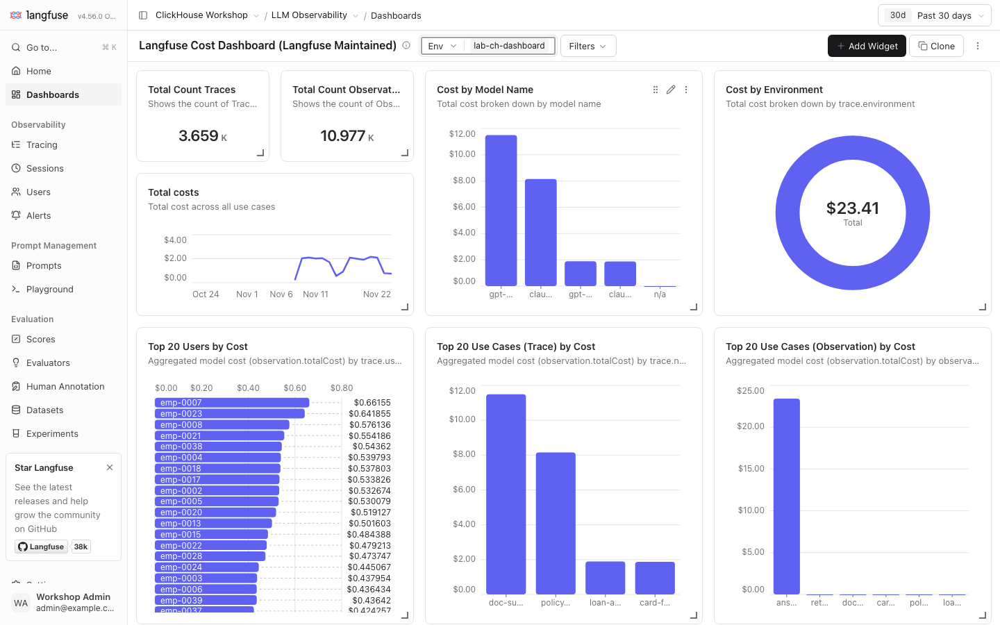
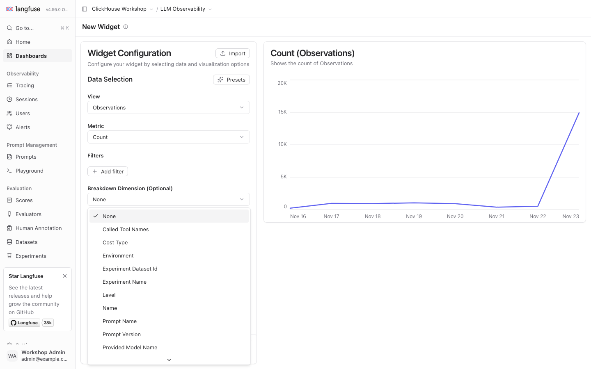
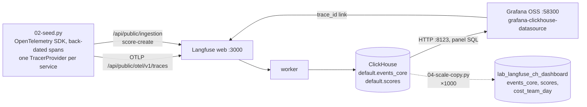
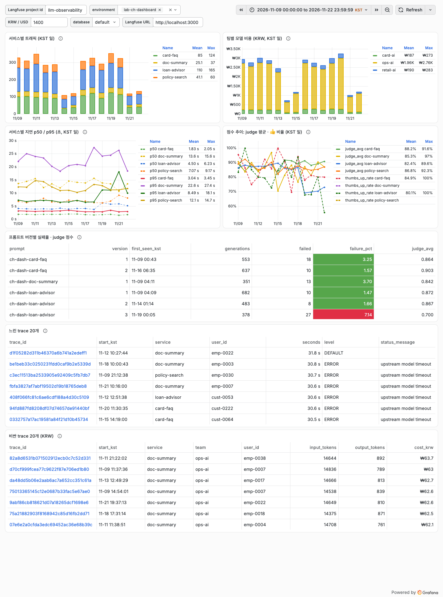
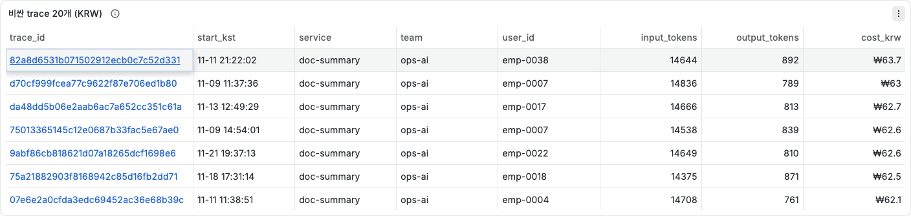
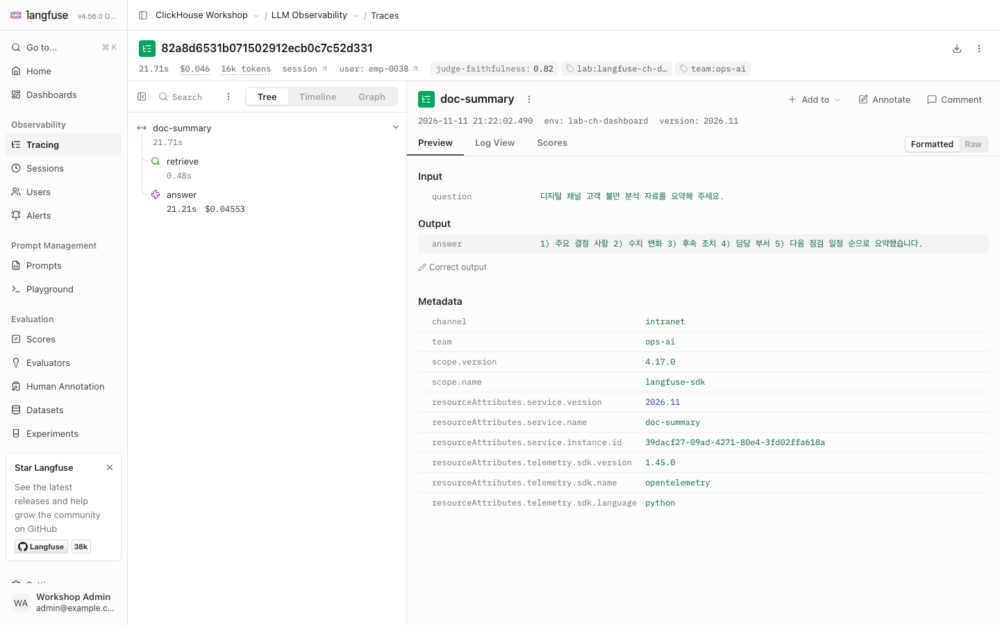

# SQL dashboards on Langfuse's ClickHouse data: KST days, KRW per team, failure rate per prompt version (Grafana OSS)

[English](#english) | [한국어](#한국어)

---

## English

**Verified end to end on 2026-11-23** with **Langfuse v4.56.0 / SDK 4.17.0 / CH 26.8.22.13** (the shared v4 stack of
[`_base/`](../../../_base/), `events_only` mode) and **Grafana OSS 13.2.6 + grafana-clickhouse-datasource 4.23.5**,
Docker 29.9.3, Python 3.12.14, Node 26.10.0 + Playwright for the captures: [07-check.py](07-check.py) passed 15 checks;
with `--fault` (one expectation inverted) it failed. Log: [lab-output.md](lab-output.md). No model is called.

### The short answer

| Question | Answer |
|---|---|
| What do Langfuse's built-in dashboards give? | Ready-made dashboards (Home, Cost, Latency, Usage Management, Agent) and a widget editor: one view (observations or scores), one metric, filters, **one** breakdown dimension, USD cost. Cost per trace name, user or model works out of the box. |
| What is missing for a Korean team? | A breakdown by a **metadata key** (team) or by `service.name` (neither is in the breakdown list), **KST days** (the widget query has no time-zone field; daily buckets come back in UTC days), **KRW**, a **ratio** such as failure rate per prompt version, and a **link** from a row to its trace. |
| Simplest free tool that does it | Grafana OSS with the official ClickHouse datasource, provisioned from files in this directory: 7 panels, 5 variables, nothing set by hand in the UI. |
| How expensive are the panels? | On Langfuse's own tables (3,659 seeded traces): 5–13 ms each. On a copy with **3.66 M traces / 11 M observations over 14 days**: 92–529 ms each on a quiet server (62–674 ms in a second quiet run); the two panels that read `team` from the metadata arrays read 6–7 GiB each. |
| The fix for those two | `team` from a tag instead of the metadata arrays: 272 → 90 ms, 6.0 → 1.0 GiB. A per-day rollup: 4 ms, 58 rows read. The two-step top-N for costly traces: 529 → 213 ms. Rollups on Langfuse's tables as such are the subject of the MV lab ([langfuse-ch-mv](../langfuse-ch-mv/)). |

### Built-in dashboards in Langfuse 4.56.0

The Cost Dashboard, filtered to this lab's environment (`lab-ch-dashboard`, past 30 days, the shortest preset that covers
the 14 seeded days; the presets are 5 min, 30 min, 1 h, 3 h, 1 d, 7 d, 30 d, 90 d, 1 y):



$23.41 in total, the same figure as `sum(calculated_total_cost)` over the generations in ClickHouse. The widget editor's
breakdown list for the observations view:



What the editor offers, read from the running 4.56.0 instance on 2026-11-23:

| | Offered |
|---|---|
| Views | Observations, Scores Numeric, Scores Categorical, Scores Boolean |
| Metrics (observations) | Count, Latency, Total/Input/Output Cost, tokens, Time To First Token, Tokens Per Second, Unique User/Session Ids, … (21) |
| Breakdown (one) | Called Tool Names, Cost Type, Environment, Experiment Dataset Id, Experiment Name, Level, Name, Prompt Name, Prompt Version, Provided Model Name, Release, Session Id, Start Time Month, Tags, Tool Names, Trace Name, Trace Release, Trace Version, Type, Usage Type, User Id, Version |
| Filters | Environment, Trace Name, Tags, User, Session, **Metadata**, Version, Release, Observation Name, Evaluator, Experiment …, Is Root Observation, Tool Names, Model, Status, Type |
| Chart types | Line, Vertical Bar, Horizontal Bar, Big Number, Histogram, Pie, Pivot Table |

Metadata is a filter, not a breakdown: cost per team takes one widget per team. The widget sends the same query object
as `GET /api/public/v2/metrics` (`dashboard.executeQuery`, `version: v2`, no time-zone field). Sent to the public API with
`granularity: day`, it returned a `2026-11-08` bucket of 32 root spans, which are exactly the spans of KST 2026-11-09
00:00–09:00 (`toDate(start_time)` in UTC: 32; `toDate(start_time, 'Asia/Seoul')` puts them on 11-09). The v1
`/api/public/metrics` answers 404 in `events_only` mode.

### What runs



| File | Does |
|---|---|
| [lib.sh](lib.sh) | Paths, `lab_compose` (Grafana only, project `lf-ch-dashboard`, on the shared stack's network), `GRAFANA_PORT=58300` |
| [lablib.py](lablib.py) | Shared Python helpers: secrets file, Langfuse public API, ClickHouse over HTTP; environment, tag and database names |
| [01-prompts.py](01-prompts.py) | Creates 4 text prompts `ch-dash-<service>` with 1–3 versions (idempotent) |
| [02-seed.py](02-seed.py) | 14 KST days (default: the 14 days up to yesterday) of Korean traces for 4 services and 3 teams, failures, 2 score types |
| [03-grafana-up.sh](03-grafana-up.sh) | Rebuilds the dashboard JSON, starts Grafana, runs one query through the datasource |
| [sql/](sql/) | The 7 panel queries, the single source of the dashboard. `.sql.tmpl`, not `.sql`: Grafana macros and `${variables}` are not ClickHouse syntax, and CI parses every tracked `.sql` |
| [build_dashboard.py](build_dashboard.py) | Writes [grafana/dashboards/langfuse-kr.json](grafana/dashboards/langfuse-kr.json) from `sql/` (`--check` fails when stale) |
| [grafana/provisioning/](grafana/provisioning/) | Datasource and dashboard provider (credentials from the container environment) |
| [04-scale-copy.py](04-scale-copy.py) | Copies the seeded rows N times (default 300; the measurements use 1000) into `lab_langfuse_ch_dashboard`, same DDL as Langfuse's tables |
| [05-measure.py](05-measure.py) | Rows/bytes read, time and memory of every panel from `system.query_log`, written to [results/](results/) |
| [06-rollup.sql](06-rollup.sql) | Per-day cost rollup (target table, MV, backfill) on the scaled copy |
| [sql-fixes/](sql-fixes/) | Faster versions of the two heaviest panels (`.sql.tmpl` as well) |
| [07-check.py](07-check.py) | 15 checks; `--fault` must fail |
| [08-captures.mjs](08-captures.mjs) | The screenshots in [captures/](captures/) |
| [99-down.sh](99-down.sh) | Removes Grafana and `lab_langfuse_ch_dashboard`; `--traces` also deletes the seeded traces |

### The seeded data

| Service (`service.name`) | Team (trace metadata `team`) | Model | Traces/weekday | Prompt versions |
|---|---|---|---:|---|
| loan-advisor | retail-ai | gpt-4.1-mini | ~140 | v1 → v2 (day 6) → v3 (day 11, 9 % failures, longer answers, lower judge score) |
| card-faq | card-ai | claude-haiku-4-5-20251001 | ~110 | v1 → v2 (day 8, fewer failures) |
| doc-summary | ops-ai | gpt-4o | ~30 | v1 (long inputs: the costly traces) |
| policy-search | ops-ai | claude-sonnet-4-5-20250929 | ~50 | v1 → v2 (day 4) |

Weekends carry 35 % of a weekday; hours follow a KST office-day curve. Each trace is a root span, a `retrieve`
retriever and an `answer` generation (model, usage, prompt name and version). Failures are generations at level `ERROR`
(`upstream model timeout` at 30 s, a JSON parse error, a guardrail block). Scores: `user-feedback` (BOOLEAN) on 22 % of
customer-facing traces, `judge-faithfulness` (NUMERIC 0–1) on 35 % of all traces, sent through the ingestion API with their
own timestamps (source `API`, not a Langfuse evaluator). Cost is Langfuse's own, from its model price table.

Why OpenTelemetry directly: the Langfuse SDK 4.17.0 has no `start_time` argument, so back-dated spans go through the
OpenTelemetry SDK with the attribute names the Langfuse SDK writes (`langfuse.observation.*`, `langfuse.trace.*`,
`user.id`, `session.id`). With the tracer scope named `langfuse-sdk`, Langfuse stores them like SDK spans (no
`attributes.*` copies in metadata); with another scope name every attribute also lands in metadata.

### Run

Needs the shared v4 stack (`_base/bin/up.sh v4`), the v4 virtual environment (`.venv-v4`, see
[_base/v4/requirements.txt](../../../_base/v4/requirements.txt)), and for the captures Node with `playwright` and Chromium.

```bash
cd labs/v4/langfuse-ch-dashboard
. ./lib.sh                                  # LF_ENV_FILE=… for another clone's _base/.env
"$PY" 01-prompts.py
"$PY" 02-seed.py                            # --end 2026-11-22 to repeat this run's window
./03-grafana-up.sh                          # http://127.0.0.1:58300/d/langfuse-kr
"$PY" 04-scale-copy.py --copies 1000        # ~1 GiB, ~7 min on the shared stack
docker exec -i "$LF_PROJECT-clickhouse-1" clickhouse-client -u "$CLICKHOUSE_USER" --password "$CLICKHOUSE_PASSWORD" --multiquery < 06-rollup.sql
"$PY" 05-measure.py --db default
"$PY" 05-measure.py --db lab_langfuse_ch_dashboard --label x1000
"$PY" 05-measure.py --db lab_langfuse_ch_dashboard --sql-dir sql-fixes --label x1000
"$PY" 07-check.py
node 08-captures.mjs                        # PLAYWRIGHT=<path>/playwright/index.mjs if not installed here
./99-down.sh                                # --traces also deletes the seeded traces
```

The dashboard's `database` variable switches every panel between Langfuse's tables (`default`) and the scaled copy.

### The dashboard



| Panel | SQL | What it answers |
|---|---|---|
| Traffic per service (KST day) | [p1](sql/p1-traffic-kst-day.sql.tmpl) | `toStartOfDay(start_time, 'Asia/Seoul')`, root observations only (`parent_span_id = ''`) |
| Model cost per team (KRW, KST day) | [p3](sql/p3-cost-team-krw.sql.tmpl) | `sum(calculated_total_cost) × ${krw_per_usd}` by `metadata_values[indexOf(metadata_names, 'team')]` |
| Latency p50 / p95 per service | [p2](sql/p2-latency-kst-day.sql.tmpl) | Root observation `end_time − start_time`; p95 of loan-advisor rises from 11-19, the day v3 shipped |
| Score trend | [p7](sql/p7-score-trend.sql.tmpl) | `judge-faithfulness` average and `user-feedback` 👍 rate; the service comes from the trace's root observation (join) |
| Failure rate and judge score per prompt version | [p4](sql/p4-failure-by-prompt.sql.tmpl) | v3 of loan-advisor: 7.14 % failed against 1.66 % for v2, judge 0.700 against 0.867 |
| 20 slowest traces | [p5](sql/p5-slow-traces.sql.tmpl) | `trace_id` links to `${langfuse_url}/project/${project}/traces/<id>` |
| 20 costliest traces (KRW) | [p6](sql/p6-costly-traces.sql.tmpl) | Same link; cost summed over the trace's generations |

`krw_per_usd` is a text variable, **1,400 by default: an example value, not a quoted rate**. Set it to the rate your
finance team uses. `project`, `environment` and `langfuse_url` are variables too.

Clicking a `trace_id` opens the trace in Langfuse. The costliest trace, ₩63.7 in Grafana, is $0.046 in Langfuse
(0.04553 × 1,400 = 63.7):





Two properties of the tables the panels rely on: v4 copies trace attributes (user, session, tags, trace metadata) onto
every observation, so no panel joins back to a trace row; `events_core` keeps the first 200 characters of input, output
and metadata values, which is enough for dashboards (full text is in `events_full`). Both are ReplacingMergeTree; the
panels do not use `FINAL`. In this run there were 0 duplicate `(project_id, span_id)` rows in `events_core` and 0
duplicate score ids.

### Query cost

Measured 2026-11-23 on the shared stack: ClickHouse 26.8.22.13 in Docker Desktop (VM: 12 CPUs, 15.6 GiB, shared with the
other containers of the stack; no CPU or memory limit on the ClickHouse container). Range 2026-11-09 00:00 … 2026-11-22
23:59:59 KST. Median of 5 runs after one warm-up, `use_query_cache = 0`, from `system.query_log`. The times below are the
run at 19:45 KST, when no other client query was running. Each panel's SQL expanded as grafana-clickhouse-datasource 4.23.5 sends it
(`$__timeFilter(c)` → `c >= toDateTime(<from>) AND c <= toDateTime(<to>)`, compared with what Grafana sent, which
`query_log` records with `grafana_panel:<id>` in `http_user_agent`). Raw tables: [results/](results/) (`*-1945.md`).

The logged end-to-end run at 20:05 KST ([lab-output.md](lab-output.md), `*-2005.md`) read exactly the same rows and bytes on
the copy, but had 1–2 queries of other sessions running on the same server and took 126–1,479 ms per panel (p6 1,479,
p7 1,347, p4 566). A third run at 20:16 KST, after renaming the panel files to `.sql.tmpl`, was quiet again and took
62–674 ms (p6 674, p7 644; `*-2016.md`). On a shared server the time moves; the bytes read do not.

| Panel | Langfuse tables: 3,659 traces, 10,977 observations | ms | Copy ×1000: 3.66 M traces, 10.98 M observations | ms | Peak memory |
|---|---:|---:|---:|---:|---:|
| p1 traffic | 12,361 rows · 0.6 MiB | 6 | 10.98 M rows · 531 MiB | 132 | 15 MiB |
| p2 latency p50/p95 | 12,361 · 0.7 MiB | 8 | 10.98 M · 626 MiB | 92 | 28 MiB |
| p3 cost per team | 12,361 · 6.9 MiB | 8 | 10.98 M · **6,047 MiB** | 272 | 69 MiB |
| p4 failure per prompt version | 15,242 · 1.2 MiB | 8 | 12.40 M · 951 MiB | 329 | 397 MiB |
| p5 slowest traces | 24,722 · 1.4 MiB | 5 | 11.02 M · 933 MiB | 103 | 10 MiB |
| p6 costliest traces | 12,361 · 7.8 MiB | 6 | 10.98 M · **6,848 MiB** | 529 | 710 MiB |
| p7 score trend | 15,242 · 1.3 MiB | 13 | 12.86 M · 1,071 MiB | 283 | 692 MiB |

The Langfuse column reads more rows than the lab's 10,977 because the project also holds other labs' traces in the same
granules. Every panel reads all observations of the range: `environment`, `type` and `parent_span_id` are not in the
sort key `(project_id, toStartOfMinute(start_time), xxHash32(trace_id), …)`, so only project and time prune granules.

p3 and p6 read 6–7 GiB because `team` lives in `metadata_names` / `metadata_values`: on the ×1000 copy those two columns
hold 3.51 GiB and 2.01 GiB uncompressed, the largest columns of the table (they also carry the OpenTelemetry
resource attributes of every span).

### Fixing the two heavy panels

| Variant (copy ×1000) | Rows read | Bytes read | ms | Peak memory |
|---|---:|---:|---:|---:|
| p3 as is: `team` from metadata | 10.98 M | 6,047 MiB | 272 | 69 MiB |
| [p3 A](sql-fixes/p3-cost-team-krw.tags.sql.tmpl): `team` from the tag `team:<name>` | 10.98 M | 1,043 MiB | 90 | 17 MiB |
| [p3 B](sql-fixes/p3-cost-team-krw.rollup.sql.tmpl): from the rollup [06-rollup.sql](06-rollup.sql) | 58 | 0.0 MiB | 4 | 8 MiB |
| p6 as is | 10.98 M | 6,848 MiB | 529 | 710 MiB |
| [p6 two-step](sql-fixes/p6-costly-traces.two-step.sql.tmpl): top 20 ids on narrow columns, then wide columns for those 20 | 12.83 M | 842 MiB | 213 | 345 MiB |

[07-check.py](07-check.py) asserts that each fix returns exactly the rows of the panel it replaces. In the two-step query,
the second pass uses the `idx_trace_id` bloom filter of `events_core`: `EXPLAIN indexes = 1` for two trace ids kept 34 of
1,844 granules of the copy. Fix A needs the team
in the trace tags as well (here the seed writes both). Fix B moves the work to insert time; this lab builds the rollup only
on its own copy. An MV on Langfuse's own `events_core`, and what happens to it when Langfuse rewrites rows or an exporter
retries, is the MV lab's subject ([langfuse-ch-mv](../langfuse-ch-mv/)), not repeated here.

---

## 한국어

**2026-11-23에 처음부터 끝까지 검증**했습니다. **Langfuse v4.56.0 / SDK 4.17.0 / CH 26.8.22.13**(공용 v4 스택
[`_base/`](../../../_base/), `events_only` 모드), **Grafana OSS 13.2.6 + grafana-clickhouse-datasource 4.23.5**,
Docker 29.9.3, Python 3.12.14, 화면 캡처용 Node 26.10.0 + Playwright. [07-check.py](07-check.py)의 검사 15개가 통과했고,
`--fault`(기대값 하나를 뒤집음)로는 실패했습니다. 실행 기록: [lab-output.md](lab-output.md). 모델은 호출하지 않습니다.

### 요약

| 질문 | 답 |
|---|---|
| Langfuse 기본 대시보드는 무엇을 주나 | 기본 대시보드(Home, Cost, Latency, Usage Management, Agent)와 위젯 편집기: 뷰 하나(observations 또는 scores), 지표 하나, 필터, 분해(breakdown) 차원 **하나**, USD 비용. trace 이름·사용자·모델별 비용은 바로 됩니다. |
| 한국 팀에게 빠진 것 | **메타데이터 키**(팀)나 `service.name` 기준 분해(분해 목록에 없음), **KST 일 단위**(위젯 쿼리에 시간대 필드가 없고 일 단위 버킷이 UTC 날짜로 옴), **원화**, 프롬프트 버전별 실패율 같은 **비율**, 행에서 trace로 가는 **링크** |
| 가장 간단한 무료 도구 | Grafana OSS + 공식 ClickHouse 데이터소스. 이 디렉터리의 파일로 프로비저닝하며 패널 7개, 변수 5개, UI에서 손으로 설정하는 것은 없습니다. |
| 패널 비용 | Langfuse 테이블(넣은 trace 3,659개)에서는 패널당 5–13 ms. **trace 366만 개 / observation 1,098만 개(14일)** 복사본에서는 다른 쿼리가 없는 서버에서 92–529 ms(두 번째 조용한 실행에서는 62–674 ms). 메타데이터 배열에서 `team`을 꺼내는 두 패널은 각각 6–7 GiB를 읽습니다. |
| 그 두 패널의 해결 | 메타데이터 대신 태그에서 `team`: 272 → 90 ms, 6.0 → 1.0 GiB. 일별 rollup: 4 ms, 58행. 비싼 trace는 두 단계 top-N: 529 → 213 ms. Langfuse 테이블 위의 rollup 자체는 MV 실습에서 다룹니다([langfuse-ch-mv](../langfuse-ch-mv/)). |

### Langfuse 4.56.0 기본 대시보드

Cost Dashboard를 이 실습의 environment(`lab-ch-dashboard`)로 거르고 기간은 지난 30일(넣은 14일을 덮는 가장 짧은
프리셋. 프리셋은 5분, 30분, 1시간, 3시간, 1일, 7일, 30일, 90일, 1년):


합계 $23.41은 ClickHouse에서 generation의 `sum(calculated_total_cost)`와 같습니다. 위젯 편집기의 observations 뷰
분해 차원 목록:


2026-11-23에 실행 중인 4.56.0에서 읽은 편집기 선택지:

| | 제공 |
|---|---|
| 뷰 | Observations, Scores Numeric, Scores Categorical, Scores Boolean |
| 지표(observations) | Count, Latency, Total/Input/Output Cost, 토큰, Time To First Token, Tokens Per Second, Unique User/Session Ids 등 21개 |
| 분해(하나) | Called Tool Names, Cost Type, Environment, Experiment Dataset Id, Experiment Name, Level, Name, Prompt Name, Prompt Version, Provided Model Name, Release, Session Id, Start Time Month, Tags, Tool Names, Trace Name, Trace Release, Trace Version, Type, Usage Type, User Id, Version |
| 필터 | Environment, Trace Name, Tags, User, Session, **Metadata**, Version, Release, Observation Name, Evaluator, Experiment 관련, Is Root Observation, Tool Names, Model, Status, Type |
| 차트 | Line, Vertical Bar, Horizontal Bar, Big Number, Histogram, Pie, Pivot Table |

메타데이터는 필터일 뿐 분해 기준이 아니어서 팀별 비용은 팀마다 위젯을 하나씩 만들어야 합니다. 위젯은
`GET /api/public/v2/metrics`와 같은 쿼리 객체를 보냅니다(`dashboard.executeQuery`, `version: v2`, 시간대 필드 없음).
같은 쿼리를 `granularity: day`로 공개 API에 보내자 `2026-11-08` 버킷에 root span 32개가 나왔고, 이는 정확히 KST
2026-11-09 00:00–09:00의 span입니다(UTC `toDate(start_time)`로 32개, `toDate(start_time, 'Asia/Seoul')`로는 11-09).
v1 `/api/public/metrics`는 `events_only` 모드에서 404를 돌려줍니다.

### 구성

위 영어 절의 다이어그램과 파일 표를 그대로 씁니다. 요점만 적으면 다음과 같습니다.

- [02-seed.py](02-seed.py)가 OpenTelemetry SDK로 과거 시각의 span을 Langfuse OTLP 엔드포인트에 보내고, 점수는
  ingestion API로 따로 보냅니다. 서비스마다 TracerProvider가 달라 `service.name`(`service_name` 열)이 서비스별로 다릅니다.
- Grafana는 공용 스택의 네트워크에 붙어 `clickhouse:8123`으로 질의합니다. 데이터소스와 대시보드는
  [grafana/provisioning/](grafana/provisioning/)과 [sql/](sql/)에서 만들어집니다(`build_dashboard.py`가 JSON 생성).
- [04-scale-copy.py](04-scale-copy.py)는 넣은 행을 N배로 `lab_langfuse_ch_dashboard`에 복사합니다(Langfuse 테이블과
  같은 DDL). Langfuse 테이블은 읽기만 합니다.
- 패널 SQL([sql/](sql/), [sql-fixes/](sql-fixes/))은 `.sql.tmpl`입니다. Grafana 매크로와 `${변수}`는 ClickHouse 문법이 아니고,
  CI가 추적되는 `.sql` 파일을 모두 파싱하기 때문입니다.

### 넣는 데이터

| 서비스(`service.name`) | 팀(trace 메타데이터 `team`) | 모델 | 평일 trace 수 | 프롬프트 버전 |
|---|---|---|---:|---|
| loan-advisor | retail-ai | gpt-4.1-mini | 약 140 | v1 → v2(6일째) → v3(11일째, 실패 9 %, 긴 답, 낮은 judge 점수) |
| card-faq | card-ai | claude-haiku-4-5-20251001 | 약 110 | v1 → v2(8일째, 실패 감소) |
| doc-summary | ops-ai | gpt-4o | 약 30 | v1(긴 입력: 비싼 trace) |
| policy-search | ops-ai | claude-sonnet-4-5-20250929 | 약 50 | v1 → v2(4일째) |

주말은 평일의 35 %이고 시간대는 KST 업무일 곡선을 따릅니다. trace 하나는 root span, `retrieve`(retriever),
`answer`(generation: 모델, 사용량, 프롬프트 이름과 버전)로 이뤄집니다. 실패는 level `ERROR`인 generation입니다
(30초 `upstream model timeout`, JSON 파싱 실패, 가드레일 차단). 점수는 고객용 trace의 22 %에 `user-feedback`(BOOLEAN),
전체 trace의 35 %에 `judge-faithfulness`(NUMERIC 0–1)를 각자의 시각으로 ingestion API로 넣습니다(source `API`.
Langfuse evaluator가 매긴 점수가 아닙니다). 비용은 Langfuse가 모델 가격표로 계산한 값입니다.

OpenTelemetry를 직접 쓰는 이유: Langfuse SDK 4.17.0에는 `start_time` 인자가 없어서, 과거 시각의 span은 Langfuse
SDK가 쓰는 속성 이름(`langfuse.observation.*`, `langfuse.trace.*`, `user.id`, `session.id`) 그대로 OpenTelemetry SDK로
보냅니다. tracer scope 이름을 `langfuse-sdk`로 두면 Langfuse가 SDK span처럼 저장하고(메타데이터에 `attributes.*`
복사본 없음), 다른 이름이면 모든 속성이 메타데이터에도 들어갑니다.

### 실행

공용 v4 스택(`_base/bin/up.sh v4`), v4 가상환경(`.venv-v4`, [_base/v4/requirements.txt](../../../_base/v4/requirements.txt)),
캡처에는 `playwright`와 Chromium이 있는 Node가 필요합니다. 명령은 영어 절의 [Run](#run)과 같습니다. 대시보드의
`database` 변수로 모든 패널을 Langfuse 테이블(`default`)과 복사본 사이에서 바꿀 수 있습니다.

### 대시보드


| 패널 | SQL | 내용 |
|---|---|---|
| 서비스별 트래픽(KST 일) | [p1](sql/p1-traffic-kst-day.sql.tmpl) | `toStartOfDay(start_time, 'Asia/Seoul')`, root observation만(`parent_span_id = ''`) |
| 팀별 모델 비용(원, KST 일) | [p3](sql/p3-cost-team-krw.sql.tmpl) | `metadata_values[indexOf(metadata_names, 'team')]`별 `sum(calculated_total_cost) × ${krw_per_usd}` |
| 서비스별 지연 p50 / p95 | [p2](sql/p2-latency-kst-day.sql.tmpl) | root observation의 `end_time − start_time`. loan-advisor p95가 v3가 나간 11-19부터 오릅니다 |
| 점수 추이 | [p7](sql/p7-score-trend.sql.tmpl) | `judge-faithfulness` 평균과 `user-feedback` 👍 비율. 서비스는 trace의 root observation에서(join) |
| 프롬프트 버전별 실패율 · judge 점수 | [p4](sql/p4-failure-by-prompt.sql.tmpl) | loan-advisor v3 실패 7.14 %(v2는 1.66 %), judge 0.700(v2는 0.867) |
| 느린 trace 20개 | [p5](sql/p5-slow-traces.sql.tmpl) | `trace_id`가 `${langfuse_url}/project/${project}/traces/<id>`로 연결 |
| 비싼 trace 20개(원) | [p6](sql/p6-costly-traces.sql.tmpl) | 같은 링크. 비용은 trace의 generation 합 |

`krw_per_usd`는 텍스트 변수이며 **기본값 1,400은 예시 값일 뿐 실제 환율이 아닙니다**. 재무팀이 쓰는 환율로 바꿔 쓰세요.
`project`, `environment`, `langfuse_url`도 변수입니다.

`trace_id`를 누르면 Langfuse의 trace 화면이 열립니다. Grafana에서 ₩63.7인 가장 비싼 trace는 Langfuse에서
$0.046입니다(0.04553 × 1,400 = 63.7).


패널이 기대는 테이블 성질 두 가지: v4는 trace 속성(사용자, 세션, 태그, trace 메타데이터)을 모든 observation에
복사하므로 어느 패널도 trace 행으로 되돌아가 join하지 않습니다. `events_core`는 input, output, 메타데이터 값의 앞
200자만 담는데 대시보드에는 충분합니다(전체 본문은 `events_full`). 두 테이블 모두 ReplacingMergeTree이고 패널은
`FINAL`을 쓰지 않습니다. 이번 실행에서 `events_core`의 `(project_id, span_id)` 중복은 0행, 점수 id 중복도 0행이었습니다.

### 쿼리 비용

2026-11-23, 공용 스택에서 측정했습니다. Docker Desktop의 ClickHouse 26.8.22.13(VM: CPU 12개, 15.6 GiB, 스택의 다른
컨테이너와 공유, ClickHouse 컨테이너에 CPU·메모리 제한 없음). 기간 2026-11-09 00:00 … 2026-11-22 23:59:59 KST.
예열 1회 뒤 5회의 중앙값, `use_query_cache = 0`, `system.query_log` 값입니다. 아래 시간은 다른 클라이언트의 쿼리가 없던
19:45 KST 실행의 값입니다. 각 패널 SQL은 grafana-clickhouse-datasource 4.23.5가 보내는 형태로 펼쳤습니다
(`$__timeFilter(c)` → `c >= toDateTime(<from>) AND c <= toDateTime(<to>)`. Grafana가 보낸 쿼리와 비교했고, `query_log`의
`http_user_agent`에 `grafana_panel:<id>`가 남습니다). 원자료: [results/](results/)(`*-1945.md`).

기록을 남긴 20:05 KST 종단 실행([lab-output.md](lab-output.md), `*-2005.md`)은 복사본에서 읽은 행과 바이트가 정확히 같았지만,
같은 서버에서 다른 세션의 쿼리가 1–2개 돌고 있어 패널당 126–1,479 ms가 걸렸습니다(p6 1,479, p7 1,347, p4 566). 패널 파일 이름을
`.sql.tmpl`로 바꾼 뒤 20:16 KST에 다시 돌린 세 번째 실행은 다른 쿼리가 없었고 62–674 ms였습니다(p6 674, p7 644, `*-2016.md`).
공유 서버에서 시간은 흔들려도 읽는 바이트는 그대로입니다.

| 패널 | Langfuse 테이블: trace 3,659 / observation 10,977 | ms | 복사본 ×1000: trace 366만 / observation 1,098만 | ms | 최대 메모리 |
|---|---:|---:|---:|---:|---:|
| p1 트래픽 | 12,361행 · 0.6 MiB | 6 | 1,098만 행 · 531 MiB | 132 | 15 MiB |
| p2 지연 p50/p95 | 12,361 · 0.7 MiB | 8 | 1,098만 · 626 MiB | 92 | 28 MiB |
| p3 팀별 비용 | 12,361 · 6.9 MiB | 8 | 1,098만 · **6,047 MiB** | 272 | 69 MiB |
| p4 프롬프트 버전별 실패 | 15,242 · 1.2 MiB | 8 | 1,240만 · 951 MiB | 329 | 397 MiB |
| p5 느린 trace | 24,722 · 1.4 MiB | 5 | 1,102만 · 933 MiB | 103 | 10 MiB |
| p6 비싼 trace | 12,361 · 7.8 MiB | 6 | 1,098만 · **6,848 MiB** | 529 | 710 MiB |
| p7 점수 추이 | 15,242 · 1.3 MiB | 13 | 1,286만 · 1,071 MiB | 283 | 692 MiB |

Langfuse 열이 실습의 10,977행보다 많이 읽는 것은 같은 프로젝트의 다른 실습 trace가 같은 그래뉼에 있기 때문입니다.
모든 패널이 기간 안의 observation을 전부 읽습니다. `environment`, `type`, `parent_span_id`가 정렬 키
`(project_id, toStartOfMinute(start_time), xxHash32(trace_id), …)`에 없어서 그래뉼을 걸러 내는 것은 프로젝트와 시간뿐입니다.

p3와 p6가 6–7 GiB를 읽는 이유는 `team`이 `metadata_names` / `metadata_values`에 있기 때문입니다. ×1000 복사본에서 이 두
열은 압축 전 3.51 GiB와 2.01 GiB로 테이블에서 가장 큰 열입니다(모든 span의 OpenTelemetry resource 속성도
여기에 들어갑니다).

### 무거운 두 패널 고치기

| 방법(복사본 ×1000) | 읽은 행 | 읽은 바이트 | ms | 최대 메모리 |
|---|---:|---:|---:|---:|
| p3 그대로: 메타데이터에서 `team` | 1,098만 | 6,047 MiB | 272 | 69 MiB |
| [p3 A](sql-fixes/p3-cost-team-krw.tags.sql.tmpl): 태그 `team:<이름>`에서 | 1,098만 | 1,043 MiB | 90 | 17 MiB |
| [p3 B](sql-fixes/p3-cost-team-krw.rollup.sql.tmpl): rollup [06-rollup.sql](06-rollup.sql)에서 | 58 | 0.0 MiB | 4 | 8 MiB |
| p6 그대로 | 1,098만 | 6,848 MiB | 529 | 710 MiB |
| [p6 두 단계](sql-fixes/p6-costly-traces.two-step.sql.tmpl): 좁은 열로 상위 20개 id, 그 20개만 넓은 열 | 1,283만 | 842 MiB | 213 | 345 MiB |

[07-check.py](07-check.py)는 고친 쿼리가 원래 패널과 정확히 같은 행을 돌려주는지 확인합니다. 두 단계 쿼리의 두 번째
읽기는 `events_core`의 `idx_trace_id` bloom filter를 씁니다. trace id 두 개로 `EXPLAIN indexes = 1`을 돌리면 복사본의 그래뉼
1,844개 중 34개만 남았습니다. A는 팀이 trace 태그에도
있어야 합니다(이 실습의 seed는 둘 다 씁니다). B는 일을 적재 시점으로 옮깁니다. 이 실습은 자기 복사본에만 rollup을
만듭니다. Langfuse의 `events_core`에 직접 거는 MV와, Langfuse가 행을 다시 쓰거나 exporter가 재시도할 때 생기는 일은
MV 실습에서 다루므로([langfuse-ch-mv](../langfuse-ch-mv/)) 여기서는 반복하지 않습니다.
