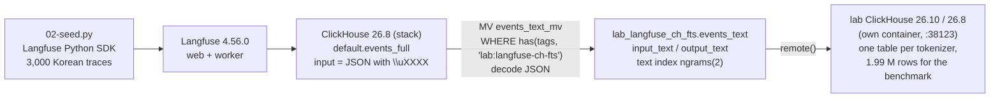
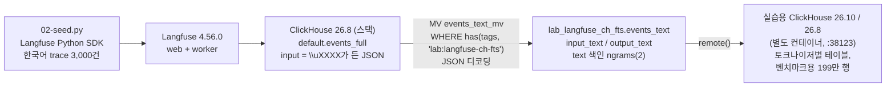

# Full-text search over Langfuse v4 prompts and responses in ClickHouse, with Korean text

[English](#english) | [한국어](#한국어)

---

## English

**Verified end to end on 2026-11-23** with **Langfuse v4.56.0 / SDK 4.17.0 / CH 26.8.22.13** (the shared v4 stack, `events_only` mode) and the lab's own **ClickHouse 26.10.10.3** (benchmark repeated on 26.8.22.13), Docker 29.9.3, Python 3.12.14 (seed) and 3.9.6 (stdlib scripts), from an empty lab database and no lab traces: [08-check.py](08-check.py) passed 34 checks; with `--fault` 3 of them failed. Log: [lab-output.md](lab-output.md).

### The short answer

| Question | Answer |
|---|---|
| Since which ClickHouse release is the `text` index GA? | **26.2** (released 2026-02-26): *"The text index is now GA."* ([#96794](https://github.com/ClickHouse/ClickHouse/pull/96794)). It went beta in 25.11 ([#88928](https://github.com/ClickHouse/ClickHouse/pull/88928)). What arrived in **26.9** is that supported `LIKE` and `ILIKE` patterns can use a text index ([#114728](https://github.com/ClickHouse/ClickHouse/pull/114728)). See [How the release was confirmed](#how-the-release-was-confirmed). |
| When did Langfuse get its own full-text search, and what does it need? | **v4.0.0** (2026-07-29): the release notes list *full-text search across inputs, outputs, and metadata* among the v4 features. Langfuse v4 needs **ClickHouse 25.12 or newer** ("required for lightweight updates, the JSON type, and full-text search", upgrade guide and ClickHouse page of the self-hosting docs); its read client sets `enable_full_text_index = 1` and the text-index caches (`client.ts`). The UI search bar and the Observations API v2 `matches` operator both use it. See [Langfuse's built-in search](#langfuses-built-in-search-measured-on-korean). |
| Does Langfuse already index prompts and responses? | Yes. Migration `0039_create_events_full` creates `events_full` with `INDEX idx_fts_input_low lower(input) TYPE text(tokenizer = splitByNonAlpha)` and the same on `output`; the UI's content search uses it through `hasAllTokens`. |
| Does that index work for Korean? | Only where the text is a word on its own. `splitByNonAlpha` keeps a Korean word and its particle together (`중도상환수수료는` is one token), so a search for the bare word misses it. In the UI, `content:중도상환수수료` returned **No results** on the 3,000 `answer-generation` observations, 188 of which contain the word. |
| Why did the same search find the root spans? | The Python SDK writes dict and list values as JSON with `\uXXXX` escapes. There every Hangul syllable becomes its own token (`uc911`, `ub3c4`, …), and Langfuse also searches the escaped form of the query, so those rows match. Plain-string values (a generation's `output` string) are stored as Hangul and miss. |
| Which tokenizer suits Korean? | `ngrams(2)` with `hasAllTokens` found every occurrence of seven terms of two or more syllables, with false positives where the bigrams occur apart (환불요청: +317 rows). `asciiCJK` (one token per syllable) with `hasPhrase` was **exact on all eight terms**, the one-syllable `앱` included. `icu('ko')` behaves like `splitByNonAlpha` for Hangul. |
| How much faster than `LIKE`? | On 1.99 M rows (26.10.10.3, median of 5, laptop shared with other labs): `hasAllTokens` on `ngrams(2)` took 35 ms for 대출 (347,160 rows) against 171 ms for `LIKE` on the table without an index, and 2 ms against 53 ms for a 28-row error code, reading 122,880 instead of 1,992,540 rows. The index costs 166 MiB, 19 % of the uncompressed text. |
| Where should the index live? | On a copy in your own database, kept current by a materialized view on `events_full` — not added to Langfuse's table. The copy also stores the decoded text, which no index on `events_full.input` can see. See [Why a copy](#why-a-copy-and-not-alter-table-events_full). |
| Does the API's `matches` find Korean? | Rarely. `matches` checks `position()` plus `hasAllTokens` on the stored text, with no escaped-form retry: Korean in the SDK's escaped JSON is never found, and plain strings only where the word stands alone (`중도상환수수료`: 0 of 659 rows; `중도상환수수료는`: 188 of 188 `answer-generation` outputs). ASCII terms are found everywhere. |
| Does the copy follow deletes? | No. Langfuse deletes a trace with a lightweight `DELETE FROM events_full …`; an MV sees inserts only. After `DELETE /api/public/traces` the copy still had the trace until the lab's reconcile `DELETE` removed it. |

### What runs



| File | Does |
|---|---|
| [lib.sh](lib.sh) · [lablib.py](lablib.py) | Paths, credentials from `_base/.env`, HTTP helpers for the stack's ClickHouse (`LF`, port 8123) and the lab's own (`FTS`, port 38123) |
| [01-up.sh](01-up.sh) | Starts the lab's own ClickHouse (`FTS_IMAGE`, default `26.10.10.3`, 3 GiB cap) next to the running v4 stack; does not touch the stack |
| [02-seed.py](02-seed.py) | 3,000 Korean support-chat traces, offline, tagged `lab:langfuse-ch-fts`: root span (`{"question"}` → `{"answer"}`), `retrieve-context` (knowledge-base passages), `answer-generation` (messages → answer string) |
| [03-copy-mv.sql](03-copy-mv.sql) | On the stack's server: database `lab_langfuse_ch_fts`, the copy `events_text` with decoded text and `ngrams(2)` indexes, the MV, the backfill |
| [04-tokenizers.py](04-tokenizers.py) | `tokens()` per tokenizer on both servers; one indexed table per tokenizer (9,000 rows) and eight terms against the truth; Langfuse's UI predicate on `events_full` |
| [05-mv-live.py](05-mv-live.py) | 20 new traces through Langfuse reach the copy; a trace deleted through the API stays in the copy until a reconcile `DELETE` |
| [06-langfuse-search.py](06-langfuse-search.py) | Langfuse's built-in search for real: Observations API v2 `matches` on `input` and `output` for eight Korean and ASCII terms, scored per observation name against the truth and the copy's index |
| [07-bench.py](07-bench.py) | `LIKE` / `ILIKE` / `hasToken` / the UI predicate / `hasAllTokens` / `hasPhrase` on 1.99 M rows, four tables that differ only in their index; median of 5 runs from `system.query_log` |
| [08-check.py](08-check.py) | 34 checks on the live servers and the `.run/` results; `--fault` inverts two expectations and must fail |
| [99-down.sh](99-down.sh) | Removes the lab container and drops `lab_langfuse_ch_fts`; `--traces` also deletes the seeded traces through the public API |
| [lab-output.md](lab-output.md) · [results/](results/) | The log of the verified run and its JSON results (`tokenizers.json`, `mv-live.json`, `bench-<version>.json`) |

### Run

Needs the shared v4 stack up (`_base/bin/up.sh v4`), Docker, Python 3.10+ with the v4 venv (`_base/v4/requirements.txt`). No model calls, nothing paid.

```bash
labs/v4/langfuse-ch-fts/01-up.sh
.venv-v4/bin/python labs/v4/langfuse-ch-fts/02-seed.py
python3 labs/v4/langfuse-ch-fts/lablib.py LF labs/v4/langfuse-ch-fts/03-copy-mv.sql
python3 labs/v4/langfuse-ch-fts/04-tokenizers.py
LAB_PYTHON=.venv-v4/bin/python python3 labs/v4/langfuse-ch-fts/05-mv-live.py
python3 labs/v4/langfuse-ch-fts/06-langfuse-search.py
python3 labs/v4/langfuse-ch-fts/07-bench.py
FTS_IMAGE=26.8.22.13 labs/v4/langfuse-ch-fts/01-up.sh && python3 labs/v4/langfuse-ch-fts/07-bench.py   # optional: same benchmark on 26.8
python3 labs/v4/langfuse-ch-fts/08-check.py
python3 labs/v4/langfuse-ch-fts/08-check.py --fault   # must FAIL
labs/v4/langfuse-ch-fts/99-down.sh --traces
```

Wait for the 9,000 rows to arrive in `events_full` before step 03 (a few seconds). `LF_ENV_FILE=<path>` points the scripts at another clone's `_base/.env`.

### How the release was confirmed

Read on 2026-11-23 from `CHANGELOG.md` on ClickHouse `master` and the docs pages below; not from memory.

| Release | Changelog line |
|---|---|
| 25.11 (2025-11-27) | "Full-text search is now in beta (from a previously experimental stage)." #88928 |
| 25.12 (2025-12-18) | "Introduce Text index format v3 and promote it to Beta status." |
| **26.2** (2026-02-26) | **"The text index is now GA."** #96794 — the docs page: "Text indexes are generally available (GA) in ClickHouse version 26.2 and newer." |
| 26.4 (2026-04-30) | "The text index is now GA and stays enabled regardless of the `compatibility` setting" #101518 |
| 26.8 (2026-08-27) | `icu`, `chinese`, `japanese` and `splitByRegexp` tokenizers |
| 26.9 (2026-09-21) | "Supported `LIKE` and `ILIKE` patterns can now use text indexes." #114728 |
| 26.10 (2026-10-22) | faster `LIKE`/`ILIKE` dictionary scans, `pfor` posting-list codec (opt-in; default from 26.11) |

On both servers of this lab `enable_full_text_index` is `1` without any setting, and `allow_experimental_text_index_phrase_search` (positions for `hasPhrase`) is `0`. `LIKE` on a text-indexed column skipped granules on **26.8.22.13** as well: `lower(content) LIKE '%…%'` on the `ngrams(2)` table selected the same granules on 26.8.22.13 as on 26.10.10.3. Whether 26.8 got #114728 as a backport or used the index as a hint before it was not checked.

### What Langfuse stores, and what its index sees

Langfuse 4.56.0 keeps every observation in `events_full` (`events_core` truncates `input`/`output` to 200 characters, so search needs `events_full`). For the seeded traces, Python SDK 4.17.0 wrote:

| Observation | `input` | `output` |
|---|---|---|
| `support-chat` (root) | `{"question": "\uce74\ub4dc\uac00…"}` | `{"answer": "\uc911\ub3c4…"}` |
| `retrieve-context` | `{"query": "\uce74\ub4dc\uac00…"}` | `{"docs": ["[loan-02] \uc911\ub3c4…"]}` |
| `answer-generation` | `[{"role": "system", "content": "\ub2f9\uc2e0…"}, …]` | `중도상환수수료는 …` (plain string) |

So `input LIKE '%대출%'` finds **0** of the seeded inputs; the escaped form `\ub300\ucd9c` finds them. The UI's content search (`packages/shared/src/server/queries/clickhouse-sql/search.ts` and `fts.ts` at v4.56.0) is, per column:

```sql
(col ILIKE '%q%' AND hasAllTokens(lower(col), arraySlice(arrayDistinct(tokens(lower('%q%'))), 1, 64)))
OR (col ILIKE '%<q as \uXXXX>%' AND hasAllTokens(lower(col), …tokens of the escaped q…))
```

That predicate, run on `events_full` for the 3,000 seeded traces (`04-tokenizers.py`, step 4; found / truth):

| Term | `support-chat` | `retrieve-context` | `answer-generation` |
|---|---|---|---|
| 중도상환수수료 | 188 / 188 | 283 / 283 | 0 / 188 |
| 주택담보대출 | 233 / 233 | 316 / 316 | 87 / 233 |
| OTP | 370 / 370 | 442 / 442 | 283 / 370 |
| 대출 | 524 / 524 | 524 / 524 | 524 / 524 |

The escaped JSON matches because `splitByNonAlpha` cuts `\uc911\ub3c4` at every backslash, so each syllable is a token; the plain-string `output` of `answer-generation` has `중도상환수수료는` as one token and misses. The two screenshots in the notes article show the same in the UI.

### Langfuse's built-in search, measured on Korean

**Which version, and how it was confirmed (read 2026-11-23):** the GitHub release notes of `v4.0.0` (2026-07-29) list full-text search across inputs, outputs and metadata as a v4 feature; the Langfuse docs page *Full-Text Search* says it uses ClickHouse text indexes, matches whole words rather than substrings, and offers the `matches` operator in the Observations API v2; the self-hosting docs (*Upgrade v3 to v4*, *ClickHouse*) set **ClickHouse 25.12** as the v4 minimum for it. In the source, migration `0039_create_events_full` creates the `splitByNonAlpha` indexes (identical at v4.56.0 and v4.83.0, the latest release, 2026-11-19), and the events read client sets `enable_full_text_index = 1`, `use_text_index_dictionary_cache`, `use_text_index_header_cache` and `use_text_index_postings_cache` (`packages/shared/src/server/clickhouse/client.ts`). Between v4.56.0 and v4.83.0 the search predicates did not change in substance: v4.83.0 passes the search values through `escapeSqlLikePattern` first and builds the API filter through a new query AST (`events-predicate.ts`) with the same `matches` expression. Running that v4.83.0 form of the UI predicate on the same data gave the same counts as v4.56.0 (`04-tokenizers.py` step 4). **Langfuse 4.83.0 itself was not run**: the shared stack stays on 4.56.0, and a second stack (web, worker, Postgres, Redis, MinIO, ClickHouse) was too large for the shared Docker VM.

The Observations API v2 `matches` operator, called on the stack (`06-langfuse-search.py`; API found / truth, and the copy's `ngrams(2)` index in brackets; seeded batch only):

| Term | Column | `support-chat` | `retrieve-context` | `answer-generation` |
|---|---|---|---|---|
| 중도상환수수료 | `input` | 0 / 0 (0) | 0 / 0 (0) | 0 / 0 (0) |
| 중도상환수수료 | `output` | 0 / 188 (188) | 0 / 283 (283) | 0 / 188 (188) |
| 중도상환수수료는 | `input` | 0 / 0 (0) | 0 / 0 (0) | 0 / 0 (0) |
| 중도상환수수료는 | `output` | 0 / 188 (188) | 0 / 283 (283) | 188 / 188 (188) |
| 주택담보대출 | `input` | 0 / 87 (87) | 0 / 87 (87) | 0 / 87 (87) |
| 주택담보대출 | `output` | 0 / 181 (181) | 0 / 273 (273) | 0 / 181 (181) |
| 대출 | `input` | 0 / 524 (524) | 0 / 524 (524) | 0 / 524 (524) |
| 대출 | `output` | 0 / 524 (524) | 0 / 524 (524) | 389 / 524 (524) |
| 환불요청 | `input` | 0 / 132 (132) | 0 / 132 (132) | 0 / 132 (132) |
| 환불요청 | `output` | 0 / 252 (392) | 0 / 399 (532) | 252 / 252 (392) |
| OTP | `input` | 168 / 168 (168) | 168 / 168 (168) | 168 / 168 (168) |
| OTP | `output` | 311 / 311 (311) | 424 / 424 (424) | 182 / 311 (311) |
| timeout | `input` | 128 / 128 (128) | 128 / 128 (128) | 128 / 128 (128) |
| timeout | `output` | 270 / 270 (270) | 393 / 393 (393) | 270 / 270 (270) |
| 앱 | `input` | 0 / 469 (0) | 0 / 469 (0) | 0 / 469 (0) |
| 앱 | `output` | 0 / 1,067 (0) | 0 / 1,407 (0) | 392 / 1,067 (0) |

- **Korean in JSON-escaped values is never found by `matches`.** Its predicate is `position(lower(col), lower(q)) > 0 AND hasAllTokens(lower(col), q)` on the stored text, and the stored text has no Hangul. The UI search adds a second try with the escaped query; `matches` does not.
- **In plain strings, only a word that stands alone is found.** `중도상환수수료는` (with the particle) finds every `answer-generation` output that has it; the bare word finds none; `대출` and `앱` are found where they happen to stand alone.
- **ASCII terms are found everywhere** (`OTP`, `timeout`), escaped JSON included, because `splitByNonAlpha` cuts at the backslash before the next syllable.
- Langfuse issue [#17824](https://github.com/langfuse/langfuse/issues/17824) (open, 2026-09-23) reports that v4 full-text search returns nothing for a single Thai word inside a sentence written without spaces.

### Korean tokenizers, measured

`tokens('주택담보대출을 OTP가 API timeout으로', …)` (same on 26.8.22.13 and 26.10.10.3):

| Tokenizer | Tokens |
|---|---|
| `splitByNonAlpha` | `['주택담보대출을','OTP가','API','timeout으로']` |
| `icu('ko')` | `['주택담보대출을','OTP','가','API','timeout','으로']` |
| `asciiCJK` | `['주','택','담','보','대','출','을','OTP','가','API','timeout','으','로']` |
| `ngrams(2)` | `['주택','택담','담보','보대','대출','출을','을 ',' O','OT','TP','P가','가 ',' A','AP','PI','I ',' t','ti','im','me','eo','ou','ut','t으','으로']` |
| `ngrams(3)` | `['주택담','택담보','담보대','보대출','대출을','출을 ','을 O',' OT','OTP','TP가','P가 ','가 A',' AP','API','PI ','I t',' ti','tim','ime','meo','eou','out','ut으','t으로']` |
| `sparseGrams` | `['주택담','택담보','담보대','보대출','담보대출','대출을','담보대출을','출을 ','을 O',' OT','OTP',' OTP','TP가','P가 ','TP가 ','가 A','TP가 A',' OTP가 A','을 OTP가 A',' AP','API','PI ','API ',' API ','I t',' ti','tim',' tim','ime',' time','meo',' timeo','eou','out','eout','ut으','eout으',' timeout으','I timeout으',' API timeout으','t으로']` |

One table per tokenizer on 26.10.10.3, `INDEX idx lower(content) TYPE text(tokenizer = …)`, 9,000 rows (`input_text` and `output_text` of the copy). Each cell: rows found / missed / false positives against `positionUTF8` (truth in the header).

| Tokenizer · function | 대출 (1,572) | 주택담보대출 (782) | 담보대출 (782) | 비밀번호 재설정 (836) | 환불요청 (1,073) | OTP (1,182) | 앱 (3,767) | timeout (1,069) |
|---|---|---|---|---|---|---|---|---|
| `splitByNonAlpha` · `hasAllTokens` | 1,322 / 250 / 0 | 261 / 521 / 0 | 0 / 782 / 0 | 836 / 0 / 0 | 903 / 170 / 0 | 665 / 517 / 0 | 1,289 / 2,478 / 0 | 933 / 136 / 0 |
| `splitByNonAlpha` · `hasToken` | 1,322 / 250 / 0 | 261 / 521 / 0 | 0 / 782 / 0 | – | 903 / 170 / 0 | 665 / 517 / 0 | 1,289 / 2,478 / 0 | 933 / 136 / 0 |
| `icu('ko')` · `hasAllTokens` | 1,322 / 250 / 0 | 261 / 521 / 0 | 0 / 782 / 0 | 836 / 0 / 0 | 903 / 170 / 0 | 1,182 / 0 / 0 | 1,289 / 2,478 / 0 | 1,069 / 0 / 0 |
| `asciiCJK` · `hasAllTokens` | 1,792 / 0 / 220 | 782 / 0 / 0 | 782 / 0 / 0 | 1,147 / 0 / 311 | 1,462 / 0 / 389 | 1,182 / 0 / 0 | 3,767 / 0 / 0 | 1,069 / 0 / 0 |
| `asciiCJK` · `hasPhrase` | 1,572 / 0 / 0 | 782 / 0 / 0 | 782 / 0 / 0 | 836 / 0 / 0 | 1,073 / 0 / 0 | 1,182 / 0 / 0 | 3,767 / 0 / 0 | 1,069 / 0 / 0 |
| `ngrams(2)` · `hasAllTokens` | 1,572 / 0 / 0 | 782 / 0 / 0 | 782 / 0 / 0 | 836 / 0 / 0 | 1,390 / 0 / 317 | 1,182 / 0 / 0 | 0 / 3,767 / 0 | 1,069 / 0 / 0 |
| `ngrams(2)` · `hasPhrase` | 1,572 / 0 / 0 | 782 / 0 / 0 | 782 / 0 / 0 | 836 / 0 / 0 | 1,073 / 0 / 0 | 1,182 / 0 / 0 | 0 / 3,767 / 0 | 1,069 / 0 / 0 |
| `ngrams(3)` · `hasAllTokens` | 0 / 1,572 / 0 | 782 / 0 / 0 | 782 / 0 / 0 | 836 / 0 / 0 | 1,073 / 0 / 0 | 1,182 / 0 / 0 | 0 / 3,767 / 0 | 1,069 / 0 / 0 |
| `sparseGrams` · `hasAllTokens` | 0 / 1,572 / 0 | 782 / 0 / 0 | 782 / 0 / 0 | 836 / 0 / 0 | 1,073 / 0 / 0 | 1,182 / 0 / 0 | 0 / 3,767 / 0 | 1,069 / 0 / 0 |

- `splitByNonAlpha` and `icu('ko')` find a word only where it stands alone or before punctuation. `icu('ko')` does split Latin from Hangul (`OTP가` → `OTP`, `가`), so OTP and timeout are complete with it.
- `ngrams(2)` finds every term of two or more characters; `hasAllTokens` only checks that the bigrams occur, so `환불요청` also matched `환불 처리는 따로 신청이 불요합니다. 요청하신 …`. A one-syllable term has no bigram, and the search returns nothing.
- `ngrams(3)` and `sparseGrams` lose two-syllable words (`대출`), the most common Korean search.
- `asciiCJK` with `hasAllTokens` over-matches (syllables anywhere in the row), but with `hasPhrase` it was exact everywhere: without `support_phrase_search`, `hasPhrase` uses the index as a filter and checks each remaining row against the phrase.

The tokenizer topic itself, for ClickStack logs, is in the notes article *ClickStack에서 한국어 로그 검색하기*; this lab applies it to Langfuse data.

### Benchmark: LIKE, hasToken and the text index

1,992,540 rows: the 9,057 decoded rows of the copy at that point (9,000 seeded, 60 from step 05, less the 3 rows of the trace deleted there) repeated 220 times, with their own trace ids and error codes per repetition (`E1066` in repetition 137 becomes `E1371066`, a 28-row term). Four tables that differ only in their index, one part each after `OPTIMIZE FINAL`, 245 granules of 8,192 rows. `SELECT count(), uniqExact(trace_id) … WHERE <predicate>`, one warm-up and the median of 5 runs from `system.query_log`, `use_query_cache = 0`, `use_query_condition_cache = 0`.

Measured 2026-11-23 on an Apple M4 Pro laptop, Docker 29.9.3 with a 12-CPU / 16 GB VM shared with the stack and four other labs; the lab's ClickHouse in its own container with a 3 GiB memory cap, no CPU cap, `max_threads` 12. Host load average (1 min) during the runs: 37.4–34.7 for 26.10.10.3, 34.2–34.3 for 26.8.22.13 — other sessions were busy, so the 26.8 column is not a version comparison. Bold = fewer rows than the truth.

| Term (rows that contain it) | Method | Rows found | 26.10 ms | 26.8 ms | Rows read | Granules |
|---|---|---|---|---|---|---|
| **대출** (347,160) | LIKE, no index | 347,160 | 171 | 140 | 1,992,540 | 244/245 |
|  | ILIKE, no index | 347,160 | 188 | 136 | 1,992,540 | 244/245 |
|  | hasToken, splitByNonAlpha | **292,160** | 30 | 35 | 1,867,776 | 228/245 |
|  | Langfuse UI form, splitByNonAlpha | **292,160** | 196 | 167 | 1,867,776 | 228/245 |
|  | lower LIKE, ngrams(2) | 347,160 | 159 | 119 | 1,867,776 | 228/245 |
|  | hasAllTokens, ngrams(2) | 347,160 | 35 | 32 | 1,867,776 | 228/245 |
|  | hasPhrase, ngrams(2) | 347,160 | 175 | 158 | 1,867,776 | 228/245 |
|  | hasPhrase, asciiCJK | 347,160 | 213 | 200 | 1,925,120 | 235/245 |
| **중도상환수수료** (145,860) | LIKE, no index | 145,860 | 152 | 115 | 1,992,540 | 244/245 |
|  | ILIKE, no index | 145,860 | 129 | 105 | 1,992,540 | 244/245 |
|  | hasToken, splitByNonAlpha | **0** | 1 | 1 | 0 | 0/245 |
|  | Langfuse UI form, splitByNonAlpha | **0** | 1 | 1 | 0 | 0/245 |
|  | lower LIKE, ngrams(2) | 145,860 | 110 | 105 | 1,695,744 | 207/245 |
|  | hasAllTokens, ngrams(2) | 145,860 | 31 | 32 | 1,695,744 | 207/245 |
|  | hasPhrase, ngrams(2) | 145,860 | 142 | 134 | 1,695,744 | 207/245 |
|  | hasPhrase, asciiCJK | 145,860 | 197 | 172 | 1,925,120 | 235/245 |
| **비밀번호 재설정** (184,140) | LIKE, no index | 184,140 | 128 | 103 | 1,992,540 | 244/245 |
|  | ILIKE, no index | 184,140 | 138 | 139 | 1,992,540 | 244/245 |
|  | Langfuse UI form, splitByNonAlpha | 184,140 | 142 | 155 | 1,671,168 | 204/245 |
|  | lower LIKE, ngrams(2) | 184,140 | 116 | 138 | 1,671,168 | 204/245 |
|  | hasAllTokens, ngrams(2) | 184,140 | 29 | 28 | 1,671,168 | 204/245 |
|  | hasPhrase, ngrams(2) | 184,140 | 145 | 148 | 1,671,168 | 204/245 |
|  | hasPhrase, asciiCJK | 184,140 | 195 | 197 | 1,785,856 | 218/245 |
| **timeout** (236,500) | LIKE, no index | 236,500 | 144 | 202 | 1,992,540 | 244/245 |
|  | ILIKE, no index | 236,500 | 138 | 171 | 1,992,540 | 244/245 |
|  | hasToken, splitByNonAlpha | **206,580** | 29 | 38 | 1,754,972 | 215/245 |
|  | Langfuse UI form, splitByNonAlpha | **206,580** | 142 | 166 | 1,754,972 | 215/245 |
|  | lower LIKE, ngrams(2) | 236,500 | 118 | 116 | 1,763,164 | 216/245 |
|  | hasAllTokens, ngrams(2) | 236,500 | 35 | 29 | 1,763,164 | 216/245 |
|  | hasPhrase, ngrams(2) | 236,500 | 175 | 173 | 1,763,164 | 216/245 |
|  | hasPhrase, asciiCJK | 236,500 | 138 | 126 | 1,763,164 | 216/245 |
| **E1371066** (28) | LIKE, no index | 28 | 53 | 78 | 1,992,540 | 244/245 |
|  | ILIKE, no index | 28 | 64 | 76 | 1,992,540 | 244/245 |
|  | hasToken, splitByNonAlpha | **19** | 2 | 2 | 98,304 | 12/245 |
|  | Langfuse UI form, splitByNonAlpha | **19** | 8 | 6 | 98,304 | 12/245 |
|  | lower LIKE, ngrams(2) | 28 | 7 | 6 | 122,880 | 15/245 |
|  | hasAllTokens, ngrams(2) | 28 | 2 | 3 | 122,880 | 15/245 |
|  | hasPhrase, ngrams(2) | 28 | 6 | 7 | 122,880 | 15/245 |
|  | hasPhrase, asciiCJK | 28 | 7 | 8 | 122,880 | 15/245 |

Index sizes (26.10.10.3; the text is 869 MiB uncompressed — templated text that ZSTD compresses to 2.4 MiB, far better than real model output would):

| Table | Index | Index size | vs. uncompressed text |
|---|---|---|---|
| `b_word` | `splitByNonAlpha` | 60.8 MiB | 7.0 % |
| `b_ng2` | `ngrams(2)` | 165.7 MiB | 19.1 % |
| `b_cjk` | `asciiCJK` | 58.3 MiB | 6.7 % |
| | build time (inserts + `OPTIMIZE FINAL`, 26.10.10.3) | `b_none` 5.4 s, `b_word` 6.8 s, `b_ng2` 15.5 s, `b_cjk` 13.9 s | |

What the numbers say:

- **Recall decides first.** `hasToken` and the UI predicate on `splitByNonAlpha` return fewer rows than `LIKE` for every Korean term with particles (0 of 145,860 for `중도상환수수료`) — fast, and wrong.
- **`hasAllTokens` on `ngrams(2)`** was the fastest correct method for every term: it answers from the index (the posting lists) without reading the text column.
- **`hasPhrase`** is exact but reads the text of every candidate granule to verify the phrase; for common terms it was not much faster than `LIKE`, and sometimes slower.
- **Rare terms** are where the index skips data: for the 28-row error code the indexed methods read 15 of 245 granules, `LIKE` reads all of them.
- **`LIKE` on `lower(content)`** uses the `ngrams(2)` index to skip granules, on 26.8.22.13 as on 26.10.10.3; on common terms there is little to skip.
- The `use_query_condition_cache` trap: with the default (`1`), a repeated `LIKE` on the table **without** an index read 0 rows on the rare term after the warm-up, because the condition cache remembered which granules matched. Turn it off when timing.

### Why a copy and not `ALTER TABLE events_full`

1. **The text you want to search is not in `events_full` as text.** Korean in JSON values is `\uXXXX`; no tokenizer on `input` sees Hangul. The copy stores `if(isValidJSON(x), JSONExtractString(concat('{"v":', x, '}'), 'v'), x)`: for a non-string value `JSONExtractString` returned the value as JSON text with the escapes decoded, on 26.8.22.13 and 26.10.10.3 (`04-tokenizers.py` step 2 checks it).
2. **`events_full` is Langfuse's schema.** Its migrations create it with its own indexes (one text index per expression: ClickHouse rejected a second one on `lower(input_text)`); an index added by hand is unknown to the next migration and is rebuilt on every merge of the stack's busiest table.
3. **The copy holds only what search needs** (project, trace, span, time, tags, decoded text) and only the projects or tags you choose.

The MV ([03-copy-mv.sql](03-copy-mv.sql)):

```sql
CREATE MATERIALIZED VIEW lab_langfuse_ch_fts.events_text_mv TO lab_langfuse_ch_fts.events_text AS
SELECT project_id, trace_id, span_id, start_time, name, type, tags,
       if(isValidJSON(input),  JSONExtractString(concat('{"v":', input,  '}'), 'v'), input)  AS input_text,
       if(isValidJSON(output), JSONExtractString(concat('{"v":', output, '}'), 'v'), output) AS output_text,
       event_ts, is_deleted
FROM default.events_full
WHERE has(tags, 'lab:langfuse-ch-fts');
```

`05-mv-live.py`: 20 new traces through Langfuse (60 rows) were in the copy 2.0 s after the seed finished, none missing, and `대출` through the copy's `ngrams(2)` index found 6 of 6. One trace deleted with `DELETE /api/public/traces` left `events_full` after 95.0 s (a `Delete` statement in `system.query_log`) and kept 3 rows in the copy until this reconcile ran:

```sql
DELETE FROM lab_langfuse_ch_fts.events_text
WHERE has(tags, 'batch:live')
  AND trace_id NOT IN (SELECT trace_id FROM default.events_full
                       WHERE has(tags, 'lab:langfuse-ch-fts') AND has(tags, 'batch:live'));
```

### Gaps

- One seed text generator: templated Korean sentences, so the corpus has a small vocabulary and compresses unrealistically well. Index sizes are compared with the uncompressed text for that reason.
- Timings were taken on a laptop shared with other labs (load average in the conditions above); compare methods within one run, not across versions.
- Langfuse 4.83.0 was not run (read from the source and emulated in SQL; see above).
- Not measured: `support_phrase_search = 1` (experimental), the `pfor` codec (default from 26.11), cold caches, a JavaScript SDK (which may not escape non-ASCII).
- The copy here filters on the lab tag; a production copy would filter by project and time, and needs a TTL or a reconcile job that matches Langfuse's retention and deletes.

### Sources (read 2026-11-23)

- ClickHouse `CHANGELOG.md` (master): https://github.com/ClickHouse/ClickHouse/blob/master/CHANGELOG.md
- Cloud changelog 26.2: https://clickhouse.com/docs/resources/changelogs/cloud/release-notes/26_02
- OSS changelog 2025: https://clickhouse.com/docs/resources/changelogs/oss/2025
- Full-text search with text indexes: https://clickhouse.com/docs/engines/table-engines/mergetree-family/invertedindexes
- Langfuse release v4.0.0: https://github.com/langfuse/langfuse/releases/tag/v4.0.0 · docs *Full-Text Search*: https://langfuse.com/docs/observability/features/full-text-search · *Upgrade v3 to v4*: https://langfuse.com/self-hosting/upgrade/upgrade-guides/upgrade-v3-to-v4 · issue #17824: https://github.com/langfuse/langfuse/issues/17824
- Langfuse v4.83.0 source (`events-predicate.ts`, `searchText.ts`, `sqlLike.ts`): https://github.com/langfuse/langfuse/tree/v4.83.0
- Langfuse v4.56.0 source: `packages/shared/clickhouse/migrations/canonical/0039_create_events_full.up.sql`, `packages/shared/src/server/queries/clickhouse-sql/fts.ts`, `search.ts` — https://github.com/langfuse/langfuse/tree/v4.56.0

---

## 한국어

**2026-11-23 처음부터 끝까지 검증**: **Langfuse v4.56.0 / SDK 4.17.0 / CH 26.8.22.13**(공용 v4 스택, `events_only` 모드), 실습용 **ClickHouse 26.10.10.3**(벤치마크는 26.8.22.13에서도 반복), Docker 29.9.3, Python 3.12.14(시드)와 3.9.6(표준 라이브러리 스크립트). 빈 실습 데이터베이스, 실습 trace 없는 상태에서 시작했습니다. [08-check.py](08-check.py)가 검사 34개를 통과했고, `--fault`에서는 그중 3개가 실패했습니다. 기록: [lab-output.md](lab-output.md).

### 짧은 답

| 질문 | 답 |
|---|---|
| `text` 색인은 어느 릴리스부터 GA인가? | **26.2**(2026-02-26 릴리스)입니다. 변경 기록에 *"The text index is now GA."*([#96794](https://github.com/ClickHouse/ClickHouse/pull/96794))라고 적혀 있고, 베타는 25.11([#88928](https://github.com/ClickHouse/ClickHouse/pull/88928))이었습니다. **26.9**에 들어온 것은 지원되는 `LIKE`·`ILIKE` 패턴이 text 색인을 쓰게 된 변경([#114728](https://github.com/ClickHouse/ClickHouse/pull/114728))입니다. [릴리스를 확인한 방법](#릴리스를-확인한-방법) 참고. |
| Langfuse의 자체 전문 검색은 언제 들어왔고 무엇이 필요한가? | **v4.0.0**(2026-07-29)입니다. 릴리스 노트가 v4 기능으로 *input·output·metadata 전문 검색*을 꼽습니다. Langfuse v4에는 **ClickHouse 25.12 이상**이 필요하고("lightweight update, JSON 타입, 전문 검색에 필요", 셀프호스팅 문서의 업그레이드 가이드와 ClickHouse 페이지), 읽기 클라이언트가 `enable_full_text_index = 1`과 text 색인 캐시를 켭니다(`client.ts`). UI 검색창과 Observations API v2의 `matches` 연산자가 모두 이 색인을 씁니다. [Langfuse 자체 검색](#langfuse-자체-검색-한국어로-측정) 참고. |
| Langfuse가 프롬프트와 응답에 이미 색인을 거나? | 겁니다. 마이그레이션 `0039_create_events_full`이 `events_full`에 `INDEX idx_fts_input_low lower(input) TYPE text(tokenizer = splitByNonAlpha)`와 같은 `output` 색인을 만들고, UI의 본문 검색이 `hasAllTokens`로 이 색인을 씁니다. |
| 그 색인으로 한국어가 찾아지나? | 단어가 따로 떨어져 있을 때만 찾아집니다. `splitByNonAlpha`는 한국어 단어와 조사를 한 토큰으로 둡니다(`중도상환수수료는`이 토큰 하나). 그래서 조사 없는 단어로 찾으면 빠집니다. UI에서 `content:중도상환수수료`로 찾으면 `answer-generation` 3,000건 중 이 단어가 든 188건이 있는데도 **No results**였습니다. |
| 같은 검색에서 루트 span은 왜 찾아졌나? | Python SDK는 dict·list 값을 `\uXXXX` 이스케이프가 든 JSON으로 씁니다. 여기서는 한글 음절 하나하나가 토큰(`uc911`, `ub3c4`, …)이 되고, Langfuse가 검색어의 이스케이프 형태로도 찾기 때문에 맞습니다. 문자열 그대로 저장된 값(generation의 `output` 문자열)은 한글로 남아 빠집니다. |
| 한국어에는 어떤 토크나이저가 맞나? | `ngrams(2)` + `hasAllTokens`는 두 음절 이상인 검색어 일곱 개를 모두 찾았고, 두 글자 조각이 따로 떨어져 있는 행도 맞췄습니다(환불요청: 오탐 317행). `asciiCJK`(음절마다 토큰 하나) + `hasPhrase`는 한 음절 `앱`을 포함해 **여덟 개 모두 정확**했습니다. `icu('ko')`는 한글에서 `splitByNonAlpha`와 같게 동작합니다. |
| `LIKE`보다 얼마나 빠른가? | 199만 행에서(26.10.10.3, 5회 중앙값, 다른 실습과 함께 쓰는 노트북) `ngrams(2)`의 `hasAllTokens`는 대출(347,160행)에 35 ms, 색인 없는 테이블의 `LIKE`는 171 ms였습니다. 28행짜리 오류 코드에서는 2 ms 대 53 ms였고, 읽은 행은 122,880 대 1,992,540이었습니다. 색인은 166 MiB로 압축 전 글의 19%입니다. |
| 색인은 어디에 두나? | Langfuse 테이블에 더하지 말고, 내 데이터베이스의 복사 테이블에 두고 `events_full` 위의 materialized view로 채웁니다. 복사 테이블에는 디코딩한 글을 저장하는데, 이 글은 `events_full.input`의 어떤 색인으로도 볼 수 없습니다. [복사 테이블을 쓰는 이유](#alter-table-events_full-대신-복사-테이블을-쓰는-이유) 참고. |
| API의 `matches`는 한국어를 찾나? | 거의 못 찾습니다. `matches`는 저장된 글에 `position()`과 `hasAllTokens`를 걸 뿐 이스케이프 형태로 다시 찾지 않습니다. SDK가 이스케이프한 JSON 속 한국어는 한 번도 찾지 못했고, 문자열은 단어가 따로 떨어져 있을 때만 찾았습니다(`중도상환수수료`: 659행 중 0행, `중도상환수수료는`: `answer-generation` 출력 188행 중 188행). ASCII 검색어는 어디서나 찾습니다. |
| 복사 테이블은 삭제를 따라가나? | 따라가지 않습니다. Langfuse는 trace를 경량 `DELETE FROM events_full …`로 지우고, MV는 insert만 봅니다. `DELETE /api/public/traces` 뒤에도 복사 테이블에는 trace가 남아 있었고, 실습의 정리용 `DELETE`를 돌리고서야 사라졌습니다. |

### 구성



| 파일 | 하는 일 |
|---|---|
| [lib.sh](lib.sh) · [lablib.py](lablib.py) | 경로, `_base/.env`의 접속 정보, 스택 ClickHouse(`LF`, 8123)와 실습용 ClickHouse(`FTS`, 38123)에 보내는 HTTP 도우미 |
| [01-up.sh](01-up.sh) | 떠 있는 v4 스택 옆에 실습용 ClickHouse를 띄움(`FTS_IMAGE`, 기본 `26.10.10.3`, 메모리 3 GiB 제한). 스택은 건드리지 않음 |
| [02-seed.py](02-seed.py) | 한국어 상담 trace 3,000건을 오프라인으로 넣음. 태그 `lab:langfuse-ch-fts`. 루트 span(`{"question"}` → `{"answer"}`), `retrieve-context`(지식 베이스 문단), `answer-generation`(메시지 → 답변 문자열) |
| [03-copy-mv.sql](03-copy-mv.sql) | 스택 서버에서: 데이터베이스 `lab_langfuse_ch_fts`, 디코딩한 글과 `ngrams(2)` 색인을 가진 복사 테이블 `events_text`, MV, 기존 행 채우기 |
| [04-tokenizers.py](04-tokenizers.py) | 두 서버에서 토크나이저별 `tokens()`, 토크나이저마다 색인 테이블 하나(9,000행)에 검색어 여덟 개를 정답과 비교, `events_full`에서 Langfuse UI 검색 조건 |
| [05-mv-live.py](05-mv-live.py) | Langfuse로 새로 넣은 trace 20건이 복사 테이블에 들어오는지, API로 지운 trace가 정리용 `DELETE` 전까지 복사 테이블에 남는지 |
| [06-langfuse-search.py](06-langfuse-search.py) | Langfuse 자체 검색을 실제로 호출: Observations API v2 `matches`로 `input`·`output`에서 한국어·ASCII 검색어 여덟 개를 찾고, observation 이름별로 정답·복사 테이블 색인과 비교 |
| [07-bench.py](07-bench.py) | 색인만 다른 테이블 네 개, 199만 행에서 `LIKE` / `ILIKE` / `hasToken` / UI 조건 / `hasAllTokens` / `hasPhrase`. `system.query_log`에서 5회 중앙값 |
| [08-check.py](08-check.py) | 살아 있는 서버와 `.run/` 결과로 34개 검사. `--fault`는 기대값 두 개를 뒤집으며 실패해야 함 |
| [99-down.sh](99-down.sh) | 실습 컨테이너를 지우고 `lab_langfuse_ch_fts`를 삭제. `--traces`는 넣은 trace도 공개 API로 지움 |
| [lab-output.md](lab-output.md) · [results/](results/) | 검증 실행의 기록과 JSON 결과(`tokenizers.json`, `mv-live.json`, `bench-<버전>.json`) |

### 실행

공용 v4 스택(`_base/bin/up.sh v4`), Docker, v4 venv(`_base/v4/requirements.txt`)가 깔린 Python 3.10 이상이 필요합니다. 모델 호출도, 비용도 없습니다.

```bash
labs/v4/langfuse-ch-fts/01-up.sh
.venv-v4/bin/python labs/v4/langfuse-ch-fts/02-seed.py
python3 labs/v4/langfuse-ch-fts/lablib.py LF labs/v4/langfuse-ch-fts/03-copy-mv.sql
python3 labs/v4/langfuse-ch-fts/04-tokenizers.py
LAB_PYTHON=.venv-v4/bin/python python3 labs/v4/langfuse-ch-fts/05-mv-live.py
python3 labs/v4/langfuse-ch-fts/06-langfuse-search.py
python3 labs/v4/langfuse-ch-fts/07-bench.py
FTS_IMAGE=26.8.22.13 labs/v4/langfuse-ch-fts/01-up.sh && python3 labs/v4/langfuse-ch-fts/07-bench.py   # 선택: 같은 벤치마크를 26.8에서
python3 labs/v4/langfuse-ch-fts/08-check.py
python3 labs/v4/langfuse-ch-fts/08-check.py --fault   # 실패해야 함
labs/v4/langfuse-ch-fts/99-down.sh --traces
```

03 전에 `events_full`에 9,000행이 다 들어왔는지 확인합니다(몇 초 걸림). 다른 클론의 `_base/.env`를 쓰려면 `LF_ENV_FILE=<경로>`.

### 릴리스를 확인한 방법

2026-11-23에 ClickHouse `master`의 `CHANGELOG.md`와 아래 문서에서 읽었습니다. 기억에 기대지 않았습니다.

| 릴리스 | 변경 기록 |
|---|---|
| 25.11 (2025-11-27) | "Full-text search is now in beta (from a previously experimental stage)." #88928 |
| 25.12 (2025-12-18) | "Introduce Text index format v3 and promote it to Beta status." |
| **26.2** (2026-02-26) | **"The text index is now GA."** #96794. 문서에도 "Text indexes are generally available (GA) in ClickHouse version 26.2 and newer."라고 적혀 있음 |
| 26.4 (2026-04-30) | "The text index is now GA and stays enabled regardless of the `compatibility` setting" #101518 |
| 26.8 (2026-08-27) | `icu`, `chinese`, `japanese`, `splitByRegexp` 토크나이저 |
| 26.9 (2026-09-21) | "Supported `LIKE` and `ILIKE` patterns can now use text indexes." #114728 |
| 26.10 (2026-10-22) | `LIKE`/`ILIKE` 사전 스캔 가속, `pfor` posting list 코덱(선택, 26.11부터 기본) |

이 실습의 두 서버 모두 아무 설정 없이 `enable_full_text_index`가 `1`이고, `hasPhrase`용 위치 정보를 켜는 `allow_experimental_text_index_phrase_search`는 `0`입니다. text 색인이 걸린 열의 `LIKE`는 **26.8.22.13**에서도 granule을 건너뛰었습니다. `ngrams(2)` 테이블에서 `lower(content) LIKE '%…%'`가 26.8.22.13과 26.10.10.3에서 같은 granule을 골랐습니다. 26.8에 #114728이 백포트된 것인지, 그 전부터 색인을 힌트로 썼던 것인지는 확인하지 않았습니다.

### Langfuse가 저장하는 것, 그 색인이 보는 것

Langfuse 4.56.0은 observation을 모두 `events_full`에 둡니다(`events_core`는 `input`/`output`을 200자로 자르므로 검색에는 `events_full`이 필요합니다). 넣은 trace를 Python SDK 4.17.0은 이렇게 썼습니다.

| Observation | `input` | `output` |
|---|---|---|
| `support-chat`(루트) | `{"question": "\uce74\ub4dc\uac00…"}` | `{"answer": "\uc911\ub3c4…"}` |
| `retrieve-context` | `{"query": "\uce74\ub4dc\uac00…"}` | `{"docs": ["[loan-02] \uc911\ub3c4…"]}` |
| `answer-generation` | `[{"role": "system", "content": "\ub2f9\uc2e0…"}, …]` | `중도상환수수료는 …`(문자열 그대로) |

그래서 `input LIKE '%대출%'`는 넣은 input을 **하나도** 찾지 못하고, 이스케이프 형태 `\ub300\ucd9c`로는 찾습니다. UI의 본문 검색(v4.56.0의 `packages/shared/src/server/queries/clickhouse-sql/search.ts`, `fts.ts`)은 열마다 이렇습니다.

```sql
(col ILIKE '%q%' AND hasAllTokens(lower(col), arraySlice(arrayDistinct(tokens(lower('%q%'))), 1, 64)))
OR (col ILIKE '%<q의 \uXXXX 형태>%' AND hasAllTokens(lower(col), …이스케이프한 q의 토큰…))
```

이 조건을 넣은 trace 3,000건의 `events_full`에 돌린 결과입니다(`04-tokenizers.py` 4단계, 찾은 수 / 정답).

| 검색어 | `support-chat` | `retrieve-context` | `answer-generation` |
|---|---|---|---|
| 중도상환수수료 | 188 / 188 | 283 / 283 | 0 / 188 |
| 주택담보대출 | 233 / 233 | 316 / 316 | 87 / 233 |
| OTP | 370 / 370 | 442 / 442 | 283 / 370 |
| 대출 | 524 / 524 | 524 / 524 | 524 / 524 |

이스케이프된 JSON이 맞는 이유는 `splitByNonAlpha`가 `\uc911\ub3c4`를 백슬래시마다 끊어 음절 하나하나를 토큰으로 만들기 때문입니다. `answer-generation`의 문자열 `output`에서는 `중도상환수수료는`이 토큰 하나라서 빠집니다. 노트 글의 UI 화면 두 장이 같은 결과를 보여 줍니다.

### Langfuse 자체 검색, 한국어로 측정

**어느 버전인지, 어떻게 확인했는지(2026-11-23 확인):** GitHub의 `v4.0.0`(2026-07-29) 릴리스 노트가 input·output·metadata 전문 검색을 v4 기능으로 꼽습니다. Langfuse 문서 *Full-Text Search*는 ClickHouse text 색인을 쓰고, 부분 문자열이 아니라 단어 단위로 맞추며, Observations API v2에 `matches` 연산자가 있다고 설명합니다. 셀프호스팅 문서(*Upgrade v3 to v4*, *ClickHouse*)는 이를 위해 v4 최소 버전을 **ClickHouse 25.12**로 둡니다. 소스에서는 마이그레이션 `0039_create_events_full`이 `splitByNonAlpha` 색인을 만들고(v4.56.0과 최신 릴리스 v4.83.0(2026-11-19)에서 같음), events 읽기 클라이언트가 `enable_full_text_index = 1`, `use_text_index_dictionary_cache`, `use_text_index_header_cache`, `use_text_index_postings_cache`를 켭니다(`packages/shared/src/server/clickhouse/client.ts`). v4.56.0과 v4.83.0 사이에 검색 조건의 내용은 바뀌지 않았습니다. v4.83.0은 검색어를 먼저 `escapeSqlLikePattern`으로 감싸고, API 필터를 새 query AST(`events-predicate.ts`)로 만들지만 `matches` 식은 같습니다. v4.83.0 형태의 UI 조건을 같은 데이터에 돌리면 v4.56.0과 같은 수가 나왔습니다(`04-tokenizers.py` 4단계). **Langfuse 4.83.0 자체는 돌리지 않았습니다.** 공용 스택은 4.56.0에 두었고, 스택을 하나 더(web, worker, Postgres, Redis, MinIO, ClickHouse) 띄우기에는 공용 Docker VM이 작았습니다.

스택에서 Observations API v2의 `matches` 연산자를 실제로 호출한 결과입니다(`06-langfuse-search.py`, API가 찾은 수 / 정답, 괄호 안은 복사 테이블의 `ngrams(2)` 색인, 넣은 데이터만).

| 검색어 | 열 | `support-chat` | `retrieve-context` | `answer-generation` |
|---|---|---|---|---|
| 중도상환수수료 | `input` | 0 / 0 (0) | 0 / 0 (0) | 0 / 0 (0) |
| 중도상환수수료 | `output` | 0 / 188 (188) | 0 / 283 (283) | 0 / 188 (188) |
| 중도상환수수료는 | `input` | 0 / 0 (0) | 0 / 0 (0) | 0 / 0 (0) |
| 중도상환수수료는 | `output` | 0 / 188 (188) | 0 / 283 (283) | 188 / 188 (188) |
| 주택담보대출 | `input` | 0 / 87 (87) | 0 / 87 (87) | 0 / 87 (87) |
| 주택담보대출 | `output` | 0 / 181 (181) | 0 / 273 (273) | 0 / 181 (181) |
| 대출 | `input` | 0 / 524 (524) | 0 / 524 (524) | 0 / 524 (524) |
| 대출 | `output` | 0 / 524 (524) | 0 / 524 (524) | 389 / 524 (524) |
| 환불요청 | `input` | 0 / 132 (132) | 0 / 132 (132) | 0 / 132 (132) |
| 환불요청 | `output` | 0 / 252 (392) | 0 / 399 (532) | 252 / 252 (392) |
| OTP | `input` | 168 / 168 (168) | 168 / 168 (168) | 168 / 168 (168) |
| OTP | `output` | 311 / 311 (311) | 424 / 424 (424) | 182 / 311 (311) |
| timeout | `input` | 128 / 128 (128) | 128 / 128 (128) | 128 / 128 (128) |
| timeout | `output` | 270 / 270 (270) | 393 / 393 (393) | 270 / 270 (270) |
| 앱 | `input` | 0 / 469 (0) | 0 / 469 (0) | 0 / 469 (0) |
| 앱 | `output` | 0 / 1,067 (0) | 0 / 1,407 (0) | 392 / 1,067 (0) |

- **JSON 이스케이프된 값 속 한국어는 `matches`가 한 번도 찾지 못합니다.** 조건이 저장된 글에 거는 `position(lower(col), lower(q)) > 0 AND hasAllTokens(lower(col), q)`인데, 저장된 글에는 한글이 없습니다. UI 검색은 이스케이프한 검색어로 한 번 더 찾지만 `matches`는 그러지 않습니다.
- **문자열에서는 단어가 따로 떨어져 있을 때만 찾습니다.** 조사까지 붙인 `중도상환수수료는`는 그 말이 든 `answer-generation` 출력을 모두 찾고, 조사 없는 단어는 하나도 못 찾습니다. `대출`과 `앱`은 우연히 따로 떨어져 있는 곳에서만 찾습니다.
- **ASCII 검색어는 어디서나 찾습니다**(`OTP`, `timeout`). 이스케이프된 JSON에서도 `splitByNonAlpha`가 다음 음절 앞의 백슬래시에서 끊기 때문입니다.
- Langfuse 이슈 [#17824](https://github.com/langfuse/langfuse/issues/17824)(열림, 2026-09-23)는 띄어쓰기 없이 쓴 태국어 문장 속 단어 하나로 찾으면 v4 전문 검색이 결과를 돌려주지 않는다고 보고합니다.

### 한국어 토크나이저 측정

`tokens('주택담보대출을 OTP가 API timeout으로', …)`(26.8.22.13과 26.10.10.3에서 같음):

| Tokenizer | Tokens |
|---|---|
| `splitByNonAlpha` | `['주택담보대출을','OTP가','API','timeout으로']` |
| `icu('ko')` | `['주택담보대출을','OTP','가','API','timeout','으로']` |
| `asciiCJK` | `['주','택','담','보','대','출','을','OTP','가','API','timeout','으','로']` |
| `ngrams(2)` | `['주택','택담','담보','보대','대출','출을','을 ',' O','OT','TP','P가','가 ',' A','AP','PI','I ',' t','ti','im','me','eo','ou','ut','t으','으로']` |
| `ngrams(3)` | `['주택담','택담보','담보대','보대출','대출을','출을 ','을 O',' OT','OTP','TP가','P가 ','가 A',' AP','API','PI ','I t',' ti','tim','ime','meo','eou','out','ut으','t으로']` |
| `sparseGrams` | `['주택담','택담보','담보대','보대출','담보대출','대출을','담보대출을','출을 ','을 O',' OT','OTP',' OTP','TP가','P가 ','TP가 ','가 A','TP가 A',' OTP가 A','을 OTP가 A',' AP','API','PI ','API ',' API ','I t',' ti','tim',' tim','ime',' time','meo',' timeo','eou','out','eout','ut으','eout으',' timeout으','I timeout으',' API timeout으','t으로']` |

26.10.10.3에서 토크나이저마다 `INDEX idx lower(content) TYPE text(tokenizer = …)` 테이블을 하나씩 만들고, 복사 테이블의 `input_text`와 `output_text` 9,000행을 넣었습니다. 칸마다 찾은 행 / 놓친 행 / 오탐이며, 정답(`positionUTF8`)은 머리글에 있습니다.

| Tokenizer · function | 대출 (1,572) | 주택담보대출 (782) | 담보대출 (782) | 비밀번호 재설정 (836) | 환불요청 (1,073) | OTP (1,182) | 앱 (3,767) | timeout (1,069) |
|---|---|---|---|---|---|---|---|---|
| `splitByNonAlpha` · `hasAllTokens` | 1,322 / 250 / 0 | 261 / 521 / 0 | 0 / 782 / 0 | 836 / 0 / 0 | 903 / 170 / 0 | 665 / 517 / 0 | 1,289 / 2,478 / 0 | 933 / 136 / 0 |
| `splitByNonAlpha` · `hasToken` | 1,322 / 250 / 0 | 261 / 521 / 0 | 0 / 782 / 0 | – | 903 / 170 / 0 | 665 / 517 / 0 | 1,289 / 2,478 / 0 | 933 / 136 / 0 |
| `icu('ko')` · `hasAllTokens` | 1,322 / 250 / 0 | 261 / 521 / 0 | 0 / 782 / 0 | 836 / 0 / 0 | 903 / 170 / 0 | 1,182 / 0 / 0 | 1,289 / 2,478 / 0 | 1,069 / 0 / 0 |
| `asciiCJK` · `hasAllTokens` | 1,792 / 0 / 220 | 782 / 0 / 0 | 782 / 0 / 0 | 1,147 / 0 / 311 | 1,462 / 0 / 389 | 1,182 / 0 / 0 | 3,767 / 0 / 0 | 1,069 / 0 / 0 |
| `asciiCJK` · `hasPhrase` | 1,572 / 0 / 0 | 782 / 0 / 0 | 782 / 0 / 0 | 836 / 0 / 0 | 1,073 / 0 / 0 | 1,182 / 0 / 0 | 3,767 / 0 / 0 | 1,069 / 0 / 0 |
| `ngrams(2)` · `hasAllTokens` | 1,572 / 0 / 0 | 782 / 0 / 0 | 782 / 0 / 0 | 836 / 0 / 0 | 1,390 / 0 / 317 | 1,182 / 0 / 0 | 0 / 3,767 / 0 | 1,069 / 0 / 0 |
| `ngrams(2)` · `hasPhrase` | 1,572 / 0 / 0 | 782 / 0 / 0 | 782 / 0 / 0 | 836 / 0 / 0 | 1,073 / 0 / 0 | 1,182 / 0 / 0 | 0 / 3,767 / 0 | 1,069 / 0 / 0 |
| `ngrams(3)` · `hasAllTokens` | 0 / 1,572 / 0 | 782 / 0 / 0 | 782 / 0 / 0 | 836 / 0 / 0 | 1,073 / 0 / 0 | 1,182 / 0 / 0 | 0 / 3,767 / 0 | 1,069 / 0 / 0 |
| `sparseGrams` · `hasAllTokens` | 0 / 1,572 / 0 | 782 / 0 / 0 | 782 / 0 / 0 | 836 / 0 / 0 | 1,073 / 0 / 0 | 1,182 / 0 / 0 | 0 / 3,767 / 0 | 1,069 / 0 / 0 |

- `splitByNonAlpha`와 `icu('ko')`는 단어가 혼자 있거나 문장 부호 앞에 있을 때만 찾습니다. `icu('ko')`는 라틴 문자와 한글을 나누므로(`OTP가` → `OTP`, `가`) OTP와 timeout은 모두 찾습니다.
- `ngrams(2)`는 두 글자 이상인 검색어를 모두 찾습니다. 다만 `hasAllTokens`는 두 글자 조각이 있는지만 보므로 `환불요청`이 `환불 처리는 따로 신청이 불요합니다. 요청하신 …`에도 맞았습니다. 한 음절 검색어는 두 글자 조각이 없어 아무것도 돌려주지 않습니다.
- `ngrams(3)`과 `sparseGrams`는 한국어에서 가장 흔한 두 음절 검색어(`대출`)를 놓칩니다.
- `asciiCJK`는 `hasAllTokens`로는 지나치게 많이 맞추지만(행 어디든 음절이 있으면 맞음), `hasPhrase`로는 모두 정확했습니다. `support_phrase_search` 없이 `hasPhrase`는 색인으로 후보를 거른 뒤 남은 행을 구절과 직접 맞춰 봅니다.

토크나이저 주제 자체는 ClickStack 로그를 다룬 노트 글 *ClickStack에서 한국어 로그 검색하기*에 있고, 이 실습은 그 내용을 Langfuse 데이터에 적용합니다.

### 벤치마크: LIKE, hasToken, text 색인

1,992,540행입니다. 그 시점 복사 테이블의 디코딩한 9,057행(넣은 9,000행, 05단계의 60행, 거기서 지운 trace의 3행 제외)을 220번 반복했고, 반복마다 trace id와 오류 코드를 따로 붙였습니다(137번째 반복의 `E1066`은 `E1371066`이 되어 28행짜리 검색어가 됨). 색인만 다른 테이블 네 개이고, `OPTIMIZE FINAL` 뒤 테이블마다 part 하나, 8,192행 granule 245개입니다. `SELECT count(), uniqExact(trace_id) … WHERE <조건>`을 한 번 예열한 뒤 5회 실행해 `system.query_log`의 중앙값을 적었습니다. `use_query_cache = 0`, `use_query_condition_cache = 0`.

측정 2026-11-23, Apple M4 Pro 노트북, Docker 29.9.3(CPU 12개 / 16 GB VM을 스택·다른 실습 네 개와 함께 씀). 실습용 ClickHouse는 별도 컨테이너, 메모리 3 GiB 제한, CPU 제한 없음, `max_threads` 12. 실행 중 호스트 부하 평균(1분): 26.10.10.3 37.4–34.7, 26.8.22.13 34.2–34.3. 다른 세션이 바빴으므로 26.8 열은 버전 비교가 아닙니다. 굵은 글씨 = 정답보다 적게 찾음.

| 검색어(든 행 수) | 방법 | 찾은 행 | 26.10 ms | 26.8 ms | 읽은 행 | granule |
|---|---|---|---|---|---|---|
| **대출** (347,160) | LIKE, no index | 347,160 | 171 | 140 | 1,992,540 | 244/245 |
|  | ILIKE, no index | 347,160 | 188 | 136 | 1,992,540 | 244/245 |
|  | hasToken, splitByNonAlpha | **292,160** | 30 | 35 | 1,867,776 | 228/245 |
|  | Langfuse UI form, splitByNonAlpha | **292,160** | 196 | 167 | 1,867,776 | 228/245 |
|  | lower LIKE, ngrams(2) | 347,160 | 159 | 119 | 1,867,776 | 228/245 |
|  | hasAllTokens, ngrams(2) | 347,160 | 35 | 32 | 1,867,776 | 228/245 |
|  | hasPhrase, ngrams(2) | 347,160 | 175 | 158 | 1,867,776 | 228/245 |
|  | hasPhrase, asciiCJK | 347,160 | 213 | 200 | 1,925,120 | 235/245 |
| **중도상환수수료** (145,860) | LIKE, no index | 145,860 | 152 | 115 | 1,992,540 | 244/245 |
|  | ILIKE, no index | 145,860 | 129 | 105 | 1,992,540 | 244/245 |
|  | hasToken, splitByNonAlpha | **0** | 1 | 1 | 0 | 0/245 |
|  | Langfuse UI form, splitByNonAlpha | **0** | 1 | 1 | 0 | 0/245 |
|  | lower LIKE, ngrams(2) | 145,860 | 110 | 105 | 1,695,744 | 207/245 |
|  | hasAllTokens, ngrams(2) | 145,860 | 31 | 32 | 1,695,744 | 207/245 |
|  | hasPhrase, ngrams(2) | 145,860 | 142 | 134 | 1,695,744 | 207/245 |
|  | hasPhrase, asciiCJK | 145,860 | 197 | 172 | 1,925,120 | 235/245 |
| **비밀번호 재설정** (184,140) | LIKE, no index | 184,140 | 128 | 103 | 1,992,540 | 244/245 |
|  | ILIKE, no index | 184,140 | 138 | 139 | 1,992,540 | 244/245 |
|  | Langfuse UI form, splitByNonAlpha | 184,140 | 142 | 155 | 1,671,168 | 204/245 |
|  | lower LIKE, ngrams(2) | 184,140 | 116 | 138 | 1,671,168 | 204/245 |
|  | hasAllTokens, ngrams(2) | 184,140 | 29 | 28 | 1,671,168 | 204/245 |
|  | hasPhrase, ngrams(2) | 184,140 | 145 | 148 | 1,671,168 | 204/245 |
|  | hasPhrase, asciiCJK | 184,140 | 195 | 197 | 1,785,856 | 218/245 |
| **timeout** (236,500) | LIKE, no index | 236,500 | 144 | 202 | 1,992,540 | 244/245 |
|  | ILIKE, no index | 236,500 | 138 | 171 | 1,992,540 | 244/245 |
|  | hasToken, splitByNonAlpha | **206,580** | 29 | 38 | 1,754,972 | 215/245 |
|  | Langfuse UI form, splitByNonAlpha | **206,580** | 142 | 166 | 1,754,972 | 215/245 |
|  | lower LIKE, ngrams(2) | 236,500 | 118 | 116 | 1,763,164 | 216/245 |
|  | hasAllTokens, ngrams(2) | 236,500 | 35 | 29 | 1,763,164 | 216/245 |
|  | hasPhrase, ngrams(2) | 236,500 | 175 | 173 | 1,763,164 | 216/245 |
|  | hasPhrase, asciiCJK | 236,500 | 138 | 126 | 1,763,164 | 216/245 |
| **E1371066** (28) | LIKE, no index | 28 | 53 | 78 | 1,992,540 | 244/245 |
|  | ILIKE, no index | 28 | 64 | 76 | 1,992,540 | 244/245 |
|  | hasToken, splitByNonAlpha | **19** | 2 | 2 | 98,304 | 12/245 |
|  | Langfuse UI form, splitByNonAlpha | **19** | 8 | 6 | 98,304 | 12/245 |
|  | lower LIKE, ngrams(2) | 28 | 7 | 6 | 122,880 | 15/245 |
|  | hasAllTokens, ngrams(2) | 28 | 2 | 3 | 122,880 | 15/245 |
|  | hasPhrase, ngrams(2) | 28 | 6 | 7 | 122,880 | 15/245 |
|  | hasPhrase, asciiCJK | 28 | 7 | 8 | 122,880 | 15/245 |

색인 크기(26.10.10.3. 글은 압축 전 869 MiB입니다. 틀에서 만든 글이라 ZSTD가 2.4 MiB로 줄였는데, 실제 모델 출력은 이렇게 줄지 않습니다):

| Table | Index | Index size | vs. uncompressed text |
|---|---|---|---|
| `b_word` | `splitByNonAlpha` | 60.8 MiB | 7.0 % |
| `b_ng2` | `ngrams(2)` | 165.7 MiB | 19.1 % |
| `b_cjk` | `asciiCJK` | 58.3 MiB | 6.7 % |
| | build time (inserts + `OPTIMIZE FINAL`, 26.10.10.3) | `b_none` 5.4 s, `b_word` 6.8 s, `b_ng2` 15.5 s, `b_cjk` 13.9 s | |

숫자가 말하는 것:

- **먼저 따질 것은 재현율입니다.** `splitByNonAlpha` 위의 `hasToken`과 UI 조건은 조사가 붙는 한국어 검색어마다 `LIKE`보다 적은 행을 돌려줍니다(`중도상환수수료`는 145,860행 중 0행). 빠르지만 틀립니다.
- **`ngrams(2)`의 `hasAllTokens`**는 모든 검색어에서 가장 빠르면서 맞는 방법이었습니다. 글 열을 읽지 않고 색인(posting list)만으로 답합니다.
- **`hasPhrase`**는 정확하지만 구절을 확인하려고 후보 granule의 글을 모두 읽습니다. 흔한 검색어에서는 `LIKE`보다 크게 빠르지 않고, 더 느린 경우도 있었습니다.
- **드문 검색어**에서 색인이 데이터를 건너뜁니다. 28행짜리 오류 코드에서 색인을 쓰는 방법은 granule 245개 중 15개를 읽었고, `LIKE`는 모두 읽었습니다.
- **`lower(content)`에 거는 `LIKE`**는 26.8.22.13에서도 26.10.10.3과 같이 `ngrams(2)` 색인으로 granule을 건너뜁니다. 흔한 검색어에서는 건너뛸 것이 거의 없습니다.
- `use_query_condition_cache` 함정: 기본값(`1`)에서는 색인이 **없는** 테이블의 `LIKE`를 반복하자 예열 뒤 드문 검색어에서 0행을 읽었습니다. condition cache가 맞는 granule을 기억했기 때문입니다. 시간을 잴 때는 끕니다.

### ALTER TABLE events_full 대신 복사 테이블을 쓰는 이유

1. **찾고 싶은 글이 `events_full`에 글로 들어 있지 않습니다.** JSON 값 속 한국어는 `\uXXXX`이고, `input`에 건 어떤 토크나이저도 한글을 보지 못합니다. 복사 테이블은 `if(isValidJSON(x), JSONExtractString(concat('{"v":', x, '}'), 'v'), x)`를 저장합니다. 문자열이 아닌 값에 `JSONExtractString`을 쓰면 이스케이프를 푼 JSON 글이 나왔습니다(26.8.22.13과 26.10.10.3, `04-tokenizers.py` 2단계에서 확인).
2. **`events_full`은 Langfuse의 스키마입니다.** 마이그레이션이 자기 색인과 함께 만들고(식 하나에 text 색인 하나: `lower(input_text)`에 두 번째 색인을 걸자 ClickHouse가 거부함), 손으로 더한 색인은 다음 마이그레이션이 모르며 스택에서 가장 바쁜 테이블이 merge될 때마다 다시 만들어집니다.
3. **복사 테이블에는 검색에 필요한 것만 둡니다**(프로젝트, trace, span, 시각, 태그, 디코딩한 글). 프로젝트나 태그도 고를 수 있습니다.

MV([03-copy-mv.sql](03-copy-mv.sql)):

```sql
CREATE MATERIALIZED VIEW lab_langfuse_ch_fts.events_text_mv TO lab_langfuse_ch_fts.events_text AS
SELECT project_id, trace_id, span_id, start_time, name, type, tags,
       if(isValidJSON(input),  JSONExtractString(concat('{"v":', input,  '}'), 'v'), input)  AS input_text,
       if(isValidJSON(output), JSONExtractString(concat('{"v":', output, '}'), 'v'), output) AS output_text,
       event_ts, is_deleted
FROM default.events_full
WHERE has(tags, 'lab:langfuse-ch-fts');
```

`05-mv-live.py`: Langfuse로 넣은 새 trace 20건(60행)이 시드가 끝나고 2.0초 뒤 복사 테이블에 빠짐없이 있었고, 복사 테이블의 `ngrams(2)` 색인으로 `대출`을 찾으면 6행 중 6행이 나왔습니다. `DELETE /api/public/traces`로 지운 trace 하나는 95.0초 뒤 `events_full`에서 사라졌고(`system.query_log`에 `Delete` 문), 복사 테이블에는 아래 정리 작업을 돌릴 때까지 3행이 남아 있었습니다.

```sql
DELETE FROM lab_langfuse_ch_fts.events_text
WHERE has(tags, 'batch:live')
  AND trace_id NOT IN (SELECT trace_id FROM default.events_full
                       WHERE has(tags, 'lab:langfuse-ch-fts') AND has(tags, 'batch:live'));
```

### 한계

- 글은 생성기 하나로 만든 틀 문장이라 어휘가 적고 지나치게 잘 압축됩니다. 그래서 색인 크기는 압축 전 글과 비교했습니다.
- 시간은 다른 실습과 함께 쓰는 노트북에서 쟀습니다(위 조건의 부하 평균). 한 실행 안에서 방법끼리 비교하고, 버전끼리는 비교하지 마세요.
- Langfuse 4.83.0은 돌리지 않았습니다(소스를 읽고 SQL로 흉내 냄, 위 참고).
- 재지 않은 것: `support_phrase_search = 1`(실험 기능), `pfor` 코덱(26.11부터 기본), 차가운 캐시, JavaScript SDK(비ASCII를 이스케이프하지 않을 수 있음).
- 이 실습의 복사 테이블은 실습 태그로 거릅니다. 운영에서는 프로젝트와 기간으로 거르고, Langfuse의 보존 기간과 삭제에 맞춘 TTL이나 정리 작업이 필요합니다.

### 출처(2026-11-23 확인)

- ClickHouse `CHANGELOG.md`(master): https://github.com/ClickHouse/ClickHouse/blob/master/CHANGELOG.md
- Cloud 변경 기록 26.2: https://clickhouse.com/docs/resources/changelogs/cloud/release-notes/26_02
- OSS 변경 기록 2025: https://clickhouse.com/docs/resources/changelogs/oss/2025
- Full-text search with text indexes: https://clickhouse.com/docs/engines/table-engines/mergetree-family/invertedindexes
- Langfuse 릴리스 v4.0.0: https://github.com/langfuse/langfuse/releases/tag/v4.0.0 · 문서 *Full-Text Search*: https://langfuse.com/docs/observability/features/full-text-search · *Upgrade v3 to v4*: https://langfuse.com/self-hosting/upgrade/upgrade-guides/upgrade-v3-to-v4 · 이슈 #17824: https://github.com/langfuse/langfuse/issues/17824
- Langfuse v4.83.0 소스(`events-predicate.ts`, `searchText.ts`, `sqlLike.ts`): https://github.com/langfuse/langfuse/tree/v4.83.0
- Langfuse v4.56.0 소스: `packages/shared/clickhouse/migrations/canonical/0039_create_events_full.up.sql`, `packages/shared/src/server/queries/clickhouse-sql/fts.ts`, `search.ts` — https://github.com/langfuse/langfuse/tree/v4.56.0
