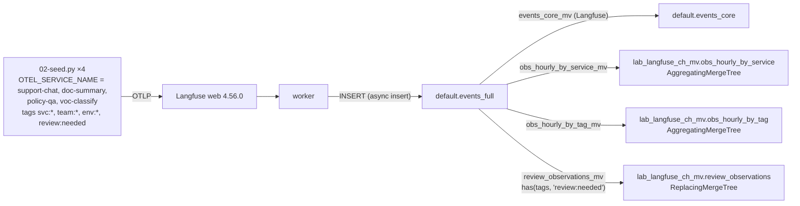
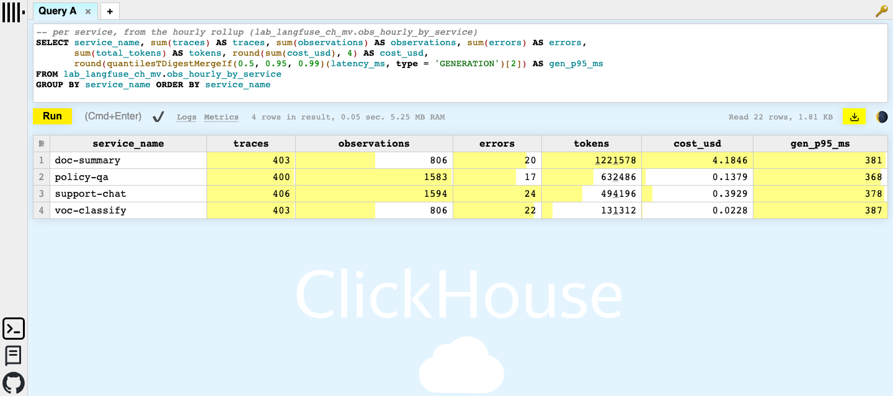
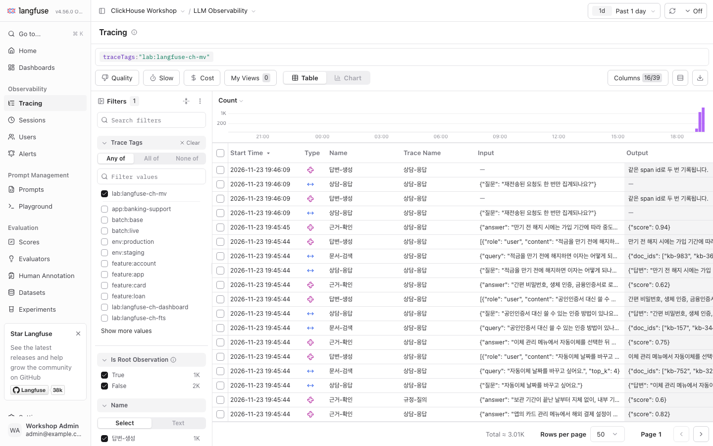
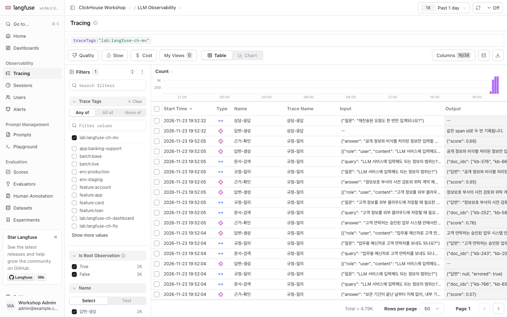
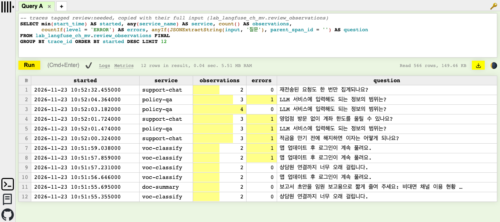
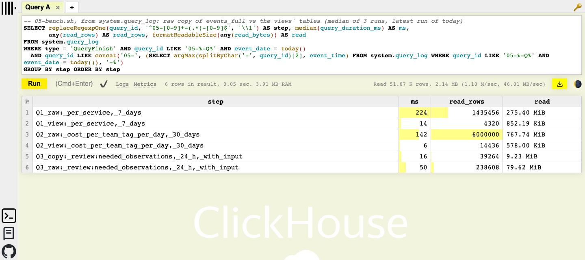
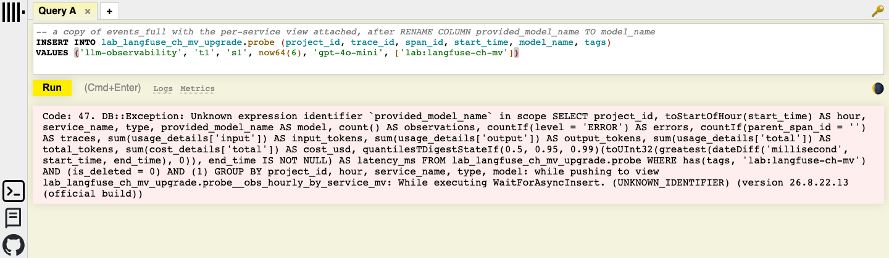

# Incremental materialized views on Langfuse v4 traces: rollups per service and tag, a copy of flagged traces, and what retries, deletes and upgrades do to them

[English](#english) | [한국어](#한국어)

---

## English

**Verified end to end on 2026-11-23** (10:50–11:05 UTC) with **Langfuse v4.56.0 / SDK 4.17.0 / CH 26.8.22.13** on the shared v4 stack (`_base/`, `events_only`, OSS, existing volumes; other labs were writing to the same ClickHouse during the run), from an empty lab database with [run.sh](run.sh) (log: [results/run-2026-11-23.txt](results/run-2026-11-23.txt)). [04-check.sh](04-check.sh) passed 4 checks after the backfill and 4 after new traces arrived through the views; after [07-retry-delete.sh](07-retry-delete.sh) all 4 failed, and after [08-repair.sh](08-repair.sh) all 4 passed again. [05-bench.sh](05-bench.sh): raw copy and views agreed on 6M synthetic rows. [06-upgrade.sh](06-upgrade.sh) read the migrations of `langfuse/langfuse:4.83.0`. Docker 29.9.3, Python 3.12.14, no model calls (offline seeder). A first full run the same day (10:43–10:49 UTC, [results/run-first-2026-11-23.txt](results/run-first-2026-11-23.txt)) gave the same check results.

Langfuse v4 writes every observation to one wide ClickHouse table, `events_full`. A dashboard that asks "tokens and cost per service per day" or "p95 latency per team this week" scans that table each time. An incremental materialized view (MV) aggregates once, at insert time, into a small table. This lab builds three on a running Langfuse, checks that they agree with `events_full`, measures what they save, and measures where they stop agreeing: an exporter retry, a trace deleted in Langfuse, and a Langfuse upgrade that changes the source table.

### The short answer

| Question | What the run showed |
|---|---|
| Where are the observations? | `default.events_full`: ReplacingMergeTree(event_ts, is_deleted), 78 columns on 4.56.0 (migration 51). Langfuse's own MV `events_core_mv` copies it to `events_core` with `input`, `output` and metadata values cut to 200 characters. A trace is its root observation (`parent_span_id = ''`); tags, user, session and `service_name` (OpenTelemetry `service.name`) are on every row. |
| Do the views stay current? | **Yes.** After the backfill (4,197 observations, 1,412 traces), 04 matched `events_full FINAL` exactly: observations, errors, traces, tokens, cost per service and per tag, rows and bytes of the copy. 200 more traces (593 observations) then arrived only through the views, and 04 matched again. |
| What do they save? | On 6M synthetic observations: cost per team per day over 30 days read **6,000,000 rows (768 MiB) in 142 ms** raw and **14,436 rows (578 KiB) in 6 ms** from the tag rollup; the 7-day per-service summary 224 ms → 14 ms; 24 hours of flagged traces with their input 50 ms → 16 ms from the copy. |
| An exporter retry | **The rollup counts it twice.** The same 2 spans sent twice, 15 s apart, became two inserts of 2 rows: 4 rows in `events_full`, 2 with `FINAL`. The rollup had one trace, 2 observations and 1,200 tokens too many. Langfuse's own trace list showed the trace twice until the merge. |
| A trace deleted in Langfuse | **The views keep it.** Langfuse deletes with `DELETE FROM events_full` and `events_core`, not an insert, so no MV sees it. The rows left `events_full` 259 s after the API call (40 s in the first run); the copy still had the trace's full input. |
| Upgrade 4.56.0 → 4.83.0 | **The views survive.** Two new migrations touch `events_full`: 0053 adds two columns (and re-states `events_core_mv`), 0056 changes a column DEFAULT. On a copy with the views attached: both ALTERs OK, inserts OK, every view complete. A `SELECT *` view keeps its 78-column target: the new columns are not copied. |
| What would break them | A **RENAME** of a column a view reads is accepted, then **every insert into the source fails** (Code 47), after the source rows were written (4,789 of 4,789): a writer that retries duplicates them. A **DROP** of such a column is refused (Code 524 `ALTER_OF_COLUMN_IS_FORBIDDEN`): the view would stop the migration. A **type change** (`tags` to `String`) is accepted and breaks inserts even with `materialized_views_ignore_errors = 1`. No Langfuse migration up to 4.83.0 does any of these to `events_full`. |

### What runs



| File | Does |
|---|---|
| [lib.sh](lib.sh) | ClickHouse over HTTP (`ch`, `chq`, `chf`, `qlog`), `check`, and `view_select` / `view_insert`: a view's own SELECT from `system.tables` with its cutoff condition replaced (for the backfill, the repair, and to put the same views on copies) |
| [01-schema.sh](01-schema.sh) | The live schema: tables and engines, last migration, `events_full`'s engine and keys, the columns the views read, `events_core_mv`, one trace as rows ([results/01-schema.txt](results/01-schema.txt)) |
| [02-seed.sh](02-seed.sh) · [02-seed.py](02-seed.py) | Korean traces for four services in parallel, one process each with its own `OTEL_SERVICE_NAME`; waits until ClickHouse has them |
| [03-mv.sql](03-mv.sql) · [03-mv.sh](03-mv.sh) | The lab database, three target tables, three MVs, then the backfill |
| [04-check.sh](04-check.sh) | The views against `events_full FINAL`: 4 checks, latency p95 side by side |
| [07-retry-delete.sh](07-retry-delete.sh) · [07-retry.py](07-retry.py) | One trace exported twice with the same span IDs; one trace deleted through the API; then 04 (FAIL expected) ([results/07-retry-delete.txt](results/07-retry-delete.txt)) |
| [08-repair.sh](08-repair.sh) | Rebuild the rollup hours that differ from `events_full FINAL`; delete copies of observations that are gone |
| [05-bench.sh](05-bench.sh) | 6M synthetic observations in a copy of `events_full`'s DDL with the same views attached; raw vs views, insert time ([results/05-bench.tsv](results/05-bench.tsv), [results/05-sizes.txt](results/05-sizes.txt)) |
| [06-upgrade.sh](06-upgrade.sh) | The migrations between two Langfuse images, applied to a copy with the views attached; RENAME, DROP, type change and ADD on copies ([results/06-upgrade.txt](results/06-upgrade.txt)) |
| [09-captures.sh](09-captures.sh) · [09-captures.mjs](09-captures.mjs) | Screenshots (Playwright): the Langfuse trace list, ClickHouse Play |
| [99-drop.sh](99-drop.sh) | Drop the lab databases (the views go with them). Langfuse's tables and the lab's traces stay |
| [run.sh](run.sh) | 99, 01, 02, 03, 04, 02, 04, 07, 08, 04, 05, 06 in that order |

### Run it

On the shared v4 stack (`_base/bin/up.sh v4`) with the Python venv of `_base/v4/requirements.txt`:

```bash
labs/v4/langfuse-ch-mv/run.sh           # the whole lab, 6–15 minutes; log in results/run.log
labs/v4/langfuse-ch-mv/09-captures.sh   # optional; Playwright (PLAYWRIGHT=<path to its index.mjs>)
labs/v4/langfuse-ch-mv/99-drop.sh       # when done
```

`06-upgrade.sh` needs `langfuse/langfuse:4.83.0` locally (`docker pull`; `LF_TO=` for another version). `LF_ENV_FILE=<path>` points the scripts at another clone's `_base/.env`. `BENCH_MILLIONS` sets the size of 05 (default 6). The views live in `lab_langfuse_ch_mv` and read `default.events_full`; they keep only rows tagged `lab:langfuse-ch-mv` (drop that condition in [03-mv.sql](03-mv.sql) to roll up a whole project). They run on every insert into `events_full`, other labs' inserts included.

### The views

The per-service rollup (the per-tag one is the same with `arrayJoin(tags)` as the dimension; the copy is a plain column list into a ReplacingMergeTree):

```sql
CREATE TABLE lab_langfuse_ch_mv.obs_hourly_by_service
(
    project_id String, hour DateTime, service_name LowCardinality(String),
    type LowCardinality(String), model LowCardinality(String),
    observations SimpleAggregateFunction(sum, UInt64),
    errors       SimpleAggregateFunction(sum, UInt64),
    traces       SimpleAggregateFunction(sum, UInt64),   -- root observations: one per trace
    input_tokens SimpleAggregateFunction(sum, UInt64), output_tokens SimpleAggregateFunction(sum, UInt64),
    total_tokens SimpleAggregateFunction(sum, UInt64),
    cost_usd     SimpleAggregateFunction(sum, Decimal(38, 12)),
    latency_ms   AggregateFunction(quantilesTDigest(0.5, 0.95, 0.99), UInt32)
)
ENGINE = AggregatingMergeTree PARTITION BY toYYYYMM(hour)
ORDER BY (project_id, hour, service_name, type, model);

CREATE MATERIALIZED VIEW lab_langfuse_ch_mv.obs_hourly_by_service_mv TO lab_langfuse_ch_mv.obs_hourly_by_service AS
SELECT project_id, toStartOfHour(start_time) AS hour, service_name, type, provided_model_name AS model,
       count() AS observations, countIf(level = 'ERROR') AS errors, countIf(parent_span_id = '') AS traces,
       sum(usage_details['input']) AS input_tokens, sum(usage_details['output']) AS output_tokens,
       sum(usage_details['total']) AS total_tokens, sum(cost_details['total']) AS cost_usd,
       quantilesTDigestStateIf(0.5, 0.95, 0.99)(
           toUInt32(greatest(dateDiff('millisecond', start_time, end_time), 0)), end_time IS NOT NULL) AS latency_ms
FROM default.events_full
WHERE has(tags, 'lab:langfuse-ch-mv') AND is_deleted = 0 AND created_at >= {CUTOFF}
GROUP BY project_id, hour, service_name, type, model;
```

Reading it: `sum(observations)`, `sum(cost_usd)`, `quantilesTDigestMerge(0.5, 0.95, 0.99)(latency_ms)` over any range of hours.



Design choices the runs measured ([results/05-bench-design1.txt](results/05-bench-design1.txt) has the first design's numbers, 2M rows, 10:37 UTC):

- **Traces as root observations, not `uniqExact(trace_id)`.** With `AggregateFunction(uniqExact, String)` the per-service rollup of 2M rows was 5,768 rows, 14.63 MiB, and the 7-day query 95 ms. With `countIf(parent_span_id = '')`, exact because a v4 trace is its root observation, the rollup of 6M rows was 5,774 rows, 6.50 MiB, and the query 14 ms. Distinct users or sessions still need a `uniq*` state.
- **The copy sorted by day, then trace.** Sorted by `(project_id, trace_id, span_id)`, the 24-hour query on the copy read 180,303 rows in 87 ms, more than the raw table (103,876 rows, 46 ms), whose key starts with time. With `toDate(start_time)` second in the key it read 39,264 rows in 16 ms (6M rows; raw 238,608 rows, 50 ms).
- **Latency as t-digest states.** On the lab's traces the p95 merged from the states equalled `quantileExact` for every service (378–387 ms).

### Backfill without a gap or a double count

An MV sees only inserts made after it exists. [03-mv.sh](03-mv.sh) writes a fixed cutoff 20 s in the future into each view (`created_at >= CUTOFF`), waits until the cutoff plus 20 s has passed, then inserts each view's own SELECT with `created_at < CUTOFF` over `events_full FINAL`. A row is counted by the view or by the backfill, never both; `FINAL` keeps an unmerged duplicate out of the backfill. The run backfilled 4,197 observations of 1,412 traces (the lab's traces of earlier runs included); the next 593 observations came through the views.

### Retries and deletes

`events_full` is a ReplacingMergeTree, so Langfuse can write a row again and let merges (or `FINAL`) keep one. An MV cannot: it aggregates each insert block when it arrives. On this ClickHouse, Langfuse's writes are async inserts (`async_insert = 1` is the 26.8.22.13 default here; `system.query_log` shows them as `AsyncInsertFlush`), so the view runs on each flushed block.

- **Retry.** [07-retry.py](07-retry.py) records a root span and a generation with the OpenTelemetry SDK and sends that batch to Langfuse's OTLP endpoint twice, 15 s apart, as an exporter does after a timeout. Both requests were accepted and written (`system.query_log`: two 2-row inserts at 10:52:33 and 10:52:48 UTC). `events_full` had 4 rows, 2 with `FINAL`; the copy (ReplacingMergeTree) 4, 2 with `FINAL`; the rollup one trace, 2 observations and 1,200 tokens too many for `support-chat`.

  

  The same list at 11:05 UTC, after the merge, shows the retried trace once:

  

- **Delete.** `DELETE /api/public/traces/<id>` returned `Trace deleted successfully`; the worker removes the rows with `DELETE FROM events_full …` and `DELETE FROM events_core …` (`deleteEventsByTraceIds` in the 4.56.0 worker image). The rows were gone 259 s later (40 s in the first run). Retention deletes the same way (`deleteEventsOlderThanDays`). The rollups kept counting the trace, and the copy kept its input and output: deletion requests and retention in Langfuse do not reach a copy.

[08-repair.sh](08-repair.sh) finds the hours whose observations, tokens or cost differ from `events_full FINAL`, deletes them from the rollup and inserts them again with the view's SELECT; for the copy it deletes the rows whose observation is no longer in `events_full`. After it, 04 passed again. Rebuild only closed hours: rows of the current hour that arrive during the rebuild are counted by the view and by the rebuild.



The SDK stores Korean input as JSON with `\uXXXX` escapes; `JSONExtractString(input, '질문')` decodes it.

### Raw table vs views

[05-bench.sh](05-bench.sh), 2026-11-23 10:57–11:04 UTC: 6M synthetic observations (2M traces, 4 services, 30 days up to now) in `events_full_mv`, a `CREATE TABLE … AS default.events_full` copy with the three views attached; the views agreed with it (traces, observations, cost per service). Each query ran three times with the query cache off; median duration, rows and bytes read of that run, from `system.query_log`. Other labs were using the same ClickHouse.

| Query | Raw (`events_full` copy) | View's table |
|---|---|---|
| Q1 per service, 7 days: traces, observations, tokens, cost, p95 | 224 ms · 1,435,456 rows · 275 MiB | 14 ms · 4,320 rows · 852 KiB |
| Q2 cost per team tag per day, 30 days | 142 ms · 6,000,000 rows · 768 MiB | 6 ms · 14,436 rows · 578 KiB |
| Q3 `review:needed` observations of 24 h with input and output | 50 ms · 238,608 rows · 79.6 MiB | 16 ms · 39,264 rows · 9.2 MiB |

| Table | Rows | Compressed |
|---|---|---|
| `events_full_mv` (raw copy) | 6,000,000 | 652.74 MiB |
| `obs_hourly_by_service` | 5,774 | 6.50 MiB |
| `obs_hourly_by_tag` | 14,436 | 13.48 MiB |
| `review_observations` | 720,423 | 56.18 MiB |

The insert cost of the views did not stand out from the noise of the shared machine: 500,000 rows took a median of 18,577 ms without views and 18,018 ms with the three (three inserts each, alternating; 5,258 ms and 6,471 ms in the first run, from `system.query_log`).



### Before a Langfuse upgrade

Langfuse runs its ClickHouse migrations when the new web container starts. Your views are in the way only if a migration changes a column they read. What [06-upgrade.sh](06-upgrade.sh) found between 4.56.0 and 4.83.0 (both images local):

| Migration (new in 4.83.0) | Tables | On a copy with the views attached |
|---|---|---|
| 0052, 0054 | `audit_logs` | — |
| 0053 `add_skill_observation_references` | `events_full`, `events_core`, `events_core_mv` | `ADD COLUMN skills_available, skills_resource_loaded`: OK; inserts and every view OK; a `SELECT *` view's target keeps 78 columns |
| 0055 | `topic_assignments`, `topic_facet_summaries` | — |
| 0056 `compute_event_bytes` | `events_full` | `MODIFY COLUMN event_bytes … DEFAULT byteSize(…)`: OK |

0050 has different text in the two images; it is already applied (migration 51) and is not run again.

Changes no Langfuse migration has made to `events_full` up to 4.83.0, each on a fresh copy with the views and a `SELECT *` view attached (4,789 rows inserted each time):

| `ALTER TABLE …` | ALTER | Next insert into the source | Rows in the source after it | With `materialized_views_ignore_errors = 1` |
|---|---|---|---|---|
| `RENAME COLUMN provided_model_name TO model_name` | OK | **ERROR** Code 47, unknown identifier, while pushing to the view | **4,789 of 4,789** | OK; the views that read the column get nothing |
| `DROP COLUMN service_name` | **ERROR** Code 524 `ALTER_OF_COLUMN_IS_FORBIDDEN` (referenced by 3 views) | OK | 4,789 | OK |
| `MODIFY COLUMN tags String` | OK | **ERROR** Code 43, `has` needs an array | 4,789 | **ERROR** remains (the `SELECT *` view's filter) |
| `ADD COLUMN lab_probe String DEFAULT ''` | OK | OK | 4,789 | OK |

The failed insert had already written the source rows. The worker that gets the error retries, and every retry adds the rows again. The same happens to a single async insert (`INSERT … VALUES` in Play after the RENAME: error returned, row written):



Before upgrading:

1. List the new migrations: `/app/packages/shared/clickhouse/migrations/unclustered` in the old and the new `langfuse/langfuse` image (06 copies both with `docker create` + `docker cp`), and read those that `ALTER TABLE events_full`.
2. Find the views that read `events_full`: `SELECT dependencies_database, dependencies_table FROM system.tables WHERE database = 'default' AND name = 'events_full'` lists every one (Langfuse's `events_core_mv` and other labs' views included); search their `as_select` for each column a migration renames, drops or retypes.
3. Run the new migrations on a copy with your views attached, as 06 does (`CREATE TABLE … AS default.events_full`, the views on the copy, the ALTERs, an insert).
4. If a view must change: drop it before the upgrade, recreate it after, and backfill from the time it was dropped with the cutoff method above.
5. Name the columns. A `SELECT *` view does not fail on a new column, but it does not copy it either.

### Measured

| What | Value (2026-11-23, run 10:50–11:05 UTC) |
|---|---|
| Lab rows in `events_full` at the end | 4,789 observations, 1,612 traces (`FINAL`), from this and earlier runs |
| Backfill | 4,197 observations, 1,412 traces; then +593 observations, +200 traces through the views |
| 04 | 4 PASS (backfill), 4 PASS (new traces), 4 FAIL (retry + delete), 4 PASS (repair) |
| Retry | 4 rows in `events_full` (2 with `FINAL`); rollup +1 trace, +2 observations, +1,200 tokens over the truth |
| Delete | rows gone from `events_full` 259 s after the API call (first run: 40 s); copy kept 3 rows |
| Q1 / Q2 / Q3 | 224 → 14 ms, 142 → 6 ms, 50 → 16 ms (6M synthetic rows, medians of 3) |
| Upgrade 4.56.0 → 4.83.0 | 2 migrations on `events_full` (0053, 0056), both OK with the views attached |

Not covered: a real in-place upgrade of the shared stack (the migrations ran on copies), Langfuse's `dual` and `legacy` write modes, a clustered ClickHouse (`ON CLUSTER`, replicated targets), and refreshable MVs as the alternative for exact counts under retries (see the notes article).

---

## 한국어

**2026-11-23**(10:50–11:05 UTC) 공유 v4 스택(`_base/`, `events_only`, OSS, 기존 볼륨; 실행 중 다른 실습도 같은 ClickHouse에 쓰고 있었음)에서 **Langfuse v4.56.0 / SDK 4.17.0 / CH 26.8.22.13**으로, 빈 실습 데이터베이스부터 [run.sh](run.sh)로 처음부터 끝까지 확인했습니다(로그: [results/run-2026-11-23.txt](results/run-2026-11-23.txt)). [04-check.sh](04-check.sh)는 백필 뒤 4개, 새 trace가 MV로 들어온 뒤 4개를 통과했습니다. [07-retry-delete.sh](07-retry-delete.sh) 뒤에는 4개 모두 실패했고, [08-repair.sh](08-repair.sh) 뒤 다시 4개 모두 통과했습니다. [05-bench.sh](05-bench.sh): 합성 600만 행에서 원본 사본과 MV 결과가 같았습니다. [06-upgrade.sh](06-upgrade.sh)는 `langfuse/langfuse:4.83.0`의 마이그레이션을 읽었습니다. Docker 29.9.3, Python 3.12.14, 모델 호출 없음(오프라인 시드). 같은 날 첫 번째 전체 실행(10:43–10:49 UTC, [results/run-first-2026-11-23.txt](results/run-first-2026-11-23.txt))도 검사 결과가 같았습니다.

Langfuse v4는 모든 observation을 넓은 ClickHouse 테이블 하나, `events_full`에 씁니다. "서비스별 하루 토큰과 비용", "이번 주 팀별 p95 지연" 같은 대시보드는 매번 이 테이블을 훑습니다. 증분 materialized view(MV)는 INSERT 때 한 번 집계해 작은 테이블에 넣습니다. 이 실습은 돌고 있는 Langfuse에 MV 세 개를 붙이고, `events_full`과 결과가 같은지 확인하고, 얼마나 덜 읽는지 재고, 결과가 어긋나는 경우를 잽니다. 내보내기 재시도, Langfuse에서 지운 trace, 원본 테이블을 바꾸는 Langfuse 업그레이드입니다.

### 요약

| 질문 | 실행 결과 |
|---|---|
| observation은 어디에? | `default.events_full`: ReplacingMergeTree(event_ts, is_deleted), 4.56.0에서 컬럼 78개(마이그레이션 51). Langfuse 자체 MV `events_core_mv`가 이를 `events_core`로 복사하면서 `input`, `output`, metadata 값을 200자로 자릅니다. trace는 루트 observation(`parent_span_id = ''`)이고, 태그·사용자·세션·`service_name`(OpenTelemetry `service.name`)이 모든 행에 있습니다. |
| MV가 계속 맞나? | **맞습니다.** 백필(observation 4,197개, trace 1,412개) 뒤 04가 `events_full FINAL`과 정확히 같았습니다. 서비스별·태그별 observation, 오류, trace, 토큰, 비용과 복사본의 행 수·바이트입니다. 이어서 trace 200개(observation 593개)가 MV로만 들어왔고 04는 다시 같았습니다. |
| 얼마나 덜 읽나? | 합성 observation 600만 개에서, 30일 팀별 하루 비용은 원본 **6,000,000행(768 MiB), 142 ms**, 태그 롤업 **14,436행(578 KiB), 6 ms**였습니다. 7일 서비스별 요약은 224 ms → 14 ms, 24시간 검토 대상 trace(입력 포함)는 복사본에서 50 ms → 16 ms였습니다. |
| 내보내기 재시도 | **롤업이 두 번 셉니다.** 같은 span 2개를 15초 간격으로 두 번 보내자 2행짜리 INSERT가 두 번 일어났습니다. `events_full`은 4행, `FINAL`로는 2행이었습니다. 롤업에는 trace 1개, observation 2개, 토큰 1,200개가 더 들어갔습니다. 병합 전까지는 Langfuse의 trace 목록에도 두 번 보였습니다. |
| Langfuse에서 지운 trace | **MV는 그대로 둡니다.** Langfuse는 INSERT가 아니라 `DELETE FROM events_full`과 `events_core`로 지우므로 어떤 MV도 이를 보지 못합니다. API 호출 259초 뒤 `events_full`에서 행이 사라졌고(첫 실행 40초), 복사본에는 그 trace의 입력 전체가 남았습니다. |
| 4.56.0 → 4.83.0 업그레이드 | **MV는 그대로 동작합니다.** `events_full`을 건드리는 새 마이그레이션은 두 개입니다. 0053은 컬럼 두 개를 더하고(`events_core_mv`도 다시 정의), 0056은 컬럼 DEFAULT를 바꿉니다. MV를 붙인 사본에 적용하니 ALTER 둘 다 성공했고, INSERT와 모든 MV도 정상이었습니다. `SELECT *` MV는 대상이 78컬럼 그대로라 새 컬럼을 복사하지 않습니다. |
| 무엇이 MV를 깨나 | MV가 읽는 컬럼의 **RENAME**은 허용되지만, 그 뒤 **원본으로 가는 INSERT가 모두 실패**합니다(Code 47). 실패하기 전에 원본 행은 이미 써졌습니다(4,789/4,789). 재시도하는 쪽이 있으면 중복이 생깁니다. 그런 컬럼의 **DROP**은 거부됩니다(Code 524 `ALTER_OF_COLUMN_IS_FORBIDDEN`). MV가 마이그레이션을 멈추게 됩니다. **타입 변경**(`tags`를 `String`으로)은 허용되고, `materialized_views_ignore_errors = 1`에서도 INSERT가 실패합니다. 4.83.0까지 Langfuse 마이그레이션 중 `events_full`에 이런 변경을 한 것은 없습니다. |

### 구성

위 영어 절의 다이어그램과 파일 표를 보세요. 스크립트 이름과 순서는 같습니다. [run.sh](run.sh)가 99, 01, 02, 03, 04, 02, 04, 07, 08, 04, 05, 06을 차례로 실행합니다.

### 실행

공유 v4 스택(`_base/bin/up.sh v4`)과 `_base/v4/requirements.txt`의 Python venv에서:

```bash
labs/v4/langfuse-ch-mv/run.sh           # 전체 실습, 6–15분, 로그는 results/run.log
labs/v4/langfuse-ch-mv/09-captures.sh   # 선택, Playwright 필요(PLAYWRIGHT=<index.mjs 경로>)
labs/v4/langfuse-ch-mv/99-drop.sh       # 끝나면
```

`06-upgrade.sh`는 로컬에 `langfuse/langfuse:4.83.0` 이미지가 있어야 합니다(`docker pull`, 다른 버전은 `LF_TO=`). `LF_ENV_FILE=<경로>`로 다른 clone의 `_base/.env`를 쓸 수 있습니다. `BENCH_MILLIONS`는 05의 크기입니다(기본 6). MV는 `lab_langfuse_ch_mv`에 있고 `default.events_full`을 읽으며, `lab:langfuse-ch-mv` 태그가 붙은 행만 남깁니다. 프로젝트 전체를 집계하려면 [03-mv.sql](03-mv.sql)에서 그 조건을 빼세요. MV는 다른 실습의 INSERT를 포함해 `events_full`에 들어오는 모든 INSERT에서 돕니다.

### MV

서비스별 롤업 DDL은 영어 절에 있습니다. 태그별 롤업은 `arrayJoin(tags)`를 차원으로 쓰는 것만 다르고, 복사본은 컬럼을 나열해 ReplacingMergeTree에 넣습니다. 읽을 때는 원하는 시간 범위에 `sum(observations)`, `sum(cost_usd)`, `quantilesTDigestMerge(0.5, 0.95, 0.99)(latency_ms)`를 씁니다.

실행으로 확인한 설계 선택([results/05-bench-design1.txt](results/05-bench-design1.txt)에 첫 설계의 수치, 200만 행, 10:37 UTC):

- **trace 수는 `uniqExact(trace_id)`가 아니라 루트 observation 수로.** `AggregateFunction(uniqExact, String)`일 때 200만 행의 서비스별 롤업은 5,768행 14.63 MiB, 7일 조회는 95 ms였습니다. `countIf(parent_span_id = '')`로 바꾸자 600만 행의 롤업이 5,774행 6.50 MiB, 조회는 14 ms였습니다. v4의 trace는 루트 observation이므로 이 값은 정확합니다. 고유 사용자나 세션 수에는 여전히 `uniq*` 상태가 필요합니다.
- **복사본은 날짜, 그다음 trace 순으로 정렬.** `(project_id, trace_id, span_id)`로 정렬하자 복사본의 24시간 조회가 180,303행 87 ms로, 시간이 키 앞에 있는 원본(103,876행 46 ms)보다 많이 읽었습니다. 키 둘째에 `toDate(start_time)`를 넣자 39,264행 16 ms였습니다(600만 행, 원본 238,608행 50 ms).
- **지연은 t-digest 상태로.** 실습 trace에서는 상태를 병합한 p95가 모든 서비스에서 `quantileExact`와 같았습니다(378–387 ms).

### 빈틈도 중복도 없는 백필

MV는 만들어진 뒤의 INSERT만 봅니다. [03-mv.sh](03-mv.sh)는 20초 뒤의 고정 시각을 각 MV 조건에 넣고(`created_at >= CUTOFF`), 그 시각에서 20초가 더 지나기를 기다린 뒤, 각 MV의 SELECT를 `created_at < CUTOFF`로 바꿔 `events_full FINAL`에서 넣습니다. 한 행은 MV나 백필 중 하나로만 들어갑니다. `FINAL`은 병합 전 중복이 백필에 들어가지 않게 합니다. 이번 실행은 observation 4,197개, trace 1,412개를 백필했고(이전 실행의 실습 trace 포함), 다음 593개는 MV로 들어왔습니다.

### 재시도와 삭제

`events_full`은 ReplacingMergeTree라서 Langfuse가 같은 행을 다시 써도 병합(또는 `FINAL`)이 하나만 남깁니다. MV는 그러지 못합니다. INSERT 블록이 도착할 때마다 집계합니다. 이 ClickHouse에서 Langfuse의 쓰기는 비동기 INSERT입니다(여기서는 26.8.22.13 기본값 `async_insert = 1`, `system.query_log`에 `AsyncInsertFlush`로 보임). MV는 플러시된 블록마다 돕니다.

- **재시도.** [07-retry.py](07-retry.py)는 OpenTelemetry SDK로 루트 span과 generation을 만들고, 그 배치를 Langfuse OTLP 엔드포인트로 15초 간격으로 두 번 보냅니다. 타임아웃 뒤의 exporter와 같습니다. 두 요청 모두 받아들여져 써졌습니다(`system.query_log`: 10:52:33과 10:52:48 UTC의 2행 INSERT 두 번). `events_full`은 4행(`FINAL` 2행), 복사본(ReplacingMergeTree)도 4행(`FINAL` 2행)이었고, 롤업은 `support-chat`에 trace 1개, observation 2개, 토큰 1,200개가 더 들어갔습니다. 영어 절의 첫 화면(첫 실행 10:48 UTC, 병합 전)에서는 Langfuse trace 목록도 같은 trace를 두 번 보여 줍니다. 11:05 UTC 병합 뒤의 화면에서는 한 번만 보입니다.
- **삭제.** `DELETE /api/public/traces/<id>`는 `Trace deleted successfully`를 돌려주고, worker가 `DELETE FROM events_full …`과 `DELETE FROM events_core …`로 행을 지웁니다(4.56.0 worker 이미지의 `deleteEventsByTraceIds`). 259초 뒤 행이 사라졌습니다(첫 실행 40초). 보존 기간 삭제도 같은 방식입니다(`deleteEventsOlderThanDays`). 롤업은 그 trace를 계속 셌고, 복사본은 입력과 출력을 그대로 갖고 있었습니다. Langfuse의 삭제 요청과 보존 기간은 복사본에 닿지 않습니다.

[08-repair.sh](08-repair.sh)는 observation·토큰·비용이 `events_full FINAL`과 다른 시간대를 찾아 롤업에서 지우고 MV의 SELECT로 다시 넣습니다. 복사본에서는 `events_full`에 더 이상 없는 observation의 행을 지웁니다. 그 뒤 04는 다시 통과했습니다. 다시 만드는 것은 지난 시간대만 하세요. 진행 중인 시간대는 다시 만드는 동안 들어온 행이 MV와 재계산 양쪽에서 세집니다.

SDK는 한국어 입력을 `\uXXXX` 이스케이프가 든 JSON으로 저장합니다. `JSONExtractString(input, '질문')`으로 풀어 읽습니다.

### 원본 대비

[05-bench.sh](05-bench.sh), 2026-11-23 10:57–11:04 UTC: 합성 observation 600만 개(trace 200만 개, 서비스 4개, 지금까지 30일)를 `CREATE TABLE … AS default.events_full` 사본 `events_full_mv`에 넣고 MV 세 개를 붙였습니다. 서비스별 trace·observation·비용이 MV와 같았습니다. 쿼리마다 쿼리 캐시를 끄고 세 번 실행해, 중앙값 시간과 그 실행의 읽은 행·바이트를 `system.query_log`에서 가져왔습니다. 같은 ClickHouse를 다른 실습도 쓰고 있었습니다. 수치는 영어 절의 표와 같습니다.

| 쿼리 | 원본(`events_full` 사본) | MV 대상 테이블 |
|---|---|---|
| Q1 서비스별 7일: trace, observation, 토큰, 비용, p95 | 224 ms · 1,435,456행 · 275 MiB | 14 ms · 4,320행 · 852 KiB |
| Q2 팀 태그별 하루 비용, 30일 | 142 ms · 6,000,000행 · 768 MiB | 6 ms · 14,436행 · 578 KiB |
| Q3 24시간 `review:needed` observation, 입력·출력 포함 | 50 ms · 238,608행 · 79.6 MiB | 16 ms · 39,264행 · 9.2 MiB |

MV의 INSERT 비용은 공유 머신의 흔들림보다 크게 드러나지 않았습니다. 50만 행 INSERT 중앙값이 MV 없이 18,577 ms, MV 셋과 함께 18,018 ms였습니다(번갈아 세 번씩, 첫 실행은 `system.query_log` 기준 5,258 ms와 6,471 ms).

### Langfuse 업그레이드 전에

Langfuse는 새 web 컨테이너가 시작할 때 ClickHouse 마이그레이션을 실행합니다. 마이그레이션이 MV가 읽는 컬럼을 바꿀 때만 MV가 걸립니다. [06-upgrade.sh](06-upgrade.sh)가 4.56.0과 4.83.0 사이에서 찾은 것(두 이미지 모두 로컬):

| 마이그레이션(4.83.0에 새로 생김) | 테이블 | MV를 붙인 사본에서 |
|---|---|---|
| 0052, 0054 | `audit_logs` | — |
| 0053 `add_skill_observation_references` | `events_full`, `events_core`, `events_core_mv` | `ADD COLUMN skills_available, skills_resource_loaded`: 성공. INSERT와 모든 MV 정상. `SELECT *` MV의 대상은 78컬럼 그대로 |
| 0055 | `topic_assignments`, `topic_facet_summaries` | — |
| 0056 `compute_event_bytes` | `events_full` | `MODIFY COLUMN event_bytes … DEFAULT byteSize(…)`: 성공 |

0050은 두 이미지에서 내용이 다르지만 이미 적용돼(마이그레이션 51) 다시 실행되지 않습니다.

4.83.0까지 Langfuse 마이그레이션이 `events_full`에 한 적 없는 변경을, 매번 MV와 `SELECT *` MV를 붙인 새 사본에서(매번 4,789행 INSERT):

| `ALTER TABLE …` | ALTER | 다음 원본 INSERT | 그 뒤 원본의 행 | `materialized_views_ignore_errors = 1`일 때 |
|---|---|---|---|---|
| `RENAME COLUMN provided_model_name TO model_name` | 성공 | **오류** Code 47, MV로 보내는 중 알 수 없는 식별자 | **4,789 / 4,789** | 성공. 그 컬럼을 읽는 MV에는 아무것도 안 들어감 |
| `DROP COLUMN service_name` | **오류** Code 524 `ALTER_OF_COLUMN_IS_FORBIDDEN`(MV 3개가 참조) | 성공 | 4,789 | 성공 |
| `MODIFY COLUMN tags String` | 성공 | **오류** Code 43, `has`에는 배열이 필요 | 4,789 | **오류** 그대로(`SELECT *` MV의 필터) |
| `ADD COLUMN lab_probe String DEFAULT ''` | 성공 | 성공 | 4,789 | 성공 |

실패한 INSERT도 원본 행은 이미 써 두었습니다. 오류를 받은 worker는 재시도하고, 재시도할 때마다 행이 또 들어갑니다. 비동기 INSERT 한 건도 같았습니다(RENAME 뒤 Play의 `INSERT … VALUES`: 오류를 돌려주고 행은 써짐).

업그레이드 전에:

1. 새 마이그레이션 목록을 봅니다. 이전과 새 `langfuse/langfuse` 이미지의 `/app/packages/shared/clickhouse/migrations/unclustered`(06이 `docker create` + `docker cp`로 둘 다 꺼냄)에서 `ALTER TABLE events_full`이 있는 파일을 읽습니다.
2. `events_full`을 읽는 MV를 찾습니다. `SELECT dependencies_database, dependencies_table FROM system.tables WHERE database = 'default' AND name = 'events_full'`이 모두 보여 줍니다(Langfuse의 `events_core_mv`와 다른 실습의 MV 포함). 마이그레이션이 이름을 바꾸거나 지우거나 타입을 바꾸는 컬럼을 각 MV의 `as_select`에서 찾습니다.
3. 06처럼 MV를 붙인 사본에 새 마이그레이션을 돌려 봅니다(`CREATE TABLE … AS default.events_full`, 사본에 MV, ALTER, INSERT).
4. MV를 바꿔야 하면 업그레이드 전에 지우고, 업그레이드 뒤 다시 만들고, 지운 시각부터 위의 컷오프 방식으로 백필합니다.
5. 컬럼은 이름으로 나열합니다. `SELECT *` MV는 새 컬럼에서 실패하지 않지만 복사하지도 않습니다.

### 측정값

영어 절의 "Measured" 표와 같습니다(2026-11-23, 10:50–11:05 UTC 실행).

다루지 않은 것: 공유 스택의 실제 in-place 업그레이드(마이그레이션은 사본에서만 실행), Langfuse의 `dual`·`legacy` 쓰기 모드, 클러스터 ClickHouse(`ON CLUSTER`, 복제 대상 테이블), 재시도에도 정확한 집계를 위한 refreshable MV(노트 글 참고).
