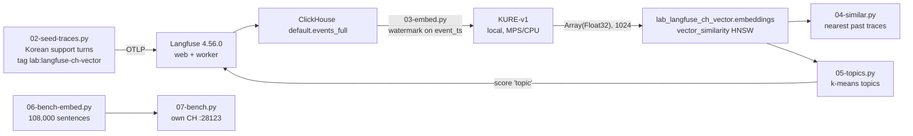
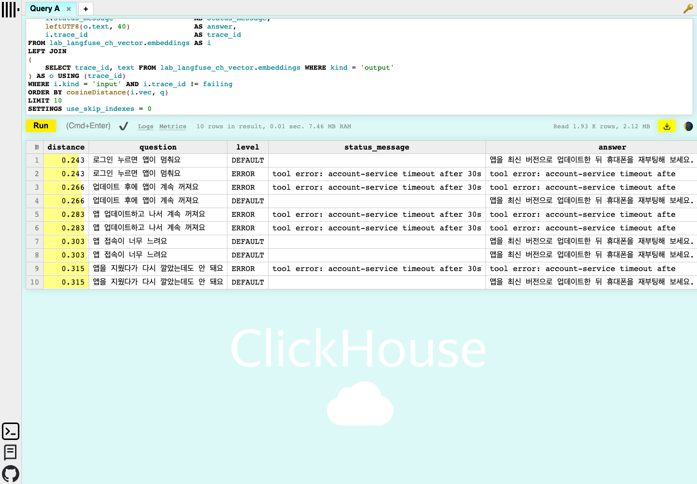
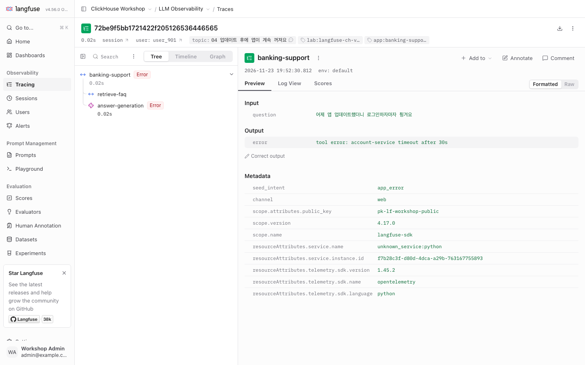
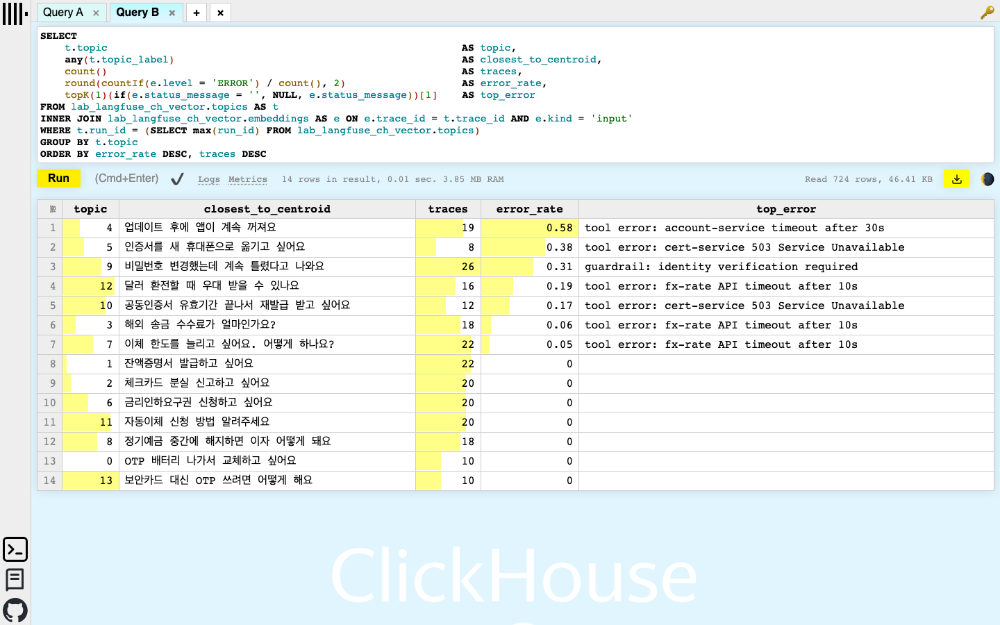
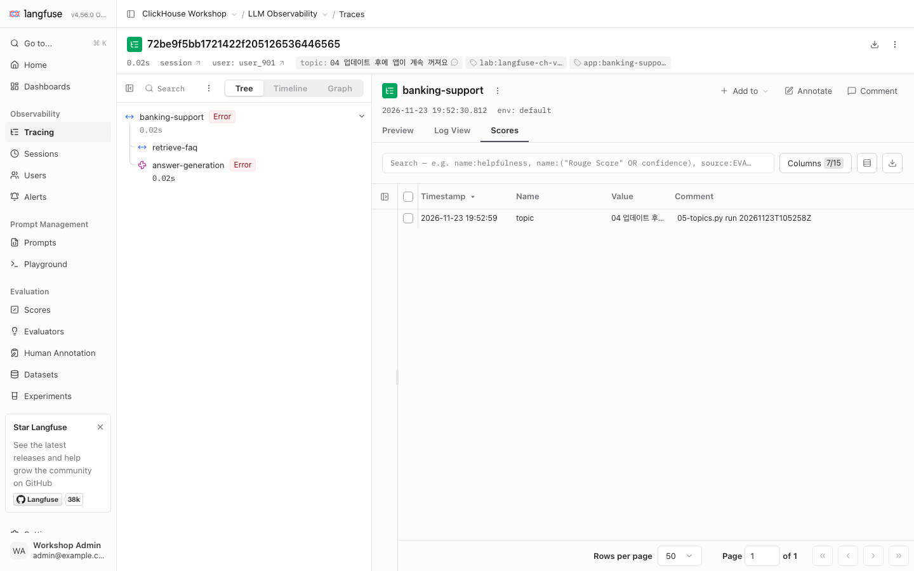
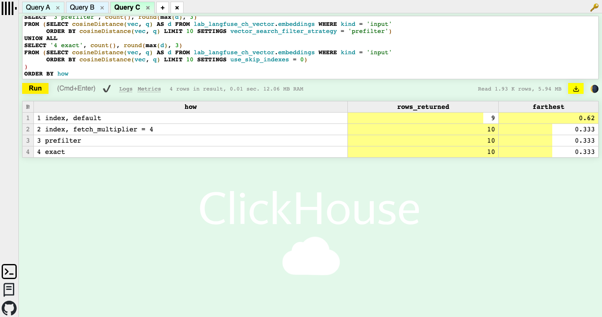

# Similar-case search over Langfuse traces: a Korean embedding model and ClickHouse vector search

[English](#english) | [한국어](#한국어)

---

## English

**Verified end to end on 2026-11-23** with **Langfuse v4.56.0 / SDK 4.17.0 / CH 26.8.22.13** (the shared v4 stack of `_base/`) and **nlpai-lab/KURE-v1 @ `444abe2`** run locally with sentence-transformers 6.3.0 and torch 2.15.0 on the Apple M4 Pro GPU (MPS), Python 3.12.14, Docker 29.9.3. The benchmark ran on a separate `clickhouse/clickhouse-server:26.8.22.13` container (4 GB memory cap, Docker VM with 12 CPUs, other lab containers running). Offline: no model API, no cloud. [08-check.py](08-check.py) passed 10 checks; with `--fault` 2 of them failed. Log: [lab-output.md](lab-output.md).

### The short answer

| Question | Answer |
|---|---|
| Which model? | **KURE-v1** (Korea University NLP&AI lab): BAAI/bge-m3 fine-tuned on Korean retrieval data, **MIT licence**, **567,754,752 parameters** (2.27 GB of safetensors), **1024 dimensions**, normalised output. Read from the model card and the Hugging Face API at revision `444abe2` on 2026-11-23. It runs on a laptop: 180 sentences/s on the M4 Pro GPU. |
| Where does the text come from? | `events_full`, root observations (`parent_span_id = ''`), `input` and `output`. Not `events_core`: its materialized view keeps only `leftUTF8(input, 200)`. The Python SDK writes Korean as `\uXXXX` escapes inside the JSON string, so decode before you search the raw column. |
| Incremental? | Yes. A watermark on `event_ts`, a 5-minute overlap and `NOT IN` on what is already embedded. A second run embedded 0 texts; the run after one new trace embedded exactly 2 (its input and output). Deleted traces disappear from `events_full` about a minute after the API call; the next run removes their vectors (checked with a row whose trace id does not exist). |
| Is the vector index production-ready on 26.8? | Yes: experimental, beta in 25.5 ([#80164](https://github.com/ClickHouse/ClickHouse/pull/80164)), **GA in 25.8** ([#85888](https://github.com/ClickHouse/ClickHouse/pull/85888)), from `docs/changelogs/2025.md` at tag `v26.8.22.13-lts`. On 26.8.22.13 the old enable settings are `Obsolete`. |
| Brute force or index? | See [Measured](#measured). In short: at a few hundred traces an exact scan takes milliseconds; at 50,000 and 100,000 vectors the HNSW index answered in 4–5 ms (p50) where the exact scan took 59–102.5 ms, with recall@10 0.998 at the default settings. |
| Any trap? | **A `WHERE` next to the index is applied after the index search.** With a filter that keeps 2 % of the rows, the index returned 0.2 rows on average instead of 10. `vector_search_index_fetch_multiplier = 100` or `vector_search_filter_strategy = 'prefilter'` gives the 10 rows back. |
| What is it good for? | A failing trace's 10 nearest past traces were all the same kind of problem and half of them had failed with the same error, against 11.7 % errors overall. k-means over the same vectors gave topics with an adjusted Rand index of 0.851 against the intents the data was seeded from, and the app-error topic stood out at a 58 % error rate. |

### What runs



| File | Does |
|---|---|
| [corpus.py](corpus.py) | Twelve support intents of a banking app, ten Korean wordings each (paraphrases, spacing and typo variants, near-duplicates), and the 108,000-sentence benchmark corpus built from them |
| [lablib.py](lablib.py) | ClickHouse over HTTP with query parameters, the model pinned to one revision, `text_of()` for Langfuse's JSON input/output |
| [01-schema.sql](01-schema.sql), [01-setup.py](01-setup.py) | Database `lab_langfuse_ch_vector`: `embeddings` (with the HNSW index), `watermark`, `topics`, `queries`; prints the live vector-search settings; downloads the model |
| [02-seed-traces.py](02-seed-traces.py) | 240 traces (12 intents × 10 wordings × 2 rounds), offline; some intents fail with a tool error at a fixed rate; `--failing` sends one new failing trace |
| [03-embed.py](03-embed.py) | The incremental pipeline |
| [04-similar.py](04-similar.py), [04-similar.sql](04-similar.sql), [04-postfilter.sql](04-postfilter.sql) | Sends a failing trace, embeds it incrementally, lists its 10 nearest past traces and how they ended; a free-text search through the index with and without the filter fix |
| [05-topics.py](05-topics.py), [05-topics.sql](05-topics.sql) | k-means for k = 6…20, keeps the best silhouette, names each topic by its most central question, writes `topics` and (with `--scores`) a categorical `topic` score per trace back to Langfuse |
| [06-bench-up.sh](06-bench-up.sh) | A separate ClickHouse 26.8.22.13 for the benchmark on `127.0.0.1:28123` |
| [06-bench-embed.py](06-bench-embed.py) | Embeds the 108,000 benchmark sentences once into `.run/bench.npz` (real text, not random vectors; they do not go through Langfuse) |
| [07-bench.py](07-bench.py) | Exact scan vs HNSW at 10,000 / 50,000 / 100,000 vectors, bf16 / f32 / i8 / b1, filtered search; writes [results/](results/) |
| [08-check.py](08-check.py) | 10 checks; `--fault` swaps the expected intent of the similar-case search and must fail |
| [09-captures.mjs](09-captures.mjs) | The screenshots in [captures/](captures/) (Playwright) |
| [99-cleanup.py](99-cleanup.py) | Drops `lab_langfuse_ch_vector`, removes the bench container; `--traces` deletes this lab's traces through the Langfuse API; `--cache` removes `.run/` |

### Run

Needs the shared v4 stack up (`_base/bin/up.sh v4`), Python 3.12, about 3 GB of disk for the model, and Node with Playwright for the screenshots only.

```bash
uv venv -p python3.12 .venv-vector
uv pip install -p .venv-vector/bin/python -r labs/v4/langfuse-ch-vector/requirements.txt
.venv-vector/bin/python labs/v4/langfuse-ch-vector/01-setup.py
.venv-vector/bin/python labs/v4/langfuse-ch-vector/02-seed-traces.py
.venv-vector/bin/python labs/v4/langfuse-ch-vector/03-embed.py
.venv-vector/bin/python labs/v4/langfuse-ch-vector/04-similar.py
.venv-vector/bin/python labs/v4/langfuse-ch-vector/05-topics.py --scores
labs/v4/langfuse-ch-vector/06-bench-up.sh
.venv-vector/bin/python labs/v4/langfuse-ch-vector/06-bench-embed.py      # ~9 min on an M4 Pro GPU
.venv-vector/bin/python labs/v4/langfuse-ch-vector/07-bench.py            # ~6 min
.venv-vector/bin/python labs/v4/langfuse-ch-vector/08-check.py
.venv-vector/bin/python labs/v4/langfuse-ch-vector/99-cleanup.py --traces --cache
```

`03-embed.py --tag ''` embeds every trace of the project instead of this lab's tag.

### The schema

One row per text: the input or the output of a trace's root observation.

```sql
CREATE TABLE lab_langfuse_ch_vector.embeddings
(
    project_id String, trace_id String, span_id String,
    kind LowCardinality(String),                      -- 'input' | 'output'
    name String, level LowCardinality(String), status_message String,
    start_time DateTime64(6), event_ts DateTime64(6), text String,
    model LowCardinality(String), embedded_at DateTime64(3) DEFAULT now64(3),
    vec Array(Float32),
    CONSTRAINT dim CHECK length(vec) = 1024,
    INDEX vec_hnsw vec TYPE vector_similarity('hnsw', 'cosineDistance', 1024)
)
ENGINE = MergeTree
ORDER BY (project_id, kind, trace_id, span_id);
```

Plain `MergeTree`, not `ReplacingMergeTree`: the pipeline writes each `(span_id, kind)` once, so no `FINAL` is needed in front of the index. The pipeline reads `events_full` like this (the newest version of each root observation, then the deletion flag, then what is not embedded yet):

```sql
SELECT ... FROM
(
    SELECT * FROM default.events_full
    WHERE project_id = {project:String} AND parent_span_id = ''
      AND event_ts > {since:DateTime64(6)} - toIntervalSecond(300)
      AND has(tags, {tag:String})
    ORDER BY span_id, event_ts DESC
    LIMIT 1 BY span_id
)
ARRAY JOIN ['input', 'output'] AS kind, [input, output] AS value
WHERE is_deleted = 0 AND value NOT IN ('', 'null', '{}')
  AND (span_id, kind) NOT IN (SELECT span_id, kind FROM lab_langfuse_ch_vector.embeddings)
```

### Find past traces like this failing one

[04-similar.py](04-similar.py) sends `어제 앱 업데이트했더니 로그인하자마자 튕겨요` ("since yesterday's app update it crashes right after login"), a wording that is in none of the intent lists, as a failing trace. The incremental run picked up exactly that trace (2 texts; model load 10.8 s, embedding 0.64 s). Its 10 nearest past traces:



All ten are app-error questions (login freezes, crashes after an update, slow app, reinstall did not help), and 5 of them failed with the same `account-service timeout`. Across all 240 traces the error rate was 0.117. The failing trace in Langfuse:



The query is plain SQL over the lab table and joins the answer row of each neighbour, so the successful neighbours show what was answered last time:

```sql
WITH (SELECT vec FROM lab_langfuse_ch_vector.embeddings WHERE kind = 'input' AND trace_id = {t:String}) AS q
SELECT round(cosineDistance(i.vec, q), 3) AS distance, i.text AS question, i.level, i.status_message,
       leftUTF8(o.text, 40) AS answer, i.trace_id
FROM lab_langfuse_ch_vector.embeddings AS i
LEFT JOIN (SELECT trace_id, text FROM lab_langfuse_ch_vector.embeddings WHERE kind = 'output') AS o USING (trace_id)
WHERE i.kind = 'input' AND i.trace_id != {t:String}
ORDER BY cosineDistance(i.vec, q)
LIMIT 10
SETTINGS use_skip_indexes = 0   -- exact: a few hundred rows
```

### Topics

[05-topics.py](05-topics.py) ran k-means for k = 6…20 over the 241 question vectors and kept k = 14 (silhouette 0.322). Each topic is named by the question closest to its centroid:



Against the twelve intents the data was seeded from (metadata `seed_intent`, read only for grading): adjusted Rand index **0.851**, purity **0.950**. Two intents split in two (certificates: renewal vs moving to a new phone; OTP: device vs mobile OTP), and 6 of the 120 wordings (12 traces) landed in a topic that another intent dominates: `금융인증서 비밀번호를 잊어버렸어요` (financial-certificate password) and, less obviously, `SWIFT 코드는 어디에 입력하나요` in the password topic, `유로 환전 한도가 있나요` (euro exchange limit) in the transfer-limit topic. The app-error topic had an error rate of 0.58, the certificate topic 0.38. With `--scores` the topic goes back to Langfuse as a categorical score, visible on the trace and filterable in the UI:



### Filters next to the index

The HNSW index returns the k nearest rows of each part; a `WHERE` that the primary key cannot narrow down is applied to those k rows afterwards. In this lab's table, a free-text search with `WHERE kind = 'input'` returned 9 rows, the 9th at distance 0.62: two answer rows were among the 10 nearest and were filtered out, and the second part (one trace) contributed its only row.



At 100,000 vectors with a filter that keeps 2 % of the rows (`grp = <one of 50>`, unrelated to meaning, like one app or one user), see the filtered rows in [Measured](#measured). The fixes are the documented ones: `vector_search_index_fetch_multiplier` (fetch more candidates per part) or `vector_search_filter_strategy = 'prefilter'` (an exact scan of the rows that pass the filter).

### Measured

Final run of 2026-11-23 ([lab-output.md](lab-output.md), [results/bench-2026-11-23.json](results/bench-2026-11-23.json)): ClickHouse 26.8.22.13 in its own container (4 GB, Docker VM 12 CPUs, other lab containers running), 200 held-out query sentences, top-10, `ORDER BY cosineDistance(vec, {q:Array(Float32)}) LIMIT 10`. "Exact" is the same query with `use_skip_indexes = 0`; recall@10 is the share of the exact top-10 that the index returned; latency is `query_duration_ms` from `system.query_log`. Every table was one part (`OPTIMIZE FINAL`, then `ADD INDEX` + `MATERIALIZE INDEX`), and `EXPLAIN indexes = 1` showed `vec_hnsw` for the index queries and not for the exact ones.

**Size** (bf16, the default quantization; ef_search = `hnsw_candidate_list_size_for_search`, default 256):

| Vectors | Exact p50 / p95 ms | Index p50 / p95 ms (ef 256) | recall@10 ef 256 | recall@10 ef 16 | Index build s | Index on disk MB | Vectors on disk MB |
|---|---|---|---|---|---|---|---|
| 10,000 | 13 / 22 | 4 / 10 | 0.997 | 0.990 | 1.1 | 21 | 41 |
| 50,000 | 59 / 114 | 5 / 13 | 0.998 | 0.984 | 8.0 | 106 | 206 |
| 100,000 | 102.5 / 328 | 4 / 9 | 0.998 | 0.975 | 25.8 | 212 | 412 |

The exact scan of the same 100,000 vectors had a p50 of 58–102.5 ms across the four 100,000-row tables (it does not use the index, so the spread is the noise of a shared laptop). The same bf16 build took 12.8 s in an earlier run that day. The first index query after a build took 5.5–73 ms: it loads the index into the vector index cache.

**Quantization** at 100,000 vectors (ef 256; "rescore" = `vector_search_with_rescoring = 1`, `vector_search_index_fetch_multiplier = 4`):

| Quantization | Index MB | Build s | recall@10 | p50 / p95 ms | recall@10 with rescore | p50 / p95 ms with rescore |
|---|---|---|---|---|---|---|
| f32 | 417 | 12.4 | 1.000 | 4 / 9 | — | — |
| bf16 (default) | 212 | 25.8 | 0.998 | 4 / 9 | — | — |
| i8 | 105 | 7.7 | 0.962 | 3 / 7 | 0.999 | 56 / 156 |
| b1 | 20 | 4.0 | 0.850 | 2 / 3 | 0.998 | 48 / 72 |

Rescoring reads the stored f32 vectors of the candidate rows' granules: on average 277 MB of the 411 MB vector column for b1, so at this size it costs about as much as the exact scan (411 MB).

**Filtered search** at 100,000 vectors (bf16): `WHERE grp = <one of 50>`, 2 % of the rows, unrelated to meaning. Recall against the exact top-10 of the filtered rows:

| How | Rows returned (mean of 10) | recall@10 | p50 / p95 ms | Read per query |
|---|---|---|---|---|
| index, default | 0.2 | 0.018 | 4 / 28 | 0.3 MB |
| index, `vector_search_index_fetch_multiplier = 10` | 1.8 | 0.177 | 6 / 14 | 1.3 MB |
| index, `vector_search_index_fetch_multiplier = 100` | 10.0 | 1.000 | 15 / 45 | 1.5 MB |
| `vector_search_filter_strategy = 'prefilter'` | 10.0 | 1.000 | 41 / 61 | 411.5 MB |
| exact (`use_skip_indexes = 0`) | 10.0 | 1.000 | 68 / 188 | 411.5 MB |

`grp` is not in the sorting key, so pre-filtering scans the whole vector column, like the exact query.

**Embedding** (KURE-v1 on the M4 Pro GPU): the 108,000 benchmark sentences in 601 s (180/s; 199/s in an earlier run the same day). The pipeline's first run embedded 480 texts in 2.39 s after 11.25 s of model loading; the run for one new trace embedded 2 texts in 0.64 s after 10.83 s of loading.

### Gaps

- The traces are generated from 120 hand-written wordings. The 108,000 benchmark sentences are those wordings with openings, context phrases and closings, so near-duplicates are frequent and "same intent" is close to 1.0 for every method; recall@10 against the exact scan is the number to read. Real traffic is more varied.
- Only the root observation's input and output are embedded, one vector per text. Long multi-turn inputs and chunking were not tried.
- The benchmark stops at 100,000 vectors: 108,000 distinct sentences exist and the bench container had 4 GB. Larger sizes and parallel queries were not measured.
- Latency is `query_duration_ms` (whole milliseconds) on a laptop with other containers running; read the p50s as orders of magnitude.
- Langfuse's schema has `topics` and `topic_assignments` tables; they were empty here and this lab does not use them.

### Sources (all read 2026-11-23)

- [nlpai-lab/KURE-v1 model card](https://huggingface.co/nlpai-lab/KURE-v1) and `https://huggingface.co/api/models/nlpai-lab/KURE-v1?blobs=true` (licence, parameters, file sizes, revision)
- [Exact and approximate vector search](https://clickhouse.com/docs/reference/engines/table-engines/mergetree-family/annindexes) (ClickHouse docs; the `annindexes.mdx` source at `v26.8.22.13-lts`)
- [ClickHouse changelog 2025](https://clickhouse.com/docs/resources/changelogs/oss/2025) (`docs/changelogs/2025.md` at `v26.8.22.13-lts`: beta in 25.5, GA in 25.8)
- [Langfuse public API: delete traces](https://api.reference.langfuse.com/) (`DELETE /api/public/traces`)

---

## 한국어

**2026-11-23 처음부터 끝까지 검증.** 대상은 **Langfuse v4.56.0 / SDK 4.17.0 / CH 26.8.22.13**(`_base/`의 공용 v4 스택)이고, 임베딩은 **nlpai-lab/KURE-v1 @ `444abe2`** 를 sentence-transformers 6.3.0, torch 2.15.0으로 Apple M4 Pro GPU(MPS)에서 로컬로 돌렸습니다(Python 3.12.14, Docker 29.9.3). 벤치마크는 별도 `clickhouse/clickhouse-server:26.8.22.13` 컨테이너(메모리 상한 4 GB, CPU 12개인 Docker VM, 다른 실습 컨테이너가 함께 실행 중)에서 했습니다. 모델 API도 클라우드도 쓰지 않습니다. [08-check.py](08-check.py)는 10개 검사를 통과했고, `--fault`로는 그중 2개가 실패합니다. 로그: [lab-output.md](lab-output.md).

### 짧은 답

| 질문 | 답 |
|---|---|
| 어떤 모델? | **KURE-v1**(고려대 NLP&AI 연구실). BAAI/bge-m3를 한국어 검색 데이터로 미세조정한 모델로, **MIT 라이선스**, **파라미터 567,754,752개**(safetensors 2.27 GB), **1024차원**, 출력은 정규화되어 있습니다. 2026-11-23에 모델 카드와 Hugging Face API(리비전 `444abe2`)에서 확인했습니다. 노트북에서 돌아갑니다. M4 Pro GPU에서 초당 180문장이었습니다. |
| 텍스트는 어디서 읽나? | `events_full`의 루트 observation(`parent_span_id = ''`)의 `input`과 `output`. `events_core`는 쓰지 않습니다. 그 materialized view는 `leftUTF8(input, 200)`만 남깁니다. Python SDK는 한국어를 JSON 문자열 안에 `\uXXXX`로 이스케이프해 넣으므로, 원본 컬럼을 검색하려면 먼저 디코딩해야 합니다. |
| 증분 처리? | 됩니다. `event_ts` 워터마크, 5분 겹침, 이미 임베딩한 행을 빼는 `NOT IN`. 두 번째 실행은 0건을 임베딩했고, 새 trace 하나 뒤의 실행은 정확히 2건(그 trace의 입력과 출력)을 임베딩했습니다. 삭제한 trace는 API 호출 1분쯤 뒤 `events_full`에서 사라지고, 다음 실행이 그 벡터를 지웁니다(없는 trace id로 넣은 행으로 확인). |
| 26.8의 벡터 인덱스는 GA인가? | GA입니다. 실험 기능에서 25.5에 베타([#80164](https://github.com/ClickHouse/ClickHouse/pull/80164)), **25.8에 GA**([#85888](https://github.com/ClickHouse/ClickHouse/pull/85888))가 되었습니다. `v26.8.22.13-lts` 태그의 `docs/changelogs/2025.md`에서 확인했습니다. 26.8.22.13에서는 예전 활성화 설정이 `Obsolete`입니다. |
| 전수 비교와 인덱스 중 무엇? | [측정값](#측정값)을 보세요. 요약하면, trace 수백 건이면 전수 비교도 몇 ms입니다. 벡터 5만 개와 10만 개에서 HNSW 인덱스는 4–5 ms(p50)에 답했고 전수 비교는 59–102.5 ms가 걸렸습니다. 기본 설정의 recall@10은 0.998이었습니다. |
| 함정은? | **인덱스 옆의 `WHERE`는 인덱스 검색 뒤에 적용됩니다.** 행의 2 %만 남기는 필터에서 인덱스는 10건 대신 평균 0.2건을 돌려줬습니다. `vector_search_index_fetch_multiplier = 100` 또는 `vector_search_filter_strategy = 'prefilter'`로 10건이 돌아옵니다. |
| 어디에 쓰나? | 실패한 trace와 가장 가까운 과거 trace 10건은 모두 같은 종류의 문제였고, 그 절반이 같은 오류로 실패했습니다. 전체 오류율은 11.7 %였습니다. 같은 벡터로 k-means를 돌린 주제는 데이터를 만든 의도와 비교해 adjusted Rand index 0.851이었고, 앱 오류 주제가 오류율 58 %로 눈에 띄었습니다. |

### 구성


| 파일 | 하는 일 |
|---|---|
| [corpus.py](corpus.py) | 은행 앱 상담 의도 12개와 의도마다 한국어 표현 10개(바꿔 말하기, 띄어쓰기·오타 변형, 거의 같은 문장), 그리고 이것으로 만든 벤치마크 문장 10만 8천 개 |
| [lablib.py](lablib.py) | 쿼리 파라미터를 쓰는 HTTP ClickHouse 호출, 리비전을 고정한 모델, Langfuse JSON 입력/출력용 `text_of()` |
| [01-schema.sql](01-schema.sql), [01-setup.py](01-setup.py) | 데이터베이스 `lab_langfuse_ch_vector`: `embeddings`(HNSW 인덱스 포함), `watermark`, `topics`, `queries`. 서버의 벡터 검색 설정을 출력하고 모델을 내려받습니다 |
| [02-seed-traces.py](02-seed-traces.py) | trace 240건(의도 12 × 표현 10 × 2회), 오프라인. 일부 의도는 정해진 비율로 도구 오류로 실패합니다. `--failing`은 새 실패 trace 하나를 보냅니다 |
| [03-embed.py](03-embed.py) | 증분 파이프라인 |
| [04-similar.py](04-similar.py), [04-similar.sql](04-similar.sql), [04-postfilter.sql](04-postfilter.sql) | 실패 trace를 보내고 증분으로 임베딩한 뒤, 가장 가까운 과거 trace 10건과 그 결말을 보여줍니다. 인덱스를 거친 자유 텍스트 검색을 필터 보정 전후로 비교합니다 |
| [05-topics.py](05-topics.py), [05-topics.sql](05-topics.sql) | k = 6…20으로 k-means, silhouette가 가장 좋은 k를 고르고, 주제마다 중심에 가장 가까운 질문으로 이름을 붙여 `topics`에 쓰고, `--scores`면 trace마다 categorical 점수 `topic`을 Langfuse에 다시 씁니다 |
| [06-bench-up.sh](06-bench-up.sh) | 벤치마크용 별도 ClickHouse 26.8.22.13, `127.0.0.1:28123` |
| [06-bench-embed.py](06-bench-embed.py) | 벤치마크 문장 10만 8천 개를 한 번 임베딩해 `.run/bench.npz`에 저장(무작위 벡터가 아닌 실제 문장, Langfuse는 거치지 않음) |
| [07-bench.py](07-bench.py) | 벡터 1만 / 5만 / 10만 개에서 전수 비교와 HNSW, bf16 / f32 / i8 / b1, 필터 검색. 결과는 [results/](results/) |
| [08-check.py](08-check.py) | 검사 10개. `--fault`는 비슷한 사례 검색의 기대 의도를 바꿔 실패해야 합니다 |
| [09-captures.mjs](09-captures.mjs) | [captures/](captures/)의 화면(Playwright) |
| [99-cleanup.py](99-cleanup.py) | `lab_langfuse_ch_vector` 삭제, 벤치 컨테이너 제거. `--traces`는 이 실습의 trace를 Langfuse API로 지우고, `--cache`는 `.run/`을 지웁니다 |

### 실행

공용 v4 스택이 떠 있어야 합니다(`_base/bin/up.sh v4`). Python 3.12, 모델용 디스크 약 3 GB, 화면 캡처에만 Node와 Playwright가 필요합니다. 

```bash
uv venv -p python3.12 .venv-vector
uv pip install -p .venv-vector/bin/python -r labs/v4/langfuse-ch-vector/requirements.txt
.venv-vector/bin/python labs/v4/langfuse-ch-vector/01-setup.py
.venv-vector/bin/python labs/v4/langfuse-ch-vector/02-seed-traces.py
.venv-vector/bin/python labs/v4/langfuse-ch-vector/03-embed.py
.venv-vector/bin/python labs/v4/langfuse-ch-vector/04-similar.py
.venv-vector/bin/python labs/v4/langfuse-ch-vector/05-topics.py --scores
labs/v4/langfuse-ch-vector/06-bench-up.sh
.venv-vector/bin/python labs/v4/langfuse-ch-vector/06-bench-embed.py      # ~9 min on an M4 Pro GPU
.venv-vector/bin/python labs/v4/langfuse-ch-vector/07-bench.py            # ~6 min
.venv-vector/bin/python labs/v4/langfuse-ch-vector/08-check.py
.venv-vector/bin/python labs/v4/langfuse-ch-vector/99-cleanup.py --traces --cache
```

`03-embed.py --tag ''`는 이 실습의 태그 대신 프로젝트의 모든 trace를 임베딩합니다.

### 스키마

텍스트 하나가 한 행입니다. trace 루트 observation의 입력 또는 출력입니다. 

```sql
CREATE TABLE lab_langfuse_ch_vector.embeddings
(
    project_id String, trace_id String, span_id String,
    kind LowCardinality(String),                      -- 'input' | 'output'
    name String, level LowCardinality(String), status_message String,
    start_time DateTime64(6), event_ts DateTime64(6), text String,
    model LowCardinality(String), embedded_at DateTime64(3) DEFAULT now64(3),
    vec Array(Float32),
    CONSTRAINT dim CHECK length(vec) = 1024,
    INDEX vec_hnsw vec TYPE vector_similarity('hnsw', 'cosineDistance', 1024)
)
ENGINE = MergeTree
ORDER BY (project_id, kind, trace_id, span_id);
```

`ReplacingMergeTree`가 아니라 일반 `MergeTree`입니다. 파이프라인이 `(span_id, kind)`마다 한 번만 쓰므로 인덱스 앞에 `FINAL`이 필요 없습니다. 파이프라인은 루트 observation마다 최신 버전을 고르고, 그다음 삭제 표시를 보고, 아직 임베딩하지 않은 것만 읽습니다.

```sql
SELECT ... FROM
(
    SELECT * FROM default.events_full
    WHERE project_id = {project:String} AND parent_span_id = ''
      AND event_ts > {since:DateTime64(6)} - toIntervalSecond(300)
      AND has(tags, {tag:String})
    ORDER BY span_id, event_ts DESC
    LIMIT 1 BY span_id
)
ARRAY JOIN ['input', 'output'] AS kind, [input, output] AS value
WHERE is_deleted = 0 AND value NOT IN ('', 'null', '{}')
  AND (span_id, kind) NOT IN (SELECT span_id, kind FROM lab_langfuse_ch_vector.embeddings)
```

### 실패한 trace와 비슷한 과거 사례 찾기

[04-similar.py](04-similar.py)는 어느 의도 목록에도 없는 표현인 `어제 앱 업데이트했더니 로그인하자마자 튕겨요`를 실패 trace로 보냅니다. 증분 실행은 정확히 그 trace만 가져왔습니다(텍스트 2건, 모델 로딩 10.8초, 임베딩 0.64초). 가장 가까운 과거 trace 10건입니다.


10건 모두 앱 오류 질문(로그인 시 멈춤, 업데이트 후 꺼짐, 느린 접속, 재설치해도 안 됨)이었고, 그중 5건이 같은 `account-service timeout`으로 실패했습니다. trace 240건 전체의 오류율은 0.117이었습니다. Langfuse에서 본 실패 trace입니다.


쿼리는 실습 테이블에 대한 평범한 SQL이고, 이웃마다 답 행을 조인하므로 성공한 이웃에서 지난번에 어떻게 답했는지도 보입니다.

```sql
WITH (SELECT vec FROM lab_langfuse_ch_vector.embeddings WHERE kind = 'input' AND trace_id = {t:String}) AS q
SELECT round(cosineDistance(i.vec, q), 3) AS distance, i.text AS question, i.level, i.status_message,
       leftUTF8(o.text, 40) AS answer, i.trace_id
FROM lab_langfuse_ch_vector.embeddings AS i
LEFT JOIN (SELECT trace_id, text FROM lab_langfuse_ch_vector.embeddings WHERE kind = 'output') AS o USING (trace_id)
WHERE i.kind = 'input' AND i.trace_id != {t:String}
ORDER BY cosineDistance(i.vec, q)
LIMIT 10
SETTINGS use_skip_indexes = 0   -- exact: a few hundred rows
```

### 주제

[05-topics.py](05-topics.py)는 질문 벡터 241개에 k = 6…20으로 k-means를 돌려 k = 14(silhouette 0.322)를 골랐습니다. 주제 이름은 중심에 가장 가까운 질문입니다.


데이터를 만든 의도 12개(메타데이터 `seed_intent`, 채점에만 읽음)와 비교하면 adjusted Rand index **0.851**, purity **0.950**이었습니다. 의도 두 개가 둘로 갈렸고(인증서: 갱신과 새 휴대폰으로 옮기기, OTP: 기기와 모바일 OTP), 표현 120개 중 6개(trace 12건)는 다른 의도가 대부분인 주제로 갔습니다. `금융인증서 비밀번호를 잊어버렸어요`와, 덜 그럴듯하게 `SWIFT 코드는 어디에 입력하나요`가 비밀번호 주제에, `유로 환전 한도가 있나요`가 이체 한도 주제에 들어갔습니다. 앱 오류 주제의 오류율은 0.58, 인증서 주제는 0.38이었습니다. `--scores`를 주면 주제가 categorical 점수로 Langfuse에 돌아가 trace에서 보이고 UI에서 필터할 수 있습니다.


### 인덱스 옆의 필터

HNSW 인덱스는 part마다 가장 가까운 k행을 돌려주고, 기본 키로 좁힐 수 없는 `WHERE`는 그 k행에 나중에 적용됩니다. 이 실습의 테이블에서 `WHERE kind = 'input'`을 붙인 자유 텍스트 검색은 9행을 돌려줬고, 9번째는 거리 0.62였습니다. 가장 가까운 10행 안에 답 행 2개가 있어 걸러졌고, 두 번째 part(trace 하나)가 자기 유일한 행을 보탰습니다.


벡터 10만 개에서 의미와 관계없이 행의 2 %만 남기는 필터(`grp = <50개 중 하나>`, 앱 하나나 사용자 한 명 같은 조건)의 결과는 [측정값](#측정값)의 필터 행을 보세요. 고치는 방법은 문서에 있는 그대로입니다. `vector_search_index_fetch_multiplier`(part마다 후보를 더 가져오기) 또는 `vector_search_filter_strategy = 'prefilter'`(필터를 통과한 행만 전수 비교)입니다.

### 측정값

2026-11-23 최종 실행([lab-output.md](lab-output.md), [results/bench-2026-11-23.json](results/bench-2026-11-23.json)): 별도 컨테이너의 ClickHouse 26.8.22.13(4 GB, CPU 12개인 Docker VM, 다른 실습 컨테이너가 함께 실행 중), 따로 떼어 둔 질문 문장 200개, 상위 10개, `ORDER BY cosineDistance(vec, {q:Array(Float32)}) LIMIT 10`. "전수 비교"는 같은 쿼리에 `use_skip_indexes = 0`을 준 것이고, recall@10은 전수 비교 상위 10개 중 인덱스가 돌려준 비율, 지연은 `system.query_log`의 `query_duration_ms`입니다. 모든 테이블은 part 하나였고(`OPTIMIZE FINAL` 뒤 `ADD INDEX` + `MATERIALIZE INDEX`), `EXPLAIN indexes = 1`에서 인덱스 쿼리에는 `vec_hnsw`가 보이고 전수 비교에는 보이지 않았습니다.

**규모**(기본 양자화 bf16, ef_search = `hnsw_candidate_list_size_for_search`, 기본값 256):

| 벡터 수 | 전수 비교 p50 / p95 ms | 인덱스 p50 / p95 ms (ef 256) | recall@10 ef 256 | recall@10 ef 16 | 인덱스 생성 초 | 인덱스 디스크 MB | 벡터 디스크 MB |
|---|---|---|---|---|---|---|---|
| 10,000 | 13 / 22 | 4 / 10 | 0.997 | 0.990 | 1.1 | 21 | 41 |
| 50,000 | 59 / 114 | 5 / 13 | 0.998 | 0.984 | 8.0 | 106 | 206 |
| 100,000 | 102.5 / 328 | 4 / 9 | 0.998 | 0.975 | 25.8 | 212 | 412 |

같은 벡터 10만 개의 전수 비교 p50은 10만 행 테이블 네 개에서 58–102.5 ms였습니다(인덱스를 쓰지 않으므로 차이는 공용 노트북의 잡음입니다). 같은 bf16 인덱스 생성은 같은 날 앞선 실행에서 12.8초였습니다. 인덱스 생성 직후 첫 쿼리는 5.5–73 ms였습니다. 인덱스를 벡터 인덱스 캐시에 올리는 시간입니다.

**양자화**, 벡터 10만 개(ef 256, "rescore" = `vector_search_with_rescoring = 1`, `vector_search_index_fetch_multiplier = 4`):

| 양자화 | 인덱스 MB | 생성 초 | recall@10 | p50 / p95 ms | rescore recall@10 | rescore p50 / p95 ms |
|---|---|---|---|---|---|---|
| f32 | 417 | 12.4 | 1.000 | 4 / 9 | — | — |
| bf16(기본값) | 212 | 25.8 | 0.998 | 4 / 9 | — | — |
| i8 | 105 | 7.7 | 0.962 | 3 / 7 | 0.999 | 56 / 156 |
| b1 | 20 | 4.0 | 0.850 | 2 / 3 | 0.998 | 48 / 72 |

rescore는 후보 행이 든 granule의 f32 벡터를 읽습니다. b1에서 평균 411 MB의 벡터 컬럼 중 277 MB를 읽었으므로, 이 규모에서는 전수 비교(411 MB)와 비슷한 비용입니다.

**필터 검색**, 벡터 10만 개(bf16): `WHERE grp = <50개 중 하나>`, 행의 2 %, 의미와 무관한 조건. recall은 필터를 통과한 행의 전수 비교 상위 10개 기준입니다.

| 방법 | 돌아온 행(10개 중 평균) | recall@10 | p50 / p95 ms | 쿼리당 읽은 양 |
|---|---|---|---|---|
| 인덱스, 기본값 | 0.2 | 0.018 | 4 / 28 | 0.3 MB |
| 인덱스, `vector_search_index_fetch_multiplier = 10` | 1.8 | 0.177 | 6 / 14 | 1.3 MB |
| 인덱스, `vector_search_index_fetch_multiplier = 100` | 10.0 | 1.000 | 15 / 45 | 1.5 MB |
| `vector_search_filter_strategy = 'prefilter'` | 10.0 | 1.000 | 41 / 61 | 411.5 MB |
| 전수 비교(`use_skip_indexes = 0`) | 10.0 | 1.000 | 68 / 188 | 411.5 MB |

`grp`는 정렬 키에 없으므로 prefilter도 전수 비교처럼 벡터 컬럼 전체를 읽습니다.

**임베딩**(M4 Pro GPU의 KURE-v1): 벤치마크 문장 10만 8천 개를 601초에(초당 180, 같은 날 앞선 실행은 초당 199). 파이프라인 첫 실행은 모델 로딩 11.25초 뒤 텍스트 480개를 2.39초에, 새 trace 하나를 위한 실행은 로딩 10.83초 뒤 텍스트 2개를 0.64초에 임베딩했습니다.

### 한계

- trace는 손으로 쓴 표현 120개에서 만들었습니다. 벤치마크 문장 10만 8천 개는 그 표현에 인사말, 상황 문구, 맺음말을 붙인 것이라 거의 같은 문장이 많고, 그래서 "같은 의도" 비율은 어느 방법이든 1.0에 가깝습니다. 읽어야 할 숫자는 전수 비교 대비 recall@10입니다. 실제 트래픽은 더 다양합니다.
- 루트 observation의 입력과 출력만 텍스트당 벡터 하나로 임베딩했습니다. 긴 멀티턴 입력과 청킹은 해 보지 않았습니다.
- 벤치마크는 벡터 10만 개에서 멈춥니다. 서로 다른 문장이 10만 8천 개였고 벤치 컨테이너 메모리가 4 GB였습니다. 더 큰 규모와 동시 쿼리는 재지 않았습니다.
- 지연은 다른 컨테이너가 함께 도는 노트북에서 잰 `query_duration_ms`(ms 단위 정수)입니다. p50은 규모를 가늠하는 값으로 읽으세요.
- Langfuse 스키마에 `topics`, `topic_assignments` 테이블이 있지만 이 환경에서는 비어 있었고, 이 실습은 쓰지 않습니다.

### 출처(모두 2026-11-23 확인)

- [nlpai-lab/KURE-v1 model card](https://huggingface.co/nlpai-lab/KURE-v1) and `https://huggingface.co/api/models/nlpai-lab/KURE-v1?blobs=true` (licence, parameters, file sizes, revision)
- [Exact and approximate vector search](https://clickhouse.com/docs/reference/engines/table-engines/mergetree-family/annindexes) (ClickHouse docs; the `annindexes.mdx` source at `v26.8.22.13-lts`)
- [ClickHouse changelog 2025](https://clickhouse.com/docs/resources/changelogs/oss/2025) (`docs/changelogs/2025.md` at `v26.8.22.13-lts`: beta in 25.5, GA in 25.8)
- [Langfuse public API: delete traces](https://api.reference.langfuse.com/) (`DELETE /api/public/traces`)
