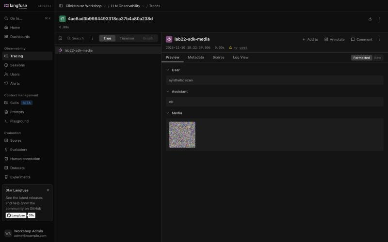
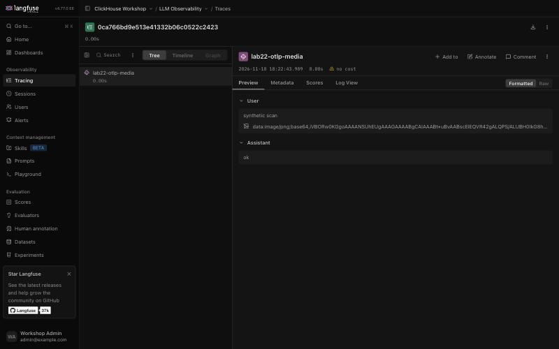
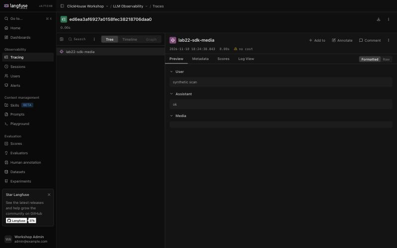

# Self-Hosting Langfuse on ClickHouse — Workshop (OSS + Enterprise)

[English](#english) | [한국어](#한국어)

---

## English

> **Langfuse v4 track.** The stack versions are pinned in [`_base/v4/versions.env`](../../../_base/v4/versions.env). For a Langfuse v3 deployment use [`labs/v3/langfuse-ee`](../../v3/langfuse-ee/README.md); v3 gets security patches only until 2027-01-31.

> **Related notes** (Korean): [Langfuse, 그리고 ClickHouse: LLM 옵저버빌리티 데이터 스택 해부](https://clickhouse.litkhai.dev/articles/langfuse/langfuse-clickhouse-llm/)

A hands-on, end-to-end workshop for **self-hosting [Langfuse](https://langfuse.com)** — the open-source LLM observability platform — and then looking *under the hood* at the **ClickHouse backend** that powers it.

Langfuse stores all of its OLTP state (users, orgs, projects, prompts, the audit log) in **Postgres**, but every **observation and score** lands in **ClickHouse**. The stack here is pinned to **Langfuse v4**, whose data model is *observations-first*: one wide row per observation in `events_full` / `events_core` (a trace is just its root observation, with user, session, tags and metadata repeated on every row), plus `scores`. That makes Langfuse a real, production-grade ClickHouse application you can stand up in minutes — and a great way to *feel* why ClickHouse is the right OLAP engine for high-volume, append-only LLM telemetry.

The workshop has two tracks:

- **OSS track (labs 01–04)** — deploy the full stack with Docker Compose, push realistic traces with the Python SDK, then query the ClickHouse backend directly with SQL.
- **Enterprise track (labs 05–22)** — activate an **enterprise license key** and exercise the EE-only features: **Instance Management / Org API**, project-level **RBAC**, **SCIM** provisioning, **Audit Logs**, **Data Retention**, **Server-Side Data Masking** (proven against ClickHouse), **Protected Prompt Labels**, **UI Customization**, **Organization-Creators allowlist**, and a **Parquet export ↔ ClickHouse** round-trip.

> This directory is the **`-ee` (Enterprise Edition) edition** of the workshop — the OSS track still runs standalone, but the focus is the enterprise feature surface and how each one lands in (or is proven against) ClickHouse.

### 🎯 Why this lab

Most Langfuse tutorials stop at "send a trace to Langfuse Cloud." This one is for **Solution Architects and platform teams** who need to answer:

1. *What does a self-hosted Langfuse deployment actually consist of?* (6 containers, 4 stateful backends)
2. *Where does my LLM telemetry physically live, and can I query it?* (Yes — it's ClickHouse, and lab 04 runs cost/latency/quality analytics straight on it)
3. *What do I get when I add an enterprise license?* (RBAC, SCIM, audit, retention — fully scripted, no UI click-ops)

### 🏗️ Architecture

```
                       ┌─────────────────┐
   your LLM app  ──────►   langfuse-web   │  :3000  UI + Public API
   (SDK / OTEL)        │   langfuse-worker│  :3030  async ingestion + jobs
                       └───────┬─────────┘
            ┌──────────────────┼───────────────────┬───────────────┐
            ▼                  ▼                   ▼               ▼
      ┌──────────┐      ┌────────────┐       ┌─────────┐     ┌──────────┐
      │ Postgres │      │ ClickHouse │       │  Redis  │     │  MinIO   │
      │  OLTP    │      │   OLAP     │       │ queue + │     │  S3 blob │
      │ users,   │      │ events_full│       │  cache  │     │ raw events│
      │ orgs,    │      │ events_core│       └─────────┘     │ media,    │
      │ audit_log│      │ scores     │ ◄── labs 03 & 04      │ exports   │
      └──────────┘      └────────────┘                      └──────────┘
```

### 📁 File Structure

```
langfuse-ee/
├── README.md                    # This file
├── 01-up.sh                     # Wrapper → _base/bin/up.sh v4: stack up, wait for health, print credentials
├── 02-generate-traces.py        # Wrapper → _base/v4/seed_traces.py: nested spans/generations, sessions, scores
├── 03-clickhouse-explore.sql    # Discover the events_full/events_core/scores tables in ClickHouse
├── 04-clickhouse-analytics.sql  # Cost / latency / quality analytics straight on ClickHouse
├── 05-ee-activate.sh            # Restart with the license key, verify EE is active
├── 06-ee-rbac-scim.sh           # Org/project provisioning, SCIM users, project-level RBAC
├── 07-ee-audit-retention.sh     # Data-retention policy + read the audit log
├── 08-ee-data-masking.sh        # Server-side masking, PROVEN absent in ClickHouse
│   ├── 08-generate-pii-traces.py#   ↳ send traces containing sentinel secrets/PII
│   └── 08-verify-masking.sql    #   ↳ ClickHouse proof in events_full: raw secrets gone, [REDACTED_*] present, a PASS/FAIL verdict row
├── 09-ee-protected-prompts.sh   # Versioned prompts + deployment labels + protected labels
├── 10-ee-instance-governance.sh # UI customization + organization-creators allowlist
├── 11-ee-parquet-export.sh      # Blob-storage Parquet export + ClickHouse s3() round-trip
├── 12-ee-masking-failure-modes.sh # Masking callback down / slow / 500 × FAIL_CLOSED, per-project rule, legacy path, S3 raw copy
│   └── 12-send-marker.py        #   ↳ one OTLP trace with a scenario-unique fake secret
├── 13-ee-project-isolation.sh   # Org NONE + project VIEWER: what a user can and cannot see across projects
├── 14-field-encryption.sh       # AES-GCM field encryption in the SDK hook, checked in ClickHouse, API and search
│   ├── 14-field-encryption.py   #   ↳ sender with mask_otel_spans
│   ├── 14-decrypt-fields.py     #   ↳ reader: public API + per-project key
│   └── 14-judge-encrypted.sh    #   ↳ real managed LLM-as-a-judge on the encrypted input (claude-haiku-4-5, ~3 calls)
├── 15-ch-row-policy.sh          # ClickHouse OSS row policy on project_id; CREATE MASKING POLICY on OSS
├── 16-ee-sso.sh                 # Keycloak OIDC, a SAML IdP behind it, first-login roles, SSO enforcement, account linking
│   └── 16-sso-login.py          #   ↳ scripted browser sign-in through Keycloak (stdlib only)
├── 17-ee-encryption.sh          # TLS to ClickHouse, ClickHouse encrypted disk, MinIO SSE-S3, what Postgres holds
├── 18-ee-protected-labels.sh    # Protected `production` label: MEMBER vs ADMIN vs project API key, audit rows, license off
├── 19-ee-scheduled-parquet-export.sh # The worker's scheduled Parquet export, read back from its manifests; lag buffer, late spans
├── 20-ee-retention-after-export.sh # Archive-then-delete for real: the batch retention cleaner deletes, the Parquet archive stays
├── 21-ee-export-object-lock.sh  # The export into a WORM bucket (MinIO object lock, GOVERNANCE retention)
├── 22-ee-aws-s3-sse-kms.sh      # Event + media buckets on AWS S3 with a customer-managed KMS key; SDK vs OTLP media, presigned URLs
│   └── 22-send-media.py         #   ↳ one trace with a synthetic PNG: SDK LangfuseMedia or raw OTLP data URI
├── captures/22-*.jpg            # Langfuse UI captures of step 22
└── 99-cleanup.sh                # Wrapper → _base/bin/down.sh v4: tear the stack down (--purge to wipe volumes)
```

The stack itself is **shared with the other labs** and lives in [`_base/`](../../../_base/README.md) — compose file, EE / masking / governance overlays, the masking sidecar, `.env.example`, and `bin/up.sh` · `bin/check.sh` · `bin/down.sh`:

```
_base/
├── .env.example                 # Secrets, headless-init, EE license key, SDK keys (copy to _base/.env)
├── v3/ · v4/                    # Per track: versions.env (image pins) · requirements.txt (v4: langfuse, anthropic, opentelemetry-instrumentation-anthropic, cryptography) · seed_traces.py
├── docker-compose.yml           # OSS stack (pinned images): web · worker · postgres · clickhouse · redis · minio
├── docker-compose.ee.yml        # EE overlay: injects license key + admin API key
├── docker-compose.masking.yml   # Lab 08 overlay: masking sidecar + worker callback wiring
├── docker-compose.governance.yml# Lab 10 overlay: UI customization + org-creators allowlist
├── docker-compose.sso.yml       # Lab 16 overlay: Keycloak (realms in sso/) + AUTH_KEYCLOAK_* and the SSO switches
├── docker-compose.encryption.yml# Lab 17 overlay: ClickHouse TLS + encrypted disk (own volume), MinIO KMS key, LANGFUSE_S3_*_SSE
├── docker-compose.retention.yml # Lab 20 overlay: the batch data-retention cleaner on, 1-minute interval (worker)
├── docker-compose.aws-s3*.yml   # Lab 22 overlays: event + media buckets on AWS S3 (aws-s3), SSE-KMS on events (aws-s3-sse) and media (aws-s3-media-sse)
├── sso/ · encryption/           # Lab 16 realm files · lab 17 ClickHouse config (keys and certificates are generated, gitignored)
├── masking/masking_service.py   # Labs 08, 12: tiny stdlib masking-callback sidecar (+ /mask-slow, /mask-500, per-project rule)
└── bin/                         # up.sh · check.sh · down.sh (first argument: the track, v3 or v4)
```

### ✅ Prerequisites

- **Docker + Docker Compose** (Docker Desktop on Mac/Windows). Give it ≥ 4 CPU / 16 GiB.
- **Python 3.10+** for lab 02 and the SDK scripts (Langfuse Python SDK v4 requires it; on macOS the system `python3` is older — use e.g. `python3.12`). Install the pinned packages with `pip install -r _base/v4/requirements.txt`.
- *(optional)* an **Anthropic API key** (`ANTHROPIC_API_KEY` in `_base/.env`) to make lab 02 and the eval lab call a real model (`claude-haiku-4-5`) instead of the offline simulation.
- **`jq`** and **`curl`** for the enterprise scripts (05 onward).
- An **enterprise license key** for the enterprise labs, 05 onward (the OSS track needs nothing extra; 14 and 15 are not license-gated, and 18 and 19 also run with `--license-off`).

### 🚀 Quick Start (OSS track)

```bash
# from the repository root
cp _base/.env.example _base/.env   # edit the # CHANGEME secrets for anything non-local
cd labs/v4/langfuse-ee

# 1) Deploy. First boot runs Postgres + ClickHouse migrations (~2-3 min).
./01-up.sh
#    → http://localhost:3000  (login: admin@example.com / workshop-admin-pw)
../../../_base/bin/check.sh v4     # optional: containers healthy, migrations finished, SDK keys valid

# 2) Push ~40 realistic traces (runs fully offline; an Anthropic key is optional)
python3.12 -m venv ../../../.venv-v4 && source ../../../.venv-v4/bin/activate    # Python 3.10+
pip install -r ../../../_base/v4/requirements.txt
python 02-generate-traces.py

# 3) Explore Langfuse's ClickHouse backend
docker exec -i langfuse-hols-v4-clickhouse-1 clickhouse-client -u clickhouse --password clickhouse \
  --multiquery < 03-clickhouse-explore.sql

# 4) Run LLM-observability analytics directly on ClickHouse
docker exec -i langfuse-hols-v4-clickhouse-1 clickhouse-client -u clickhouse --password clickhouse \
  --multiquery < 04-clickhouse-analytics.sql
```

> The container name is fixed by the compose project name (`langfuse-hols-v4`: `langfuse-hols-` plus the track, set in `_base/docker-compose.yml`), so it no longer depends on the directory the stack was started from.

### 🏢 Enterprise Track

```bash
# Put your key in _base/.env:   LANGFUSE_EE_LICENSE_KEY=<your-key>
#                               ADMIN_API_KEY=<any-strong-random-string>

./05-ee-activate.sh          # redeploy with the EE overlay; verify license is active
./06-ee-rbac-scim.sh         # create org → org key → project → SCIM users → RBAC roles
./07-ee-audit-retention.sh   # set a 14-day retention policy + dump the audit log
./08-ee-data-masking.sh      # mask secrets on ingestion; PROVE they never reach ClickHouse
./09-ee-protected-prompts.sh # versioned prompts + deployment labels + protected labels
./10-ee-instance-governance.sh # UI customization + organization-creators allowlist
./11-ee-parquet-export.sh    # Parquet export to object storage + ClickHouse s3() round-trip
./12-ee-masking-failure-modes.sh  # masking callback down / slow / 500, per-project rule, legacy path, S3 raw copy (~4 min)
./13-ee-project-isolation.sh # org NONE + project VIEWER: cross-project visibility
./14-field-encryption.sh     # AES-GCM field encryption in the SDK hook (needs cryptography from requirements.txt)
./15-ch-row-policy.sh        # ClickHouse OSS row policy on project_id
./16-ee-sso.sh               # Keycloak OIDC + SAML broker, first-login roles, SSO enforcement (~3 min)
./17-ee-encryption.sh        # TLS to ClickHouse + encrypted disk + MinIO SSE-S3 (~2 min, own ClickHouse volume)
./18-ee-protected-labels.sh --license-off  # who can still move a protected label; restarts web + worker twice (a few minutes)
./19-ee-scheduled-parquet-export.sh        # scheduled Parquet export read back (~20 min: waits out the 20-min lag buffer)
./20-ee-retention-after-export.sh          # archive-then-delete with the batch retention cleaner (retention overlay, a few minutes)
./21-ee-export-object-lock.sh              # export into a WORM bucket; a written version cannot be deleted
./22-ee-aws-s3-sse-kms.sh                  # AWS S3 + SSE-KMS for events and media (needs AWS credentials, ~5 min); --cleanup after
```

### 🧩 EE feature coverage

Every Enterprise entitlement listed on the [Langfuse license-key page](https://langfuse.com/self-hosting/license-key), mapped to the lab that exercises it:

| Enterprise entitlement | Lab | ClickHouse angle |
|---|---|---|
| Instance Management API | 05 | — |
| Org Management API & SCIM | 06 | — |
| Project-level RBAC roles | 06, 13 | — |
| Audit Logs | 07 | (audit log is in Postgres) |
| Data Retention policies | 07 | nightly worker deletes old rows from ClickHouse |
| **Server-Side Data Masking** | 08, 12 | **proof runs on ClickHouse** — raw secrets never persist; 12 shows when they do |
| **Protected Prompt Labels** | 09, 18 | (prompts are in Postgres) |
| **UI Customization** | 10 | — |
| **Organization Creators** | 10 | — |
| Parquet Blob-Storage Export* | 11, 19 | **ClickHouse `FORMAT Parquet` writes the files; `s3()` reads them back** |

\* Scheduled blob-storage export is available to all self-hosted projects (not license-gated), but it's the enterprise data-platform / archival story and the most ClickHouse-native lab — so it lives on the enterprise track.

Steps 14 and 15 are not license-gated: 14 uses the Python SDK's `mask_otel_spans` hook, and 15 uses ClickHouse OSS row policies. They are here because regulated deployments ask for them together with 06/08.

### 📖 Lab Walkthrough

#### 01 — Deploy the stack ([01-up.sh](01-up.sh))

Brings up the six containers from [docker-compose.yml](../../../_base/docker-compose.yml) (via the shared [`_base/bin/up.sh`](../../../_base/bin/up.sh)) and blocks until `GET /api/public/health` returns OK. The compose file uses **headless initialization** (`LANGFUSE_INIT_*` in `_base/.env`) to auto-create the first organization, project, user, and API keys on boot — so there are **no UI click-ops** before you can send data. Key things to notice: ClickHouse runs single-node (`CLICKHOUSE_CLUSTER_ENABLED=false`), all backends run in **UTC** (a hard Langfuse requirement), and MinIO provides S3-compatible blob storage.

#### 02 — Generate traces ([02-generate-traces.py](02-generate-traces.py))

Uses the **Langfuse Python SDK (v4, OpenTelemetry-native)** to simulate a customer-support RAG assistant. Each trace is a nested observation tree:

```python
with lf.start_as_current_observation(as_type="span", name="support-request",
                                     input={"question": ...}) as root:
    with propagate_attributes(trace_name="support-request", user_id=..., session_id=...,
                              tags=[...], metadata={"tier": ...}):          # on EVERY observation below
        with lf.start_as_current_observation(as_type="span", name="retrieve-context"): ...
        with lf.start_as_current_observation(as_type="generation",
                                             name="answer-generation", model="gpt-4o") as gen:
            gen.update(output=..., usage_details={"input": ..., "output": ...})
    root.update(output=...)
lf.create_score(name="user-thumbs", value=1, data_type="BOOLEAN", trace_id=...)
lf.flush()   # critical in short scripts — sends the async buffer before exit
```

SDK v4 replaced `update_current_trace()` with `propagate_attributes()`: the trace attributes are written onto every observation created inside the block (metadata is `dict[str, str]`, values ≤ 200 characters), and the trace input/output go on the root observation. It varies model, user, session, tags (`env`/`feature`/`tier`), token usage, latency, errors (~8%), and attaches scores. Cost is computed **automatically** by Langfuse from the model name + token usage — but only when the usage keys match the model's price keys, so the generator sends `input` / `output`, and only simulates models that have a price definition (`gpt-4o-mini`, `gpt-4o`, `claude-haiku-4-5`). Runs offline by default; set `ANTHROPIC_API_KEY` in `_base/.env` to make real calls with the official `anthropic` SDK, traced by `opentelemetry-instrumentation-anthropic` (the call shows up as a `GENERATION` with the model, tokens and cost).

#### 03 — Explore the ClickHouse backend ([03-clickhouse-explore.sql](03-clickhouse-explore.sql))

Pure discovery against the `default` database Langfuse migrated into: `SHOW TABLES`, `DESCRIBE events_full/events_core/scores`, engine + sort-key + partitioning, row counts, the full observation tree for one trace, and the monthly partition layout. **There is no trace row any more: a trace is the root row (`is_app_root`) of `events_full` / `events_core`, its steps are the other rows with the same `trace_id`, and scores live in `scores`.** The v3 tables `traces` and `observations` still exist but stay empty — the lab prints their row counts (0) as the evidence that v4 writes elsewhere.

> The ClickHouse schema is an internal Langfuse detail, **not a stable API** — v3 → v4 moved everything from `traces` / `observations` to `events_full` / `events_core`, and column names can change again. The `DESCRIBE` output is always the source of truth for your installed version.

#### 04 — Analytics on ClickHouse ([04-clickhouse-analytics.sql](04-clickhouse-analytics.sql))

The SA payoff: the same questions the Langfuse UI answers, expressed as plain ClickHouse SQL — and a showcase of why ClickHouse fits this workload.

| Query | ClickHouse primitive |
|---|---|
| Spend & tokens by model | `sum()` over `total_cost` and the `usage_details` `Map`, on `type = 'GENERATION'` rows |
| Latency p50/p95/p99 per model | `quantile()` over `dateDiff('millisecond', start_time, end_time)` |
| Error rate per model | `countIf(level = 'ERROR')` conditional aggregation |
| Cost by customer tier | `metadata_values[indexOf(metadata_names, 'tier')]` — metadata is two parallel arrays; **no join** |
| Quality by customer tier | the one remaining join: `scores.trace_id = events_core.trace_id` |
| Thumbs-up rate / grounding | `sumIf`/`avgIf` over the `scores` table |
| Per-user spend leaderboard | one pass over `events_core` — `user_id` is on every row |
| Daily trend / session depth | time bucketing + `uniqExactIf` / `countIf(is_app_root)` |

The v4 lesson of this lab: the v3 queries joined `traces` to `observations` to learn the user or the tier of a generation. In v4 every observation row already carries them, so those joins disappear.

#### 05 — Activate Enterprise ([05-ee-activate.sh](05-ee-activate.sh))

Redeploys `langfuse-web` + `langfuse-worker` with [docker-compose.ee.yml](../../../_base/docker-compose.ee.yml), which injects `LANGFUSE_EE_LICENSE_KEY` into **both** containers (plus `ADMIN_API_KEY`). It verifies activation by hitting the **Instance Management API** (`/api/admin/organizations`) — which only responds when a valid license is present.

#### 06 — RBAC & SCIM ([06-ee-rbac-scim.sh](06-ee-rbac-scim.sh))

The complete self-service admin chain, fully scripted:

```
ADMIN_API_KEY → create Organization → mint org-scoped API key
     org key   → create Project → mint project API key
     org key   → SCIM: provision users → assign ORG roles
     org key   → assign a PROJECT-level role that overrides the org role  (EE)
```

Roles: `OWNER` (all) · `ADMIN` (settings + members) · `MEMBER` (view + create scores) · `VIEWER` (read-only). The finale gives Bob `VIEWER` org-wide but `ADMIN` on one project — **per-project RBAC is an enterprise feature**.

#### 07 — Audit Logs & Data Retention ([07-ee-audit-retention.sh](07-ee-audit-retention.sh))

- **Data Retention**: sets a 14-day retention on the project via `PUT /api/public/projects/{id}`. A non-zero value requires the data-retention entitlement (EE) — the same call is rejected on OSS. A nightly worker then deletes traces/observations/scores older than the window straight from ClickHouse.
- **Audit Logs**: discovers the audit table in Postgres and dumps the most recent who/what/when records — including the org/project/membership changes lab 06 just made, with full before/after state.

#### 08 — Server-Side Data Masking ([08-ee-data-masking.sh](08-ee-data-masking.sh))

The flagship **ClickHouse-verifiable** EE demo. A tiny masking-callback sidecar ([masking_service.py](../../../_base/masking/masking_service.py), stdlib only) is wired to the worker via [docker-compose.masking.yml](../../../_base/docker-compose.masking.yml) as `LANGFUSE_INGESTION_MASKING_CALLBACK_URL`. Langfuse POSTs each OTLP-ingested trace to it; the service redacts anything matching a secret/PII pattern (API keys, credit cards, e-mails, KR 주민등록번호) and returns the same structure — **before** the trace is persisted.

[08-generate-pii-traces.py](08-generate-pii-traces.py) sends traces containing four sentinel secrets (in the input, the output and the metadata), then [08-verify-masking.sql](08-verify-masking.sql) proves the payoff **directly on ClickHouse**, in `events_full` — the table with the full, untruncated payloads:

```sql
-- want ALL ZERO: no raw secret reached the OLAP store (input, output or metadata)
countIf(position(input, '0xDEADBEEF01') > 0 OR position(output, '0xDEADBEEF01') > 0
     OR arrayExists(v -> position(v, '0xDEADBEEF01') > 0, metadata_values))  AS leaked_api_key
-- want > 0: the redaction placeholders did land
countIf(position(input, '[REDACTED_') > 0 OR position(output, '[REDACTED_') > 0)  AS masked_payload_rows
```

The file ends with one explicit **`verdict`** row — `PASS` only if the pii-demo rows landed **and** some of them carry a `[REDACTED_*]` placeholder **and** every leak count is `0`, otherwise `FAIL` — and `08-ee-data-masking.sh` exits `1` on `FAIL`. A "0 leaks" result proves nothing if the table is empty, so `./08-ee-data-masking.sh --selftest` is the positive control: it points the same SQL at an empty copy of `events_full` and requires the verdict to be `FAIL`.

Key facts: masking applies **only** to the OTLP endpoint (`/api/public/otel` = SDK v3+); `FAIL_CLOSED=true` drops events if the callback errors (secure default); the callback body is an **OTLP Trace Request proto in JSON**, so the sidecar deep-walks the JSON and only rewrites string leaves.

#### 09 — Protected Prompt Labels ([09-ee-protected-prompts.sh](09-ee-protected-prompts.sh))

Prompt governance. The script creates a versioned prompt, moves the `production` label from v1 → v2 via the API, resolves the current production prompt, then shows those versions living in **Postgres** (prompts are OLTP — not ClickHouse) and the matching rows in the **audit log** (ties back to lab 07). The capstone is the EE **protected label**: once `production` is marked protected in Project Settings, the lab-06 roles apply — Bob (`VIEWER`) and Alice (`MEMBER`) can no longer repoint or delete it, only Owner/Admin can. Protection is toggled in the UI (no public API); enforcement is per user role. Step 18 protects the label and measures who can still move it, including a project API key.

#### 10 — Instance Governance ([10-ee-instance-governance.sh](10-ee-instance-governance.sh))

Two instance-level controls, both env-driven via [docker-compose.governance.yml](../../../_base/docker-compose.governance.yml): **UI Customization** (`LANGFUSE_UI_LOGO_*`, `LANGFUSE_UI_FEEDBACK/DOCUMENTATION/SUPPORT_HREF` — co-brand + point help links inward) and the **Organization-Creators allowlist** (`LANGFUSE_ALLOWED_ORGANIZATION_CREATORS` — only listed emails may create new orgs). The script redeploys `langfuse-web`, then `exec … env | grep`s the running container to **prove the vars are live**, and prints a UI verification checklist.

#### 11 — Parquet Export ↔ ClickHouse ([11-ee-parquet-export.sh](11-ee-parquet-export.sh))

The enterprise data-platform / archival story, in two parts. **(A)** Configure a scheduled **Parquet** blob-storage export via `PUT /api/public/integrations/blob-storage` (type `S3_COMPATIBLE`, pointed at the workshop MinIO). On v4 the integration's `exportSource` must be the enriched observations source, `OBSERVATIONS_V2`; the legacy `LEGACY_TRACES_OBSERVATIONS` source reads the v3 tables, and Langfuse's export docs state that legacy sources are unavailable in the default `events_only` mode. **(B)** Demonstrate the exact primitive that powers it, **live**, with ClickHouse — no waiting on the scheduler:

```sql
INSERT INTO FUNCTION s3('http://minio:9000/langfuse/exports/manual/events_full.parquet',
                        'minio', 'miniosecret', 'Parquet')
  SELECT * FROM default.events_full FINAL WHERE is_deleted = 0 SETTINGS s3_truncate_on_insert = 1;
SELECT count() FROM s3('http://minio:9000/langfuse/exports/manual/events_full.parquet',
                       'minio', 'miniosecret', 'Parquet');   -- read it right back
```

The script prints the source and Parquet row counts side by side and exits `1` if they differ.

Pairs with lab 07 as **archive-then-delete**: export before retention deletes. SA gotcha baked in — on self-hosted, **ClickHouse < 25.11** may not surface Parquet export failures (a run can "succeed" with an invalid file); upgrade to ≥ 25.11 or use CSV/JSON for reliable failure detection.

#### 12 — Masking failure modes ([12-ee-masking-failure-modes.sh](12-ee-masking-failure-modes.sh))

Lab 08 shows the happy path; this step breaks the callback. What the 4.56.0 worker does, read from the image
(`worker/dist/queues/otelIngestionQueue.js`, `@langfuse/shared/.../ingestionMasking/applyIngestionMasking.js`, `env.js`):
masking runs **only in the OTLP ingestion queue, after the raw payload is downloaded from the S3 event bucket**. The defaults are
`TIMEOUT_MS=500`, `FAIL_CLOSED=false` and `MAX_RETRIES=1` (2 attempts), and the callback gets `X-Langfuse-Project-Id` / `X-Langfuse-Org-Id`.
The web container never calls it. The repository overlay sets `FAIL_CLOSED=true` / `2000 ms`, so every scenario sets both explicitly. Measured on 2026-10-12:

| Callback | `FAIL_CLOSED=false` (Langfuse default) | `FAIL_CLOSED=true` |
|---|---|---|
| healthy `/mask` | masked (positive control) | — |
| down (closed port, or sidecar stopped) | **raw secret stored** in ClickHouse | dropped |
| slow (2 s against a 500 ms timeout) | **raw secret stored** | dropped |
| HTTP 500 | **raw secret stored** | dropped |

- **Dropped:** a drop is shown by the worker log line `Dropping OTEL event due to masking failure` with its `fileKey`, and by no row after a wait longer than the slowest raw case. The S3 object is still there, so the event can be replayed.
- **Per-project rules:** one callback can apply different rules per project by reading `X-Langfuse-Project-Id`. With `MASK_STRICT_PROJECT_IDS=<A>`, an account number is redacted in A and kept in B, and `sk-` keys are redacted in both.
- **Legacy `/api/public/ingestion`:** in the default `events_only` write mode it answers HTTP **207** with a per-event 400 for `trace-create`, `span-create`, `generation-create` and `event-create`. Only `score-create` is accepted, and it skips masking: its raw `comment` lands in `scores`.
- **Raw copy in S3:** the raw OTLP payload stays in the event bucket at `events/otel/<project>/<yyyy>/<mm>/<dd>/<hh>/<mm>/<uuid>.json`. No masked copy is written back, and legacy score events are kept raw at `events/<project>/score/…`. The event bucket therefore holds the unmasked data and needs the same protection as the source system, plus a lifecycle rule.

#### 13 — Project isolation ([13-ee-project-isolation.sh](13-ee-project-isolation.sh))

New org with projects A and B. Two local users are created with `POST /api/auth/signup`, since SCIM takes no password:
- a **viewer** with org role `NONE` and `VIEWER` on A only;
- an **orgadmin** with org role `ADMIN` and no project role.

Both log in over NextAuth credentials (curl cookie jar).

| Surface | Viewer on A | Viewer on B | Orgadmin on A and B |
|---|---|---|---|
| session project list | listed | **absent** | both listed |
| tRPC `traces.byId`, `events.all` | 200 | **401 UNAUTHORIZED** | 200 |
| tRPC `projectApiKeys.create` | 403 | — | 200 |
| browser `/project/<id>/traces` | tracing page | **"Project Not Found"** | — |

- **UI deny is client-side:** the page route returns the same static shell to everyone, so the deny happens in the client from the session and tRPC. The browser check (2026-10-12, a viewer set up the same way) showed only A in the organization page.
- **Public API:** it authenticates with project API keys, not users. Key A reading B's trace returns HTTP 200 with an empty list, and the control (key B) returns the trace.

#### 14 — Field encryption in the SDK hook ([14-field-encryption.sh](14-field-encryption.sh))

**What is encrypted.** `Langfuse(mask_otel_spans=fn)` (SDK 4.17.0) patches span attributes before export. The sender encrypts
`langfuse.trace.input`, `langfuse.observation.input` and every `*.metadata.account_no` with AES-256-GCM:
- a random 12-byte nonce;
- AAD = project id;
- format `enc:v1:<project_id>:<base64url>`.

The output stays plaintext as the search control, and one control trace is sent without the hook. Per-project keys live in
`_base/.env.field-keys` (mode 600, ignored by `_base/.gitignore`). If the hook raises, the SDK drops the whole batch rather than sending plaintext.

**Results**
- **Storage:** ClickHouse `events_full` / `events_core` hold 0 plaintext markers and 4/4 `enc:v1:` rows. The control rows show plaintext, which proves the query can see it.
- **API:** `GET /api/public/v2/observations` returns the ciphertext the UI renders.
- **Decryption:** [14-decrypt-fields.py](14-decrypt-fields.py) reads with the project key and decrypts. With another project's key it fails with `InvalidTag`.
- **UI search** (tRPC `events.all`, `searchType` input / content): the plaintext input finds 0 encrypted traces (the control is found), while the plaintext output finds them. Metadata search was not tested.
- **LLM-as-a-judge** ([14-judge-encrypted.sh](14-judge-encrypted.sh), real `claude-haiku-4-5` calls, 2026-10-13): a managed observation-level evaluator maps only `{{input}}` on root observations. The judge's own traced call shows the prompt it received was `Question: enc:v1:<project>:…`, the stored ciphertext. It scored both encrypted traces 0 (*"The question text is encrypted ciphertext … not readable"*) and the plaintext control 1. The encrypted traces scored 0 in all 6 judgments over three runs. With the first prompt wording the control once scored 0 too, so the prompt was reworded. One passing run is not proof the control is stable. The script disables its rule on exit so no more paid calls follow.

#### 15 — ClickHouse OSS row policies ([15-ch-row-policy.sh](15-ch-row-policy.sh))

The script creates `analyst_a` (`SELECT ON default.*`) and a `USING project_id = '<A>' TO analyst_a` policy on all 12 tables that have `project_id`.
The Langfuse ClickHouse user has `access_management=0`, so the script drops a temporary admin user into `users.d` and removes it on exit.
- **The policy filters analyst_a:** it sees only A on every table with data, and `WHERE project_id='<B>'` returns 0.
- **No bypass:** `merge()`, `FINAL`, `PREWHERE` and `remote('localhost', …)` (after granting `REMOTE`) are filtered too, and `system.parts` is denied.
- **Langfuse is unaffected:** its account appears in no policy, and `users_without_row_policies_can_read_rows` is `true` (in `config.xml`'s `<access_control_improvements>`, not in `system.server_settings`). The public API for B returned the same 6 observations before and after, and ingestion kept working.
- **Unfiltered:** `schema_migrations` has no `project_id`, and the `analytics_*` views get no policy of their own.
- **Masking policy:** `CREATE MASKING POLICY` on 26.8.22.13 fails with `Code: 344 … Masking Policies are available only in ClickHouse Cloud. (SUPPORT_IS_DISABLED)`.

#### 16 — SSO: OIDC, a SAML IdP behind a broker, enforcement ([16-ee-sso.sh](16-ee-sso.sh))

The overlay [`docker-compose.sso.yml`](../../../_base/docker-compose.sso.yml) adds one Keycloak 26.8.1 with two realms:
- `langfuse` is the OIDC provider Langfuse uses (`AUTH_KEYCLOAK_*`);
- `corp` stands in for a company IdP that speaks SAML only. Langfuse has OIDC/OAuth providers but no SAML provider, so `langfuse` brokers `corp`, and the broker checks the SAML signature against `corp`'s certificate.

[16-sso-login.py](16-sso-login.py) signs in the way a browser does: NextAuth CSRF, `POST /api/auth/signin/keycloak`, the Keycloak login form, the SAMLResponse form for the brokered IdP, the Langfuse callback, `GET /api/auth/session`. `kc_idp_hint=corp-saml` on the sign-in request goes straight to the SAML IdP. Users and passwords are made at run time.

| Phase | Switches | What was observed |
|---|---|---|
| A | provider only | OIDC and SAML-brokered sign-in give a session; a wrong password does not. First login gets `LANGFUSE_DEFAULT_ORG_ROLE=NONE` + `LANGFUSE_DEFAULT_PROJECT_ROLE=VIEWER`. An email that already has a password account is refused with `OAuthAccountNotLinked` |
| B | `AUTH_DOMAINS_WITH_SSO_ENFORCEMENT=sso.test`, `AUTH_KEYCLOAK_ALLOW_ACCOUNT_LINKING=true` | sign-up and password sign-in for `sso.test` → HTTP 422 / refused, `other.test` unaffected; the refused user signs in through SSO and gets a `keycloak` row in Postgres `"Account"` |
| C | `AUTH_DISABLE_USERNAME_PASSWORD=true` | password sign-up and sign-in refused for every domain, the initial admin included; SSO still works |

- **Tokens in Postgres:** after an SSO sign-in, the user's `"Account"` row holds the IdP's `access_token`, `refresh_token` and `id_token` as issued: plain JWTs, not encrypted by Langfuse. `AUTH_IGNORE_ACCOUNT_FIELDS` exists to drop such fields; it was not tested.
- **Phase C locks out every password user**, the initial admin too. The script ends by restarting `langfuse-web` without the overlay and removing Keycloak, then checks the admin can sign in again.
- **For a browser:** add `127.0.0.1 keycloak` to `/etc/hosts`. The issuer must be the same URL for the browser and for `langfuse-web`.

#### 17 — Encryption in transit and at rest ([17-ee-encryption.sh](17-ee-encryption.sh))

The overlay [`docker-compose.encryption.yml`](../../../_base/docker-compose.encryption.yml) switches three things. ClickHouse runs on its own volume during this step, so the other labs' traces stay on the original one:
- **ClickHouse:** an encrypted disk (AES-256-CTR, key from `CLICKHOUSE_ENCRYPTION_KEY`) as `merge_tree.storage_policy`, and TLS only: 8443 / 9440 open, 8123 / 9000 removed.
- **MinIO:** a static KMS key (`MINIO_KMS_SECRET_KEY`), with Langfuse asking for SSE on each object (`LANGFUSE_S3_*_SSE=AES256`).
- **Langfuse:** `CLICKHOUSE_URL=https://…:8443`, `CLICKHOUSE_MIGRATION_SSL=true`, and `NODE_EXTRA_CA_CERTS` for the lab CA.

The script makes the CA, the server certificate and both keys once under `_base/encryption/{certs,secrets}/` (gitignored) and reuses them, because the encrypted volume can only be read with the same key.

| Area | What was observed |
|---|---|
| in transit | HTTPS from `langfuse-web` succeeds; without the CA → `UNABLE_TO_VERIFY_LEAF_SIGNATURE`; 8123 → `ECONNREFUSED`; 9000 from another container → `Connection refused`; `clickhouse-client` on 9440 with strict verification succeeds |
| ClickHouse | every Langfuse MergeTree table and the system log tables use `encrypted_policy`; the trace input reads back through the API; 0 raw files on the volume hold it. Control: a `CODEC(NONE)` table on the plain disk shows the sentinel in 1 file, the same table on the encrypted disk in 0 |
| MinIO | the event object is `X-Amz-Server-Side-Encryption: AES256`, readable through S3, 0 raw files hold the sentinel; control: an object without SSE shows it in 1 file |
| Postgres | an LLM connection secret and the project's API secret key appear 0 times in a full `pg_dump`; the connection name and the public key are there (control) |

- **The guide's snippet does not start as printed.** On ClickHouse 26.8.22.13 the encrypted disk that wraps `default` fails with `The wrapped disk must have been announced earlier. No disk with name default`, until `<default/>` is declared before it ([encrypted_storage.xml](../../../_base/encryption/clickhouse/encrypted_storage.xml)).
- **Migrations skip certificate checks.** With `CLICKHOUSE_MIGRATION_SSL=true` the image's `up.sh` adds `secure=true&skip_verify=true`: the migration connection is encrypted, but the server certificate is not checked. Langfuse's own HTTPS client does check it.
- **`merge_tree.storage_policy` applies to tables created after it is set.** Here that is a fresh volume. An existing deployment needs a data migration (for example `INSERT … SELECT` into new tables), which was not tested.
- **Not run:** Postgres and Redis TLS (`sslmode`, `REDIS_TLS_*`), disk encryption for Postgres, AWS S3 SSE-KMS, ClickHouse Cloud CMEK.

#### 18 — Protected prompt labels, enforced ([18-ee-protected-labels.sh](18-ee-protected-labels.sh))

Step 09 describes protection; this step turns it on and measures who can still move `production`. One organization, two users who sign in over NextAuth credentials (org `ADMIN` and org `MEMBER`), and one project API key, the credential a deployment pipeline holds. Users go through the tRPC API the UI calls; the key goes through the public API.

| Who | Before protection | After `production` is protected |
|---|---|---|
| MEMBER moves `production` (`prompts.setLabels`) | 200, moved (control) | **403**, not moved |
| MEMBER removes it, creates a version carrying it, deletes the labelled version or the prompt | — | **403** each, nothing changed |
| MEMBER creates an unlabelled version | 200 | 200 (control) |
| MEMBER protects a label · ADMIN protects `latest` | — | 403 · 400 |
| ADMIN moves `production` | — | 200 |
| **Project API key**: create with `production` · `PATCH …/versions/1` · `DELETE …?version=1` | 201 | **201 · 200 · 204: moved and deleted** |

- **API keys get past protection on purpose.** Langfuse v4.56.0 `web/src/features/prompts/server/utils/authorizeProtectedLabelMutation.ts`: "Ordinary project API keys may still promote protected labels (CI)". Only in-app-agent keys follow their creator's role. Treat the project key as the deployment credential.
- **Audit log** (Postgres `audit_logs`): the protection is one `promptProtectedLabel/create` row by the ADMIN, the key's three changes are `type = API_KEY` rows with its id, the MEMBER's move before protection is one `setLabel` row, and the six denied attempts after it leave none.
- **`--license-off`** restarts web and worker without the key (admin API → 403 as the control) and repeats the checks: protection is **still enforced** (`checkHasProtectedLabels` does not check the license), the ADMIN can neither protect `staging` nor unprotect `production` (403, entitlement), the ADMIN can still move `production`, and that move leaves **no audit row** (audit logs are EE). The script then restores the EE overlay.
- `--keep-users` keeps the two users' passwords in `~/.cache/langfuse-hols/18-users` (mode 600) for UI screenshots; delete the folder afterwards.

#### 19 — The scheduled Parquet export, read back ([19-ee-scheduled-parquet-export.sh](19-ee-scheduled-parquet-export.sh))

Step 11 configures the integration and proves the ClickHouse primitive by hand; this step lets the worker write the files and reads them back **by following the run manifests** (`{prefix}{project}/manifests/*.json`, read with ClickHouse `s3(…, 'RawBLOB')`). How a run works, from Langfuse v4.56.0 `worker/src/features/blobstorage/handleBlobStorageIntegrationProjectJob.ts`: one window `[last_sync_at, min(start + interval, now − 20 min))` per run, rows chosen by `e.start_time`, ClickHouse writes the Parquet (`FORMAT Parquet`), a run that is behind queues the next window at once. Runs are triggered with "Run now" (tRPC `blobStorageIntegration.runNow`).

| Check | Result (2026-11-07) |
|---|---|
| 24 spans with `start_time` 35–127 min ago, `FULL_HISTORY`, `every_20_minutes` | 6 manifests, one per 20-min window; distinct `id` in the Parquet **24 = 24** ClickHouse rows before `last_sync_at`, no duplicates |
| A span inside the 20-min lag buffer (start now − 5 min) | **absent** from the first export, **present** after the second run 16 min later |
| A span sent after the first run with `start_time` before `last_sync_at` | in ClickHouse, **in no export** (8 manifests): the window filter is `start_time`, so late-arriving data is never exported |
| Parquet file | `PAR1`, 42 columns, no `input_price` / `output_price` / `total_price`, `total_cost` present |
| MEMBER `runNow` / `get` | 403 / 403 (`integrations:CRUD` is OWNER / ADMIN) |
| Integration with a wrong secret | `PUT` → **200** (not checked on save); after "Run now" `last_error` = signature mismatch, 0 manifests |

One manifest (03:36:04 → 03:40:00 UTC) came from the scheduler's own `*/20` tick at 04:00 UTC, between the two manual runs; the script does not assert it. The scheduled export is not license-gated on self-hosted (`scheduled-blob-exports` is in every self-hosted plan): `--license-off` restarts web and worker without the key after the setup and runs every export check unlicensed (14 PASS on 2026-11-07, `--phase1-only`).

#### 20 — Retention after export ([20-ee-retention-after-export.sh](20-ee-retention-after-export.sh))

Archive-then-delete, run for real. A project with a 3-day retention gets five spans 4 days old and one 1 hour old; a weekly `FULL_HISTORY` Parquet export archives all six. Then a **late** span, also 4 days old, arrives after the export has passed its `start_time`. The worker restarts with the [retention overlay](../../../_base/docker-compose.retention.yml) (the batch retention cleaner, off by default, on a 1-minute interval):

| Check | Result (2026-11-07) |
|---|---|
| The cleaner's statement (`system.query_log`) | lightweight `DELETE FROM events_full / events_core WHERE project_id = … AND start_time < now − 3 days`, about 10 s after the restart |
| Rows older than 3 days | 0; the 1-hour span **kept** (control) |
| The five archived old spans | **still readable from Parquet** |
| The late span | **in neither ClickHouse nor the archive: lost** |

The default path is a daily job at 03:15 (`dataRetentionQueue.ts`), which also deletes by `start_time`; it was not waited for. The script restores the worker without the overlay.

#### 21 — Export into a WORM bucket ([21-ee-export-object-lock.sh](21-ee-export-object-lock.sh))

A MinIO bucket with object lock and a default GOVERNANCE retention of 1 day as the export target. The run succeeds (`last_error` empty, manifest written, 3 = 3 rows read back), every written object carries GOVERNANCE retention, and `mc rm --version-id` on a written Parquet is refused ("is WORM protected"), while the same command deletes on a bucket without object lock (control). The bucket is left in place (governance bypass needed to remove it). COMPLIANCE mode and AWS S3 are not run (#95).

#### 22 — Event and media buckets on AWS S3 with SSE-KMS ([22-ee-aws-s3-sse-kms.sh](22-ee-aws-s3-sse-kms.sh))

Moves both buckets from MinIO to AWS S3 in one region, encrypted with a customer-managed KMS key (overlays [`aws-s3`](../../../_base/docker-compose.aws-s3.yml), [`aws-s3-sse`](../../../_base/docker-compose.aws-s3-sse.yml), [`aws-s3-media-sse`](../../../_base/docker-compose.aws-s3-media-sse.yml)). The step creates the key and two buckets: default SSE-KMS with that key and S3 Bucket Key, public access blocked, a 30-day expiry on `events/`, and a bucket policy that refuses non-TLS requests and any PUT that names another algorithm or key. A PUT without an encryption header is allowed and gets the bucket default. Then [22-send-media.py](22-send-media.py) sends a synthetic PNG two ways:

| Path | What happened |
|---|---|
| Python SDK `LangfuseMedia` (presigned PUT), `LANGFUSE_S3_MEDIA_UPLOAD_SSE` **unset** | upload 200, object `aws:kms` with the lab key; ClickHouse holds a `@@@langfuseMedia:…@@@` reference; no image bytes in the raw event object |
| Raw OTLP with a base64 data URI (a 27.8 KB PNG, 37 KB of base64), Langfuse defaults | **the base64 stays inline in ClickHouse**: the worker's extraction variables default to `false` |
| Same, with `LANGFUSE_OTEL_MEDIA_UPLOAD_ENABLED=true`, `LANGFUSE_OTEL_EARLY_MEDIA_EXTRACTION_ENABLED=true`, `LANGFUSE_OTEL_EARLY_MEDIA_EXTRACTION_PROJECT_IDS=*` | reference in ClickHouse, object `aws:kms` with the lab key; **the raw event object still holds the base64** |
| `LANGFUSE_S3_MEDIA_UPLOAD_SSE=aws:kms` + key id set | the presigned PUT URL signs `x-amz-server-side-encryption` and `…-aws-kms-key-id`, which the SDKs do not send: **403 `SignatureDoesNotMatch`, the image is not stored**, and the trace shows an empty Media box. The same PUT with the two headers → 200. Worker uploads are not affected |

Reading back: the public media API returns a presigned GET on the bucket's own S3 host, with `X-Amz-Expires` = `LANGFUSE_S3_MEDIA_DOWNLOAD_URL_EXPIRY_SECONDS` (60 in the run, default 3600). Anyone holding the URL gets the image without a Langfuse login until it expires (403 after). So the SDK hosts and the browsers that open Langfuse both need a route to the S3 endpoint. `--cleanup` deletes the buckets and schedules the key for deletion (7 days).





Not run: the server-side fallback for *large* base64 that the multi-modality docs describe (no size threshold tested), a KMS key policy limited to one IAM role, cross-region replication, instance-role or IRSA credentials, SDK 5.x and the JS SDK (their upload code sends the same three headers as SDK 4.17.0, read on 2026-11-10).

### 🔑 Gotchas worth remembering

| | Note |
|---|---|
| **Two databases, two jobs** | Postgres = OLTP (users, orgs, prompts, **audit log**). ClickHouse = OLAP (**events_full / events_core, scores**). Don't look for traces in Postgres — and on v4 not in the `traces` table either. |
| **UTC everywhere** | ClickHouse **and** Postgres must run in UTC, or queries return wrong/empty results. The compose file sets this. |
| **`flush()` in scripts** | The SDK ships data asynchronously. A short script that exits without `lf.flush()` loses its traces. |
| **Cost is derived** | You send `usage_details` (tokens); Langfuse computes cost from its model price table — but only when the usage keys match the model's price keys. Send `input` / `output`, and use model names it has a definition for (`gpt-4o`, `claude-haiku-4-5`). |
| **Trace attributes are per observation** | SDK v4 has no `update_current_trace()`. Wrap the work in `propagate_attributes(...)`; metadata is `dict[str, str]`, values ≤ 200 characters. |
| **Don't seed the global RNG** | `random.seed()` makes OpenTelemetry reuse the same trace and span ids on every run, and the duplicate rows survive `FINAL`. The generators use a private `random.Random`. |
| **EE license on BOTH containers** | `LANGFUSE_EE_LICENSE_KEY` must be set on `langfuse-web` *and* `langfuse-worker`. The overlay does this. |
| **CH schema ≠ API** | Query ClickHouse directly for labs/debugging, but treat the schema as unstable. For apps, use the Public API / SDK query helpers / Blob Storage Export. |
| **`retention=0` = forever** | Minimum non-zero retention is 3 days. Pair retention with a Blob Storage Export if you must archive before deletion. |
| **Masking fails open by default** | `LANGFUSE_INGESTION_MASKING_CALLBACK_FAIL_CLOSED` defaults to `false`: a down, slow (> 500 ms) or erroring callback stores the raw event. Set it to `true` (step 12). |
| **The event bucket keeps the raw payload** | Masking runs after the worker downloads from S3, and the raw object stays there. Protect and expire the bucket like the source data (step 12). |
| **v1 read endpoints are off in `events_only`** | `GET /api/public/traces`, `/observations`, `/scores` and `/sessions` return 404. Use `/api/public/v2/observations`. Legacy ingestion takes only `score-create`, with HTTP 207 (steps 12–15). |
| **Project API keys move protected labels** | Protection applies to users (UI / tRPC). A project API key can still create, move and delete `production` through the public API, by design (step 18). Treat the key as the deployment credential and watch `audit_logs` for `type = API_KEY`. |
| **Late spans are never exported** | The scheduled export picks rows by `start_time` from `last_sync_at` onward, 20 min behind now. A span that arrives with an older `start_time` stays in ClickHouse and in no export (step 19); and retention later deletes it with no archived copy (step 20). Reconcile the archive with ClickHouse before retention deletes. |
| **Media SSE breaks SDK uploads** | `LANGFUSE_S3_MEDIA_UPLOAD_SSE` puts the SSE headers into the signature of the presigned PUT URL, and the SDKs do not send them: S3 answers 403 and the image is lost. Encrypt the media bucket by its default SSE-KMS instead and leave that variable unset (step 22). |
| **OTLP base64 is not extracted by default** | Data URIs from raw OTel producers stay inline in ClickHouse unless the worker's three OTel media variables are on; the raw event object keeps them either way, so encrypt and expire the event bucket too (step 22). |

### 📝 Verification status

Verified **end-to-end on 2026-10-10** against **Langfuse v4.56.0 / SDK 4.17.0 / ClickHouse 26.8.22.13** (track v4, [#55](https://github.com/litkhai/langfuse-hols/issues/55)).

- **Stack:** the pinned stack in [`_base/`](../../../_base/README.md) (`_base/v4/versions.env`): Docker 29.8.2, Compose v5.5.1, Python 3.12.14, fresh volumes, default `events_only` write mode.
- **EE:** a real enterprise license key.
- **Model calls:** labs 01–11 ran offline. Lab 02 was also run with real Anthropic calls (`claude-haiku-4-5`).

The full captured console output of the 01 → 11 run is in **[lab-output.md](lab-output.md)** (blog-ready).

| Step | Result |
|---|---|
| `01` stack up | 6 containers; `/api/public/health` → version `4.56.0`; `_base/bin/check.sh v4` all PASS, including the health version equal to the pin and ClickHouse migrations applied 51 / shipped 51 |
| `02` generate traces | 40 traces offline + 5 with real `claude-haiku-4-5` calls (traced by OpenTelemetry, priced by Langfuse at $0.001303 for the 5) |
| `03` explore | data in `events_full` / `events_core` (158 rows each) and `scores` (88); the v3 `traces` / `observations` tables exist and hold **0** rows |
| `04` analytics | all 8 queries return rows from `events_core`; per-model cost non-zero for every model, the real `claude-haiku-4-5-20251001` calls included; no joins needed |
| `05` EE activate | Instance Management API `/api/admin/organizations` → HTTP 200 (license valid) |
| `06` RBAC/SCIM | org + project + 2 SCIM users + project-level role override, all via API |
| `07` audit/retention | 14-day retention set (`retentionDays: 14`); the audit log holds 9 rows: the lab-06 organization, its 2 org memberships and 2 updates to them, the project membership of the role override, 2 API keys of that organization, and an API key in the `ch-workshop` organization created with the admin key (project creation and the SCIM users are not among them). On 4.53.0 it held 6, without the membership updates and the project membership |
| `08` data masking | verdict **PASS**: 24 pii-demo rows masked, leak counts `0` across input / output / metadata in `events_full`; sidecar logged **108 redactions**. `--selftest`: the verdict FAILs on an empty table |
| `09` protected prompts | v1→v2 label move (v1 `labels={}`, v2 `{production,latest}`); prompt rows in Postgres; 2 `create prompt` audit rows |
| `10` governance | all `LANGFUSE_UI_*` + `LANGFUSE_ALLOWED_ORGANIZATION_CREATORS` confirmed in the container env |
| `11` parquet export | the integration API **accepts `fileType: PARQUET`** with the `OBSERVATIONS_V2` export source; CH `s3()` round-trip **182 == 182**. The hourly job had not fired before teardown, so its files are not proven |

> **Version drift (lab 11), resolved by the pin.** On v3.197.1 the integration API rejected `fileType: PARQUET` with HTTP 400 (`JSON` / `CSV` / `JSONL` only), although the published OpenAPI spec listed it. v4.48.0 accepted it, and so does the pinned **v4.56.0** (2026-10-10). The lab script still tries `PARQUET` first and falls back to `JSONL`, so it also works against an older image. Validate the API surface against your *running* image, not just the docs.

**Steps 12–15** ([#65](https://github.com/litkhai/langfuse-hols/issues/65)) were verified **end-to-end on 2026-10-12** against **Langfuse v4.56.0 / SDK 4.17.0 / ClickHouse 26.8.22.13**:
- **Stack:** the same pins and enterprise licence key, on the existing volumes (not fresh), in `events_only` mode.
- **Model calls:** none, except `14-judge-encrypted.sh` on 2026-10-13 (real `claude-haiku-4-5`, 9 judge calls over three runs).
- **Positive controls:** each script exits 1 when an expected result is not observed. Every one except the judge run was also run once with an injected fault and failed as it should.

| Step | Result |
|---|---|
| `12` masking failure modes | 9 scenarios PASS: fail-open stores raw on down / slow / HTTP 500, fail-closed drops (worker log + S3 object kept); per-project rule via `X-Langfuse-Project-Id`; legacy ingestion 207, only `score-create` accepted and unmasked; raw OTLP payload kept in S3, no masked copy |
| `13` project isolation | 36 checks PASS; plus a browser check of the viewer's view of B ("Project Not Found") |
| `14` field encryption | 36 checks PASS; reader 24 PASS incl. wrong-key `InvalidTag`; real judge (2026-10-13): encrypted → 0, control → 1 |
| `15` ClickHouse row policy | 30 checks PASS; `CREATE MASKING POLICY` → Code 344 on OSS 26.8.22.13 |

**Steps 16–17** ([#69](https://github.com/litkhai/langfuse-hols/issues/69)) were verified **end-to-end on 2026-11-02** against **Langfuse v4.56.0 / ClickHouse 26.8.22.13 / Keycloak 26.8.1**:
- **Stack:** the same pins and enterprise licence key, on the existing volumes. Step 17 puts ClickHouse on its own fresh volume.
- **Run:** Docker 29.9.2, Compose v5.6.1, system Python 3.9.6 for the stdlib-only helper, no model calls.
- **Positive controls:** each script exits 1 when an expected result is not observed. Every negative check has a control in the same run (wrong password, linking off, another domain, a plain-disk table, an object without SSE). No separate fault-injection run was made.

| Step | Result |
|---|---|
| `16` SSO | 21 checks PASS: OIDC and SAML-brokered sign-in, first-login roles, `OAuthAccountNotLinked` → linked with `ALLOW_ACCOUNT_LINKING`, domain enforcement, password sign-in disabled, admin password sign-in restored |
| `17` encryption | 22 checks PASS, 3 INFO: TLS only to ClickHouse (CA checked), encrypted disk with plain-disk control, MinIO SSE-S3 with unencrypted control, secrets absent from `pg_dump`, original volume restored |

**Steps 18–21** ([#93](https://github.com/litkhai/langfuse-hols/issues/93)) were verified **end-to-end on 2026-11-07** against **Langfuse v4.56.0 / ClickHouse 26.8.22.13**:
- **Stack:** the same pins and enterprise licence key, on volumes created fresh on 2026-11-07 (01 + 05 first), `events_only` mode, MinIO as the export target.
- **Run:** Docker 29.9.2, Compose v5.6.1, no model calls. Step 18 with `--license-off` (web and worker restarted without the key, then restored); step 19 in full (both phases) and again with `--license-off --phase1-only`; steps 20 and 21 once each (MinIO `RELEASE.2026-09-22T19-25-18Z`).
- **Positive controls:** each script exits 1 when an expected result is not observed, and every denial has a control in the same run (the MEMBER's move before protection, the unlabelled version, the admin API with and without the key, the spans present in ClickHouse). No separate fault-injection run was made; during development the checks fired on real mismatches (HTTP 201 vs 200, a key list swallowed by `docker compose exec`).
- **Source** read at tag `v4.56.0` and compared with `v4.76.0` (2026-11-05) for the files the steps rely on: no change in behaviour.
- **Also on v4.76.0** (the latest release on 2026-11-07): steps 18–19 in a separate compose project with its own fresh volumes (`COMPOSE_PROJECT_NAME=langfuse-hols-v4-latest LANGFUSE_VERSION=4.76.0`; the pin stays 4.56.0): 36 and 17 PASS.

| Step | Result |
|---|---|
| `18` protected labels | 36 checks PASS (23 licensed + 13 `--license-off`): MEMBER denied on every change to `production` after protection, ADMIN allowed, **project API key allowed by design**, audit rows by actor; license off → protection still enforced, nobody can change it, no audit rows |
| `19` scheduled Parquet export | 17 checks PASS: 6 → 8 manifests, 24 = 24 then 25 of 26 (the late span), lag-buffer span absent then present, no `*_price` columns, wrong secret → saved, `last_error`, 0 manifests, MEMBER 403. `--license-off --phase1-only`: 14 PASS, same results unlicensed |
| `20` retention after export | 12 checks PASS: the batch cleaner's `DELETE … start_time <` in `query_log`, old rows 0, recent row kept, archived spans still in Parquet, the late span lost |
| `21` WORM bucket | 8 checks PASS: export succeeds into an object-lock bucket, objects carry GOVERNANCE retention, version delete refused, control delete on an unlocked bucket succeeds |

**Step 22** ([#98](https://github.com/litkhai/langfuse-hols/issues/98)) was verified **end-to-end on 2026-11-10** against **Langfuse v4.77.0 / SDK 4.17.0 / ClickHouse 26.8.22.13**:
- **Stack:** a separate compose project with fresh volumes (`COMPOSE_PROJECT_NAME=langfuse-hols-v4-s3 LANGFUSE_VERSION=4.77.0`, enterprise key; the pin stays 4.56.0), `events_only`. AWS S3 and KMS in `ap-northeast-2` with temporary SSO credentials. Docker 29.9.3, Compose v5.7.0, aws-cli 2.37.6, no model calls.
- **Runs:** the first run hit the SDK 403 (media SSE set) and the inline base64 (extraction off), which became sections 3–6. The second showed that `StringNotEqualsIfExists` also denies PUTs without the header. The third, after the policy fix, failed one row whose expectation was wrong (a PUT naming `aws:kms` without a key id is refused, not written; the deny statement that matched is not identified); the fourth gave 30 PASS. The buckets were deleted with `--cleanup` the same day and the key scheduled for deletion.
- **Source** read on 2026-11-10: `StorageService.ts` (presigned PUT with the SSE parameters), worker `otelIngestionQueue.ts` (the three OTel media variables, default off), Python SDK `media_manager.py` at v5.2.0 and JS `mediaUpload.ts` at main (no SSE headers sent).

| Step | Result |
|---|---|
| `22` AWS S3 + SSE-KMS | 30 checks PASS: bucket defaults and policy (header-less PUT → lab key, AES256 / AWS managed key / no key id refused, non-TLS 403), SDK media uploaded and encrypted, OTLP base64 inline with extraction off and a reference with it on, raw events encrypted and holding the OTLP base64, presigned GET 200 then 403 after 60 s, media SSE → SDK upload 403 `SignatureDoesNotMatch` and 200 with the two headers |

Confirmed at runtime and built into the labs:

1. **v4 writes observations to `events_full` / `events_core`.** The old tables stay empty, so the analytics read `events_core FINAL` and the masking proof reads `events_full` (full payloads) with `FINAL` + `WHERE is_deleted = 0`.
2. **Cost is computed only for usage keys the model's price definition has.** Measured on v4.48.0, `gpt-4o-mini` with `input_tokens` / `output_tokens` gets `total_cost = 0`, while `input` / `output` is priced. The generator therefore sends `input` / `output`.

The ClickHouse `DESCRIBE` output in lab 03 is authoritative for your installed version.

### 🔍 Additional resources

- [Self-host Langfuse — overview](https://langfuse.com/self-hosting)
- [Docker Compose deployment](https://langfuse.com/self-hosting/deployment/docker-compose)
- [ClickHouse for Langfuse](https://langfuse.com/self-hosting/deployment/infrastructure/clickhouse)
- [Enterprise License Key](https://langfuse.com/self-hosting/license-key)
- [Access Control (RBAC)](https://langfuse.com/docs/administration/rbac) · [SCIM & Org API](https://langfuse.com/docs/administration/scim-and-org-api)
- [Audit Logs](https://langfuse.com/docs/administration/audit-logs) · [Data Retention](https://langfuse.com/docs/administration/data-retention)
- [Server-Side Data Masking](https://langfuse.com/self-hosting/security/data-masking) · [Protected Prompt Labels](https://langfuse.com/docs/prompt-management/features/prompt-version-control)
- [UI Customization](https://langfuse.com/self-hosting/administration/ui-customization) · [Organization Creators](https://langfuse.com/self-hosting/administration/organization-creators)
- [Export to Blob Storage](https://langfuse.com/docs/api-and-data-platform/features/export-to-blob-storage) · [ClickHouse `s3` table function](https://clickhouse.com/docs/sql-reference/table-functions/s3)
- [Python SDK](https://langfuse.com/docs/observability/sdk/overview) · [Python SDK v3 → v4](https://langfuse.com/docs/observability/sdk/upgrade-path/python-v3-to-v4) · [Server v3 → v4](https://langfuse.com/self-hosting/upgrade/upgrade-guides/upgrade-v3-to-v4)
- [Anthropic integration (OpenTelemetry)](https://langfuse.com/integrations/model-providers/anthropic)

### 📝 License

[MIT](../../../LICENSE) — same as the rest of the repository.

### 👤 Author

Ken Lee (ClickHouse Solution Architect) — ken.lee@clickhouse.com
Created: 2026-06-25 · EE track (labs 08–11) added: 2026-07-26

---

**Happy Tracing! 🔭**

For questions, see the main [langfuse-hols README](../../../README.md).

---

## 한국어

> **Langfuse v4 트랙.** 스택 버전은 [`_base/v4/versions.env`](../../../_base/v4/versions.env)에 고정되어 있습니다. Langfuse v3를 운영 중이라면 [`labs/v3/langfuse-ee`](../../v3/langfuse-ee/README.md)를 쓰세요. v3 보안 패치는 2027-01-31까지만 나옵니다.

> **관련 글**: [Langfuse, 그리고 ClickHouse: LLM 옵저버빌리티 데이터 스택 해부](https://clickhouse.litkhai.dev/articles/langfuse/langfuse-clickhouse-llm/)

**[Langfuse](https://langfuse.com) self-hosting** — 오픈소스 LLM 관측가능성(observability) 플랫폼 — 을 직접 구축하고, 그 내부를 떠받치는 **ClickHouse 백엔드**까지 들여다보는 종단간 실습입니다.

Langfuse는 OLTP 상태(사용자·조직·프로젝트·프롬프트·감사 로그)를 **Postgres**에 저장하지만, 모든 **observation과 score**는 **ClickHouse**에 적재됩니다. 이 스택은 **Langfuse v4**로 고정되어 있으며, v4의 데이터 모델은 *observation 우선*입니다. observation 하나가 `events_full` / `events_core`의 넓은 행 하나이고(trace는 곧 루트 observation이며 user·session·tags·metadata가 모든 행에 반복 저장됨), score는 `scores`에 저장됩니다. 즉 Langfuse는 몇 분 만에 띄울 수 있는 실전급 ClickHouse 애플리케이션이며, 고볼륨 append-only LLM 텔레메트리에 왜 ClickHouse가 적합한지를 직접 체감하기에 좋은 사례입니다.

실습은 두 트랙으로 구성됩니다.

- **OSS 트랙 (랩 01–04)** — Docker Compose로 전체 스택 배포 → Python SDK로 현실적인 trace 적재 → ClickHouse 백엔드를 SQL로 직접 조회.
- **Enterprise 트랙 (랩 05–22)** — **엔터프라이즈 라이선스 키**를 활성화하고 EE 전용 기능을 실습: **Instance Management / Org API**, 프로젝트 단위 **RBAC**, **SCIM** 프로비저닝, **감사 로그(Audit Logs)**, **데이터 보존(Data Retention)**, **서버측 데이터 마스킹(ClickHouse로 검증)**, **보호된 프롬프트 라벨(Protected Prompt Labels)**, **UI 커스터마이징**, **조직 생성 허용목록(Organization Creators)**, 그리고 **Parquet 반출 ↔ ClickHouse 라운드트립**.

> 이 디렉토리는 워크숍의 **`-ee`(Enterprise Edition) 에디션**입니다 — OSS 트랙은 여전히 단독 실행되지만, 초점은 엔터프라이즈 기능 전반과 각 기능이 ClickHouse에 어떻게 안착(또는 ClickHouse로 검증)되는지에 있습니다.

### 🎯 왜 이 랩인가

대부분의 Langfuse 튜토리얼은 "Langfuse Cloud에 trace 보내기"에서 끝납니다. 이 랩은 **솔루션 아키텍트·플랫폼 팀**이 다음 질문에 답하기 위한 것입니다.

1. *self-hosted Langfuse 배포는 실제로 무엇으로 구성되는가?* (컨테이너 6개, 상태 저장 백엔드 4종)
2. *내 LLM 텔레메트리는 물리적으로 어디에 있고, 직접 조회할 수 있는가?* (네 — ClickHouse이며, 랩 04에서 비용/지연/품질 분석을 그 위에서 직접 실행)
3. *엔터프라이즈 라이선스를 추가하면 무엇을 얻는가?* (RBAC·SCIM·감사·보존 — UI 클릭 없이 전부 스크립트로)

### 🏗️ 아키텍처

```
                       ┌─────────────────┐
   LLM 앱       ──────►   langfuse-web   │  :3000  UI + Public API
   (SDK / OTEL)        │   langfuse-worker│  :3030  비동기 적재 + 잡
                       └───────┬─────────┘
            ┌──────────────────┼───────────────────┬───────────────┐
            ▼                  ▼                   ▼               ▼
      ┌──────────┐      ┌────────────┐       ┌─────────┐     ┌──────────┐
      │ Postgres │      │ ClickHouse │       │  Redis  │     │  MinIO   │
      │  OLTP    │      │   OLAP     │       │ 큐 +    │     │  S3 blob │
      │ users,   │      │ events_full│       │ 캐시    │     │ 원본이벤트│
      │ orgs,    │      │ events_core│       └─────────┘     │ 미디어,   │
      │ audit_log│      │ scores     │ ◄── 랩 03 & 04        │ 익스포트  │
      └──────────┘      └────────────┘                      └──────────┘
```

### 📁 파일 구조

```
langfuse-ee/
├── README.md                    # 이 문서
├── 01-up.sh                     # 래퍼 → _base/bin/up.sh v4: 스택 기동, 헬스 대기, 자격증명 출력
├── 02-generate-traces.py        # 래퍼 → _base/v4/seed_traces.py: 중첩 span/generation, 세션, 스코어
├── 03-clickhouse-explore.sql    # ClickHouse의 events_full/events_core/scores 테이블 탐색
├── 04-clickhouse-analytics.sql  # ClickHouse에서 직접 비용/지연/품질 분석
├── 05-ee-activate.sh            # 라이선스 키로 재기동, EE 활성화 검증
├── 06-ee-rbac-scim.sh           # 조직/프로젝트 프로비저닝, SCIM 사용자, 프로젝트 단위 RBAC
├── 07-ee-audit-retention.sh     # 데이터 보존 정책 + 감사 로그 조회
├── 08-ee-data-masking.sh        # 서버측 마스킹 → ClickHouse에서 부재 증명
│   ├── 08-generate-pii-traces.py#   ↳ 센티넬 시크릿/PII가 든 trace 전송
│   └── 08-verify-masking.sql    #   ↳ events_full에서의 ClickHouse 증명: 원문 시크릿 부재, [REDACTED_*] 존재, PASS/FAIL 판정 행
├── 09-ee-protected-prompts.sh   # 버전 관리 프롬프트 + 배포 라벨 + 보호된 라벨
├── 10-ee-instance-governance.sh # UI 커스터마이징 + 조직 생성 허용목록
├── 11-ee-parquet-export.sh      # Blob 스토리지 Parquet 반출 + ClickHouse s3() 라운드트립
├── 12-ee-masking-failure-modes.sh # 마스킹 callback 중단/지연/500 × FAIL_CLOSED, 프로젝트별 규칙, 레거시 경로, S3 원본
│   └── 12-send-marker.py        #   ↳ 시나리오마다 다른 가짜 시크릿을 담은 OTLP trace 한 건
├── 13-ee-project-isolation.sh   # 조직 NONE + 프로젝트 VIEWER 사용자가 프로젝트 사이에서 보는 것과 못 보는 것
├── 14-field-encryption.sh       # SDK hook에서 AES-GCM 필드 암호화, ClickHouse·API·검색에서 확인
│   ├── 14-field-encryption.py   #   ↳ mask_otel_spans를 쓰는 전송기
│   ├── 14-decrypt-fields.py     #   ↳ 읽기: public API + 프로젝트별 키
│   └── 14-judge-encrypted.sh    #   ↳ 암호화된 input에 실제 관리형 LLM-as-a-judge (claude-haiku-4-5, 약 3회 호출)
├── 15-ch-row-policy.sh          # ClickHouse OSS의 project_id row policy, OSS에서의 CREATE MASKING POLICY
├── 16-ee-sso.sh                 # Keycloak OIDC, 그 뒤의 SAML IdP, 첫 로그인 역할, SSO 강제, 계정 연결
│   └── 16-sso-login.py          #   ↳ Keycloak을 거치는 브라우저 로그인을 스크립트로 재현 (stdlib 전용)
├── 17-ee-encryption.sh          # ClickHouse TLS, ClickHouse 암호화 디스크, MinIO SSE-S3, Postgres에 남는 것
├── 18-ee-protected-labels.sh    # 보호된 `production` 라벨: MEMBER·ADMIN·프로젝트 API 키, 감사 로그 행, 라이선스 해제
├── 19-ee-scheduled-parquet-export.sh # worker가 쓴 스케줄 Parquet 반출을 manifest로 읽어 확인; lag buffer, 늦게 온 span
├── 20-ee-retention-after-export.sh # 실제 archive-then-delete: batch 보존 정리기가 지우고 Parquet 보관본은 남음
├── 21-ee-export-object-lock.sh  # WORM 버킷으로 반출(MinIO object lock, GOVERNANCE 보존)
├── 22-ee-aws-s3-sse-kms.sh      # 이벤트·미디어 버킷을 고객 관리 KMS 키로 암호화한 AWS S3로; SDK와 OTLP 미디어, presigned URL
│   └── 22-send-media.py         #   ↳ 합성 PNG를 담은 trace 하나: SDK LangfuseMedia 또는 OTLP data URI
├── captures/22-*.jpg            # 22단계 Langfuse 화면 캡처
└── 99-cleanup.sh                # 래퍼 → _base/bin/down.sh v4: 스택 종료 (--purge 로 볼륨까지 삭제)
```

스택 자체는 **다른 랩과 공유**하며 [`_base/`](../../../_base/README.md)에 있습니다 — compose 파일, EE / 마스킹 / 거버넌스 오버레이, 마스킹 사이드카, `.env.example`, 그리고 `bin/up.sh` · `bin/check.sh` · `bin/down.sh`:

```
_base/
├── .env.example                 # 시크릿, headless-init, EE 라이선스 키, SDK 키 (_base/.env 로 복사)
├── v3/ · v4/                    # 트랙별: versions.env(이미지 버전 고정) · requirements.txt(v4: langfuse, anthropic, opentelemetry-instrumentation-anthropic, cryptography) · seed_traces.py
├── docker-compose.yml           # OSS 스택(이미지 버전 고정): web · worker · postgres · clickhouse · redis · minio
├── docker-compose.ee.yml        # EE 오버레이: 라이선스 키 + admin API 키 주입
├── docker-compose.masking.yml   # 랩 08 오버레이: 마스킹 사이드카 + worker 콜백 연결
├── docker-compose.governance.yml# 랩 10 오버레이: UI 커스터마이징 + 조직 생성 허용목록
├── docker-compose.sso.yml       # 랩 16 오버레이: Keycloak(realm은 sso/) + AUTH_KEYCLOAK_*와 SSO 스위치
├── docker-compose.encryption.yml# 랩 17 오버레이: ClickHouse TLS + 암호화 디스크(별도 볼륨), MinIO KMS 키, LANGFUSE_S3_*_SSE
├── docker-compose.retention.yml # 랩 20 오버레이: batch 데이터 보존 정리기 켜기, 1분 간격(worker)
├── docker-compose.aws-s3*.yml   # 랩 22 오버레이: 이벤트·미디어 버킷을 AWS S3로(aws-s3), 이벤트(aws-s3-sse)·미디어(aws-s3-media-sse)에 SSE-KMS
├── sso/ · encryption/           # 랩 16 realm 파일 · 랩 17 ClickHouse 설정 (키와 인증서는 실행 시 생성, gitignore)
├── masking/masking_service.py   # 랩 08: stdlib 전용 초경량 마스킹 콜백 사이드카
└── bin/                         # up.sh · check.sh · down.sh (첫 번째 인자: 트랙, v3 또는 v4)
```

### ✅ 사전 준비물

- **Docker + Docker Compose** (Mac/Windows는 Docker Desktop). CPU 4코어 / 16 GiB 이상 권장.
- 랩 02와 SDK 스크립트용 **Python 3.10+** (Langfuse Python SDK v4 요구사항. macOS 기본 `python3`는 더 낮으므로 `python3.12` 등을 사용). 고정된 패키지는 `pip install -r _base/v4/requirements.txt`로 설치.
- *(선택)* **Anthropic API 키**(`_base/.env`의 `ANTHROPIC_API_KEY`) — 랩 02와 eval 랩이 오프라인 시뮬레이션 대신 실제 모델(`claude-haiku-4-5`)을 호출합니다.
- 엔터프라이즈 스크립트(05번 이후)용 **`jq`** 와 **`curl`**.
- 엔터프라이즈 랩(05번 이후)용 **엔터프라이즈 라이선스 키** (OSS 트랙은 추가 준비물 없음. 14·15는 라이선스 게이트가 아니고, 18·19는 `--license-off`로도 실행됨).

### 🚀 빠른 시작 (OSS 트랙)

```bash
# 저장소 루트에서
cp _base/.env.example _base/.env   # 로컬 외 용도면 # CHANGEME 시크릿을 수정
cd labs/v4/langfuse-ee

# 1) 배포. 첫 기동 시 Postgres + ClickHouse 마이그레이션 (~2-3분)
./01-up.sh
#    → http://localhost:3000  (로그인: admin@example.com / workshop-admin-pw)
../../../_base/bin/check.sh v4     # 선택: 컨테이너 healthy, 마이그레이션 완료, SDK 키 유효 확인

# 2) 현실적인 trace 약 40건 적재 (완전 오프라인; Anthropic 키는 선택)
python3.12 -m venv ../../../.venv-v4 && source ../../../.venv-v4/bin/activate    # Python 3.10+
pip install -r ../../../_base/v4/requirements.txt
python 02-generate-traces.py

# 3) Langfuse의 ClickHouse 백엔드 탐색
docker exec -i langfuse-hols-v4-clickhouse-1 clickhouse-client -u clickhouse --password clickhouse \
  --multiquery < 03-clickhouse-explore.sql

# 4) ClickHouse에서 직접 LLM 관측 분석 실행
docker exec -i langfuse-hols-v4-clickhouse-1 clickhouse-client -u clickhouse --password clickhouse \
  --multiquery < 04-clickhouse-analytics.sql
```

> 컨테이너 이름은 compose 프로젝트 이름(`langfuse-hols-v4`: `langfuse-hols-`에 트랙을 붙인 값, `_base/docker-compose.yml`에 고정)으로 정해지므로, 스택을 어느 디렉터리에서 띄웠는지에 더 이상 좌우되지 않습니다.

### 🏢 Enterprise 트랙

```bash
# _base/.env 에 키 입력:   LANGFUSE_EE_LICENSE_KEY=<발급받은 키>
#                          ADMIN_API_KEY=<임의의 강한 랜덤 문자열>

./05-ee-activate.sh          # EE 오버레이로 재배포; 라이선스 활성 검증
./06-ee-rbac-scim.sh         # 조직 → 조직 키 → 프로젝트 → SCIM 사용자 → RBAC 역할
./07-ee-audit-retention.sh   # 14일 보존 정책 설정 + 감사 로그 덤프
./08-ee-data-masking.sh      # 인제스트 시 시크릿 마스킹; ClickHouse에 도달하지 않음을 증명
./09-ee-protected-prompts.sh # 버전 관리 프롬프트 + 배포 라벨 + 보호된 라벨
./10-ee-instance-governance.sh # UI 커스터마이징 + 조직 생성 허용목록
./11-ee-parquet-export.sh    # 오브젝트 스토리지로 Parquet 반출 + ClickHouse s3() 라운드트립
./12-ee-masking-failure-modes.sh  # 마스킹 callback 중단·지연·500, 프로젝트별 규칙, 레거시 경로, S3 원본 (~4분)
./13-ee-project-isolation.sh # 조직 NONE + 프로젝트 VIEWER: 프로젝트 간 가시성
./14-field-encryption.sh     # SDK hook에서 AES-GCM 필드 암호화 (requirements.txt의 cryptography 필요)
./15-ch-row-policy.sh        # ClickHouse OSS의 project_id row policy
./16-ee-sso.sh               # Keycloak OIDC + SAML 브로커, 첫 로그인 역할, SSO 강제 (~3분)
./17-ee-encryption.sh        # ClickHouse TLS + 암호화 디스크 + MinIO SSE-S3 (~2분, 별도 ClickHouse 볼륨)
./18-ee-protected-labels.sh --license-off  # 보호된 라벨을 누가 아직 옮길 수 있는지; web·worker를 두 번 재시작 (몇 분)
./19-ee-scheduled-parquet-export.sh        # 스케줄 Parquet 반출을 다시 읽기 (~20분: 20분 lag buffer를 기다림)
./20-ee-retention-after-export.sh          # batch 보존 정리기로 archive-then-delete (retention 오버레이, 몇 분)
./21-ee-export-object-lock.sh              # WORM 버킷으로 반출; 쓴 버전은 지울 수 없음
./22-ee-aws-s3-sse-kms.sh                  # 이벤트·미디어를 AWS S3 + SSE-KMS로(AWS 자격 증명 필요, 약 5분); 끝나면 --cleanup
```

### 🧩 EE 기능 커버리지

[Langfuse license-key 페이지](https://langfuse.com/self-hosting/license-key)가 명시하는 모든 Enterprise entitlement을, 이를 실습하는 랩에 매핑:

| Enterprise entitlement | 랩 | ClickHouse 관점 |
|---|---|---|
| Instance Management API | 05 | — |
| Org Management API & SCIM | 06 | — |
| 프로젝트 단위 RBAC 역할 | 06, 13 | — |
| 감사 로그(Audit Logs) | 07 | (감사 로그는 Postgres) |
| 데이터 보존(Data Retention) | 07 | 야간 worker가 오래된 행을 ClickHouse에서 삭제 |
| **서버측 데이터 마스킹** | 08, 12 | **증명이 ClickHouse에서 실행** — 원문 시크릿 미저장. 12는 저장되는 경우를 보여 줌 |
| **보호된 프롬프트 라벨** | 09, 18 | (프롬프트는 Postgres) |
| **UI 커스터마이징** | 10 | — |
| **조직 생성 허용목록** | 10 | — |
| Parquet Blob 스토리지 반출* | 11, 19 | **ClickHouse `FORMAT Parquet`가 파일을 쓰고 `s3()`로 다시 읽음** |

\* 스케줄 blob 스토리지 반출은 모든 self-hosted 프로젝트에서 사용 가능(라이선스 게이트 아님)하지만, 엔터프라이즈 데이터플랫폼/아카이브 스토리이자 가장 ClickHouse 친화적인 랩이므로 엔터프라이즈 트랙에 포함했습니다.

단계 14와 15는 라이선스와 무관합니다. 14는 Python SDK의 `mask_otel_spans` hook을, 15는 ClickHouse OSS의 row policy를 씁니다. 규제 산업 배포에서 06·08과 함께 묻는 항목이라 여기에 둡니다.

### 📖 랩 워크스루

#### 01 — 스택 배포

[docker-compose.yml](../../../_base/docker-compose.yml)의 6개 컨테이너를 (공유 [`_base/bin/up.sh`](../../../_base/bin/up.sh)로) 띄우고 `GET /api/public/health`가 OK를 반환할 때까지 대기합니다. compose 파일은 **headless 초기화**(`_base/.env`의 `LANGFUSE_INIT_*`)로 최초 조직·프로젝트·사용자·API 키를 부팅 시 자동 생성하므로, 데이터 전송 전 **UI 클릭 작업이 전혀 필요 없습니다**. 주목할 점: ClickHouse는 단일 노드(`CLICKHOUSE_CLUSTER_ENABLED=false`), 모든 백엔드는 **UTC**(Langfuse 필수 요건), MinIO가 S3 호환 blob 스토리지를 제공.

#### 02 — Trace 생성

**Langfuse Python SDK (v4, OpenTelemetry 네이티브)** 로 고객 지원 RAG 어시스턴트를 시뮬레이션합니다. 각 trace는 중첩 observation 트리입니다.

```python
with lf.start_as_current_observation(as_type="span", name="support-request",
                                     input={"question": ...}) as root:
    with propagate_attributes(trace_name="support-request", user_id=..., session_id=...,
                              tags=[...], metadata={"tier": ...}):          # 아래 모든 observation에 기록됨
        with lf.start_as_current_observation(as_type="span", name="retrieve-context"): ...
        with lf.start_as_current_observation(as_type="generation",
                                             name="answer-generation", model="gpt-4o") as gen:
            gen.update(output=..., usage_details={"input": ..., "output": ...})
    root.update(output=...)
lf.create_score(name="user-thumbs", value=1, data_type="BOOLEAN", trace_id=...)
lf.flush()   # 짧은 스크립트에서 필수 — 종료 전 비동기 버퍼 전송
```

SDK v4는 `update_current_trace()`를 `propagate_attributes()`로 대체했습니다. trace 속성은 블록 안에서 생성되는 모든 observation에 기록되고(metadata는 `dict[str, str]`, 값은 200자 이하), trace의 input/output은 루트 observation에 둡니다. 모델·사용자·세션·태그(`env`/`feature`/`tier`)·토큰 사용량·지연·오류(~8%)를 다양화하고 스코어를 부착합니다. 비용은 모델명 + 토큰 사용량으로부터 Langfuse가 **자동 계산**하지만, usage 키가 모델 가격표의 키와 일치할 때만 계산됩니다. 그래서 생성기는 `input` / `output`을 보내고, 가격 정의가 있는 모델(`gpt-4o-mini`, `gpt-4o`, `claude-haiku-4-5`)만 시뮬레이션합니다. 기본은 오프라인이며, `_base/.env`에 `ANTHROPIC_API_KEY`를 설정하면 공식 `anthropic` SDK로 실제 호출하고 `opentelemetry-instrumentation-anthropic`이 추적합니다(호출은 모델·토큰·비용이 있는 `GENERATION`으로 나타남).

#### 03 — ClickHouse 백엔드 탐색

Langfuse가 마이그레이션한 `default` 데이터베이스에 대한 순수 탐색: `SHOW TABLES`, `DESCRIBE events_full/events_core/scores`, 엔진 + 정렬 키 + 파티셔닝, 행 수, 한 trace의 전체 observation 트리, 월별 파티션 레이아웃. **trace 행은 더 이상 없습니다. trace는 `events_full` / `events_core`의 루트 행(`is_app_root`)이고, 그 단계들은 같은 `trace_id`를 가진 나머지 행이며, 스코어는 `scores`에 저장됩니다.** v3 테이블 `traces`와 `observations`는 남아 있지만 비어 있으며, 랩이 그 행 수(0)를 출력해 v4가 다른 곳에 쓴다는 증거로 보여 줍니다.

> ClickHouse 스키마는 Langfuse 내부 구현 세부사항이며 **안정적인 API가 아닙니다** — v3 → v4에서 모든 것이 `traces` / `observations`에서 `events_full` / `events_core`로 옮겨졌고, 컬럼명은 다시 바뀔 수 있습니다. 설치된 버전의 정답은 항상 `DESCRIBE` 출력입니다.

#### 04 — ClickHouse 분석

SA 관점의 핵심: Langfuse UI가 답하는 질문들을 순수 ClickHouse SQL로 표현하고, 이 워크로드에 ClickHouse가 왜 맞는지 보여줍니다.

| 쿼리 | ClickHouse 기능 |
|---|---|
| 모델별 비용·토큰 | `type = 'GENERATION'` 행의 `total_cost`와 `usage_details` `Map`에 대한 `sum()` |
| 모델별 지연 p50/p95/p99 | `dateDiff('millisecond', …)`에 대한 `quantile()` |
| 모델별 오류율 | `countIf(level = 'ERROR')` 조건부 집계 |
| 고객 등급별 비용 | `metadata_values[indexOf(metadata_names, 'tier')]` — metadata는 병렬 배열 두 개; **JOIN 없음** |
| 고객 등급별 품질 | 남은 유일한 JOIN: `scores.trace_id = events_core.trace_id` |
| 추천(thumbs-up)율 / 그라운딩 | `scores` 테이블의 `sumIf`/`avgIf` |
| 사용자별 비용 리더보드 | `events_core` 한 번 스캔 — `user_id`가 모든 행에 있음 |
| 일별 추이 / 세션 깊이 | 시간 버킷팅 + `uniqExactIf` / `countIf(is_app_root)` |

이 랩의 v4 교훈: v3 쿼리는 generation의 사용자·등급을 알기 위해 `traces`와 `observations`를 JOIN했습니다. v4에서는 모든 observation 행이 이미 그 값을 가지고 있어 JOIN이 사라집니다.

#### 05 — Enterprise 활성화

[docker-compose.ee.yml](../../../_base/docker-compose.ee.yml)로 `langfuse-web` + `langfuse-worker`를 재배포하여 `LANGFUSE_EE_LICENSE_KEY`를 **양쪽** 컨테이너에 주입합니다(+ `ADMIN_API_KEY`). 유효한 라이선스가 있을 때만 응답하는 **Instance Management API**(`/api/admin/organizations`)로 활성화를 검증합니다.

#### 06 — RBAC & SCIM

완전한 셀프서비스 관리 체인을 스크립트로:

```
ADMIN_API_KEY → 조직 생성 → 조직 범위 API 키 발급
     조직 키    → 프로젝트 생성 → 프로젝트 API 키 발급
     조직 키    → SCIM: 사용자 프로비저닝 → 조직(ORG) 역할 부여
     조직 키    → 조직 역할을 덮어쓰는 프로젝트 단위 역할 부여  (EE)
```

역할: `OWNER`(전체) · `ADMIN`(설정 + 멤버) · `MEMBER`(조회 + 스코어 생성) · `VIEWER`(읽기 전용). 마지막에 Bob에게 조직 전체는 `VIEWER`, 한 프로젝트에서는 `ADMIN`을 부여 — **프로젝트 단위 RBAC는 엔터프라이즈 기능**입니다.

#### 07 — 감사 로그 & 데이터 보존

- **데이터 보존**: `PUT /api/public/projects/{id}`로 프로젝트에 14일 보존을 설정. 0이 아닌 값은 data-retention entitlement(EE)가 필요하며 — OSS에서는 동일 호출이 거부됩니다. 야간 worker가 보존 기간을 넘긴 trace/observation/score를 ClickHouse에서 직접 삭제합니다.
- **감사 로그**: Postgres의 감사 테이블을 탐지하여 최근 누가/무엇을/언제 기록을 — 랩 06이 방금 만든 조직/프로젝트/멤버십 변경을 before/after 전체 상태와 함께 — 덤프합니다.

#### 08 — 서버측 데이터 마스킹 ([08-ee-data-masking.sh](08-ee-data-masking.sh))

**ClickHouse로 검증 가능한** 핵심 EE 데모입니다. 초경량 마스킹 콜백 사이드카([masking_service.py](../../../_base/masking/masking_service.py), stdlib 전용)를 [docker-compose.masking.yml](../../../_base/docker-compose.masking.yml)로 worker의 `LANGFUSE_INGESTION_MASKING_CALLBACK_URL`에 연결합니다. Langfuse는 OTLP로 인제스트된 각 trace를 콜백에 POST하고, 콜백은 시크릿/PII 패턴(API 키, 신용카드, 이메일, 주민등록번호)을 리댁션한 뒤 동일 구조로 반환합니다 — **저장 이전에** 일어납니다.

[08-generate-pii-traces.py](08-generate-pii-traces.py)가 4개 센티넬 시크릿이 든 trace(input·output·metadata에 포함)를 보내고, [08-verify-masking.sql](08-verify-masking.sql)이 **ClickHouse에서 직접**, 전체 페이로드가 잘리지 않고 들어 있는 `events_full`에서 결과를 증명합니다:

```sql
-- 전부 0이어야 함: 원문 시크릿이 OLAP 스토어에 도달하지 않음 (input, output, metadata)
countIf(position(input, '0xDEADBEEF01') > 0 OR position(output, '0xDEADBEEF01') > 0
     OR arrayExists(v -> position(v, '0xDEADBEEF01') > 0, metadata_values))  AS leaked_api_key
-- 0보다 커야 함: 리댁션 placeholder는 안착
countIf(position(input, '[REDACTED_') > 0 OR position(output, '[REDACTED_') > 0)  AS masked_payload_rows
```

파일은 명시적인 **`verdict`** 행 하나로 끝납니다. pii-demo 행이 적재되었고 **그중 일부가** `[REDACTED_*]` placeholder를 가지며 **모든 leak 카운트가 `0`일 때만** `PASS`, 아니면 `FAIL`이며, `08-ee-data-masking.sh`는 `FAIL`이면 `1`로 종료합니다. 테이블이 비어 있으면 "leak 0"은 아무것도 증명하지 못하므로, `./08-ee-data-masking.sh --selftest`가 양성 대조군입니다. 같은 SQL을 빈 `events_full` 복사본에 실행해 verdict가 `FAIL`이어야 통과합니다.

핵심: 마스킹은 **OTLP 엔드포인트**(`/api/public/otel` = SDK v3+)에만 적용; `FAIL_CLOSED=true`면 콜백 오류 시 이벤트를 드롭(보안 기본값); 콜백 본문은 **OTLP Trace Request proto(JSON)** 이므로 사이드카는 JSON을 딥워크하며 문자열 리프만 재작성합니다.

#### 09 — 보호된 프롬프트 라벨 ([09-ee-protected-prompts.sh](09-ee-protected-prompts.sh))

프롬프트 거버넌스. 버전 관리 프롬프트를 생성하고 `production` 라벨을 v1 → v2로 API로 이동, 현재 production 프롬프트를 조회한 뒤, 그 버전들이 **Postgres**에 저장됨(프롬프트는 OLTP — ClickHouse 아님)과 **감사 로그**의 대응 행(랩 07과 연결)을 보여줍니다. 마무리는 EE **보호된 라벨**: Project Settings에서 `production`을 보호로 지정하면 랩 06의 역할이 적용되어 Bob(`VIEWER`)·Alice(`MEMBER`)는 라벨을 재지정/삭제할 수 없고 Owner/Admin만 가능합니다. 보호 토글은 UI 전용(공개 API 없음)이며, 강제는 사용자 역할 기준입니다. 단계 18이 라벨을 실제로 보호하고, 프로젝트 API 키를 포함해 누가 아직 옮길 수 있는지 잽니다.

#### 10 — 인스턴스 거버넌스 ([10-ee-instance-governance.sh](10-ee-instance-governance.sh))

두 가지 인스턴스 레벨 제어를 [docker-compose.governance.yml](../../../_base/docker-compose.governance.yml)로 env 주입: **UI 커스터마이징**(`LANGFUSE_UI_LOGO_*`, `LANGFUSE_UI_FEEDBACK/DOCUMENTATION/SUPPORT_HREF` — 코브랜딩 + 도움말 링크 내부화)과 **조직 생성 허용목록**(`LANGFUSE_ALLOWED_ORGANIZATION_CREATORS` — 목록의 이메일만 새 조직 생성 가능). 스크립트는 `langfuse-web`를 재배포한 뒤 실행 중 컨테이너에 `exec … env | grep`으로 **변수가 실제 주입되었음을 증명**하고, UI 검증 체크리스트를 출력합니다.

#### 11 — Parquet 반출 ↔ ClickHouse ([11-ee-parquet-export.sh](11-ee-parquet-export.sh))

엔터프라이즈 데이터플랫폼/아카이브 스토리를 두 파트로. **(A)** `PUT /api/public/integrations/blob-storage`로 스케줄 **Parquet** blob 스토리지 반출 설정(type `S3_COMPATIBLE`, 워크숍 MinIO 지정). v4에서 통합의 `exportSource`는 enriched observations 소스인 `OBSERVATIONS_V2`여야 합니다. 레거시 `LEGACY_TRACES_OBSERVATIONS` 소스는 v3 테이블을 읽으며, Langfuse export 문서는 레거시 소스를 기본 `events_only` 모드에서 쓸 수 없다고 밝힙니다. **(B)** 그것을 구동하는 바로 그 primitive를 ClickHouse로 **라이브** 시연 — 스케줄러를 기다리지 않음:

```sql
INSERT INTO FUNCTION s3('http://minio:9000/langfuse/exports/manual/events_full.parquet',
                        'minio', 'miniosecret', 'Parquet')
  SELECT * FROM default.events_full FINAL WHERE is_deleted = 0 SETTINGS s3_truncate_on_insert = 1;
SELECT count() FROM s3('http://minio:9000/langfuse/exports/manual/events_full.parquet',
                       'minio', 'miniosecret', 'Parquet');   -- 곧바로 다시 읽기
```

스크립트는 원본 행 수와 Parquet 행 수를 나란히 출력하고, 다르면 `1`로 종료합니다.

랩 07과 **archive-then-delete**로 짝을 이룸: 보존 삭제 전에 반출. SA 함정 반영 — self-hosted에서 **ClickHouse < 25.11**은 Parquet 반출 실패가 안 뜰 수 있음(불완전 파일인데 "성공"). ≥ 25.11로 업그레이드하거나 신뢰할 수 있는 실패 감지를 위해 CSV/JSON 사용.

#### 12 — 마스킹 실패 모드 ([12-ee-masking-failure-modes.sh](12-ee-masking-failure-modes.sh))

랩 08이 정상 경로라면, 이 단계는 callback을 일부러 망가뜨립니다. 4.56.0 worker 동작은 이미지에서 직접 읽었습니다
(`worker/dist/queues/otelIngestionQueue.js`, `@langfuse/shared/.../ingestionMasking/applyIngestionMasking.js`, `env.js`).
마스킹은 **OTLP 수집 큐에서만, S3 이벤트 버킷에서 원본을 내려받은 뒤에** 실행됩니다. 기본값은 `TIMEOUT_MS=500`, `FAIL_CLOSED=false`,
`MAX_RETRIES=1`(2회 시도)이고, callback은 `X-Langfuse-Project-Id`·`X-Langfuse-Org-Id` 헤더를 받습니다. web 컨테이너는 callback을 부르지 않습니다.
저장소 오버레이는 `FAIL_CLOSED=true`·`2000 ms`이므로 시나리오마다 두 값을 명시합니다. 2026-10-12 측정 결과:

| Callback | `FAIL_CLOSED=false` (Langfuse 기본값) | `FAIL_CLOSED=true` |
|---|---|---|
| 정상 `/mask` | 마스킹됨(양성 대조) | — |
| 중단(닫힌 포트, 사이드카 정지) | ClickHouse에 **원문 시크릿 저장** | 버려짐 |
| 지연(500 ms timeout에 2초) | **원문 시크릿 저장** | 버려짐 |
| HTTP 500 | **원문 시크릿 저장** | 버려짐 |

- **버려짐:** worker 로그의 `Dropping OTEL event due to masking failure`와 `fileKey`, 그리고 가장 느린 원문 저장 사례보다 오래 기다려도 행이 없다는 것으로 확인합니다. S3 객체는 남아 있어서 재처리할 수 있습니다.
- **프로젝트별 규칙:** callback 하나가 `X-Langfuse-Project-Id`를 읽어 프로젝트마다 다른 규칙을 적용할 수 있습니다. `MASK_STRICT_PROJECT_IDS=<A>`이면 계좌번호가 A에서는 가려지고 B에서는 남으며, `sk-` 키는 양쪽 모두 가려집니다.
- **레거시 `/api/public/ingestion`:** 기본 `events_only` 쓰기 모드에서는 HTTP **207**을 돌려주고, `trace-create`·`span-create`·`generation-create`·`event-create`는 건별 400으로 거부합니다. `score-create`만 받아들이며 마스킹을 거치지 않으므로, 원문 `comment`가 `scores`에 들어갑니다.
- **S3의 원본:** OTLP 원본은 이벤트 버킷의 `events/otel/<project>/<yyyy>/<mm>/<dd>/<hh>/<mm>/<uuid>.json`에 그대로 남고, 마스킹본은 다시 쓰이지 않습니다. 레거시 score 이벤트도 `events/<project>/score/…`에 원문으로 남습니다. 그래서 이벤트 버킷은 원천 시스템과 같은 수준으로 보호하고 수명 주기 규칙을 걸어야 합니다.

#### 13 — 프로젝트 격리 ([13-ee-project-isolation.sh](13-ee-project-isolation.sh))

새 조직에 프로젝트 A와 B를 만듭니다. SCIM은 비밀번호를 받지 않으므로 `POST /api/auth/signup`으로 로컬 사용자 두 명을 만듭니다.
- **viewer:** 조직 `NONE`, A에만 `VIEWER`
- **orgadmin:** 조직 `ADMIN`, 프로젝트 역할 없음

둘 다 NextAuth credentials로 로그인합니다(curl 쿠키 저장소).

| 표면 | viewer의 A | viewer의 B | orgadmin의 A·B |
|---|---|---|---|
| 세션 프로젝트 목록 | 있음 | **없음** | 둘 다 있음 |
| tRPC `traces.byId`, `events.all` | 200 | **401 UNAUTHORIZED** | 200 |
| tRPC `projectApiKeys.create` | 403 | — | 200 |
| 브라우저 `/project/<id>/traces` | 트레이싱 화면 | **"Project Not Found"** | — |

- **UI 차단은 클라이언트에서:** 페이지 라우트는 누구에게나 같은 정적 껍데기를 주고, 차단은 클라이언트가 세션과 tRPC 결과로 합니다. 브라우저 확인(2026-10-12, 같은 방식으로 만든 viewer)에서 조직 화면에는 A만 보였습니다.
- **Public API:** 사용자가 아니라 프로젝트 API 키로 인증합니다. A의 키로 B의 trace를 읽으면 HTTP 200에 빈 목록이 오고, 대조인 B의 키는 trace를 돌려줍니다.

#### 14 — SDK hook에서 필드 암호화 ([14-field-encryption.sh](14-field-encryption.sh))

**암호화 대상.** `Langfuse(mask_otel_spans=fn)`(SDK 4.17.0)는 내보내기 전에 span 속성을 고칩니다. 전송기는
`langfuse.trace.input`, `langfuse.observation.input`과 모든 `*.metadata.account_no`를 AES-256-GCM으로 암호화합니다.
- 12바이트 랜덤 nonce
- AAD = 프로젝트 id
- 형식 `enc:v1:<project_id>:<base64url>`

output은 검색 대조용으로 평문으로 두고, hook 없이 보낸 대조 trace도 하나 둡니다. 프로젝트별 키는
`_base/.env.field-keys`(mode 600, `_base/.gitignore`가 무시)에 둡니다. hook이 예외를 내면 SDK는 평문을 보내지 않고 배치 전체를 버립니다.

**결과**
- **저장:** ClickHouse `events_full`·`events_core`에는 평문 마커가 0이고 `enc:v1:` 행이 4/4입니다. 대조 행에서는 평문이 보여, 쿼리가 평문을 찾을 수 있다는 것도 확인됩니다.
- **API:** `GET /api/public/v2/observations`는 UI가 그리는 그대로 암호문을 돌려줍니다.
- **복호화:** [14-decrypt-fields.py](14-decrypt-fields.py)가 프로젝트 키로 읽어 복호화합니다. 다른 프로젝트의 키로는 `InvalidTag`로 실패합니다.
- **UI 검색**(tRPC `events.all`, `searchType` input / content): 평문 input으로는 암호화된 trace가 0건이고(대조 trace는 찾음), 평문 output으로는 찾습니다. metadata 검색은 확인하지 않았습니다.
- **LLM-as-a-judge**([14-judge-encrypted.sh](14-judge-encrypted.sh), 실제 `claude-haiku-4-5` 호출, 2026-10-13): 관리형 observation 수준 evaluator가 루트 observation의 `{{input}}`만 매핑합니다. judge 자신의 호출 trace를 보면 받은 프롬프트가 `Question: enc:v1:<project>:…`, 즉 저장된 암호문이었습니다. 암호화된 trace 2건은 0점(*"The question text is encrypted ciphertext … not readable"*), 평문 대조는 1점이었습니다. 세 번 실행하는 동안 암호화된 trace는 6번 판정 모두 0점이었습니다. 처음 프롬프트 문구에서는 대조도 한 번 0점을 받아 문구를 고쳤으므로, 한 번 통과했다고 대조가 안정적이라고 볼 수는 없습니다. 스크립트는 종료할 때 rule을 꺼서 이후 유료 호출이 생기지 않게 합니다.

#### 15 — ClickHouse OSS row policy ([15-ch-row-policy.sh](15-ch-row-policy.sh))

`analyst_a`(`SELECT ON default.*`)를 만들고, `project_id`가 있는 테이블 12개 전부에 `USING project_id = '<A>' TO analyst_a`를 겁니다.
Langfuse용 ClickHouse 계정은 `access_management=0`이라, 스크립트가 `users.d`에 임시 관리자를 넣었다가 종료할 때 지웁니다.
- **analyst_a는 걸러짐:** 데이터가 있는 모든 테이블에서 A만 보이고, `WHERE project_id='<B>'`는 0입니다.
- **우회 없음:** `merge()`, `FINAL`, `PREWHERE`, `REMOTE` 권한을 준 뒤의 `remote('localhost', …)`도 걸러지고, `system.parts`는 거부됩니다.
- **Langfuse는 영향 없음:** Langfuse 계정은 어떤 정책에도 없고, `users_without_row_policies_can_read_rows`가 `true`입니다(`system.server_settings`가 아니라 `config.xml`의 `<access_control_improvements>`에 있음). B의 public API 결과는 정책 전후 같은 6건이었고 수집도 계속 동작했습니다.
- **걸러지지 않는 것:** `schema_migrations`에는 `project_id`가 없고, `analytics_*` 뷰에는 정책이 따로 걸리지 않습니다.
- **masking policy:** 26.8.22.13에서 `CREATE MASKING POLICY`는 `Code: 344 … Masking Policies are available only in ClickHouse Cloud. (SUPPORT_IS_DISABLED)`로 실패합니다.

#### 16 — SSO: OIDC, 브로커 뒤의 SAML IdP, 강제 ([16-ee-sso.sh](16-ee-sso.sh))

오버레이 [`docker-compose.sso.yml`](../../../_base/docker-compose.sso.yml)는 Keycloak 26.8.1 하나에 realm 두 개를 띄웁니다.
- `langfuse`는 Langfuse가 쓰는 OIDC 공급자입니다(`AUTH_KEYCLOAK_*`).
- `corp`는 SAML만 지원하는 사내 IdP 역할입니다. Langfuse에는 OIDC/OAuth 공급자만 있고 SAML 공급자는 없어서, `langfuse`가 `corp`를 중개하고 SAML 서명은 `corp`의 인증서로 검증합니다.

[16-sso-login.py](16-sso-login.py)는 브라우저와 같은 순서로 로그인합니다. NextAuth CSRF, `POST /api/auth/signin/keycloak`, Keycloak 로그인 폼, 중개 IdP의 SAMLResponse 폼, Langfuse callback, `GET /api/auth/session` 순입니다. 로그인 요청에 `kc_idp_hint=corp-saml`을 붙이면 SAML IdP로 바로 갑니다. 사용자와 비밀번호는 실행 시 만듭니다.

| 단계 | 스위치 | 관찰한 것 |
|---|---|---|
| A | 공급자만 | OIDC와 SAML 중개 로그인 모두 세션이 생기고, 틀린 비밀번호는 생기지 않음. 첫 로그인은 `LANGFUSE_DEFAULT_ORG_ROLE=NONE` + `LANGFUSE_DEFAULT_PROJECT_ROLE=VIEWER`. 이미 비밀번호 계정이 있는 이메일은 `OAuthAccountNotLinked`로 거부 |
| B | `AUTH_DOMAINS_WITH_SSO_ENFORCEMENT=sso.test`, `AUTH_KEYCLOAK_ALLOW_ACCOUNT_LINKING=true` | `sso.test`의 비밀번호 가입·로그인 → HTTP 422 / 거부, `other.test`는 영향 없음. A에서 거부된 사용자가 SSO로 로그인하고 Postgres `"Account"`에 `keycloak` 행이 생김 |
| C | `AUTH_DISABLE_USERNAME_PASSWORD=true` | 모든 도메인의 비밀번호 가입·로그인 거부(초기 관리자 포함), SSO는 동작 |

- **Postgres의 토큰:** SSO 로그인 뒤 사용자의 `"Account"` 행에 IdP의 `access_token`, `refresh_token`, `id_token`이 발급된 그대로, 즉 Langfuse가 암호화하지 않은 JWT로 남습니다. 이런 필드를 빼는 `AUTH_IGNORE_ACCOUNT_FIELDS`가 있지만 시험하지 않았습니다.
- **C 단계는 비밀번호 사용자를 모두 막습니다.** 초기 관리자도 마찬가지입니다. 스크립트는 마지막에 오버레이 없이 `langfuse-web`을 다시 띄우고 Keycloak을 지운 뒤, 관리자가 다시 로그인되는지 확인합니다.
- **브라우저로 보려면** `/etc/hosts`에 `127.0.0.1 keycloak`을 넣습니다. issuer는 브라우저와 `langfuse-web`에서 같은 URL이어야 합니다.

#### 17 — 전송 구간과 저장 데이터 암호화 ([17-ee-encryption.sh](17-ee-encryption.sh))

오버레이 [`docker-compose.encryption.yml`](../../../_base/docker-compose.encryption.yml)는 세 가지를 바꿉니다. 이 단계에서 ClickHouse는 별도 볼륨을 쓰므로 다른 랩의 trace는 원래 볼륨에 그대로 있습니다.
- **ClickHouse:** 암호화 디스크(AES-256-CTR, 키는 `CLICKHOUSE_ENCRYPTION_KEY`)를 `merge_tree.storage_policy`로 지정하고, TLS만 엽니다(8443 / 9440, 8123 / 9000 제거).
- **MinIO:** 고정 KMS 키(`MINIO_KMS_SECRET_KEY`)를 두고, Langfuse가 객체마다 SSE를 요청합니다(`LANGFUSE_S3_*_SSE=AES256`).
- **Langfuse:** `CLICKHOUSE_URL=https://…:8443`, `CLICKHOUSE_MIGRATION_SSL=true`, 실습 CA를 위한 `NODE_EXTRA_CA_CERTS`.

스크립트는 CA, 서버 인증서, 두 키를 `_base/encryption/{certs,secrets}/`(gitignore)에 한 번 만들고 재사용합니다. 암호화된 볼륨은 같은 키로만 읽을 수 있기 때문입니다.

| 영역 | 관찰한 것 |
|---|---|
| 전송 구간 | `langfuse-web`의 HTTPS 성공, CA 없이 → `UNABLE_TO_VERIFY_LEAF_SIGNATURE`, 8123 → `ECONNREFUSED`, 다른 컨테이너에서 9000 → `Connection refused`, 9440에서 strict 검증한 `clickhouse-client` 성공 |
| ClickHouse | Langfuse의 모든 MergeTree 테이블과 system 로그 테이블이 `encrypted_policy`. trace 입력은 API로 읽히고 볼륨의 원본 파일 0개에 있음. 대조: plain 디스크의 `CODEC(NONE)` 테이블은 1개 파일에서 보였고, 같은 테이블을 암호화 디스크에 두면 0개 |
| MinIO | 이벤트 객체는 `X-Amz-Server-Side-Encryption: AES256`, S3로는 읽히고 원본 파일 0개에 있음. 대조: SSE 없이 쓴 객체는 1개 파일에서 보임 |
| Postgres | LLM 연결 비밀키와 프로젝트 API secret key가 전체 `pg_dump`에 0회. 연결 이름과 public key는 있음(대조) |

- **가이드의 설정 예시는 그대로는 뜨지 않습니다.** ClickHouse 26.8.22.13에서 `default`를 감싸는 암호화 디스크는 `<default/>`를 먼저 선언하기 전까지 `The wrapped disk must have been announced earlier. No disk with name default`로 실패했습니다([encrypted_storage.xml](../../../_base/encryption/clickhouse/encrypted_storage.xml)).
- **마이그레이션은 인증서를 검증하지 않습니다.** `CLICKHOUSE_MIGRATION_SSL=true`이면 이미지의 `up.sh`가 `secure=true&skip_verify=true`를 붙입니다. 마이그레이션 연결은 암호화되지만 서버 인증서는 확인하지 않습니다. Langfuse 본체의 HTTPS 클라이언트는 확인합니다.
- **`merge_tree.storage_policy`는 설정 뒤에 만든 테이블에만 적용됩니다.** 여기서는 새 볼륨입니다. 운영 중인 배포는 데이터 이전(예: 새 테이블로 `INSERT … SELECT`)이 필요하고, 시험하지 않았습니다.
- **실행하지 않은 것:** Postgres와 Redis TLS(`sslmode`, `REDIS_TLS_*`), Postgres 디스크 암호화, AWS S3 SSE-KMS, ClickHouse Cloud CMEK.

#### 18 — 보호된 prompt 라벨, 실제로 강제되는지 ([18-ee-protected-labels.sh](18-ee-protected-labels.sh))

09단계는 보호를 설명만 합니다. 이 단계는 보호를 켜고 누가 아직 `production`을 옮길 수 있는지 잽니다. 조직 하나, NextAuth 비밀번호로 로그인하는 사용자 둘(조직 `ADMIN`, 조직 `MEMBER`), 그리고 배포 파이프라인이 갖는 자격 증명인 프로젝트 API 키 하나입니다. 사용자는 화면이 부르는 tRPC API로, 키는 public API로 시험합니다.

| 누가 | 보호 전 | `production` 보호 후 |
|---|---|---|
| MEMBER가 `production` 이동(`prompts.setLabels`) | 200, 옮겨짐(대조) | **403**, 그대로 |
| MEMBER가 라벨 떼기, 라벨 단 버전 만들기, 라벨 붙은 버전이나 prompt 지우기 | — | 각각 **403**, 변화 없음 |
| MEMBER가 라벨 없는 버전 만들기 | 200 | 200(대조) |
| MEMBER가 라벨 보호 · ADMIN이 `latest` 보호 | — | 403 · 400 |
| ADMIN이 `production` 이동 | — | 200 |
| **프로젝트 API 키**: `production` 단 버전 생성 · `PATCH …/versions/1` · `DELETE …?version=1` | 201 | **201 · 200 · 204: 옮겨지고 지워짐** |

- **API 키는 의도적으로 보호를 비켜 갑니다.** Langfuse v4.56.0 `web/src/features/prompts/server/utils/authorizeProtectedLabelMutation.ts`: "Ordinary project API keys may still promote protected labels (CI)". in-app agent 키만 만든 사용자의 역할을 따릅니다. 프로젝트 키를 배포 자격 증명으로 다루세요.
- **감사 로그**(Postgres `audit_logs`): 보호는 ADMIN의 `promptProtectedLabel/create` 한 행, 키의 변경 세 번은 키 id가 붙은 `type = API_KEY` 행, 보호 전 MEMBER의 이동은 `setLabel` 한 행이고, 보호 뒤 거부된 여섯 번은 행을 남기지 않습니다.
- **`--license-off`**는 web과 worker를 키 없이 다시 띄우고(대조로 admin API → 403) 같은 검사를 반복합니다. 보호는 **계속 강제되고**(`checkHasProtectedLabels`는 라이선스를 보지 않음), ADMIN은 `staging` 보호도 `production` 보호 해제도 못 하며(403, entitlement), ADMIN의 `production` 이동은 되지만 **감사 행이 남지 않습니다**(감사 로그는 EE). 끝나면 EE 오버레이를 되돌립니다.
- `--keep-users`는 화면 캡처용으로 두 사용자의 비밀번호를 `~/.cache/langfuse-hols/18-users`(mode 600)에 남깁니다. 캡처 뒤에는 폴더를 지우세요.

#### 19 — 스케줄 Parquet 반출을 다시 읽기 ([19-ee-scheduled-parquet-export.sh](19-ee-scheduled-parquet-export.sh))

11단계는 통합을 설정하고 ClickHouse primitive를 손으로 증명합니다. 이 단계는 worker가 파일을 쓰게 두고, **실행 manifest를 따라**(`{prefix}{project}/manifests/*.json`, ClickHouse `s3(…, 'RawBLOB')`로 읽음) 다시 읽습니다. Langfuse v4.56.0 `worker/src/features/blobstorage/handleBlobStorageIntegrationProjectJob.ts`에서 읽은 실행 방식: 실행마다 창 하나 `[last_sync_at, min(시작 + 주기, 지금 − 20분))`, 행은 `e.start_time`으로 고르고, Parquet는 ClickHouse가 쓰며(`FORMAT Parquet`), 밀려 있으면 다음 창을 곧바로 큐에 넣습니다. 실행은 "Run now"(tRPC `blobStorageIntegration.runNow`)로 시작합니다.

| 확인 | 결과(2026-11-07) |
|---|---|
| `start_time`이 35~127분 전인 span 24건, `FULL_HISTORY`, `every_20_minutes` | manifest 6개, 20분 창마다 하나. Parquet의 고유 `id` **24 = 24**(`last_sync_at` 이전 ClickHouse 행), 중복 없음 |
| 20분 지연 버퍼 안의 span(지금 − 5분 시작) | 첫 반출에는 **없음**, 16분 뒤 두 번째 실행 뒤에는 **있음** |
| 첫 실행 뒤에 보낸, `start_time`이 `last_sync_at`보다 이른 span | ClickHouse에는 있고 **어떤 반출에도 없음**(manifest 8개). 창 기준이 `start_time`이라 늦게 도착한 데이터는 반출되지 않음 |
| Parquet 파일 | `PAR1`, 열 42개, `input_price`·`output_price`·`total_price` 없음, `total_cost` 있음 |
| MEMBER `runNow` / `get` | 403 / 403(`integrations:CRUD`는 OWNER·ADMIN) |
| secret이 틀린 통합 | `PUT` → **200**(저장 시 확인 안 함). "Run now" 뒤 `last_error` = 서명 불일치, manifest 0개 |

manifest 하나(03:36:04 → 03:40:00 UTC)는 두 수동 실행 사이 04:00 UTC에 스케줄러의 `*/20` tick이 쓴 것입니다. 스크립트는 이것을 검사하지 않습니다. self-hosted에서 스케줄 반출은 라이선스와 무관합니다(`scheduled-blob-exports`가 모든 self-hosted 플랜에 있음). `--license-off`는 준비 뒤 web과 worker를 키 없이 다시 띄우고 모든 반출 검사를 라이선스 없이 돌립니다(2026-11-07, `--phase1-only`로 14 PASS).

#### 20 — 반출 뒤 데이터 보존 ([20-ee-retention-after-export.sh](20-ee-retention-after-export.sh))

archive-then-delete를 실제로 돌립니다. 보존 3일인 프로젝트에 4일 전 span 5건과 1시간 전 span 1건을 넣고, 주간 `FULL_HISTORY` Parquet 반출이 여섯 건을 모두 보관합니다. 그다음 역시 4일 전인 **늦은** span이 반출이 그 `start_time`을 지나간 뒤에 도착합니다. worker는 [retention 오버레이](../../../_base/docker-compose.retention.yml)(기본으로 꺼진 batch 보존 정리기를 1분 간격으로)로 다시 뜹니다.

| 확인 | 결과(2026-11-07) |
|---|---|
| 정리기가 낸 문장(`system.query_log`) | 경량 `DELETE FROM events_full / events_core WHERE project_id = … AND start_time < now − 3 days`, 재시작 약 10초 뒤 |
| 3일보다 오래된 행 | 0. 1시간 전 span은 **남음**(대조) |
| 보관된 오래된 span 5건 | **Parquet에서 그대로 읽힘** |
| 늦은 span | **ClickHouse에도 보관본에도 없음: 사라짐** |

기본 경로는 매일 03:15의 작업(`dataRetentionQueue.ts`)이고 역시 `start_time`으로 지웁니다. 이것은 기다리지 않았습니다. 스크립트는 끝나면 worker를 오버레이 없이 되돌립니다.

#### 21 — WORM 버킷으로 반출 ([21-ee-export-object-lock.sh](21-ee-export-object-lock.sh))

object lock과 기본 GOVERNANCE 보존 1일을 건 MinIO 버킷을 반출 대상으로 씁니다. 실행은 성공하고(`last_error` 없음, manifest 씀, 다시 읽은 행 3 = 3), 쓴 객체마다 GOVERNANCE 보존이 걸리며, 쓴 Parquet에 대한 `mc rm --version-id`는 거부됩니다("is WORM protected"). 같은 명령은 object lock이 없는 버킷에서는 지웁니다(대조). 버킷은 남겨 둡니다(지우려면 governance bypass 필요). COMPLIANCE 모드와 AWS S3는 실행하지 않았습니다(#95).

#### 22 — 이벤트·미디어 버킷을 AWS S3 + SSE-KMS로 ([22-ee-aws-s3-sse-kms.sh](22-ee-aws-s3-sse-kms.sh))

두 버킷을 MinIO에서 한 리전의 AWS S3로 옮기고 고객 관리 KMS 키로 암호화합니다(오버레이 [`aws-s3`](../../../_base/docker-compose.aws-s3.yml), [`aws-s3-sse`](../../../_base/docker-compose.aws-s3-sse.yml), [`aws-s3-media-sse`](../../../_base/docker-compose.aws-s3-media-sse.yml)). 스크립트가 키와 버킷 둘을 만듭니다. 그 키로 기본 SSE-KMS와 S3 Bucket Key, 퍼블릭 액세스 차단, `events/` 30일 만료, 그리고 TLS가 아닌 요청과 다른 알고리즘·다른 키를 지정한 PUT을 거부하는 버킷 정책입니다. 암호화 헤더가 없는 PUT은 허용되고 버킷 기본값으로 암호화됩니다. 그다음 [22-send-media.py](22-send-media.py)가 합성 PNG를 두 가지 방식으로 보냅니다.

| 경로 | 결과 |
|---|---|
| Python SDK `LangfuseMedia`(presigned PUT), `LANGFUSE_S3_MEDIA_UPLOAD_SSE` **미설정** | 업로드 200, 객체는 실습 키로 `aws:kms`; ClickHouse에는 `@@@langfuseMedia:…@@@` 참조; 원본 이벤트 객체에 이미지 바이트 없음 |
| base64 data URI를 담은 OTLP(27.8 KB PNG, base64 37 KB), Langfuse 기본값 | **base64가 ClickHouse에 그대로 남음**: worker 추출 변수의 기본값이 `false` |
| 같은 요청, `LANGFUSE_OTEL_MEDIA_UPLOAD_ENABLED=true`, `LANGFUSE_OTEL_EARLY_MEDIA_EXTRACTION_ENABLED=true`, `LANGFUSE_OTEL_EARLY_MEDIA_EXTRACTION_PROJECT_IDS=*` | ClickHouse에는 참조, 객체는 실습 키로 `aws:kms`; **원본 이벤트 객체에는 base64가 그대로 있음** |
| `LANGFUSE_S3_MEDIA_UPLOAD_SSE=aws:kms` + 키 ID 설정 | presigned PUT URL이 `x-amz-server-side-encryption`과 `…-aws-kms-key-id`를 서명에 넣는데 SDK는 이 헤더를 보내지 않음: **403 `SignatureDoesNotMatch`, 이미지가 저장되지 않음**. trace의 Media 칸이 비어 보임. 같은 PUT에 두 헤더를 더하면 200. worker 업로드는 영향 없음 |

다시 읽기: public media API는 버킷 자체 S3 호스트의 presigned GET을 돌려주고, `X-Amz-Expires`는 `LANGFUSE_S3_MEDIA_DOWNLOAD_URL_EXPIRY_SECONDS`입니다(실행에서는 60, 기본 3600). URL을 가진 사람은 만료 전까지 Langfuse 로그인 없이 이미지를 받습니다(만료 뒤 403). 그래서 SDK가 도는 호스트와 Langfuse를 여는 브라우저 모두 S3 엔드포인트로 가는 경로가 필요합니다. `--cleanup`은 버킷을 지우고 키 삭제를 예약합니다(7일).


실행하지 않은 것: multi-modality 문서가 말하는 *큰* base64의 서버 측 처리(크기 기준은 시험하지 않음), IAM 역할 하나로 제한한 KMS 키 정책, 리전 간 복제, 인스턴스 역할·IRSA 자격 증명, SDK 5.x와 JS SDK(두 SDK의 업로드 코드는 SDK 4.17.0과 같은 헤더 셋만 보냄, 2026-11-10 소스 확인).

### 🔑 기억할 함정들

| | 노트 |
|---|---|
| **두 DB, 두 역할** | Postgres = OLTP(사용자·조직·프롬프트·**감사 로그**). ClickHouse = OLAP(**events_full / events_core, scores**). Postgres에서 trace를 찾지 말 것 — v4에서는 `traces` 테이블에서도 찾을 수 없음. |
| **모든 곳에서 UTC** | ClickHouse **와** Postgres 모두 UTC여야 함. 아니면 쿼리가 틀리거나 빈 결과를 반환. compose가 설정함. |
| **스크립트에서 `flush()`** | SDK는 비동기 전송. `lf.flush()` 없이 종료하는 짧은 스크립트는 trace를 잃음. |
| **비용은 파생값** | `usage_details`(토큰)를 보내면 Langfuse가 모델 가격표로 비용 계산 — 단, usage 키가 모델 가격표의 키와 일치할 때만. `input` / `output`을 보내고, 정의가 있는 모델명을 사용(`gpt-4o`, `claude-haiku-4-5`). |
| **trace 속성은 observation 단위** | SDK v4에는 `update_current_trace()`가 없음. 작업을 `propagate_attributes(...)`로 감쌀 것. metadata는 `dict[str, str]`, 값은 200자 이하. |
| **전역 RNG에 seed 금지** | `random.seed()`는 OpenTelemetry가 매 실행마다 같은 trace/span id를 쓰게 만들고, 중복 행은 `FINAL`로도 합쳐지지 않음. 생성기는 별도의 `random.Random`을 사용. |
| **EE 라이선스는 양쪽 컨테이너에** | `LANGFUSE_EE_LICENSE_KEY`는 `langfuse-web`과 `langfuse-worker` 모두에 필요. 오버레이가 처리. |
| **CH 스키마 ≠ API** | 랩/디버깅용으로 ClickHouse를 직접 조회하되 스키마는 불안정하다고 간주. 앱에서는 Public API / SDK query helper / Blob Storage Export 사용. |
| **`retention=0` = 영구** | 0이 아닌 최소 보존은 3일. 삭제 전 보관이 필요하면 Blob Storage Export와 병행. |
| **마스킹은 기본이 fail-open** | `LANGFUSE_INGESTION_MASKING_CALLBACK_FAIL_CLOSED` 기본값은 `false`라서, callback이 죽거나 느리거나(> 500 ms) 오류를 내면 원본이 저장됨. `true`로 설정할 것(단계 12). |
| **이벤트 버킷에 원본이 남음** | 마스킹은 worker가 S3에서 내려받은 뒤 실행되고 원본 객체는 그대로 남음. 버킷을 원천 데이터처럼 보호하고 만료시킬 것(단계 12). |
| **`events_only`에서 v1 조회 API는 꺼져 있음** | `GET /api/public/traces`·`/observations`·`/scores`·`/sessions`는 404. `/api/public/v2/observations`를 쓸 것. 레거시 수집은 HTTP 207과 함께 `score-create`만 받음(단계 12–15). |
| **프로젝트 API 키는 보호된 라벨을 옮긴다** | 보호는 사용자(화면·tRPC)에 걸립니다. 프로젝트 API 키는 public API로 `production`을 여전히 만들고 옮기고 지울 수 있고, 의도된 동작입니다(18단계). 키를 배포 자격 증명으로 다루고 `audit_logs`의 `type = API_KEY`를 지켜보세요. |
| **늦게 온 span은 반출되지 않는다** | 스케줄 반출은 `last_sync_at`부터, 지금보다 20분 늦게, `start_time`으로 행을 고릅니다. 더 오래된 `start_time`으로 도착한 span은 ClickHouse에만 남고 어떤 반출에도 없습니다(19단계). 데이터 보존은 나중에 보관본 없이 그것을 지웁니다(20단계). 보존 삭제 전에 보관본을 ClickHouse와 맞춰 보세요. |
| **미디어 SSE는 SDK 업로드를 깹니다** | `LANGFUSE_S3_MEDIA_UPLOAD_SSE`는 presigned PUT URL 서명에 SSE 헤더를 넣는데 SDK는 이 헤더를 보내지 않습니다. S3가 403을 돌려주고 이미지는 저장되지 않습니다. 이 변수는 비워 두고 미디어 버킷의 기본 SSE-KMS로 암호화하세요(22단계). |
| **OTLP base64는 기본으로 추출되지 않습니다** | SDK를 거치지 않은 OTel 데이터의 data URI는 worker의 OTel 미디어 변수 셋을 켜지 않으면 ClickHouse에 그대로 남습니다. 원본 이벤트 객체에는 어느 쪽이든 남으니 이벤트 버킷도 암호화하고 만료를 거세요(22단계). |

### 📝 검증 상태

**2026-10-10**에 **Langfuse v4.56.0 / SDK 4.17.0 / ClickHouse 26.8.22.13**에서 **end-to-end 검증**했습니다(v4 트랙, [#55](https://github.com/litkhai/langfuse-hols/issues/55)).

- **스택:** [`_base/`](../../../_base/README.md)의 고정 스택(`_base/v4/versions.env`)입니다. Docker 29.8.2, Compose v5.5.1, Python 3.12.14, 새 볼륨, 기본 `events_only` 쓰기 모드를 썼습니다.
- **EE:** 실제 엔터프라이즈 라이선스 키를 썼습니다.
- **모델 호출:** 랩 01–11은 오프라인으로 돌렸고, 랩 02는 실제 Anthropic 호출(`claude-haiku-4-5`)로도 한 번 더 돌렸습니다.

01 → 11 전체 실행의 콘솔 출력 원본은 **[lab-output.md](lab-output.md)**에 있습니다(블로그용).

| 단계 | 결과 |
|---|---|
| `01` 스택 기동 | 컨테이너 6개; `/api/public/health` → 버전 `4.56.0`; `_base/bin/check.sh v4` 전부 PASS(health 버전이 고정 버전과 같음, ClickHouse 마이그레이션 51/51 포함) |
| `02` 트레이스 생성 | 오프라인 40건 + 실제 `claude-haiku-4-5` 호출 5건(OpenTelemetry로 트레이스되고, Langfuse가 계산한 비용은 5건에 $0.001303) |
| `03` 탐색 | 데이터는 `events_full`·`events_core`(각 158행)와 `scores`(88행)에 있음. v3 `traces`·`observations` 테이블은 있으나 **0행** |
| `04` 분석 | 8개 쿼리 모두 `events_core`에서 결과 반환; 실제 `claude-haiku-4-5-20251001` 호출을 포함해 모든 모델의 비용이 0이 아님; 조인 불필요 |
| `05` EE 활성화 | Instance Management API `/api/admin/organizations` → HTTP 200 (라이선스 유효) |
| `06` RBAC/SCIM | 조직 + 프로젝트 + SCIM 사용자 2명 + 프로젝트 단위 역할 오버라이드, 전부 API로 |
| `07` 감사/보존 | 14일 보존 설정(`retentionDays: 14`); 감사 로그는 9행: 랩 06의 조직 생성, 조직 멤버십 2개와 그 수정 2건, 역할 오버라이드를 담은 프로젝트 멤버십, 그 조직의 API 키 2개, admin 키로 `ch-workshop` 조직에 만든 API 키(프로젝트 생성·SCIM 사용자는 이 목록에 없음). 4.53.0에서는 멤버십 수정과 프로젝트 멤버십 없이 6행이었음 |
| `08` 데이터 마스킹 | 판정 **PASS**: pii-demo 24행 마스킹, `events_full`의 input·output·metadata 전체에서 누출 `0`; 사이드카 로그 **108 redactions**. `--selftest`: 빈 테이블에서는 판정이 FAIL |
| `09` 보호된 프롬프트 | v1→v2 라벨 이동(v1 `labels={}`, v2 `{production,latest}`); 프롬프트 행은 Postgres에; `create prompt` 감사 2건 |
| `10` 거버넌스 | 컨테이너 env에서 `LANGFUSE_UI_*` + `LANGFUSE_ALLOWED_ORGANIZATION_CREATORS` 전부 확인 |
| `11` parquet 반출 | 통합 API가 `OBSERVATIONS_V2` export source와 함께 **`fileType: PARQUET`를 허용**; CH `s3()` 라운드트립 **182 == 182**. 한 시간 주기 작업은 정리 전에 실행되지 않아 파일 생성까지는 증명하지 못함 |

> **버전 드리프트(랩 11), 고정으로 해소.** v3.197.1에서는 공개 OpenAPI 스펙에 있는데도 통합 API가 `fileType: PARQUET`를 HTTP 400으로 거부했습니다(`JSON`/`CSV`/`JSONL`만 허용). v4.48.0에서 허용됐고, 고정한 **v4.56.0**에서도 허용됩니다(2026-10-10). 스크립트는 여전히 `PARQUET`를 먼저 시도하고 `JSONL`로 폴백하므로, 더 오래된 이미지에서도 동작합니다. 문서가 아니라 *실행 중인 이미지* 기준으로 API를 확인하세요.

**단계 12–15**([#65](https://github.com/litkhai/langfuse-hols/issues/65))는 **2026-10-12**에 **Langfuse v4.56.0 / SDK 4.17.0 / ClickHouse 26.8.22.13**에서 **end-to-end 검증**했습니다.
- **스택:** 같은 고정 버전과 엔터프라이즈 라이선스 키를 썼고, 새 볼륨이 아니라 기존 볼륨에서 `events_only` 모드로 돌렸습니다.
- **모델 호출:** 2026-10-13의 `14-judge-encrypted.sh`(실제 `claude-haiku-4-5`, 세 번 실행에 판정 9회)를 빼면 없습니다.
- **양성 대조:** 각 스크립트는 기대한 결과가 관찰되지 않으면 1로 끝납니다. judge 실행을 뺀 모두에서 고장을 한 번 주입해 실패하는 것도 확인했습니다.

| 단계 | 결과 |
|---|---|
| `12` 마스킹 실패 모드 | 9개 시나리오 PASS: fail-open은 중단·지연·HTTP 500에서 원본 저장, fail-closed는 버림(worker 로그 + S3 객체 유지); `X-Langfuse-Project-Id`로 프로젝트별 규칙; 레거시 수집은 207, `score-create`만 받고 마스킹 안 됨; OTLP 원본은 S3에 남고 마스킹본은 없음 |
| `13` 프로젝트 격리 | 검사 36개 PASS. 여기에 viewer가 B를 보는 화면의 브라우저 확인("Project Not Found") |
| `14` 필드 암호화 | 검사 36개 PASS; 복호화 24 PASS(잘못된 키 `InvalidTag` 포함); 실제 judge(2026-10-13): 암호화 → 0, 대조 → 1 |
| `15` ClickHouse row policy | 검사 30개 PASS; OSS 26.8.22.13에서 `CREATE MASKING POLICY` → Code 344 |

**16–17단계**([#69](https://github.com/litkhai/langfuse-hols/issues/69))는 **2026-11-02**에 **Langfuse v4.56.0 / ClickHouse 26.8.22.13 / Keycloak 26.8.1**로 **처음부터 끝까지 검증**했습니다.
- **스택:** 같은 버전 고정과 엔터프라이즈 라이선스 키, 기존 볼륨. 17단계는 ClickHouse를 새 별도 볼륨에 띄웁니다.
- **실행 환경:** Docker 29.9.2, Compose v5.6.1, stdlib만 쓰는 도우미는 시스템 Python 3.9.6, 모델 호출 없음.
- **양성 대조:** 기대한 결과가 나오지 않으면 각 스크립트가 1로 끝납니다. 모든 부정 확인에는 같은 실행 안에 대조가 있습니다(틀린 비밀번호, 연결 꺼짐, 다른 도메인, plain 디스크 테이블, SSE 없는 객체). 별도의 결함 주입 실행은 하지 않았습니다.

| 단계 | 결과 |
|---|---|
| `16` SSO | 검사 21개 PASS: OIDC와 SAML 중개 로그인, 첫 로그인 역할, `OAuthAccountNotLinked` → `ALLOW_ACCOUNT_LINKING`으로 연결, 도메인 강제, 비밀번호 로그인 끄기, 관리자 비밀번호 로그인 복구 |
| `17` 암호화 | 검사 22개 PASS, INFO 3개: ClickHouse는 TLS만(CA 검증), plain 디스크 대조가 있는 암호화 디스크, 암호화하지 않은 대조가 있는 MinIO SSE-S3, `pg_dump`에 비밀값 없음, 원래 볼륨 복구 |

**18–21단계**([#93](https://github.com/litkhai/langfuse-hols/issues/93))는 **2026-11-07**에 **Langfuse v4.56.0 / ClickHouse 26.8.22.13**으로 **처음부터 끝까지 검증**했습니다.
- **스택:** 같은 버전 고정과 엔터프라이즈 라이선스 키, 2026-11-07에 새로 만든 볼륨(01 + 05 먼저), `events_only` 모드, 반출 대상은 MinIO.
- **실행 환경:** Docker 29.9.2, Compose v5.6.1, 모델 호출 없음. 18단계는 `--license-off`로(web과 worker를 키 없이 다시 띄운 뒤 복구), 19단계는 두 단계 모두와 `--license-off --phase1-only`로 한 번 더, 20·21단계는 한 번씩(MinIO `RELEASE.2026-09-22T19-25-18Z`).
- **양성 대조:** 기대한 결과가 나오지 않으면 각 스크립트가 1로 끝나고, 모든 거부에 같은 실행 안의 대조가 있습니다(보호 전 MEMBER의 이동, 라벨 없는 버전, 키가 있을 때와 없을 때의 admin API, ClickHouse에 있는 span). 별도의 결함 주입 실행은 하지 않았습니다. 개발 중 실제 불일치(HTTP 201 대 200, `docker compose exec`가 삼킨 키 목록)에서 검사가 실패하는 것은 봤습니다.
- **소스**는 태그 `v4.56.0`에서 읽고, 단계가 기대는 파일을 `v4.76.0`(2026-11-05)과 비교했습니다. 동작 변화 없음.
- **v4.76.0에서도**(2026-11-07 최신 릴리스): 18–19단계를 별도 compose 프로젝트와 새 볼륨에서(`COMPOSE_PROJECT_NAME=langfuse-hols-v4-latest LANGFUSE_VERSION=4.76.0`, 고정 버전은 4.56.0 그대로) 돌려 36·17 PASS.

| 단계 | 결과 |
|---|---|
| `18` 보호된 라벨 | 검사 36개 PASS(라이선스 23 + `--license-off` 13): 보호 뒤 MEMBER의 `production` 변경은 모두 거부, ADMIN은 허용, **프로젝트 API 키는 의도적으로 허용**, 주체별 감사 행. 라이선스 해제 → 보호는 계속 강제, 누구도 변경 불가, 감사 행 없음 |
| `19` 스케줄 Parquet 반출 | 검사 17개 PASS: manifest 6 → 8개, 24 = 24 다음 26개 중 25개(빠진 것은 늦게 온 span), 지연 버퍼 span 없음 → 있음, `*_price` 열 없음, 틀린 secret → 저장됨·`last_error`·manifest 0개, MEMBER 403. `--license-off --phase1-only`: 14 PASS, 라이선스 없이 같은 결과 |
| `20` 반출 뒤 보존 | 검사 12개 PASS: `query_log`에 batch 정리기의 `DELETE … start_time <`, 오래된 행 0, 최근 행 남음, 보관된 span은 Parquet에 그대로, 늦은 span은 사라짐 |
| `21` WORM 버킷 | 검사 8개 PASS: object lock 버킷으로 반출 성공, 객체에 GOVERNANCE 보존, 버전 삭제 거부, object lock 없는 버킷의 대조 삭제는 성공 |

**22단계**([#98](https://github.com/litkhai/langfuse-hols/issues/98))는 **2026-11-10**에 **Langfuse v4.77.0 / SDK 4.17.0 / ClickHouse 26.8.22.13**으로 **처음부터 끝까지 검증**했습니다.
- **스택:** 새 볼륨을 쓰는 별도 compose 프로젝트(`COMPOSE_PROJECT_NAME=langfuse-hols-v4-s3 LANGFUSE_VERSION=4.77.0`, enterprise 키; 고정 버전은 4.56.0 그대로), `events_only`. AWS S3와 KMS는 `ap-northeast-2`, 임시 SSO 자격 증명. Docker 29.9.3, Compose v5.7.0, aws-cli 2.37.6, 모델 호출 없음.
- **실행:** 첫 실행에서 SDK 403(미디어 SSE 설정)과 base64 잔존(추출 꺼짐)을 만나 3–6절이 됐습니다. 두 번째 실행에서 `StringNotEqualsIfExists`가 헤더 없는 PUT까지 거부하는 것을 확인했습니다. 정책을 고친 세 번째 실행은 기대값이 틀린 한 줄에서 FAIL했습니다(키 ID 없이 `aws:kms`만 지정한 PUT은 써지지 않고 거부됨; 어느 deny 문장에 걸렸는지는 확인하지 않음). 네 번째 실행에서 30개 PASS. 같은 날 `--cleanup`으로 버킷을 지우고 키 삭제를 예약했습니다.
- **소스**(2026-11-10 확인): `StorageService.ts`(SSE 파라미터를 넣은 presigned PUT), worker `otelIngestionQueue.ts`(OTel 미디어 변수 셋, 기본 꺼짐), Python SDK v5.2.0 `media_manager.py`와 JS main `mediaUpload.ts`(SSE 헤더를 보내지 않음).

| 단계 | 결과 |
|---|---|
| `22` AWS S3 + SSE-KMS | 검사 30개 PASS: 버킷 기본값과 정책(헤더 없는 PUT → 실습 키, AES256·AWS 관리 키·키 ID 없음은 거부, TLS 아닌 요청 403), SDK 미디어 업로드와 암호화, 추출 꺼짐이면 OTLP base64 잔존·켜면 참조, 원본 이벤트 암호화와 OTLP base64 잔존, presigned GET 200 뒤 60초 후 403, 미디어 SSE → SDK 업로드 403 `SignatureDoesNotMatch`, 두 헤더를 더하면 200 |


런타임에서 확인해 랩에 반영한 두 가지:

1. **v4는 observation을 `events_full`·`events_core`에 씁니다.** 예전 테이블은 비어 있습니다. 그래서 분석 쿼리는 `events_core FINAL`을, 마스킹 검증은 전체 원본이 있는 `events_full`을 `FINAL` + `WHERE is_deleted = 0`으로 읽습니다.
2. **비용은 모델 가격 정의에 있는 usage 키에 대해서만 계산됩니다.** v4.48.0에서 측정해 보니 `gpt-4o-mini`는 `input_tokens`/`output_tokens`로 보내면 `total_cost = 0`이고, `input`/`output`으로 보내면 비용이 계산됩니다. 그래서 생성기는 `input`/`output`을 보냅니다.

설치 버전의 정답은 랩 03의 `DESCRIBE` 출력입니다.

### 🔍 추가 자료

- [Self-host Langfuse — 개요](https://langfuse.com/self-hosting)
- [Docker Compose 배포](https://langfuse.com/self-hosting/deployment/docker-compose)
- [Langfuse용 ClickHouse](https://langfuse.com/self-hosting/deployment/infrastructure/clickhouse)
- [Enterprise License Key](https://langfuse.com/self-hosting/license-key)
- [Access Control (RBAC)](https://langfuse.com/docs/administration/rbac) · [SCIM & Org API](https://langfuse.com/docs/administration/scim-and-org-api)
- [Audit Logs](https://langfuse.com/docs/administration/audit-logs) · [Data Retention](https://langfuse.com/docs/administration/data-retention)
- [서버측 데이터 마스킹](https://langfuse.com/self-hosting/security/data-masking) · [보호된 프롬프트 라벨](https://langfuse.com/docs/prompt-management/features/prompt-version-control)
- [UI 커스터마이징](https://langfuse.com/self-hosting/administration/ui-customization) · [Organization Creators](https://langfuse.com/self-hosting/administration/organization-creators)
- [Blob 스토리지 반출](https://langfuse.com/docs/api-and-data-platform/features/export-to-blob-storage) · [ClickHouse `s3` 테이블 함수](https://clickhouse.com/docs/sql-reference/table-functions/s3)
- [Python SDK](https://langfuse.com/docs/observability/sdk/overview) · [Python SDK v3 → v4](https://langfuse.com/docs/observability/sdk/upgrade-path/python-v3-to-v4) · [서버 v3 → v4](https://langfuse.com/self-hosting/upgrade/upgrade-guides/upgrade-v3-to-v4)
- [Anthropic 연동 (OpenTelemetry)](https://langfuse.com/integrations/model-providers/anthropic)

### 📝 라이선스

[MIT](../../../LICENSE) — same as the rest of the repository.

### 👤 작성자

Ken Lee (ClickHouse Solution Architect) — ken.lee@clickhouse.com
작성일: 2026-06-25 · EE 트랙(랩 08–11) 추가: 2026-07-26

---

**Happy Tracing! 🔭**

질문이나 이슈는 메인 [langfuse-hols README](../../../README.md)를 참조하세요.
