# Asking an AI about Langfuse traces through MCP: the ClickHouse MCP server on Langfuse's ClickHouse, and Langfuse's own MCP server

[English](#english) | [한국어](#한국어)

---

## English

**Verified end to end on 2026-11-23** with **Langfuse v4.56.0 / SDK 4.17.0 / CH 26.8.22.13** (the shared v4 stack, compose project `langfuse-hols-v4`), **mcp-clickhouse 0.7.0** (uvx, Python 3.12, clickhouse-connect 1.13.0) and **Claude Code 2.1.330** with `--model sonnet` (`claude-sonnet-5-5`, the signed-in Claude Code account, no API key); Docker 29.9.3, Compose v5.7.0. Steps 01–09 in order after `99-cleanup.sh --traces --purge`: [09-check.py](09-check.py) passed 7 checks and graded 21 answers; with `--fault` it failed 1. The 15 `claude -p` runs of step 04 reported 1.385 USD together (Claude Code's API list-price figure). Log and transcripts: [lab-output.md](lab-output.md).

### The short answer

| Question | Answer (measured 2026-11-23, versions above) |
|---|---|
| Does self-hosted Langfuse 4.56.0 have an MCP server? | Yes: `POST /api/public/mcp` (streamable HTTP), Basic auth with a **project** key pair (`pk-lf-…:sk-lf-…`); without it HTTP 401. It reports `serverInfo` `langfuse 0.3.0-unstable`, protocol `2025-06-18`. Read from the running instance ([03-mcp-tools.sh](03-mcp-tools.sh)) and from `web/src/pages/api/public/mcp/index.ts` and `web/src/features/mcp/README.md` at tag `v4.56.0`. |
| Only prompts? | No. **86 tools**: prompts, observations (= traces), metrics, scores, datasets, dashboards, evaluators, annotation queues, comments, models, experiments, alerts. 45 carry `readOnlyHint`, 41 do not, 33 of those `destructiveHint` (e.g. `deleteEvaluator`, `deleteDatasetRun`). Every tool, and what v4.83.0 adds (read from its source and release notes, not run): [langfuse-mcp-tools.md](langfuse-mcp-tools.md). The MCP server code is outside the `ee/` directories, so MIT. |
| Can the Langfuse MCP key be read-only? | Only with two settings that are off by default: `API_AUTH_MIGRATION=enforce` and `API_KEY_PROJECT_ROLES_ENABLE=true` (`web/src/env.mjs`, `.env.prod.example` of v4.56.0). Then *Create API key* offers **Viewer** ("Read-only privileges"), and `createScore` with that key is refused. On the stack as it ships, the **same Viewer key wrote a score**. `tools/list` shows all 86 tools either way. See [step 06](#step-06-a-read-only-langfuse-key). |
| Can the ClickHouse MCP server be read-only? | Two layers. mcp-clickhouse sends `readonly=1` with every query unless `CLICKHOUSE_ALLOW_WRITE_ACCESS=true` — a client-side switch. The server-side layer is the user: `lab_mcp_ro` has `SELECT` on the Langfuse database only, no `input`/`output` columns, and a settings profile with `readonly=1`. 8 negative checks fail as they should, 4 positive controls pass ([01-ro-user.sh](01-ro-user.sh)). |
| What can the model see? | Through ClickHouse MCP: no prompt or completion text (column `REVOKE`); asked for a question that contains a phone number, the model got `ACCESS_DENIED` and stopped (2 of 2 runs). Through Langfuse MCP: everything the key's project holds; the same question returned the made-up phone number verbatim (2 of 2), with an admin key and with a Viewer key. The MCP server has no column-level control: what must not reach the model has to be masked before it is stored. |
| Which server for which question? | Langfuse MCP for what is **not in ClickHouse**: prompt texts, versions and labels live in Postgres (Q4: 2 of 2 correct; ClickHouse MCP cannot answer it). It also answered the failure rate by prompt version, with three `queryMetrics` calls and one `listObservations` for the messages (Q3, 1 of 1). ClickHouse MCP for **free-form SQL** across observations: the slowest traces and which child observation made them slow (Q1), cost per user with tokens and models (Q2, 2 of 2) — but see the next row. |
| Does the model find Langfuse's tables on its own? | Not reliably. Langfuse v4 keeps everything in `events_full` / `events_core`; the v3 tables `traces` and `observations` still exist and are **empty**. Without help, Q1 ended in "no data" in 3 of 3 runs and Q3 in 1 of 4, each time after querying only the empty tables. With the six lines of [schema-hint.md](schema-hint.md) in the system prompt: Q1 2 of 2, Q3 3 of 3 correct. |

### What runs

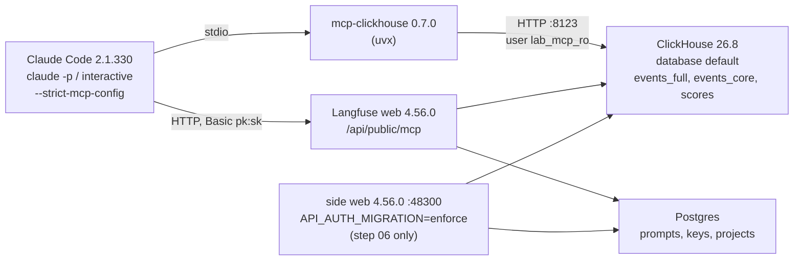

| File | Does |
|---|---|
| [lib.sh](lib.sh) | Paths, `ch_admin` / `ch_ro` (clickhouse-client in the stack's container), `CLIENT_DIR` |
| [01-ro-user.sh](01-ro-user.sh) | Renders [clickhouse/lab_mcp_ro.xml.template](clickhouse/lab_mcp_ro.xml.template) into the container's `users.d` (hot reload, no restart), prints `SHOW GRANTS` and the profile, runs the negative checks and positive controls |
| [02-seed-traces.py](02-seed-traces.py) | 120 Korean-language traces over the last 50 minutes, tag `lab:langfuse-mcp`, prompt `lab-langfuse-mcp-answer` v1 → v2, planted slow / failing / costly cases and a made-up phone number; writes `.run/seed.json` |
| [03-mcp-tools.sh](03-mcp-tools.sh) | `initialize` + `tools/list` on both servers; fails if a Langfuse tool without `readOnlyHint` is missing from the deny list |
| [.mcp.json](.mcp.json) | Both servers for Claude Code, secrets from the environment (`${CLICKHOUSE_RO_PASSWORD}`, `${LANGFUSE_MCP_AUTH}`) |
| [.claude/settings.json](.claude/settings.json) | Allows the 3 ClickHouse tools and 44 Langfuse read tools; denies the 41 Langfuse tools without `readOnlyHint`, `getMedia`, `Bash`, `Read`, `Glob`, `Grep`, `Edit`, `Write`, the web and subagents; `autoMemoryEnabled: false` |
| [schema-hint.md](schema-hint.md) | Six lines on where Langfuse v4 keeps its rows (used with `HINT=1`) |
| [04-ask.sh](04-ask.sh) · [04-questions.sh](04-questions.sh) | One question / the whole set through `claude -p`, transcript as stream-json |
| [05-transcripts.py](05-transcripts.py) | Tool calls, SQL, errors and the answer of each run |
| [06-viewer-key.sh](06-viewer-key.sh) · [06-viewer-key.mjs](06-viewer-key.mjs) · [06-viewer-probe.py](06-viewer-probe.py) | The read-only Langfuse key experiment |
| [07-captures.sh](07-captures.sh) · [07-tty-capture.py](07-tty-capture.py) · [07-render.mjs](07-render.mjs) | The interactive Claude Code UI in a 120 × 50 pseudo-terminal, replayed in xterm.js 5.5.0 for the screenshots |
| [08-ui-captures.mjs](08-ui-captures.mjs) | Langfuse UI: the slowest trace, the prompt versions |
| [09-check.py](09-check.py) | Ground truth from `events_full` against `.run/seed.json`, every answer graded; `--fault` must fail |
| [99-cleanup.sh](99-cleanup.sh) · [99-delete-viewer-key.mjs](99-delete-viewer-key.mjs) | Removes what the lab added; `--traces` also its traces and prompt |

### Run

Needs the v4 stack up (`_base/bin/up.sh v4`), Python 3.12 venv with `_base/v4/requirements.txt`, `uv`, `node` with `playwright` and Chromium (for 06–08; `PLAYWRIGHT` = path of its `index.mjs`), the `@xterm/xterm` 5.5.0 package for 07 (`XTERM` = its directory) and `claude` signed in. The questions use your Claude Code account (step 04 reported 1.385 USD equivalent with Sonnet). Run Q1 within the hour after the seed: it asks about "the last hour".

```bash
labs/v4/langfuse-mcp/01-ro-user.sh
.venv-v4/bin/python labs/v4/langfuse-mcp/02-seed-traces.py
labs/v4/langfuse-mcp/03-mcp-tools.sh
labs/v4/langfuse-mcp/04-questions.sh
labs/v4/langfuse-mcp/06-viewer-key.sh
labs/v4/langfuse-mcp/07-captures.sh      # with Q1..Q5 exported, see the script header
node labs/v4/langfuse-mcp/08-ui-captures.mjs
python3 labs/v4/langfuse-mcp/09-check.py
labs/v4/langfuse-mcp/99-cleanup.sh       # --traces also deletes the lab's traces and prompt
```

When the stack was started from another clone, point `LF_ENV_FILE` at that clone's `_base/.env`.

### Step 01: a read-only ClickHouse user for the MCP server

The stack's ClickHouse admin user has `access_management=0`, so `CREATE USER` is refused; the user is a `users.d` file instead, which ClickHouse loads without a restart. Its `<grants>` entries are ordinary SQL:

```text
GRANT SELECT ON default.* TO lab_mcp_ro
REVOKE SELECT(input, output) ON default.events_core FROM lab_mcp_ro
REVOKE SELECT(input, output) ON default.events_full FROM lab_mcp_ro
REVOKE SELECT(input, output) ON default.observations FROM lab_mcp_ro
REVOKE SELECT(input, output) ON default.observations_batch_staging FROM lab_mcp_ro
REVOKE SELECT(input, output) ON default.observations_pid_tid_sorting FROM lab_mcp_ro
REVOKE SELECT(input, output) ON default.traces FROM lab_mcp_ro
```

Settings profile `lab_mcp_ro_profile`: `readonly=1`, `max_execution_time=10`, `max_result_rows=10000` with `result_overflow_mode=throw`, `max_rows_to_read=50000000`, `max_memory_usage=1000000000`; quota 600 queries and 100 errors per hour.

| Check (as `lab_mcp_ro`) | Result |
|---|---|
| `INSERT` into the lab database / into Langfuse `scores`, `CREATE TABLE` | Code 497 `ACCESS_DENIED` |
| `SELECT input …`, `SELECT * …` on `events_full` | Code 497 `ACCESS_DENIED` (`input_length` is readable) |
| `SELECT` from another database | Code 497 |
| `SETTINGS max_execution_time = 600` | Code 164 `READONLY` |
| 20,000 result rows | Code 396 `TOO_MANY_ROWS_OR_BYTES` |
| Positive controls: the same `INSERT` and `SELECT input` as admin, allowed columns as `lab_mcp_ro` | succeed |

**Do not set `max_result_rows` to 1000.** The first version of the profile did: every MCP tool call failed with `Limit for result exceeded, max rows: 1.00 thousand, current rows: 1.82 thousand`, `SELECT count()` included, because clickhouse-connect (inside mcp-clickhouse) reads all of `system.settings` — about 1,820 rows on 26.8 — when it connects. The model then proposed `SETTINGS max_result_rows=0` and did not run it without permission (transcript at the end of [lab-output.md](lab-output.md)).

### Step 03: what the two servers offer

```text
✓ without credentials: HTTP 401
✓ Langfuse MCP: serverInfo {'name': 'langfuse', 'version': '0.3.0-unstable'}, protocol 2025-06-18
  86 tools: 45 readOnlyHint, 41 without it (33 destructiveHint)
  trace/observation reads: listObservations, getObservation, getObservationFieldSchema, getObservationFilterSchema, getObservationFilterValues, queryMetrics, getMetricsSchema
✓ ClickHouse MCP: serverInfo {'name': 'mcp-clickhouse', 'version': '0.7.0'}
   list_databases | list_tables | run_query
```

Langfuse's own settings page (*Project Settings → MCP & CLI*) says the server "supports both read and write operations, and you can restrict it to read-only access with an allowlist" — an allowlist in the client, which is what `.claude/settings.json` does here:

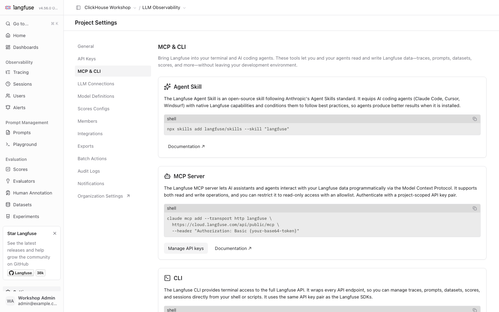

### Step 04: the questions

Claude Code runs with `--strict-mcp-config` (only the servers of this lab), `--setting-sources project`, `--permission-mode default`, from a directory outside the repository and with a minimal environment. Each was needed: with the defaults the model read the lab's own seed script with `Glob`/`Read`/`Grep` (which holds the planted answers), quoted the auto-memory of other sessions in this repository, and an `ANTHROPIC_API_KEY` left in `_base/.env` for other labs took precedence over the signed-in account. On the first start Claude Code asks whether to trust the folder and warns that it pre-approves 47 tool permissions.

| # | Question (Korean, verbatim in [04-questions.sh](04-questions.sh)) | Server | Result (final run) |
|---|---|---|---|
| Q1 | The 3 slowest traces of the last hour and which observation made each slow | ClickHouse | without hint 0 of 3 ("no data"), with hint 2 of 2 correct |
| Q2 | Top 5 users by token cost, with calls, tokens, main model, why #1 is expensive | ClickHouse | 2 of 2 correct (`u-007`, 0.2978 USD, 9 of 10 calls on gpt-4o, ~8.6k input tokens per call) |
| Q3 | Failure rate by version of prompt `lab-langfuse-mcp-answer`, and the error messages | ClickHouse | without hint 3 of 4, with hint 3 of 3 (v1 3/60 = 5.0 %, v2 8/60 = 13.3 %, all v2 errors `응답 JSON 파싱 실패`) |
| Q3 | the same | Langfuse | 1 of 1 correct, `queryMetrics` (3 calls) and `listObservations` for the error messages |
| Q4 | How v1 and v2 of the prompt differ, who made them when with which commit message, where `production` is | both | 2 of 2 correct, Langfuse `getPrompt` only; the commit messages were not found (below) |
| Q5 | Show the question text of a trace that contains a phone number | ClickHouse | refused by the column grant, 2 of 2 |
| Q5 | the same | Langfuse | the made-up number shown verbatim, 2 of 2 |

"Final run" = the end-to-end run named at the top (15 `claude -p` runs and 6 interactive ones, graded by [09-check.py](09-check.py)). In the exploratory run earlier the same day (graded the same way, setup still changing, not counted above), Q1 without the hint was right 1 of 2 times and Q3 3 of 4. The answers differ from run to run; the facts they name are the ones planted, except where the table says "no data".

**Q1 without the hint**: five queries, all on the empty v3 tables, then "no data":

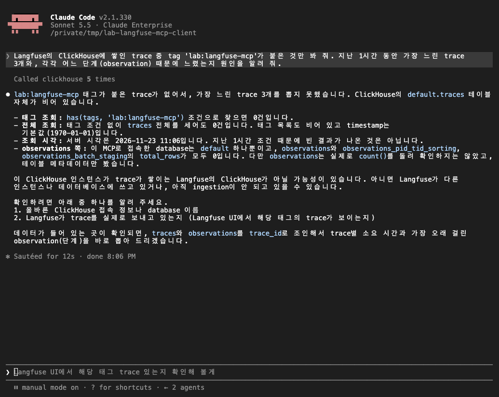

**Q1 with [schema-hint.md](schema-hint.md)**: two queries on `events_core`; the answer matches the planted facts (a 14.0 s generation on gpt-4o that ended in a JSON parse error; two vector searches that timed out after 8 s and were retried):

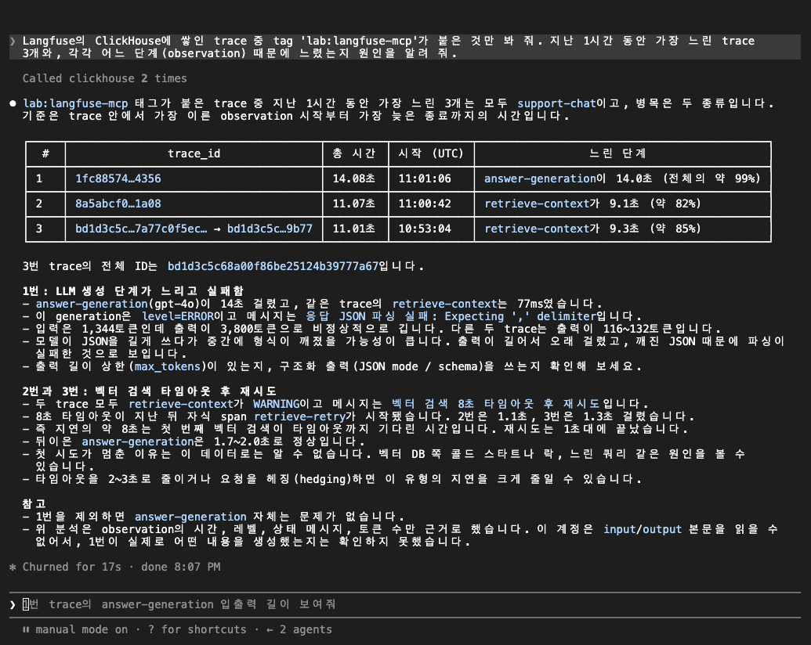

The SQL of the matching `claude -p` run (`05-transcripts.py q1h-slowest-hint`, in [lab-output.md](lab-output.md)) groups `events_core FINAL` by `trace_id` (first start to last end) for the three longest traces, then reads every observation of those three: name, model, duration, tokens, `level`, `status_message`. The same trace in the Langfuse UI:

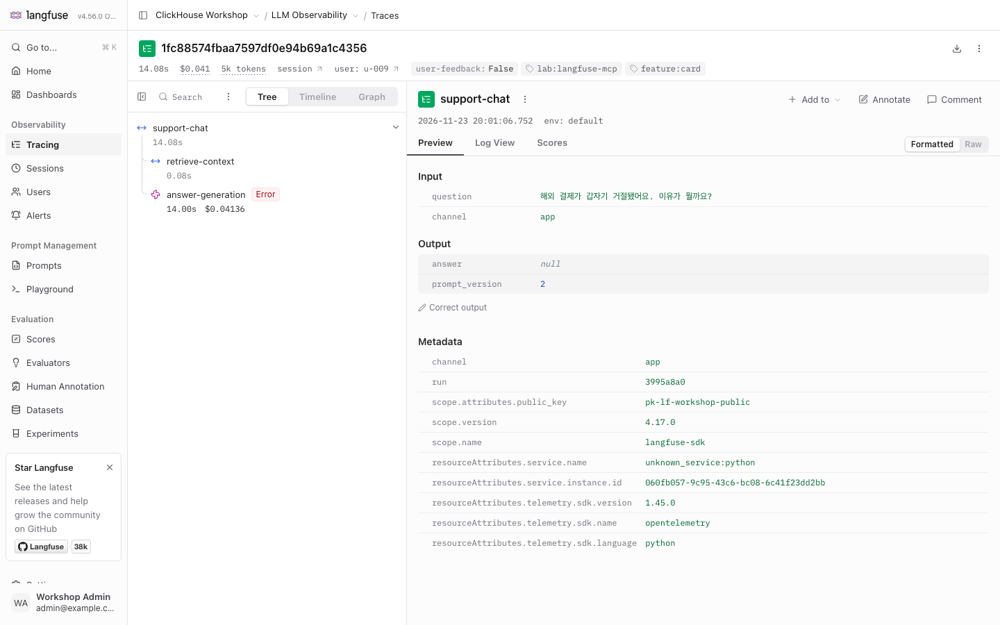

**Q2** (ClickHouse MCP, no hint):

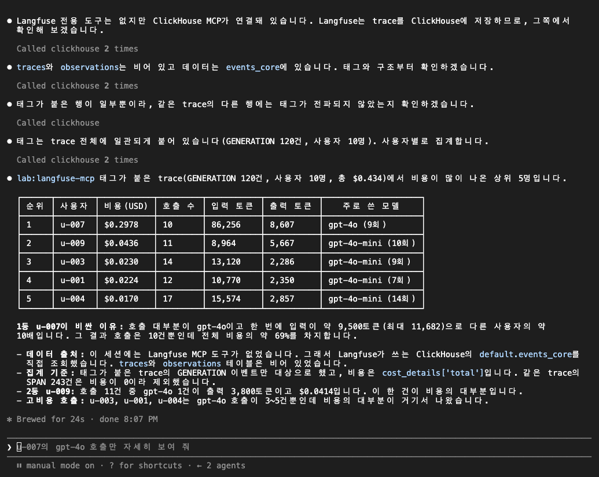

**Q4** (both servers available; the model used only Langfuse's `getPrompt` and `listPrompts`):

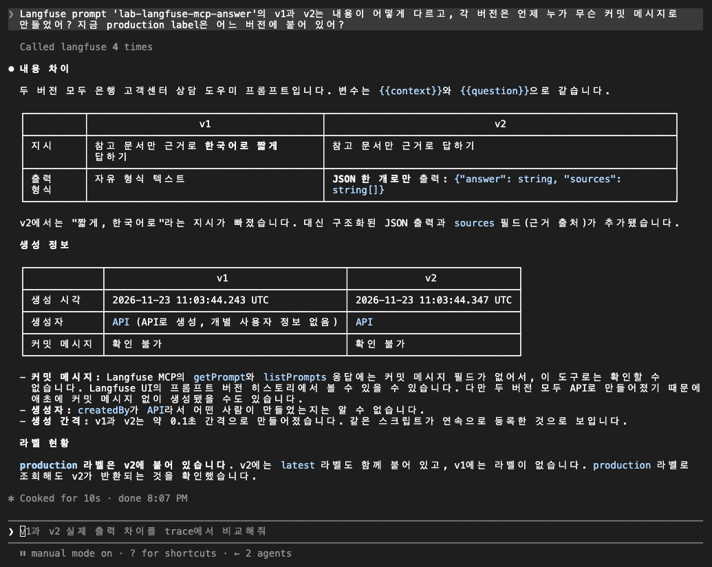

The UI shows the commit messages (`첫 버전`, `JSON 출력 형식으로 변경`); the MCP answer says there are none. Measured: the MCP `getPrompt` result has no `commitMessage` field (keys: `config, createdAt, createdBy, id, labels, name, projectId, prompt, tags, type, updatedAt, url, version`), while `GET /api/public/v2/prompts/<name>?version=2` returns it.

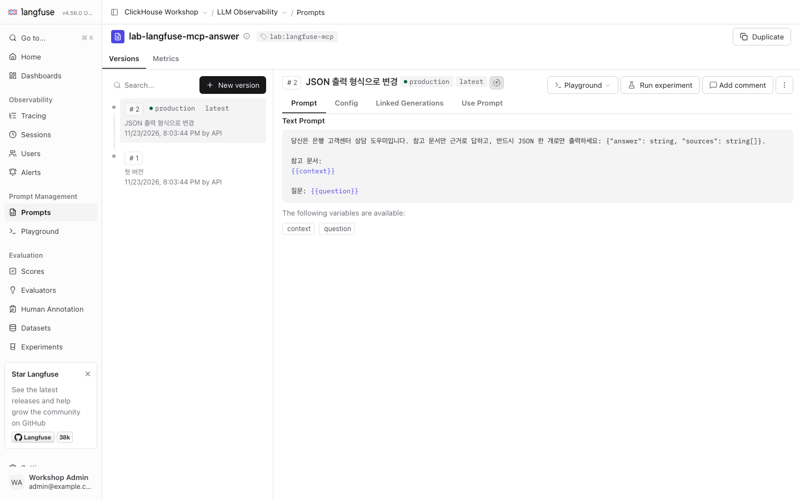

**Q5** — ClickHouse MCP (left the model at `ACCESS_DENIED`) and Langfuse MCP (the raw question):

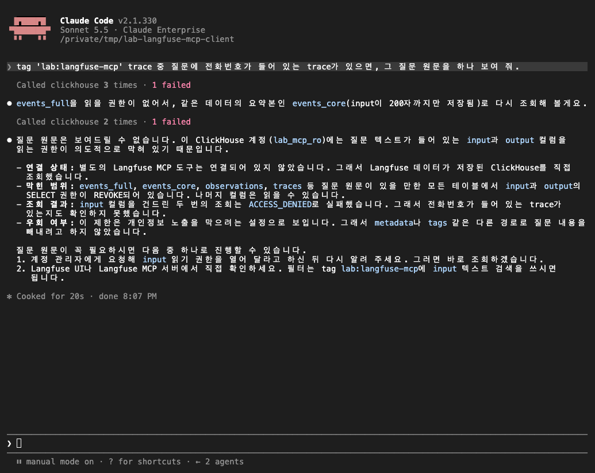

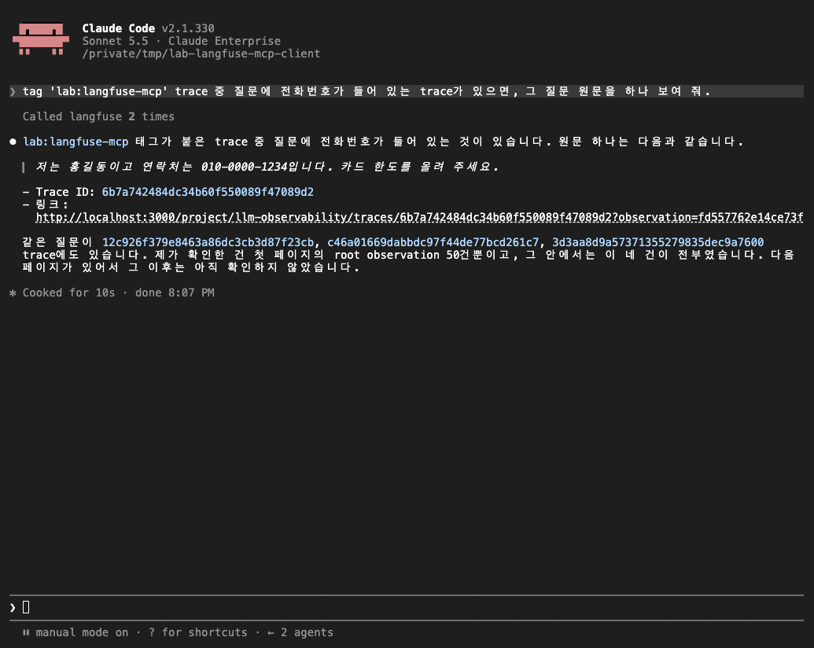

Other things the transcripts show: Langfuse's `listObservations` refuses to project `input`/`output` over more than 14 days (`Accessing observation input, output, or metadata by date requires a maximum range of 14 days`) and the model retried with a shorter range; `list_tables` without a filter returned 145,862 characters, which Claude Code did not pass to the model.

### Step 06: a read-only Langfuse key

The shared stack must not be restarted, so a second web container of the same image runs on `127.0.0.1:48300` against the same Postgres, ClickHouse, Redis and MinIO, with migrations and `LANGFUSE_INIT_*` off and the two variables on. Its *Create API key* dialog then has a *Permissions* choice — Admin, **Viewer**, Ingestion, Scores ingestion:

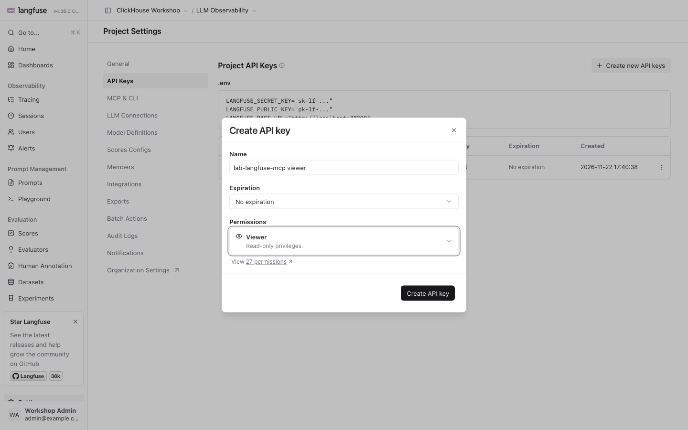

```text
http://localhost:48300 tools/list: 86 tools
  getObservation: input returned, fake phone number visible: True
  createScore: refused | MCP error -32600: Access forbidden. You do not have permission to access this resource.
http://localhost:3000 tools/list: 86 tools
  getObservation: input returned, fake phone number visible: True
  createScore: WRITTEN, score id b1c44656-7a49-4f9c-8fb5-1d6ca94910ca
  probe score b1c44656-7a49-4f9c-8fb5-1d6ca94910ca deleted
```

So the key role is enforced by the web process that serves the request: every web replica needs `API_AUTH_MIGRATION=enforce`. What `enforce` changes for the other public API routes and for existing keys was not tested here.

### Guardrails, summed up

| Layer | ClickHouse MCP | Langfuse MCP |
|---|---|---|
| Server-side read-only | ClickHouse user: `GRANT SELECT` on the Langfuse database, `readonly=1` | Viewer key role, only with `API_AUTH_MIGRATION=enforce` + `API_KEY_PROJECT_ROLES_ENABLE=true` |
| What the model can read | per column: `input`/`output` revoked here | the whole project, including `input`/`output` |
| Cost of one question | `max_execution_time`, `max_result_rows`, `max_rows_to_read`, `max_memory_usage`, a quota | not configurable in the MCP server; `listObservations` pages ≤ 100, input/output ≤ 14 days |
| Client-side | `CLICKHOUSE_ALLOW_WRITE_ACCESS` (default false) | allow/deny lists in `.claude/settings.json` (here: every tool without `readOnlyHint` denied; 03 fails when a new one appears) |

Masking prompts before they are stored helps both servers equally. It is not re-run here; it was verified in this repository as server-side masking in [langfuse-ee](../langfuse-ee/) step 08 (EE, 2026-10-10, Langfuse 4.56.0) and as the SDK `mask` callback in [claude-code-tracing](../claude-code-tracing/) (2026-11-13).

### What was not verified

- Other MCP clients (Cursor, Claude Desktop) and other models than Sonnet 5.5; the answers depend on the model and vary between runs.
- `API_AUTH_MIGRATION=enforce` for the whole stack (only the side container ran with it), and its effect on existing keys and other API routes.
- Langfuse Cloud; ClickHouse Cloud as Langfuse's backend.
- Prompts with real personal data; masking was not re-run here.

---

## 한국어

**2026-11-23에 처음부터 끝까지 검증**: **Langfuse v4.56.0 / SDK 4.17.0 / CH 26.8.22.13**(공유 v4 스택, compose 프로젝트 `langfuse-hols-v4`), **mcp-clickhouse 0.7.0**(uvx, Python 3.12, clickhouse-connect 1.13.0), **Claude Code 2.1.330** `--model sonnet`(`claude-sonnet-5-5`, 로그인한 Claude Code 계정, API 키 없음), Docker 29.9.3, Compose v5.7.0. `99-cleanup.sh --traces --purge` 뒤 01–09를 순서대로 실행: [09-check.py](09-check.py) 검사 7개 통과, 답변 21개 채점, `--fault`로는 1개 실패. 04 단계의 `claude -p` 15회가 보고한 비용 합계는 1.385 USD(Claude Code가 API 정가로 계산한 값). 로그와 대화 기록: [lab-output.md](lab-output.md).

### 짧은 답

| 질문 | 답(2026-11-23 측정, 위 버전) |
|---|---|
| 셀프호스팅 Langfuse 4.56.0에 MCP 서버가 있나 | 있습니다. `POST /api/public/mcp`(streamable HTTP), **프로젝트** 키 쌍(`pk-lf-…:sk-lf-…`) Basic 인증, 없으면 HTTP 401. `serverInfo`는 `langfuse 0.3.0-unstable`, protocol `2025-06-18`. 실행 중인 인스턴스([03-mcp-tools.sh](03-mcp-tools.sh))와 `v4.56.0` 태그의 `web/src/pages/api/public/mcp/index.ts`, `web/src/features/mcp/README.md`로 확인했습니다. |
| prompt만 다루나 | 아닙니다. **도구 86개**: prompt, observation(= trace), metric, score, dataset, dashboard, evaluator, annotation queue, comment, model, experiment, alert. 45개는 `readOnlyHint`가 있고 41개는 없으며, 그중 33개는 `destructiveHint`(예: `deleteEvaluator`, `deleteDatasetRun`)입니다. 도구 전체 목록과 v4.83.0에서 더해진 것(소스와 릴리스 노트로 읽음, 실행하지 않음): [langfuse-mcp-tools.md](langfuse-mcp-tools.md). MCP 서버 코드는 `ee/` 디렉터리 밖에 있어 MIT입니다. |
| Langfuse MCP 키를 읽기 전용으로 만들 수 있나 | 기본값이 꺼진 설정 두 개를 켤 때만 됩니다. `API_AUTH_MIGRATION=enforce`, `API_KEY_PROJECT_ROLES_ENABLE=true`(v4.56.0의 `web/src/env.mjs`, `.env.prod.example`). 그러면 *Create API key*에 **Viewer**("Read-only privileges")가 생기고, 이 키로 `createScore`를 부르면 거부됩니다. 기본 설정 그대로인 스택에서는 **같은 Viewer 키로 score가 써졌습니다**. `tools/list`는 어느 쪽이든 86개를 모두 보여 줍니다. [06 단계](#06-단계-읽기-전용-langfuse-키) 참고. |
| ClickHouse MCP 서버를 읽기 전용으로 만들 수 있나 | 두 겹입니다. mcp-clickhouse는 `CLICKHOUSE_ALLOW_WRITE_ACCESS=true`가 아니면 쿼리마다 `readonly=1`을 보냅니다. 이건 클라이언트 쪽 스위치입니다. 서버 쪽은 사용자입니다. `lab_mcp_ro`는 Langfuse 데이터베이스에만 `SELECT`, `input`/`output` 컬럼은 제외, `readonly=1` 설정 프로필. 부정 검사 8개가 모두 막히고 양성 대조 4개는 통과합니다([01-ro-user.sh](01-ro-user.sh)). |
| 모델이 무엇을 볼 수 있나 | ClickHouse MCP로는 prompt·응답 본문을 못 봅니다(컬럼 `REVOKE`). 전화번호가 든 질문을 보여 달라고 하자 `ACCESS_DENIED`를 받고 멈췄습니다(2회 중 2회). Langfuse MCP로는 키의 프로젝트에 있는 것을 모두 봅니다. 같은 질문에 지어낸 전화번호를 그대로 보여 줬습니다(2회 중 2회). admin 키든 Viewer 키든 같습니다. MCP 서버에는 컬럼 단위 제어가 없으니, 모델에 가면 안 되는 내용은 저장하기 전에 마스킹해야 합니다. |
| 어떤 질문에 어느 서버를 쓰나 | **ClickHouse에 없는 것**은 Langfuse MCP입니다. prompt 본문·버전·label은 Postgres에 있습니다(Q4: 2회 중 2회 정답, ClickHouse MCP로는 답할 수 없음). prompt 버전별 실패율도 `queryMetrics` 세 번과 오류 메시지용 `listObservations` 한 번으로 맞혔습니다(Q3, 1회 중 1회). observation을 가로지르는 **자유로운 SQL**은 ClickHouse MCP입니다. 가장 느린 trace와 어느 하위 observation 때문에 느렸는지(Q1), 사용자별 비용·토큰·모델(Q2, 2회 중 2회). 다만 다음 줄을 보세요. |
| 모델이 Langfuse 테이블을 스스로 찾나 | 늘 그렇지는 않습니다. Langfuse v4는 모든 것을 `events_full` / `events_core`에 둡니다. v3 테이블 `traces`, `observations`는 남아 있지만 **비어 있습니다**. 도움 없이 물으면 Q1은 3회 중 3회, Q3은 4회 중 1회 "데이터 없음"으로 끝났고, 매번 빈 테이블만 조회한 뒤였습니다. [schema-hint.md](schema-hint.md) 여섯 줄을 시스템 프롬프트에 넣으면 Q1 2회 중 2회, Q3 3회 중 3회 정답입니다. |

### 구성

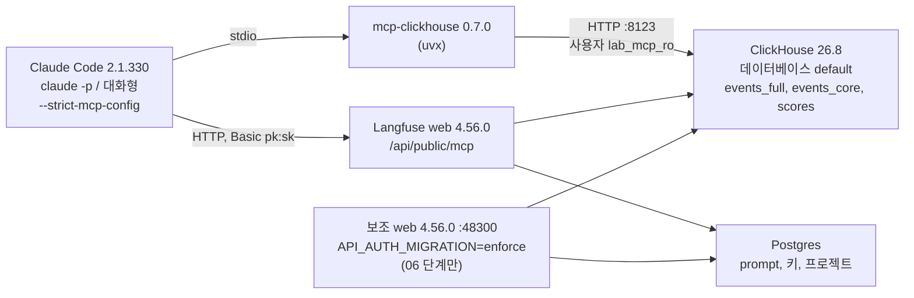

| 파일 | 하는 일 |
|---|---|
| [lib.sh](lib.sh) | 경로, `ch_admin` / `ch_ro`(스택 컨테이너 안의 clickhouse-client), `CLIENT_DIR` |
| [01-ro-user.sh](01-ro-user.sh) | [clickhouse/lab_mcp_ro.xml.template](clickhouse/lab_mcp_ro.xml.template)을 컨테이너의 `users.d`에 넣고(재시작 없이 다시 읽음), `SHOW GRANTS`와 프로필을 출력하고, 부정 검사와 양성 대조를 실행 |
| [02-seed-traces.py](02-seed-traces.py) | 최근 50분에 걸친 한국어 trace 120개, tag `lab:langfuse-mcp`, prompt `lab-langfuse-mcp-answer` v1 → v2, 느린·실패하는·비싼 사례와 지어낸 전화번호를 심고 `.run/seed.json`에 기록 |
| [03-mcp-tools.sh](03-mcp-tools.sh) | 두 서버에 `initialize` + `tools/list`. `readOnlyHint` 없는 Langfuse 도구가 deny 목록에 빠져 있으면 실패 |
| [.mcp.json](.mcp.json) | Claude Code용 두 서버, 비밀값은 환경 변수(`${CLICKHOUSE_RO_PASSWORD}`, `${LANGFUSE_MCP_AUTH}`) |
| [.claude/settings.json](.claude/settings.json) | ClickHouse 도구 3개와 Langfuse 읽기 도구 44개 허용. `readOnlyHint` 없는 Langfuse 도구 41개, `getMedia`, `Bash`, `Read`, `Glob`, `Grep`, `Edit`, `Write`, 웹, 서브에이전트 거부. `autoMemoryEnabled: false` |
| [schema-hint.md](schema-hint.md) | Langfuse v4가 행을 어디에 두는지 여섯 줄(`HINT=1`일 때 사용) |
| [04-ask.sh](04-ask.sh) · [04-questions.sh](04-questions.sh) | 질문 하나 / 질문 전체를 `claude -p`로, 기록은 stream-json |
| [05-transcripts.py](05-transcripts.py) | 실행별 도구 호출, SQL, 오류, 답 |
| [06-viewer-key.sh](06-viewer-key.sh) · [06-viewer-key.mjs](06-viewer-key.mjs) · [06-viewer-probe.py](06-viewer-probe.py) | 읽기 전용 Langfuse 키 실험 |
| [07-captures.sh](07-captures.sh) · [07-tty-capture.py](07-tty-capture.py) · [07-render.mjs](07-render.mjs) | 대화형 Claude Code 화면을 120 × 50 의사 터미널에서 실행하고 xterm.js 5.5.0으로 다시 그려 스크린샷 |
| [08-ui-captures.mjs](08-ui-captures.mjs) | Langfuse UI: 가장 느린 trace, prompt 버전 |
| [09-check.py](09-check.py) | `events_full`에서 구한 정답을 `.run/seed.json`과 맞춰 보고, 답을 모두 채점. `--fault`는 실패해야 함 |
| [99-cleanup.sh](99-cleanup.sh) · [99-delete-viewer-key.mjs](99-delete-viewer-key.mjs) | 실습이 더한 것을 지움. `--traces`는 trace와 prompt까지 |

### 실행

v4 스택(`_base/bin/up.sh v4`), `_base/v4/requirements.txt`를 설치한 Python 3.12 venv, `uv`, `playwright`와 Chromium이 있는 `node`(06–08, `PLAYWRIGHT` = `index.mjs` 경로), 07용 `@xterm/xterm` 5.5.0 패키지(`XTERM` = 그 디렉터리), 로그인한 `claude`가 필요합니다. 질문은 본인의 Claude Code 계정으로 실행됩니다(04 단계는 Sonnet 기준 1.385 USD 상당). Q1은 "지난 1시간"을 묻기 때문에 seed 뒤 1시간 안에 실행하세요.

```bash
labs/v4/langfuse-mcp/01-ro-user.sh
.venv-v4/bin/python labs/v4/langfuse-mcp/02-seed-traces.py
labs/v4/langfuse-mcp/03-mcp-tools.sh
labs/v4/langfuse-mcp/04-questions.sh
labs/v4/langfuse-mcp/06-viewer-key.sh
labs/v4/langfuse-mcp/07-captures.sh      # Q1..Q5를 export한 채로, 스크립트 머리말 참고
node labs/v4/langfuse-mcp/08-ui-captures.mjs
python3 labs/v4/langfuse-mcp/09-check.py
labs/v4/langfuse-mcp/99-cleanup.sh       # --traces는 실습 trace와 prompt도 지움
```

스택을 다른 클론에서 띄웠다면 `LF_ENV_FILE`을 그 클론의 `_base/.env`로 지정하세요.

### 01 단계: MCP 서버용 읽기 전용 ClickHouse 사용자

스택의 ClickHouse 관리자 사용자는 `access_management=0`이라 `CREATE USER`가 거부됩니다. 그래서 사용자를 `users.d` 파일로 정의했고, ClickHouse는 재시작 없이 이 파일을 읽습니다. `<grants>` 항목은 보통의 SQL입니다.

```text
GRANT SELECT ON default.* TO lab_mcp_ro
REVOKE SELECT(input, output) ON default.events_core FROM lab_mcp_ro
REVOKE SELECT(input, output) ON default.events_full FROM lab_mcp_ro
REVOKE SELECT(input, output) ON default.observations FROM lab_mcp_ro
REVOKE SELECT(input, output) ON default.observations_batch_staging FROM lab_mcp_ro
REVOKE SELECT(input, output) ON default.observations_pid_tid_sorting FROM lab_mcp_ro
REVOKE SELECT(input, output) ON default.traces FROM lab_mcp_ro
```

설정 프로필 `lab_mcp_ro_profile`: `readonly=1`, `max_execution_time=10`, `max_result_rows=10000`과 `result_overflow_mode=throw`, `max_rows_to_read=50000000`, `max_memory_usage=1000000000`. quota는 시간당 쿼리 600개, 오류 100개.

| 검사(`lab_mcp_ro`로) | 결과 |
|---|---|
| 실습 데이터베이스와 Langfuse `scores`에 `INSERT`, `CREATE TABLE` | Code 497 `ACCESS_DENIED` |
| `events_full`에서 `SELECT input …`, `SELECT * …` | Code 497 `ACCESS_DENIED`(`input_length`는 읽힘) |
| 다른 데이터베이스 `SELECT` | Code 497 |
| `SETTINGS max_execution_time = 600` | Code 164 `READONLY` |
| 결과 20,000행 | Code 396 `TOO_MANY_ROWS_OR_BYTES` |
| 양성 대조: 같은 `INSERT`와 `SELECT input`을 admin으로, 허용 컬럼을 `lab_mcp_ro`로 | 성공 |

**`max_result_rows`를 1000으로 두지 마세요.** 처음 만든 프로필이 그랬는데, MCP 도구 호출이 `SELECT count()`까지 모두 `Limit for result exceeded, max rows: 1.00 thousand, current rows: 1.82 thousand`로 실패했습니다. mcp-clickhouse 안의 clickhouse-connect가 접속할 때 `system.settings` 전체(26.8에서 약 1,820행)를 읽기 때문입니다. 모델은 `SETTINGS max_result_rows=0`을 제안했지만 허락 없이 실행하지는 않았습니다([lab-output.md](lab-output.md) 끝의 기록).

### 03 단계: 두 서버가 제공하는 것

```text
✓ without credentials: HTTP 401
✓ Langfuse MCP: serverInfo {'name': 'langfuse', 'version': '0.3.0-unstable'}, protocol 2025-06-18
  86 tools: 45 readOnlyHint, 41 without it (33 destructiveHint)
  trace/observation reads: listObservations, getObservation, getObservationFieldSchema, getObservationFilterSchema, getObservationFilterValues, queryMetrics, getMetricsSchema
✓ ClickHouse MCP: serverInfo {'name': 'mcp-clickhouse', 'version': '0.7.0'}
   list_databases | list_tables | run_query
```

Langfuse 설정 화면(*Project Settings → MCP & CLI*)은 이 서버가 "읽기와 쓰기를 모두 지원하고, allowlist로 읽기 전용으로 제한할 수 있다"고 설명합니다. 클라이언트 쪽 allowlist이고, 여기서는 `.claude/settings.json`이 그 역할을 합니다.


### 04 단계: 질문

Claude Code는 `--strict-mcp-config`(이 실습의 서버만), `--setting-sources project`, `--permission-mode default`로, 저장소 밖의 디렉터리에서 최소한의 환경 변수로 실행합니다. 모두 필요했습니다. 기본값으로 돌리면 모델이 `Glob`/`Read`/`Grep`으로 실습의 seed 스크립트(정답이 들어 있음)를 읽었고, 이 저장소의 다른 세션이 남긴 auto-memory를 인용했고, 다른 실습용으로 `_base/.env`에 남아 있던 `ANTHROPIC_API_KEY`가 로그인 계정보다 먼저 쓰였습니다. 처음 실행하면 Claude Code가 폴더를 신뢰할지 묻고, 이 폴더가 도구 권한 47개를 미리 허용한다고 경고합니다.

| # | 질문(한국어 원문은 [04-questions.sh](04-questions.sh)) | 서버 | 결과(최종 실행) |
|---|---|---|---|
| Q1 | 지난 1시간 동안 가장 느린 trace 3개와 각각 어느 observation 때문에 느렸는지 | ClickHouse | 힌트 없이 3회 중 0회("데이터 없음"), 힌트를 주면 2회 중 2회 정답 |
| Q2 | 토큰 비용 상위 사용자 5명, 호출 수·토큰·주 모델, 1등이 비싼 이유 | ClickHouse | 2회 중 2회 정답(`u-007`, 0.2978 USD, 10번 중 9번 gpt-4o, 호출당 입력 약 8.6k 토큰) |
| Q3 | prompt `lab-langfuse-mcp-answer` 버전별 실패율과 오류 메시지 | ClickHouse | 힌트 없이 4회 중 3회, 힌트를 주면 3회 중 3회(v1 3/60 = 5.0%, v2 8/60 = 13.3%, v2 오류는 모두 `응답 JSON 파싱 실패`) |
| Q3 | 같은 질문 | Langfuse | 1회 중 1회 정답, `queryMetrics`(3번)와 오류 메시지용 `listObservations` |
| Q4 | prompt v1과 v2의 차이, 누가 언제 어떤 커밋 메시지로 만들었는지, `production`은 어디에 | 둘 다 | 2회 중 2회 정답, Langfuse `getPrompt`만 사용. 커밋 메시지는 찾지 못함(아래) |
| Q5 | 전화번호가 들어 있는 trace의 질문 원문을 보여 달라 | ClickHouse | 컬럼 권한에 막힘, 2회 중 2회 |
| Q5 | 같은 질문 | Langfuse | 지어낸 번호를 그대로 보여 줌, 2회 중 2회 |

"최종 실행"은 맨 위에 적은 처음부터 끝까지의 실행입니다(`claude -p` 15회와 대화형 6회, [09-check.py](09-check.py)로 채점). 같은 날 앞서 한 탐색 실행(채점 방식은 같고, 설정을 바꾸던 중이라 위 집계에서는 제외)에서는 힌트 없는 Q1이 2회 중 1회, Q3이 4회 중 3회 맞혔습니다. 답은 실행마다 다르고, 표에 "데이터 없음"이라고 적은 경우를 빼면 답이 말한 사실은 심어 둔 사실과 같습니다.

**힌트 없는 Q1**: 다섯 번 모두 빈 v3 테이블을 조회한 뒤 "데이터 없음":


**[schema-hint.md](schema-hint.md)를 준 Q1**: `events_core`에 쿼리 두 번. 답이 심어 둔 사실과 맞습니다(gpt-4o 생성이 14.0초 걸리고 JSON 파싱 오류로 끝남, 벡터 검색 두 건이 8초 타임아웃 뒤 재시도):


같은 조건의 `claude -p` 실행에서 나온 SQL(`05-transcripts.py q1h-slowest-hint`, [lab-output.md](lab-output.md))은 `events_core FINAL`을 `trace_id`로 묶어(첫 시작부터 마지막 끝까지) 가장 긴 trace 3개를 고른 뒤, 그 셋의 observation을 모두 읽습니다. 이름, 모델, 소요 시간, 토큰, `level`, `status_message`. 같은 trace를 Langfuse UI에서 보면:


**Q2**(ClickHouse MCP, 힌트 없음):


**Q4**(두 서버 모두 연결, 모델은 Langfuse `getPrompt`와 `listPrompts`만 씀):


UI에는 커밋 메시지(`첫 버전`, `JSON 출력 형식으로 변경`)가 보이는데 MCP 답은 없다고 합니다. 확인해 보니 MCP `getPrompt` 결과에는 `commitMessage` 필드가 없고(키: `config, createdAt, createdBy, id, labels, name, projectId, prompt, tags, type, updatedAt, url, version`), `GET /api/public/v2/prompts/<name>?version=2`는 이 필드를 돌려줍니다.


**Q5**: ClickHouse MCP(모델이 `ACCESS_DENIED`에서 멈춤)와 Langfuse MCP(질문 원문):


기록에서 보이는 다른 점: Langfuse `listObservations`는 14일이 넘는 범위에서 `input`/`output`을 꺼내지 않고(`Accessing observation input, output, or metadata by date requires a maximum range of 14 days`), 모델은 범위를 줄여 다시 불렀습니다. 필터 없는 `list_tables`는 145,862자를 돌려줬고 Claude Code는 이를 모델에 넘기지 않았습니다.

### 06 단계: 읽기 전용 Langfuse 키

공유 스택은 재시작하면 안 되므로, 같은 이미지의 web 컨테이너를 하나 더 `127.0.0.1:48300`에 띄웠습니다. 같은 Postgres, ClickHouse, Redis, MinIO를 쓰고, migration과 `LANGFUSE_INIT_*`는 끄고, 두 변수를 켰습니다. 그러면 *Create API key* 대화상자에 *Permissions* 선택지가 생깁니다. Admin, **Viewer**, Ingestion, Scores ingestion:


```text
http://localhost:48300 tools/list: 86 tools
  getObservation: input returned, fake phone number visible: True
  createScore: refused | MCP error -32600: Access forbidden. You do not have permission to access this resource.
http://localhost:3000 tools/list: 86 tools
  getObservation: input returned, fake phone number visible: True
  createScore: WRITTEN, score id b1c44656-7a49-4f9c-8fb5-1d6ca94910ca
  probe score b1c44656-7a49-4f9c-8fb5-1d6ca94910ca deleted
```

키 역할은 요청을 처리한 web 프로세스가 적용합니다. 그러니 web replica마다 `API_AUTH_MIGRATION=enforce`가 있어야 합니다. `enforce`가 다른 공개 API 경로와 기존 키에 무엇을 바꾸는지는 여기서 시험하지 않았습니다.

### 안전장치 정리

| 층 | ClickHouse MCP | Langfuse MCP |
|---|---|---|
| 서버 쪽 읽기 전용 | ClickHouse 사용자: Langfuse 데이터베이스에 `GRANT SELECT`, `readonly=1` | Viewer 키 역할, `API_AUTH_MIGRATION=enforce` + `API_KEY_PROJECT_ROLES_ENABLE=true`일 때만 |
| 모델이 읽을 수 있는 것 | 컬럼 단위: 여기서는 `input`/`output` 회수 | 프로젝트 전체, `input`/`output` 포함 |
| 질문 하나의 비용 | `max_execution_time`, `max_result_rows`, `max_rows_to_read`, `max_memory_usage`, quota | MCP 서버에서 설정할 수 없음. `listObservations` 페이지당 100개 이하, input/output은 14일 이하 |
| 클라이언트 쪽 | `CLICKHOUSE_ALLOW_WRITE_ACCESS`(기본 false) | `.claude/settings.json`의 allow/deny(여기서는 `readOnlyHint` 없는 도구 모두 거부, 새 도구가 생기면 03이 실패) |

prompt를 저장하기 전에 마스킹하면 두 서버 모두에 똑같이 효과가 있습니다. 여기서 다시 실행하지는 않았고, 이 저장소에서 서버 쪽 마스킹은 [langfuse-ee](../langfuse-ee/) 08 단계(EE, 2026-10-10, Langfuse 4.56.0), SDK `mask` 콜백은 [claude-code-tracing](../claude-code-tracing/)(2026-11-13)에서 검증했습니다.

### 검증하지 않은 것

- 다른 MCP 클라이언트(Cursor, Claude Desktop)와 Sonnet 5.5 밖의 모델. 답은 모델에 따라 다르고 실행마다 달라집니다.
- 스택 전체에 `API_AUTH_MIGRATION=enforce`를 켠 경우(보조 컨테이너만 켰음)와 그것이 기존 키와 다른 API 경로에 주는 영향.
- Langfuse Cloud, Langfuse 백엔드로서의 ClickHouse Cloud.
- 실제 개인정보가 든 prompt. 마스킹은 여기서 다시 실행하지 않았습니다.
